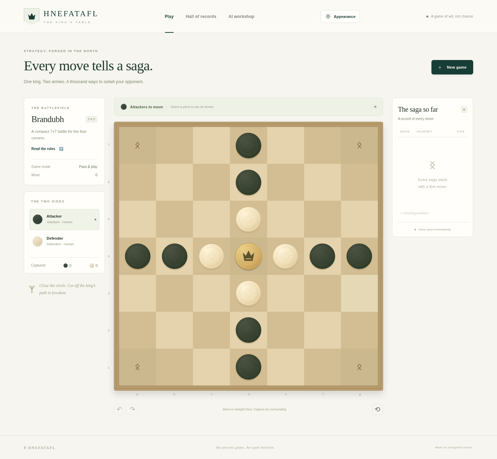

# Hnefatafl — The King's Table

Play Brandubh, Tablut and Copenhagen in a responsive browser application. Challenge
search opponents, compare them in tournaments, or train a policy/value network
from scratch with real self-play learning.



[Documentation](docs/README.md) · [Quick start](#quick-start) · [Training](docs/TRAINING.md) · [Deployment](docs/DEPLOYMENT.md)

<a id="features"></a>

## What you can do

- Play locally with two humans, Human vs AI or AI vs AI; use mouse, touch or
  keyboard, undo/redo, saved replay, captures and configurable computer playback.
- Choose tactical, alpha-beta or MCTS opponents. Use compatible trained models
  with **MCTS, alpha-beta or policy-only** wrappers and inspect saved position
  estimates or a background move advisor.
- Run saved two-to-four-player round robins with balanced sides, per-battlefield
  win matrices and explicit unfinished outcomes. Browse sortable player/AI records.
- Train on CPU or supported CUDA/MPS devices; monitor retained learning charts,
  evaluate against one selected Shield bearer, Jarl or Champion opponent and run
  persistent Optuna studies.
- Resume a full checkpoint with reviewed changes to training budgets, optimizer
  settings and execution mode while retaining learning state. Use sequential or
  concurrent self-play with batched neural inference and inspect actual throughput.
- Enroll outbound remote workers with simultaneous independent training slots.
  Rename/import/export models and delete training data separately from playable models.
- Use English/German, persistent identity runes and independent color, board and
  token themes. See the [mobile interface](docs/screenshots/mobile.png).

<a id="install-and-start"></a>

## Quick start

Use **Python 3.12 recommended** (3.11+ supported), **Node 22+** (CI uses 24) and
[uv](https://docs.astral.sh/uv/getting-started/installation/) (CI pins 0.12.23).
From the repository root:

```sh
make install
make build
.venv/bin/python -m hnefatafl.accounts init-admin
bash scripts/start.sh
```

Open port 8000 on the local machine. The server binds `127.0.0.1` and serves both
the built browser client and API. Check readiness with
`curl --fail http://127.0.0.1:8000/api/health`, then log in and create a game.
Administrator setup asks for username (default **Odin**), email and a password;
there is no default password or public registration. Ordinary accounts can play;
training, tournaments and model management require administrator permissions.
See [Authentication and RBAC](docs/SECURITY.md).
Set `HNEFATAFL_DATA_DIR` to choose persistent storage (default `./data`).
`.env.example` documents variables; it is not automatically loaded.

For live development use `bash scripts/dev.sh` after installation. See
[Deployment](docs/DEPLOYMENT.md) for trusted-LAN access, Linux/LXC, systemd,
an external HTTPS reverse proxy, stable-release updates and backups. For a dedicated
Debian 13 container, run `bash scripts/proxmox/ct/hnefatafl.sh` from a reviewed
checkout on Proxmox. [Installation and recovery instructions](docs/DEPLOYMENT.md)
describe release assets and private repository credentials. No Docker is required.
The locked environment installs CPU PyTorch; [GPU setup](docs/PERFORMANCE.md#installation-and-hardware)
requires a matching official build and suitable hardware.

## Proxmox one-line installation

Run as **root on the Proxmox VE host**; no Git checkout is needed:

```bash
bash <(curl -fsSL https://raw.githubusercontent.com/freeDom-/hnefatafl/main/scripts/proxmox/ct/hnefatafl-pve-install.sh)
```

Choose **default** for an unprivileged Debian 13 LXC with 4 cores, 4096 MiB RAM,
20 GiB on `local-lvm`, template storage `local`, DHCP on `vmbr0`, autostart enabled
and nesting disabled. Choose **advanced** to customize ID, resources, storage and
IPv4/gateway. Setup requests the repository (default `freeDom-/hnefatafl`), an
optional read-only GitHub token, port (8000), public HTTPS origin, trusted proxy
IPs/CIDRs and administrator username/email/password. Passwords have no default.

Review the scripts before running them as root: this bootstrap trusts code from
`freeDom-/hnefatafl` **main** over HTTPS. The application itself comes from a
compatible published stable **X.Y.Z** release with a verified archive digest;
files on main alone are insufficient. The host needs `curl`, Python 3, native
Proxmox tools, suitable active storage, a bridge and outbound HTTPS access.
Configure your existing reverse proxy, DNS, firewall and TLS separately.

Update from the host (185 is an example container ID):

```bash
pct exec 185 -- /usr/local/bin/hnefatafl-update
bash <(curl -fsSL https://raw.githubusercontent.com/freeDom-/hnefatafl/main/scripts/proxmox/ct/hnefatafl-pve-update.sh) 185
```

The host updater also forwards `--check`, `--list`, `--version X.Y.Z`, `--backup`,
`--rollback` and `--recover` to the existing safe updater. See
[deployment and troubleshooting](docs/DEPLOYMENT.md#proxmox-one-line-installation)
for administration, prerequisites and retained-container recovery.

<a id="play-and-replay"></a>
<a id="run-an-ai-tournament"></a>
<a id="train-and-use-a-model"></a>

## Play or train

On **Dashboard**, choose **New single-player game**, then a battlefield, mode, sides and opponents. Select a piece,
then a highlighted legal destination. Arrow keys navigate, Enter/Space selects,
and Escape clears selection. **Hall of records** opens read-only history; **Resume single-player** reconnects account play. **Analytics**
below move history configures an advisor. See [Gameplay](docs/GAMEPLAY.md).

In **AI workshop**, use **Quick check** for a tiny functional training run, or
choose a board-specific recommended plan for a larger experiment. Equivalent CLI:

```sh
.venv/bin/python -m hnefatafl.cli devices
.venv/bin/python -m hnefatafl.cli train --config configs/train-smoke.json
.venv/bin/python -m hnefatafl.cli benchmark --output data/benchmark.json
```

A successful smoke run proves updates/checkpoints/legal play, not stronger play.
See [Training](docs/TRAINING.md), [Performance](docs/PERFORMANCE.md) and
[checkpoint/data management](docs/TRAINING_DATA.md). Importing a model supplies
an opponent; it does not register or resume a training job.

<a id="tests"></a>
<a id="project-map-and-deployment"></a>

## Develop and verify

```sh
make check
```

This runs formatting/lint, Python/TypeScript checks, backend/frontend unit tests
and a production build. Browser checks additionally require Playwright Chromium.
Changes are delivered on a branch and reviewed in a pull request against `main`;
see [Development](docs/DEVELOPMENT.md) for that workflow and
[validation evidence](docs/VALIDATION.md) for recorded counts and limitations.
[Architecture](ARCHITECTURE.md) describes the component boundaries.

## Current limitations

A server connection and an authenticated account are required. Verified accounts
can create/join games in the online lobby when the operator enables admission;
registration and online admission default off. Automatic timeout finalization
also requires an approved outage policy and an enabled persistent gate. See
[online operations](docs/ONLINE.md) and [registration](docs/REGISTRATION.md).
Use the production HTTPS/proxy configuration before public exposure. Offline play,
automatic opponent matchmaking, distributed self-play and PostgreSQL migration
tools are not implemented. Installation requires a published stable release with
a verified asset.

CPU workflows are verified. CUDA/MPS execution, GPU throughput and target-host
systemd/proxy operation require separate validation. Tiny v0.17.0 CPU benchmarks
reduced forward passes but showed **no batching speedup**. No strong pretrained
model or measured improvement in playing strength is claimed. Displayed winning
chances are uncalibrated position assessments. Copenhagen's inaccessible primary
source and selected interpretation are documented in its [rules](docs/rules/copenhagen.md).

Current guides describe the implementation; [release notes](docs/README.md#rulesets-release-history-and-historical-requirements)
and [original requirements](docs/REQUIREMENTS.md) preserve historical scope.
