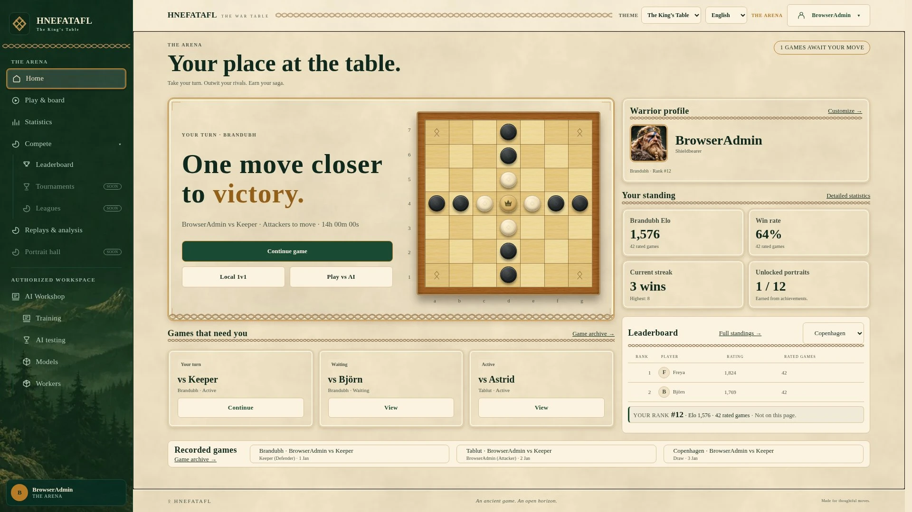

<h1 align="center">⚔️ Hnefatafl — The King's Table</h1>

<p align="center">
  <strong>Ancient Viking strategy. Modern browser play.</strong><br>
  Play Brandubh, Tablut and Copenhagen with friends or AI, compete in leagues and
  tournaments, and train your own neural opponents.
</p>

<p align="center">
  <a href="https://github.com/freeDom-/hnefatafl/releases"></a>
  <a href="https://buymeacoffee.com/free.dom"></a>
</p>

<p align="center">
  <a href="#features">Features</a> ·
  <a href="#quick-start">Quick start</a> ·
  <a href="docs/README.md">Documentation</a> ·
  <a href="docs/game/interface/README.md">Interface guide</a> ·
  <a href="docs/training/README.md">AI training</a> ·
  <a href="docs/installation/README.md">Deployment</a> ·
  <a href="#licensing">Licensing</a> ·
  <a href="#support-development">Support</a>
</p>



Hnefatafl is a self-hosted, source-available Viking board-game application. A
deterministic Python engine owns the rules; a responsive React client provides the
Arena; accounts, online games, ratings and progression are server-owned. There is no
required external service and no Docker dependency.

<a id="features"></a>

## Features

- **Three rulesets** with authoritative source notes: Brandubh (7×7), Tablut market
  rules (9×9) and Copenhagen (11×11). Variant-specific captures, escapes,
  shieldwalls, encirclement and repetition are implemented, not approximated.
- **Play your way**: single-player against fixed or custom agents, local 1v1
  pass-and-play, or rated online games with per-move/total-time clocks and
  two-game matches.
- **The Arena**: The Great Hall, Battlefield, Statistics, Trials of Valor
  (Leaderboard, Player tournaments, Leagues), Hall of records and Hall of Renown.
  Four themes, independent board/token/interface scale, English and German.
- **Competition**: Elo ratings, UTC calendar-month leagues with tiers and queue,
  double-elimination player tournaments, tiered achievements and unlockable
  portraits.
- **Analysis and replay**: read-only history, saved agent opinions, a background
  move advisor and a signed-out public Watch Hall for eligible online games.
- **AI opponents**: Shield bearer, Shield maiden, Jarl alpha-beta and MCTS agents,
  plus **MCTS, alpha-beta or policy-only** wrappers around compatible trained
  models.
- **Training workshop**: AlphaZero-style self-play, evaluation and Champion
  selection, checkpoint resumption, Optuna tuning, model import/export, AI
  tournaments and remote workers. CPU by default; optional CUDA/MPS/Intel OpenVINO.
- **Operations**: Proxmox/Debian installers, systemd and reverse-proxy examples,
  versioned release updates, rollback, backups and integrity-checked model loading.

<a id="quick-start"></a>

## Quick start

Requirements: Python 3.12 recommended (3.11+), Node.js 22.12+ or 24+, and
[uv](https://docs.astral.sh/uv/getting-started/installation/). From the repository
root:

```sh
make install
make build
.venv/bin/python -m hnefatafl.accounts init-admin
bash scripts/start.sh
```

Open <http://127.0.0.1:8000>, sign in as the administrator you just created and
create a game on **The Great Hall**. No default password and no public
registration exist. `HNEFATAFL_DATA_DIR` selects storage (default `./data`).
`.env` is not loaded automatically.

For live development use `bash scripts/dev.sh`. See
[quick start](docs/getting-started/quick-start.md),
[configuration](docs/installation/configuration.md) and
[development setup](docs/development/setup.md).

## Proxmox installation

Run as **root on the Proxmox VE host** (no Git checkout needed):

```bash
bash <(curl -fsSL https://raw.githubusercontent.com/freeDom-/hnefatafl/main/scripts/proxmox/ct/hnefatafl-pve-install.sh)
```

The default creates an unprivileged Debian 13 LXC with 4 cores, 4096 MiB RAM and
20 GiB storage on `local-lvm`. Setup asks for the repository, an optional read-only
GitHub token, port, public HTTPS origin, trusted proxies and administrator
credentials. Review the script before running it as root: it trusts code from
`main` over HTTPS, while the application itself is installed from a compatible
published stable release with a verified archive digest.

Update from the host (example container ID 185):

```bash
pct exec 185 -- /usr/local/bin/hnefatafl-update
bash <(curl -fsSL https://raw.githubusercontent.com/freeDom-/hnefatafl/main/scripts/proxmox/ct/hnefatafl-pve-update.sh) 185
```

See [installation](docs/installation/README.md) for prerequisites, reverse proxy,
updating, storage retention, backups, rollback and troubleshooting.

## Screenshots

| Surface | Preview |
| --- | --- |
| The Great Hall | [King's Table](docs/assets/game/themes/kings-table-dashboard.webp) · [Iron Ash](docs/assets/game/themes/iron-ash-dashboard.webp) · [Saga Hall](docs/assets/game/themes/saga-hall-dashboard.webp) · [Classic Table](docs/assets/game/themes/classic-table-dashboard.webp) |
| Hall of Renown | [Portrait gallery](docs/assets/game/kings-table-portrait-hall.webp) |
| Player tournaments | [Bracket](docs/assets/game/iron-ash-player-tournaments.webp) |
| Public Watch Hall | [Discovery](docs/assets/game/kings-table-public-watch.webp) |
| Achievements | [Tiered achievements](docs/assets/game/kings-table-achievements.png) |
| AI Workshop | [Training overview](docs/assets/training/kings-table-workshop.jpg) |

All screenshots come from the running application with disposable fixture data.
See the [interface guide](docs/game/interface/README.md) for page-by-page
documentation.

<a id="docs"></a>

## Documentation

- [Documentation index](docs/README.md)
- [Game guide](docs/game/README.md) and [interface guide](docs/game/interface/README.md)
- [AI, evaluation and benchmarks](docs/evaluation/README.md)
- [Training, models and workers](docs/training/README.md)
- [Installation, configuration and operations](docs/installation/README.md)
- [Administration and security](docs/administration/README.md)
- [Architecture and contributor workflow](docs/development/README.md)
- [Release notes and validation](docs/releases/README.md)

The ruleset files under [docs/rules](docs/rules) are runtime assets; the server
reads them for the in-game rules panel.

<a id="contributing"></a>

## Contributing

Deliver every change through a branch and a pull request against `main`. Read
[CONTRIBUTING.md](CONTRIBUTING.md), [AGENTS.md](AGENTS.md) and
[the contributor workflow](docs/development/contributor-workflow.md). Run
`make check` before requesting review; documentation changes additionally require
`make docs`.

<a id="licensing"></a>

## Licensing

Hnefatafl is **source-available** under the
[PolyForm Noncommercial License 1.0.0](LICENSE), SPDX identifier
`PolyForm-Noncommercial-1.0.0`. It is **not** OSI-approved open-source software.

The license permits private and qualifying noncommercial use, modification and
redistribution as defined in the [license text](LICENSE). Commercial use outside
the permission granted by the project license requires separate explicit
authorization from the relevant rights holders. Hnefatafl does not offer a
commercial licensing program, sales channel or entitlement to commercial terms;
no authorization is offered or implied through GitHub Issues. Third-party components and assets
retain their own terms in [THIRD_PARTY_NOTICES.md](THIRD_PARTY_NOTICES.md). Earlier
releases contained no root license; this change does not retroactively revoke
rights or relicense older archives. See [LICENSING.md](docs/LICENSING.md) for the
full scope and open ownership questions.

<a id="support-development"></a>

## Support development

Financial support is **completely voluntary** through
[Buy Me a Coffee](https://buymeacoffee.com/free.dom). Hnefatafl remains free for
permitted noncommercial use whether or not anyone donates. Donations are **not a
software license purchase** and unlock no features, privileges, ranking or training
advantage. *All gameplay and AI features remain free*, and non-donors have identical
access. The project makes no tax-deductible charitable-status claim. See the
[donation policy](docs/DONATIONS.md).

## Current limitations

- A server connection is required; there is no offline play.
- Registration and online admission default **off**. Configure both before public
  exposure and use the production HTTPS/reverse-proxy configuration.
- CPU workflows are verified. CUDA/MPS/Intel execution, GPU throughput, physical
  browsers and target-host systemd/proxy operation require their own validation.
- No strong pretrained model ships. A successful smoke training run proves the
  workflow, not playing strength. Displayed winning chances are uncalibrated.
- Browser-local analysis is an opt-in research feature, not a production analysis
  executor. See the [roadmap](docs/development/roadmap/browser-analysis.md).
- Offline play, distributed self-play, PostgreSQL migration tooling and automated
  league queue matchmaking beyond the released League Arena are not provided.

Historical release evidence is preserved in [release notes](docs/releases/README.md);
the original specification, including unimplemented goals, is in
[REQUIREMENTS.md](docs/REQUIREMENTS.md).
