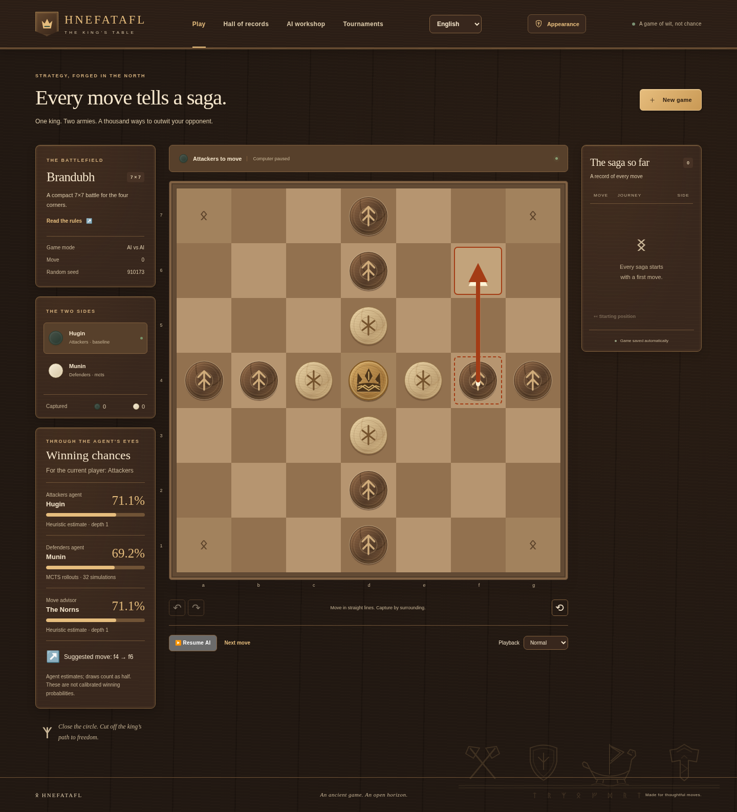

# Agent evaluation and move advice

New games can retain an agent's opinion of every displayed position. When either
side uses an AI, the game interface requests a report from each AI independently.
Both opinions use the **current side to move** as the displayed perspective,
including the AI that is playing the other side. A human-versus-human game can
also select an optional move advisor. The advisor evaluates the same position and
suggests its best searched legal move; it does not move a piece for the player.
The default advisor is **None**.

## Interpreting the numbers

These are agent estimates, not calibrated predictions of match outcomes. All
engine values use the defender's perspective in `[-1, 1]`. The display converts
the current player's signed value to `(value + 1) / 2`. A draw is half a point,
so this number estimates expected score, rather than separating win and draw
probabilities. Comparing two agents' estimates can reveal disagreement; it does
not establish which agent is correct or stronger.

| Agent | Recorded value source |
| --- | --- |
| Tactical heuristic | Heuristic value after its best searched one-ply move |
| Alpha-beta | Minimax value from the deepest fully completed iteration; current-position evaluator if the deadline prevents depth one from finishing |
| Monte Carlo tree search | Mean backed-up root value from the completed simulations, including heuristic leaf/rollout cutoffs |
| Neural search / model-backed MCTS | The registered network's current-position value head; tree search still selects the suggested move |
| Alpha-beta with a model | Minimax value from neural leaf evaluations |
| Finished position | Exact rules outcome: win 100%, loss 0%, draw 50% |

Reports retain source, effective agent configuration, derived search seed and
available search diagnostics. Search uses the configured time/iteration budget.
The advisor always suggests the most promising searched option, regardless of
nonzero play-sampling temperature. Actual play retains its original sampling
behavior. “Best” means best found within the selected agent's budget.

## Persistence and replay

`POST /api/games/{id}/analysis` accepts `{ "version": ..., "cursor": ... }`.
The client requests it before moving at a new position. It returns a position
snapshot containing separate `evaluations` entries for AI attackers, AI defenders
and the optional advisor, plus an advisor `hint`. `win_probability` is the
current-player estimate described above; an unavailable estimate is `null`.

The first completed report for a position is immutable. Ordinary game responses
include the retained report in `analysis`, or `null` if none was saved. Undo,
redo, seek, reload and server restart recover the same snapshot, including after
model deletion from a completed game. Reports are stored separately from the
gameplay payload: saving an opinion does not increment the game version, change
moves, advance a turn or affect statistics.

SQLite schema 4 adds `game_analysis`, keyed by game ID and a digest of the entire
rules state, including repetition history and ply. A different branch cannot
reuse an earlier branch's report. The migration from schema 3 is additive and
does not rewrite existing games. Deleting a game or explicitly discarding an
unfinished model reference removes its analysis in the same transaction.

A move, replay seek or deletion that wins a race against analysis invalidates
the late result with HTTP 409. Analysis cannot overwrite a game or recreate a
deleted record. Duplicate computations retain the first report. The endpoint
computes only a new game's current frontier; missing reports in older games or
past replay positions return `unavailable_reason: "not_recorded"`. It never
creates historical evidence using newer or absent weights.

An advisor model is a live reference just like a playing AI's model. Model
deletion previews its unfinished games and requires the existing explicit
discard flow. Completed games preserve their reports; starting a new branch or
restarting requires that all referenced models remain available.

## Statistics across seeds

AI identity includes algorithm, effective search parameters and model ID while
excluding random seed. The Hall of records combines otherwise equal agents
across game seeds. Aggregate configuration omits seed and reports `seed_count`;
the individual recorded games keep their actual seeds and full parameters.
Different model IDs remain distinct even if their display names match.
