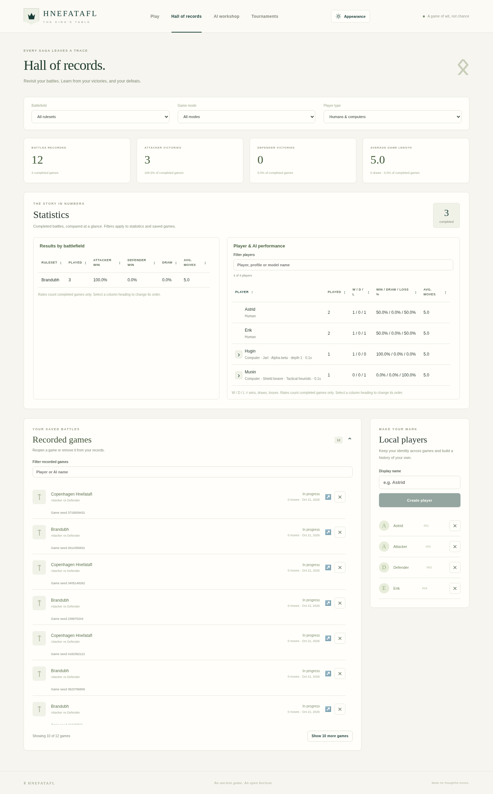
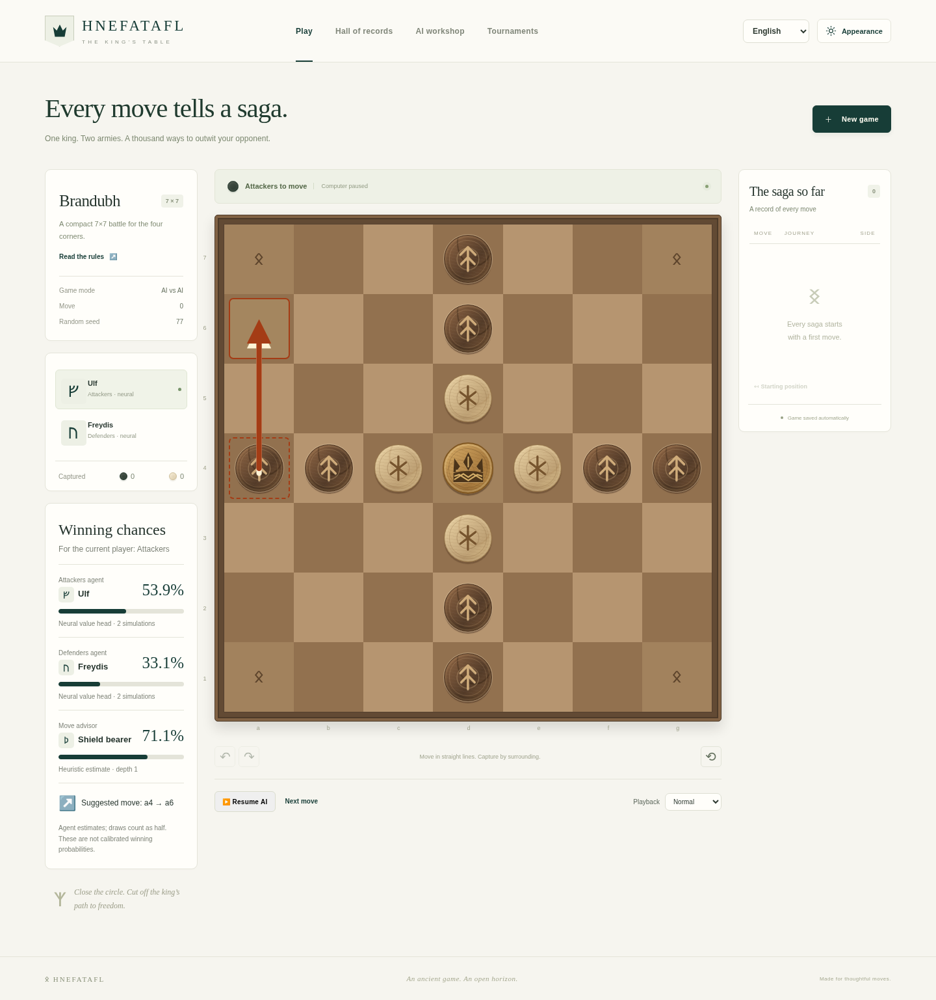
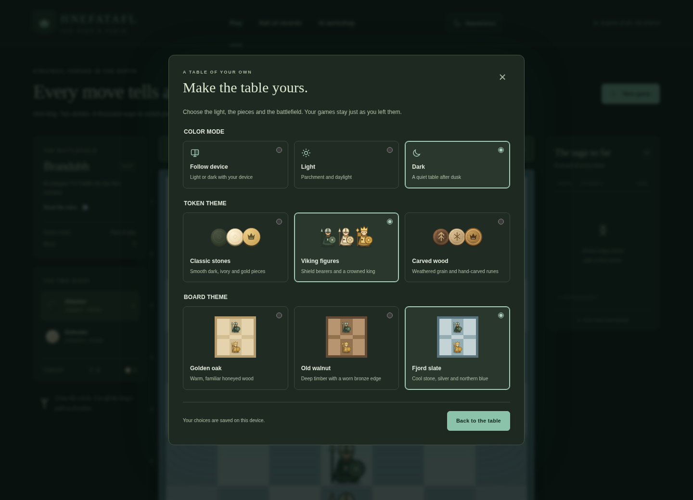

# Records, collections and appearance

## Human profiles and history

Each human side in **New game** has a player selector. Choose an existing profile
or select the new-player option and enter a name. Switching to a new name clears
the previous profile ID; a dropdown choice identifies the player by ID, not just name.

Delete profiles in **Hall of records → Local players**. The confirmation explains
that existing history remains. Deletion removes the profile from new-game selectors;
saved games, results, replay, name and stable historical identity remain. A later
profile using the same display name is a separate identity. Existing saved games
can still be viewed and played. Starting another game from a record whose player
was deleted requires choosing active players in a new game.

## AI configurations in the Hall of records

The Hall opens with summary cards and a separate **Statistics** section. Detailed
battlefield rates and player/AI performance appear before the saved-game list.
**Recorded games** is collapsible and initially shows a short page of recent
records; show more when needed. Shared filters apply to both history and statistics.

Click a column heading in either statistics table to sort ascending; click again
to reverse the order. Rates, counts and averages sort numerically. The W/D/L
column sorts by wins, then draws, then losses; the rate column uses the same
win/draw/loss priority. Player performance opens with W/D/L descending, so the
most wins appear first. Before a battlefield sort is chosen, boards stay in size order.
Use **Filter players** to search player names and their visible AI summaries.
Use **Filter recorded games** to find either participant by name. These two
case-insensitive filters operate independently and do not change the overall
summary cards or the global battlefield/mode/player-type filters.

See the [compact AI row on mobile](screenshots/compact-ai-mobile.png).

See the [mobile dark view](screenshots/records-mobile.png) and the
[model cleanup confirmation](screenshots/model-cleanup.png).

Each record has a delete button. Confirmation permanently removes that game's
moves and result. The statistics are recomputed from the remaining records,
including completed counts, win/draw/loss rates and averages. Profiles, models and
other games remain. Deleting the game currently open in this browser clears its
local game selection. A changed record requires a fresh confirmation before deletion.

Different effective AI configurations have separate records even when they share
an opponent name or model. Each AI performance entry occupies one compact row,
with its profile, algorithm and main search budget below its name. The parameter
button to the left opens all saved settings without enlarging the table row.
Expand **AI parameters** under a recorded game to inspect the actual algorithm and
settings: depth, iteration/time budget, rollout depth, exploration, temperature,
seed, evaluation and model ID as
applicable. Compact summaries help distinguish opponents before opening details.

Identity uses normalized effective settings, not the order of JSON fields. Omitted
defaults and equivalent explicit defaults group together; different relevant parameter
values remain separate, except that seed-only differences share one row. Each game
retains its original seed; an aggregate row omits seed rather than implying a
single experiment. Stale controls for a different algorithm do not create false
variants. Historical explicit-algorithm games keep their original engine-default
meaning rather than receiving a profile's different defaults retroactively.

## Models and suggested names

In **AI workshop**, use the name-suggestion button beside the model name to generate
a Viking-inspired name such as “Astrid Ravenwise”. Suggestions avoid names already
in the model collection and the current suggestion. You can always edit the name.

Each model card supports export and deletion. Deletion requires confirmation,
removes the registered inference copy and its model entry, and refreshes the available
AI choices. Original training checkpoints remain for resumption or re-import.
Completed game histories and historical model labels remain.

The delete dialog checks the server's saved records, including unfinished games
from other browser sessions or games replaced by **New game**. The browser's
current-game pointer represents only one of those records. If unfinished games
still use the model, the dialog lists them and offers an unchecked **Discard
unfinished games and delete model** option. Choosing it removes those unfinished
games without a result or retained history. Completed games remain, including
completed games whose replay cursor is at an earlier position. Changed references
require reviewing the dialog again; deleting a model never silently removes new
references. Running tournaments must be stopped before their model can be deleted.

Model cards show **Training seed** from the saved training configuration. This is
different from an evaluation seed or a game seed. Older imports without the
training seed say **Not recorded**.

## New-game opponents and seeds

Every ordinary new game and restart receives a fresh random seed by default.
The server saves the base seed with the game and derives AI decision seeds from
that base and the current move number. Replay uses saved moves. A fixed seed can
be supplied explicitly for a repeatable comparison; tight wall-clock limits can
still change search completion across machines. Restart starts a fresh experiment
with a new seed. Existing legacy records keep their previous seed semantics.

When configuring an AI side, the new-game dialog preselects a compatible trained
model using comparable evaluation results against the baseline. The ranking uses
`(wins + draws / 2) / (wins + losses + draws + unfinished)`, so unfinished games
receive no points. Larger samples break score ties, followed by deterministic
date/ID ordering. Malformed reports and evaluations against a previous model
are not treated as comparable strength evidence. If no model has a comparable
evaluation, the newest compatible model is selected and described as a fallback.
If no compatible model exists, a traditional opponent remains available. You can
always change the suggested opponent; manual choices survive option refreshes.

The ranking is a selection convenience based on saved evidence, not a claim that
short smoke-trained models are strong. Per-game seeds remain inspectable in game
and recorded-game parameters; seed-only differences share a performance row.

New games and tournaments both suggest the strongest compatible model using the
same evidence and fallback rules. Model dropdowns show saved iteration, planned
iterations when known, network size and a short model ID to distinguish equal names.
Tournament names are editable northern-mythology suggestions; reroll to find another.

The complete last successfully created setup is saved in this browser under
`hnefatafl-new-game-options`: battlefield, mode, human side and player choices,
both AI profiles/models and search settings, advisor, fixed-seed switch and value.
Cancelling a dialog or a failed creation does not change it. Removed/incompatible
models, deleted players and invalid stored settings fall back to valid options.
The earlier mode-only preference is still read when no full setup is available.

Selecting a trained model updates both its ID and display name. The two-sides
panel uses the recorded model-name snapshot for older games whose display alias
was stale; it does not change the actual weights or rewrite historical games.

## Persistent runes and tournament names

Players and models receive persistent unique runes. A model keeps the same rune
in dropdowns, its workshop card, either game side, advisor, analysis and records.
Human profiles retain theirs after deletion. Assignments are never recycled;
after the 24 single Elder Futhark runes, unique combinations extend the catalog.
See [IDENTITIES.md](IDENTITIES.md) for identity and migration details.

Tournament participants start with distinct, editable Viking names. The same
**⚄** dice control rerolls model, tournament and participant suggestions. Names
stay independent of model/profile choices. Each saved tournament seat has a unique
participant rune, plus the underlying model/agent rune shown with its details.

The header groups language and appearance at the top right. Decorative overlines
above page and panel headings have been removed; statistics retain their labels.

See the [mobile header and player runes](screenshots/cleaned-header-mobile.png).

## Agent opinions and move advice

Choose **Move advisor → Agent for move suggestions** in a new game to highlight
an agent's best searched legal move. **None** is the default. Playing AI agents
and the advisor each display an independent estimate for the same current player.
Snapshots are retained with the position and appear during replay. Missing older
evaluations are explicit. See [ANALYSIS.md](ANALYSIS.md) for the value sources,
expected-score interpretation, draw handling and model-reference protection.

## Language

Use the header language selector to switch between English and German without
leaving the current game. The browser stores the choice under `hnefatafl-language`;
a fresh visit follows German browser language or otherwise English. Rules, controls,
accessible labels, number/date formatting and workshop/tournament text follow the
selection. User names and saved tournament/model names keep their original text.

Battlefields are consistently ordered by board size: Brandubh 7×7, Tablut 9×9,
Copenhagen 11×11, in new games, records and training.

## Color, tokens and boards

Open **Appearance** in the application header. The three settings are independent:

| Setting | Choices |
| --- | --- |
| Color mode | Follow device, Light, Dark, Wood |
| Token theme | Classic stones, Viking figures, Carved wood |
| Board theme | Golden oak, Old walnut, Fjord slate |

See the [Viking figures in dark mode](screenshots/dark-vikings.png),
[Fjord Diadem with carved wood on walnut](screenshots/default-wood-walnut.png), and
[mobile dark mode](screenshots/mobile.png) for actual rendered examples.

The Viking set renders shield bearers and a crowned king. The carved set uses
weathered wood grain and carved markings. Its king uses the selected **Fjord Diadem**:
a low three-peak northern circlet with an interlaced band, rendered as scalable SVG.
This motif applies only to Carved wood; the other token sets retain their king art.
See the [three king concepts and selected design](designs/king-options.md).
Side and king distinctions remain visible
in every theme. Legal destinations, move highlights and keyboard controls keep the
same behavior. Changing appearance does not change game state or AI parameters.

**Wood** turns the interface into a timber hall with bronze fittings, parchment
text, carved runes, axes, a dragonboat, a hammer and a shield. It remains independent
of the token and board themes, so it works with every available set.

See the [wood desktop view](screenshots/wood-theme-desktop.png) and
[wood mobile view](screenshots/wood-theme-mobile.png).

Preferences are stored in this browser under `hnefatafl-appearance`, not in player
profiles or the database. Follow-device mode responds to operating-system color
changes. Invalid saved values fall back to supported defaults. If browser storage is
unavailable, settings still work for the visit and the dialog reports the limitation.
Fresh browsers use **Follow device + Carved wood + Old walnut**. Valid saved choices
remain in effect; missing or invalid fields fall back to these defaults. Choose
those three settings to return to the defaults.

## Adding another theme

`frontend/src/appearanceConfig.ts` defines the typed catalogs and allowed preferences.
Add a token catalog entry and a corresponding renderer in `frontend/src/Tokens.tsx`,
then supply its visual treatment in `appearance.css`. Token previews use the same
renderer as the board, so one addition supplies both. Preserve `A`, `D` and `K`
distinctions and leave the board's accessible coordinate/piece labels intact.

For another board, add an entry to `BOARD_THEMES` with the existing palette keys:
light/dark squares, special-square variants, frame/rim/inner/edge, runes, selected
square/ring, last move and legal destination. The provider translates these to
`--board-*` CSS variables. Board and token catalogs are independent of each other
and of the rulesets. Test new combinations in both color modes and at phone sizes.
