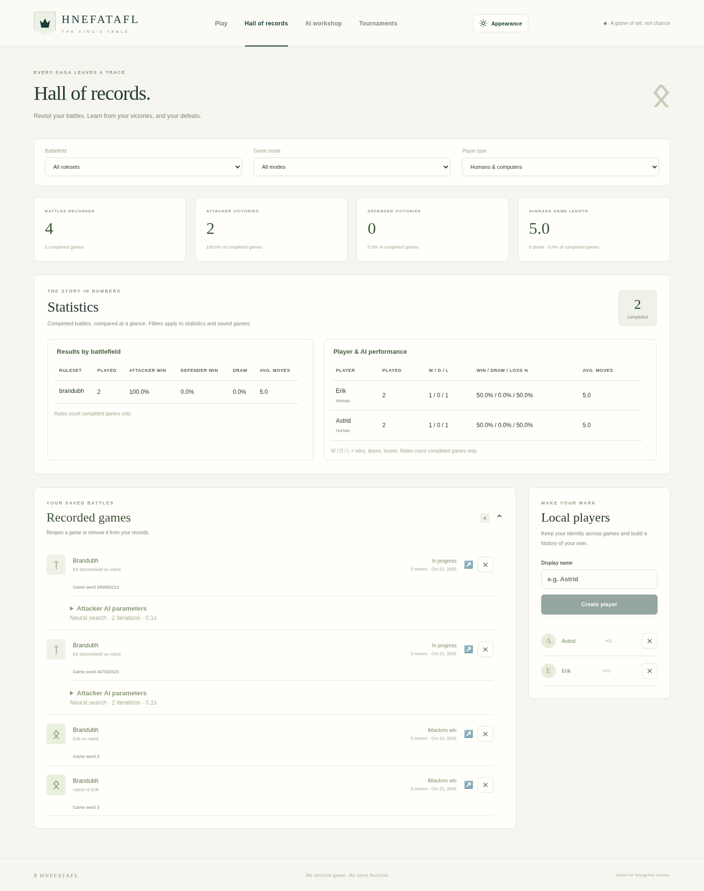

# Records, collections and appearance

## Human profiles and history

Each human side in **New game** has a player selector. Choose an existing profile
or select the new-player option and enter a name. Switching to a new name clears
the previous profile ID; a dropdown choice identifies the player by ID, not just name.

Delete profiles in **Hall of records → Local players**. The confirmation explains
that existing history remains. Deletion removes the profile from new-game selectors;
saved games, results, replay, name and stable historical identity remain. A later
profile using the same display name is a separate identity. Existing saved games
can still be viewed and played. Starting another game from a record whose player
was deleted requires choosing active players in a new game.

## AI configurations in the Hall of records

The Hall opens with summary cards and a separate **Statistics** section. Detailed
battlefield rates and player/AI performance appear before the saved-game list.
**Recorded games** is collapsible and initially shows a short page of recent
records; show more when needed. Shared filters apply to both history and statistics.

See the [mobile dark view](screenshots/records-mobile.png) and the
[model cleanup confirmation](screenshots/model-cleanup.png).

Each record has a delete button. Confirmation permanently removes that game's
moves and result. The statistics are recomputed from the remaining records,
including completed counts, win/draw/loss rates and averages. Profiles, models and
other games remain. Deleting the game currently open in this browser clears its
local game selection. A changed record requires a fresh confirmation before deletion.

Different effective AI configurations have separate records even when they share
an opponent name or model. Expand **AI parameters** under a recorded game or AI
performance row to inspect the actual algorithm and settings: depth, iteration/time
budget, rollout depth, exploration, temperature, seed, evaluation and model ID as
applicable. Compact summaries help distinguish opponents before opening details.

Identity uses normalized effective settings, not the order of JSON fields. Omitted
defaults and equivalent explicit defaults group together; different relevant parameter
values remain separate. Stale controls for a different algorithm do not create false
variants. Historical explicit-algorithm games keep their original engine-default
meaning rather than receiving a profile's different defaults retroactively.

## Models and suggested names

In **AI workshop**, use the name-suggestion button beside the model name to generate
a Viking-inspired name such as “Astrid Ravenwise”. Suggestions avoid names already
in the model collection and the current suggestion. You can always edit the name.

Each model card supports export and deletion. Deletion requires confirmation,
removes the registered inference copy and its model entry, and refreshes the available
AI choices. Original training checkpoints remain for resumption or re-import.
Completed game histories and historical model labels remain.

The delete dialog checks the server's saved records, including unfinished games
from other browser sessions or games replaced by **New game**. The browser's
current-game pointer represents only one of those records. If unfinished games
still use the model, the dialog lists them and offers an unchecked **Discard
unfinished games and delete model** option. Choosing it removes those unfinished
games without a result or retained history. Completed games remain, including
completed games whose replay cursor is at an earlier position. Changed references
require reviewing the dialog again; deleting a model never silently removes new
references. Running tournaments must be stopped before their model can be deleted.

Model cards show **Training seed** from the saved training configuration. This is
different from an evaluation seed or a game seed. Older imports without the
training seed say **Not recorded**.

## New-game opponents and seeds

Every ordinary new game and restart receives a fresh random seed by default.
The server saves the base seed with the game and derives AI decision seeds from
that base and the current move number. Replay uses saved moves. A fixed seed can
be supplied explicitly for a repeatable comparison; tight wall-clock limits can
still change search completion across machines. Restart starts a fresh experiment
with a new seed. Existing legacy records keep their previous seed semantics.

When configuring an AI side, the new-game dialog preselects a compatible trained
model using comparable evaluation results against the baseline. The ranking uses
`(wins + draws / 2) / (wins + losses + draws + unfinished)`, so unfinished games
receive no points. Larger samples break score ties, followed by deterministic
date/ID ordering. Malformed reports and evaluations against a previous model
are not treated as comparable strength evidence. If no model has a comparable
evaluation, the newest compatible model is selected and described as a fallback.
If no compatible model exists, a traditional opponent remains available. You can
always change the suggested opponent; manual choices survive option refreshes.

The ranking is a selection convenience based on saved evidence, not a claim that
short smoke-trained models are strong. Per-game seeds remain inspectable in game
and AI-variant records; different seeds still distinguish parameter variants.

Battlefields are consistently ordered by board size: Brandubh 7×7, Tablut 9×9,
Copenhagen 11×11, in new games, records and training.

## Color, tokens and boards

Open **Appearance** in the application header. The three settings are independent:

| Setting | Choices |
| --- | --- |
| Color mode | Follow device, Light, Dark |
| Token theme | Classic stones, Viking figures, Carved wood |
| Board theme | Golden oak, Old walnut, Fjord slate |

See the [Viking figures in dark mode](screenshots/dark-vikings.png),
[carved wood on walnut](screenshots/carved-wood.png), and
[mobile dark mode](screenshots/mobile.png) for actual rendered examples.

The Viking set renders shield bearers and a crowned king. The carved set uses
weathered wood grain and carved markings. Side and king distinctions remain visible
in every theme. Legal destinations, move highlights and keyboard controls keep the
same behavior. Changing appearance does not change game state or AI parameters.

Preferences are stored in this browser under `hnefatafl-appearance`, not in player
profiles or the database. Follow-device mode responds to operating-system color
changes. Invalid saved values fall back to supported defaults. If browser storage is
unavailable, settings still work for the visit and the dialog reports the limitation.
Choose Follow device + Classic stones + Golden oak to return to the defaults.

## Adding another theme

`frontend/src/appearanceConfig.ts` defines the typed catalogs and allowed preferences.
Add a token catalog entry and a corresponding renderer in `frontend/src/Tokens.tsx`,
then supply its visual treatment in `appearance.css`. Token previews use the same
renderer as the board, so one addition supplies both. Preserve `A`, `D` and `K`
distinctions and leave the board's accessible coordinate/piece labels intact.

For another board, add an entry to `BOARD_THEMES` with the existing palette keys:
light/dark squares, special-square variants, frame/rim/inner/edge, runes, selected
square/ring, last move and legal destination. The provider translates these to
`--board-*` CSS variables. Board and token catalogs are independent of each other
and of the rulesets. Test new combinations in both color modes and at phone sizes.
