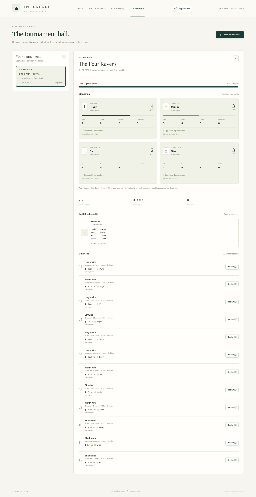
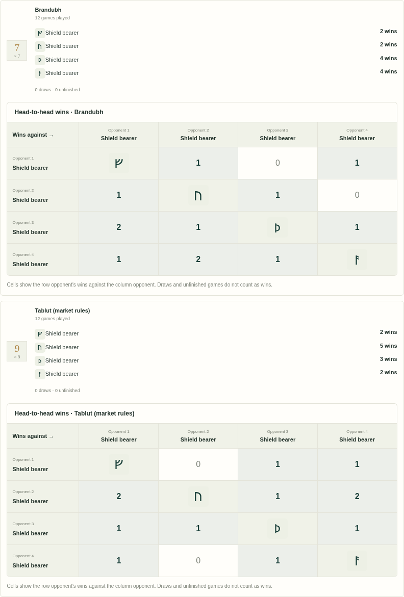

# AI tournaments

[Documentation index](README.md) · [Opponent settings](AI.md)

Use **Tournaments** in the main navigation to set up a balanced comparison and
return to its saved results later. Compare two, three or four opponents: each
opponent can use a different algorithm, budget or compatible trained model.



The [setup dialog](screenshots/tournament-setup.png) and
[mobile dark view](screenshots/tournaments-mobile.png) use the same saved collection.

## Set up a comparison

1. Choose **New tournament** and give the run a recognizable name.
2. Select one or more battlefields, listed in board-size order.
3. Select the opponents' models or profiles and search parameters. Use **Add
   opponent** to include a third or fourth participant. A neural
   model must match every selected battlefield; use separate tournaments to compare
   models trained for different rulesets. For a custom alpha-beta opponent, the
   **Alpha-beta optimizations** section exposes **Legacy alpha-beta**,
   **Optimized default**, **Full symmetry** and **Custom** presets plus individual
   legacy, transposition-table, move-ordering, D4-canonical transposition and
   symmetry move-pruning toggles and a bounded table capacity. The controls appear
   only for alpha-beta, so unrelated algorithms keep their existing form.
4. Choose an even number of games per pairing on each battlefield, a move limit and a seed.
5. Start the tournament. The saved view shows progress while the worker plays.

Participants use their model's name, or the AI profile name for ordinary agents.
There is no second participant alias. Model summaries show the network and key
training settings next to each selected model, with its persistent rune and ID.
Saved tournaments retain a model metadata snapshot, so those details remain
readable after deleting training data or removing the model from the catalog.
Later catalog renames apply to new tournaments; existing reports keep their
recorded model names. Older alias-based records display their recorded model or
profile name where available, with the original alias as a legacy fallback.

Every unordered pair of opponents plays a balanced series, swapping
attacker/defender sides after every game. Two players have one pairing, three
have three, and four have six. Total scheduled games are games per pairing
multiplied by pairings and selected battlefields. For example, four opponents
playing two games per pairing on one battlefield schedule 12 games; each
opponent participates in six. Standings count only the games that opponent plays.
The move limit counts individual moves (plies), not pairs of turns.
The shared tournament seed determines the per-game/per-move randomness; it
supersedes individual profile seeds. Tight wall-clock budgets can still produce
different search completion on different hardware. A larger balanced sample is
needed to assess playing strength.

The browser API accepts an even `games` count from 2–100 per pairing, `max_plies`
from 1–1,000 and a seed from 0–4,294,967,295. Defaults are 2 games, 300 plies and
seed 0. The headless tournament accepts even game counts 2–10,000 and move caps
1–5,000; do not assume its wider limits are accepted by the browser API.

## Import and export configurations

**Import configuration** in the setup dialog reads a portable JSON document and
fills the editable form. Import never starts a tournament and never restores
server-managed values: IDs, status, ownership, progress, results, timestamps,
worker paths and runes are ignored. Review and edit the populated form, then
start the tournament explicitly. A failed import leaves the current form
unchanged and reports the offending fields.

The document mirrors the `POST /api/tournaments` request body:

```json
{
  "name": "Spring round robin",
  "rulesets": ["brandubh"],
  "players": [
    { "profile_id": "baseline", "config": { "algorithm": "baseline", "time_limit": 1 } },
    {
      "profile_id": "neural",
      "config": {
        "algorithm": "neural",
        "model_id": "<registered model id>",
        "search_wrapper": "mcts",
        "time_limit": 10
      }
    },
    {
      "config": {
        "algorithm": "alpha_beta",
        "depth": 3,
        "time_limit": 1,
        "search": {
          "legacy": false,
          "transposition": true,
          "move_ordering": true,
          "symmetry_transposition": true,
          "symmetry_pruning": true,
          "table_capacity": 100000
        }
      }
    }
  ],
  "games": 2,
  "max_plies": 150,
  "seed": 42
}
```

A complete two-opponent alpha-beta comparison is shipped as
[`configs/alpha-beta-search-comparison.json`](../configs/alpha-beta-search-comparison.json)
(name, brandubh, legacy versus full symmetry, 20 games, 500 plies, seed
20261026); the setup dialog can create the same tournament entirely through the
browser, and the importer validates the file without touching the form until the
whole document is accepted.

`name` is optional. `rulesets` must list one to three supported, distinct
battlefields. `players` must list two to four opponents; a named fixed profile
(`baseline`, `shield_maiden`, `alpha_beta`, `mcts`) is snapshotted from the
catalog exactly as the API does, while a custom opponent keeps its validated
search settings. A custom alpha-beta opponent may include a nested `search`
object; the importer, API and `effective_ai_config` all normalise it to the same
shape, so the settings populate the form, submit, persist, execute and re-import
without loss. Legacy files without `search` keep their historical identity and
use the optimized default. A `search` object is rejected for any algorithm other
than alpha-beta (or a neural alpha-beta wrapper), and neural symmetry reuse is
refused. A neural opponent must reference a registered model whose
ruleset matches every selected battlefield, so a model-based tournament uses one
battlefield. `games` must be even and 2–100, `max_plies` 1–1,000 and `seed`
0–4,294,967,295. Unknown fields, malformed JSON, unsupported values and missing
model references are rejected as a whole; the form is never partially
overwritten.

**Export results** downloads the saved tournament as JSON. The top level uses the
same importable configuration schema, and a nested `results` object carries the
status, timestamps, progress, standings, per-battlefield summary and match
records for review. Because the configuration fields are at the top level, an
exported file can be imported again as a fresh tournament; the `results` object is
ignored by the importer. Server-managed identifiers, worker PIDs and runes are
never included. Exported configs written before `training_symmetry_mode` existed
are unaffected; the field belongs to training jobs, not tournaments.

## Read the results

Standings show each opponent's wins, losses, draws, unfinished games and score.
Wins earn one point, actual rule draws half a point for each opponent, and
unfinished games no points. Reaching the experimental move limit is unfinished,
even when one side appears to have an advantage. A stopped tournament can have
fewer finished games than scheduled; an interrupted in-flight game is discarded.

Inspect the saved opponent parameters, results by battlefield, game lengths and
decision timings. Each retained match includes its side assignments, recorded
moves and outcome. The **Match log** starts collapsed whenever you open a
tournament; use the **Match log** control to show the recorded matches. A live
data refresh of the same running tournament keeps the current expanded or
collapsed state, while opening a different tournament collapses it again.
**Replay game** opens a read-only board with move navigation.
Replay uses the rules engine, so it still works after the original model is deleted.
The selected appearance settings also apply to tournament boards.
Each saved match identifies its attacker and defender explicitly. Earlier
two-player tournament records remain viewable and replayable without migration.

Each battlefield also has a **Head-to-head wins** table. Opponents appear in the
same numbered order across rows and columns. A cell counts how often the row
opponent beat the column opponent on that battlefield, across both side
assignments. Draws and unfinished games do not count as wins. The diagonal shows
each opponent's persistent rune instead of a self-match count. Numbered headers
keep seats distinct when opponents share a name or model. Running and stopped
series show only saved results; unplayed pairings display zero. The matrix is
reconstructed from retained matches when you reopen the tournament. On narrow
screens, scroll the table horizontally; row headers remain visible.



The [mobile view](screenshots/tournament-win-matrix-mobile.png) keeps the title and
row labels visible while scrolling to later opponents.

## Keep, stop and delete

Tournaments are stored on the server in the application's SQLite database, not
only in browser storage. Reloading the page or reopening the application retains
the collection. One tournament can run at a time; its worker runs separately so
regular gameplay remains available. Training has its own worker lifecycle.

**Stop tournament** retains the completed matches and marks the run cancelled.
Shutdown stops workers started by that server; after an unexpected interruption,
the saved view reports that the worker stopped and keeps completed matches.
Runs do not automatically resume. Start a new comparison to schedule more games.

Delete an inactive tournament using its delete button. The confirmation offers
**Keep it** or **Delete**. Deletion removes that tournament's configuration,
results, replay records and worker artifacts. It does not remove models,
training checkpoints, player profiles or regular saved games. Stop a running
tournament before deleting it. Models used by a running tournament are protected
from deletion until the worker has stopped.

## API and deployment

The API exposes collection/detail routes under `/api/tournaments`, creation via
`POST`, cancellation via `POST /{id}/cancel`, deletion via `DELETE /{id}`, and a
downloadable `GET /{id}/export` result document.
`GET /{id}/games/{index}/replay` validates and reconstructs a zero-indexed match.
Request schemas are available at `/docs`; clients provide model IDs, never paths.

Schema 3 adds a tournament table without rewriting existing game records.
Run a single API worker as documented in [DEPLOYMENT.md](DEPLOYMENT.md). Back up
the entire data directory consistently before updating. Tournament endpoints have
the same trusted-local-administrator scope as the model/training endpoints.

For headless comparisons, the existing CLI remains available:

```sh
.venv/bin/python -m hnefatafl.cli tournament --config configs/tournament.json
```

CLI reports are written to stdout; browser tournaments form the saved collection.
