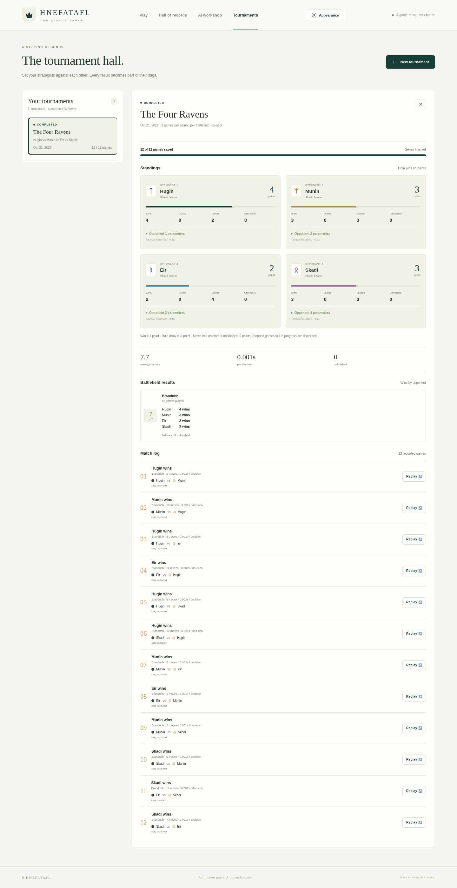
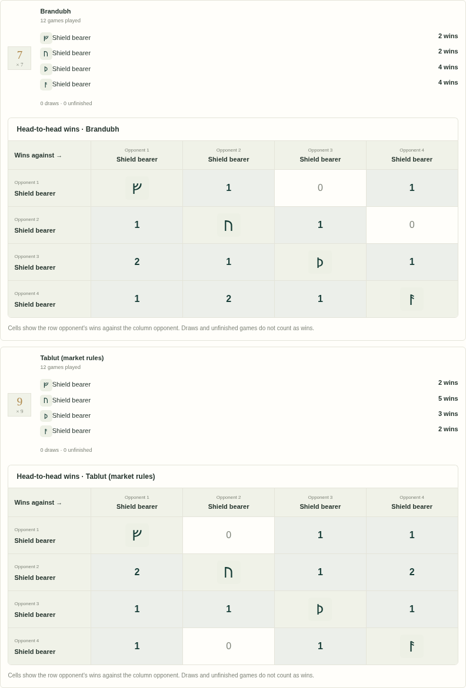

# AI tournaments

[Documentation index](README.md) · [Opponent settings](AI.md)

Use **Tournaments** in the main navigation to set up a comparison and
return to its saved results later. Two creation actions are available:
**New tournament** builds the balanced round robin described below, and
**Fixed-role comparison** pins independently configured opponents as attackers and
defenders. The saved collection shows both kinds side by side, and fixed-role
runs carry a **Fixed-role comparison** label.



The [setup dialog](screenshots/tournament-setup.png) and
[mobile dark view](screenshots/tournaments-mobile.png) use the same saved collection.

## Set up a comparison

**New tournament** compares two, three or four opponents. Each opponent can use a
different algorithm, budget or compatible trained model.

1. Choose **New tournament** and give the run a recognizable name.
2. Select one or more battlefields, listed in board-size order.
3. Select the opponents' models or profiles and search parameters. Use **Add
   opponent** to include a third or fourth participant. A neural
   model must match every selected battlefield; use separate tournaments to compare
   models trained for different rulesets. For a custom alpha-beta opponent, the
   **Alpha-beta optimizations** section exposes **Legacy alpha-beta**,
   **Optimized default**, **Full symmetry** and **Custom** presets plus individual
   legacy, transposition-table, move-ordering, D4-canonical transposition and
   symmetry move-pruning toggles and a bounded table capacity. The optimization
   controls appear only for alpha-beta. A **Heuristic** selector is available for
   custom alpha-beta and MCTS opponents and chooses the Shield maiden (default)
   or Shield bearer evaluator, so unrelated algorithms keep their existing form.
4. Choose an even number of games per pairing on each battlefield, a move limit and a seed.
5. Start the tournament. The saved view shows progress while the worker plays.

Participants use their model's name, or the AI profile name for ordinary agents.
There is no second participant alias. Model summaries show the network and key
training settings next to each selected model, with its persistent rune and ID.
Saved tournaments retain a model metadata snapshot, so those details remain
readable after deleting training data or removing the model from the catalog.
Later catalog renames apply to new tournaments; existing reports keep their
recorded model names. Older alias-based records display their recorded model or
profile name where available, with the original alias as a legacy fallback.

The participant editor is the same component as the administrator-only
**Custom opponent** section of a single-player game, and both submit the same
`config` shape to the same validation. A setting added for tournaments therefore
becomes available to custom single-player opponents without a second
implementation. See [AI](AI.md#custom-opponents).

A named catalog preset (Shield bearer, Shield maiden, Jarl, Seer) is
authoritative: the server replaces any configuration supplied beside it with the
preset's recorded parameters, including its evaluator. The setup form therefore
shows a fixed preset as a parameter summary with no editable controls — an
editable evaluator selector for a fixed preset would imply an override the server
ignores. A custom participant keeps the complete editor, including the
alpha-beta optimizations for a neural opponent that uses the alpha-beta wrapper.

Every unordered pair of opponents plays a balanced series, swapping
attacker/defender sides after every game. Two players have one pairing, three
have three, and four have six. Total scheduled games are games per pairing
multiplied by pairings and selected battlefields. For example, four opponents
playing two games per pairing on one battlefield schedule 12 games; each
opponent participates in six. Standings count only the games that opponent plays.
The move limit counts individual agent moves (plies), not pairs of turns or generated opening moves.
The shared tournament seed determines the per-game/per-move randomness; it
supersedes individual profile seeds. Tight wall-clock budgets can still produce
different search completion on different hardware. A larger balanced sample is
needed to assess playing strength.

The browser API accepts an even `games` count from 2–100 per pairing, `max_plies`
from 1–1,000 and a seed from 0–4,294,967,295. Defaults are 2 games, 300 plies and
seed 0. The headless tournament accepts even game counts 2–10,000 and move caps
1–5,000; do not assume its wider limits are accepted by the browser API.

## Fixed-role comparison

**Fixed-role comparison** measures independently configured opponents on a specific
side. Choose exactly one battlefield and configure two participants:

- **Attackers** (seat 0) plays the attacking side in every game.
- **Defenders** (seat 1) plays the defending side in every game.

Both sections use the regular tournament participant editor: profiles, heuristic
agents, trained models, MCTS/alpha-beta/no-search neural wrappers and all applicable
search parameters are independently editable. Selecting the same registered model
in both seats keeps separate configurations and statistics. For example, attackers
can use 256 MCTS simulations and defenders 64, with independent time limits,
exploration and temperature. Named profiles retain their authoritative preset
parameters; select **Custom opponent** to edit those parameters.

A neural model must match the selected battlefield. An incompatible selection stays
visible until explicitly changed; it is never silently replaced. Neural alpha-beta
symmetry switches remain unavailable because the value head need not be D4-equivariant.
The API, worker and importer validate each agent independently. Previously exported
fixed-role configurations with identical settings remain valid.

Unlike the round robin, sides are never swapped. The game count is therefore the
total number of scheduled games — 50 games means the attacker model attacks the
defender model exactly 50 times — so 1–100 games are accepted and odd counts are
valid. The move limit, seed and progress reporting behave as in the round robin.

The saved view reports side-specific results: games played, attacker wins,
defender wins, rule draws and unfinished games, plus the attacker and defender
win rates and score rates, the average game length and the per-opponent search
diagnostics. The win rate and score rate use completed games only and exclude
unfinished games; a placeholder appears while no game has finished. A stacked
outcome bar shows the same split visually. These numbers are not a balanced
overall-strength comparison, because the roles are deliberately not alternated.

The headless runner accepts the same document through
`tournament --config FILE`. It also accepts the historical flattened layout,
where each `players[i]` *is* the AI configuration, and a single document may not
mix the two representations. Seat order is always preserved: index 0 attacks and
index 1 defends.

A named fixed profile (`baseline`, `shield_maiden`, `alpha_beta`, `mcts`) is
authoritative in both the browser API and the headless runner: selecting one runs
the catalog parameters and replaces any configuration recorded beside it, so the
same document cannot execute a different algorithm in each. A custom participant,
including a trained model, keeps the configuration it records.

A portable participant's `config` is validated exactly as the browser API
validates it: unknown or misspelled fields, wrong types, out-of-range values,
unknown nested search settings and unsupported wrappers are rejected with the
participant index and the offending field, and the effective settings — including
the server defaults — are what actually runs. The historical flattened layout is
passed through with its previous, more permissive interpretation. The headless
runner also requires exactly one supported battlefield for `mode:
"fixed_roles"`, matching the browser, and rejects a missing, empty, malformed,
unsupported or multiple selection before any game starts.

Headless neural opponents need a resolvable `model_path`, exactly as before: the
model registry belongs to the server, and a `model_id` is never turned into a
filesystem path. Add the checkpoint to each participant's `config` to run an
exported comparison:

```json
{
  "name": "Model side performance",
  "mode": "fixed_roles",
  "rulesets": ["brandubh"],
  "players": [
    { "config": { "algorithm": "neural", "model_id": "<model A>", "model_path": "/models/a.pt", "search_wrapper": "mcts", "iterations": 200, "exploration": 1.4, "time_limit": 1 } },
    { "config": { "algorithm": "neural", "model_id": "<model B>", "model_path": "/models/b.pt", "search_wrapper": "mcts", "iterations": 200, "exploration": 1.4, "time_limit": 1 } }
  ],
  "games": 50,
  "max_plies": 300,
  "seed": 42
}
```

A neural participant without a `model_path`, or with a path that does not exist,
is rejected before any game starts. Both representations are validated with the
same rules as the browser API, including the shared effective search settings of
a fixed-role comparison.

Omitting `mode` keeps the historical balanced round robin, and every record saved
before this mode existed stays readable.

## Randomized legal openings

Both setup dialogs offer **Randomize starting positions**, disabled by default.
The additive boolean `randomize_start_positions` is saved, exported and imported;
its absence means false. Tournament details identify standard versus randomized
starts. The seed, battlefield, game count and move limit remain tournament settings.

Opening algorithm version 1 plays 2, 4 or 6 legal plies from the standard engine
position. SHA-256 derives a separate opening seed from the tournament seed,
ruleset, unordered seat pairing and comparison index. Hash ordering over sorted
legal moves defines deterministic choices without Python process hashes or
version-dependent random sampling. No model or search configuration participates.
Even opening lengths retain the ruleset's initial side to move, including Tablut's
defender-first convention. The immutable engine state keeps the entire ordered
repetition history.

The lightweight policy rejects captures, terminal states, repeated positions,
positions without legal moves and openings that give the side to move an immediate
win. This avoids material accidents from an unrestricted random playout. It does
not guarantee strategic balance: evaluate both roles and use enough completed
games before drawing strength conclusions. Final boards are deduplicated up to
rotation/reflection within a battlefield. Generation tries at most 32 candidates;
if no unique candidate remains, a suitable duplicate is retained with
`opening_unique: false`. If none is suitable, the run fails visibly and retains
previous games. Generation checks cancellation and performs no model inference.

Each adjacent round-robin pair of games reuses the **same full opening state**,
including side to move and history, while exchanging agents. The next comparison
uses another seed. This applies to every pairing in two-, three- and four-player
runs. Fixed-role games retain their seats and each use another opening; rerunning
with agents swapped and the same seed/settings reproduces the opening sequence.
Generation is lazy and independent of search randomness. Seed derivation and
opening choices are versioned; changing the algorithm requires a new version.
Saved prefixes remain replayable regardless of later algorithm versions.

Openings are shared within a pairing, but different pairings in a multi-agent
round robin generate their opening sets independently. Each pairing therefore
sees a different sample of positions, so multi-agent standings carry additional
sampling variance beyond the shared tournament seed. A shared opening suite for
every pairing is not part of version 1 and can be considered separately.

Saved games contain `opening_seed`, `opening_version`, `opening_plies` and
`opening_unique`. Their complete `moves` list starts with the generated prefix;
replay validates every move from the standard position and labels opening moves
separately. `plies` includes that prefix, while `agent_plies`, the configured
`max_plies`, decision timings and search diagnostics count agent moves only.
Average game length includes the opening; average decision time excludes it.
Historical games without opening metadata replay exactly as before. Time-limited
search can still do different work on different hardware even with identical
openings, so compare the participant's **Configured MCTS budget**, **Mean MCTS
simulations**, **Reached budget (eligible searches)** and **Deadline cutoffs**
(with the immediate winning-move shortcut count) rather than assuming a search
that stopped short of its budget timed out. The reached-budget rate excludes
immediate winning moves from its denominator and shows `—` when no eligible
search occurred; it is omitted for records written before the eligible-search
counter existed so an older value is never read under the new denominator.
Historical records without these counters omit them instead of showing zero.

For a portable same-weights Brandubh benchmark, replace the model ID below with
one registered on the server, then import it from **New tournament**:

```json
{
  "name": "Same weights: MCTS 64 vs 256",
  "mode": "round_robin",
  "rulesets": ["brandubh"],
  "players": [
    {"config": {"algorithm": "neural", "model_id": "REGISTERED_MODEL_ID", "iterations": 64, "time_limit": 15, "temperature": 0}},
    {"config": {"algorithm": "neural", "model_id": "REGISTERED_MODEL_ID", "iterations": 256, "time_limit": 15, "temperature": 0}}
  ],
  "games": 20,
  "max_plies": 300,
  "seed": 42,
  "randomize_start_positions": true
}
```

For fixed-role 256-vs-64, change `mode` to `fixed_roles`, reverse the two player
entries and import from **Fixed-role comparison**. The headless CLI additionally
needs a validated `model_path` for each neural seat. The regression suite uses a
real tiny CPU checkpoint and a short agent move cap to check 20 paired games,
independent budgets, persistence and replay; that is pipeline validation, not a
measurement of checkpoint strength.

## Import and export configurations

**Import configuration** in the setup dialog reads a portable JSON document and
fills the editable form. Import never starts a tournament and never restores
server-managed values: IDs, status, ownership, progress, results, timestamps,
worker paths and runes are ignored. Review and edit the populated form, then
start the tournament explicitly. A failed import leaves the current form
unchanged and reports the offending fields.

The document mirrors the `POST /api/tournaments` request body:

```json
{
  "name": "Spring round robin",
  "rulesets": ["brandubh"],
  "players": [
    { "profile_id": "baseline", "config": { "algorithm": "baseline", "time_limit": 1 } },
    {
      "profile_id": "neural",
      "config": {
        "algorithm": "neural",
        "model_id": "<registered model id>",
        "search_wrapper": "mcts",
        "time_limit": 10
      }
    },
    {
      "config": {
        "algorithm": "alpha_beta",
        "depth": 3,
        "time_limit": 1,
        "search": {
          "legacy": false,
          "transposition": true,
          "move_ordering": true,
          "symmetry_transposition": true,
          "symmetry_pruning": true,
          "table_capacity": 100000
        }
      }
    }
  ],
  "games": 2,
  "max_plies": 150,
  "seed": 42
}
```

A complete two-opponent alpha-beta comparison is shipped as
[`configs/alpha-beta-search-comparison.json`](../configs/alpha-beta-search-comparison.json)
(name, brandubh, legacy versus full symmetry, 20 games, 500 plies, seed
20261026); the setup dialog can create the same tournament entirely through the
browser, and the importer validates the file without touching the form until the
whole document is accepted.

`name` is optional. `mode` is optional and accepts `round_robin` (default) or
`fixed_roles`. A fixed-role document must list exactly one battlefield, exactly
two supported participants and 1–100 games; its two `config` objects are validated
independently. Each setup dialog accepts only its own mode and
reports a document for the other mode instead of filling the form, so a
fixed-role configuration is imported from the fixed-role setup. `rulesets` must
list one to three supported, distinct
battlefields. `players` must list two to four opponents; a named fixed profile
(`baseline`, `shield_maiden`, `alpha_beta`, `mcts`) is snapshotted from the
catalog exactly as the API does, while a custom opponent keeps its validated
search settings. A custom alpha-beta opponent may include a nested `search`
object; the importer, API and `effective_ai_config` all normalise it to the same
shape, so the settings populate the form, submit, persist, execute and re-import
without loss. Legacy files without `search` keep their historical identity and
use the optimized default. A `search` object is rejected for any algorithm other
than alpha-beta (or a neural alpha-beta wrapper), and neural symmetry reuse is
refused. A custom alpha-beta or MCTS opponent may also set `heuristic` to
`shield_maiden` (default) or `shield_bearer`; it is rejected for every other
algorithm. A neural opponent must reference a registered model whose
ruleset matches every selected battlefield, so a model-based tournament uses one
battlefield. A registered model may also back an MCTS or alpha-beta opponent
(`algorithm` `mcts` or `alpha_beta` with `model_id`): the API and the importer
both keep the model and evaluate with the network, and the alpha-beta symmetry
switches stay unavailable for a model-backed search. `games` must be even and
2–100, `max_plies` 1–1,000 and `seed` 0–4,294,967,295. An unknown field inside a
participant's `config` is rejected and reported with
the participant index and the field name, so a misspelled search parameter can
never be silently replaced by a default; the browser importer mirrors the same
accepted field list as the API and the headless runner. A participant's own
`seed` is validated like any other setting, but the tournament seed supersedes
it. Unknown fields, malformed JSON, unsupported values and missing model
references are rejected as a whole; the form is never partially overwritten.

**Export results** downloads the saved tournament as JSON. The top level uses the
same importable configuration schema (including `mode` and the attacker/defender
seat order), and a nested `results` object carries the
status, timestamps, progress, standings, per-battlefield summary and match
records for review. Because the configuration fields are at the top level, an
exported file can be imported again as a fresh tournament; the `results` object is
ignored by the importer. Server-managed identifiers, worker PIDs and runes are
never included. Exported configs written before `training_symmetry_mode` existed
are unaffected; the field belongs to training jobs, not tournaments. Exports
always contain the complete saved data, regardless of the lazy-loading behaviour
described under [API and deployment](#api-and-deployment).

## Read the results

Standings show each opponent's wins, losses, draws, unfinished games and score,
with overall and per-role games, outcomes, win rates and score rates. Percentages
include their completed sample count (`n`). Win rate is wins / completed; score
rate is (wins + 0.5 × draws) / completed, where completed = wins + losses + draws.
Unfinished games are excluded from both denominators. A role without completed
games shows `—`, including the unplayed role of a fixed-role participant.
Multi-battlefield standings offer a collapsible per-battlefield role breakdown.
Historical counters are reconstructed only when the retained match count agrees
exactly with the authoritative game counters; a partial or contradictory log
shows an unavailable message instead of a reconstructed distribution, and the
match log is labelled with its retained count. Unavailable rates show `—` without
a fabricated `n=0`; only a genuine zero-completed sample shows `n=0`.
Wins earn one point, actual rule draws half a point for each opponent, and
unfinished games no points. Reaching the experimental move limit is unfinished,
even when one side appears to have an advantage. A stopped tournament can have
fewer finished games than scheduled; an interrupted in-flight game is discarded.
A fixed-role comparison labels its two seats **Attackers** and **Defenders**
instead of numbered opponents, and adds the outcome chart described under
[Fixed-role comparison](#fixed-role-comparison); selecting the same model in both
seats still reports two separate seats.

Inspect the saved opponent parameters, results by battlefield, game lengths and
decision timings. Each retained match includes its side assignments, recorded
moves and outcome. The **Match log** starts collapsed whenever you open a
tournament; use the **Match log** control to show the recorded matches. A live
data refresh of the same running tournament keeps the current expanded or
collapsed state, while opening a different tournament collapses it again.
**Replay game** opens a read-only board with move navigation.
Replay uses the rules engine, so it still works after the original model is deleted.
The selected appearance settings also apply to tournament boards.
Each saved match identifies its attacker and defender explicitly. Earlier
two-player tournament records remain viewable and replayable without migration.

Each battlefield also has a **Head-to-head wins** table. Opponents appear in the
same numbered order across rows and columns. A cell counts how often the row
opponent beat the column opponent on that battlefield, across both side
assignments. Draws and unfinished games do not count as wins. The diagonal shows
each opponent's persistent rune instead of a self-match count. Numbered headers
keep seats distinct when opponents share a name or model. Running and stopped
series show only saved results; unplayed pairings display zero. The matrix is
reconstructed from retained matches when you reopen the tournament. On narrow
screens, scroll the table horizontally; row headers remain visible.



The [mobile view](screenshots/tournament-win-matrix-mobile.png) keeps the title and
row labels visible while scrolling to later opponents.

## Keep, stop and delete

Tournaments are stored on the server in the application's SQLite database, not
only in browser storage. Reloading the page or reopening the application retains
the collection. One tournament can run at a time; its worker runs separately so
regular gameplay remains available. Training has its own worker lifecycle.

**Stop tournament** retains the completed matches and marks the run cancelled.
Shutdown stops workers started by that server; after an unexpected interruption,
the saved view reports that the worker stopped and keeps completed matches.
Runs do not automatically resume. Start a new comparison to schedule more games.

Delete an inactive tournament using its delete button. The confirmation offers
**Keep it** or **Delete**. Deletion removes that tournament's configuration,
results, replay records and worker artifacts. It does not remove models,
training checkpoints, player profiles or regular saved games. Stop a running
tournament before deleting it. Models used by a running tournament are protected
from deletion until the worker has stopped.

## API and deployment

The API exposes collection/detail routes under `/api/tournaments`, creation via
`POST`, cancellation via `POST /{id}/cancel`, deletion via `DELETE /{id}`, and a
downloadable `GET /{id}/export` result document.
`GET /{id}/games/{index}/replay` validates and reconstructs a zero-indexed match.
Request schemas are available at `/docs`; clients provide model IDs, never paths.

`GET /api/tournaments` returns lightweight summaries by default and accepts an
explicit `?summary=true`. A summary carries the identity, mode, configuration,
progress, status, timestamps and error plus each participant's recorded name and
rune, but never the retained match records, per-game diagnostics or replay
states. `?summary=false` returns the complete records. `GET /api/tournaments/{id}`
stays the authoritative full-detail endpoint and always returns everything a
saved view, an export or a replay needs.

The summary is projected inside SQLite, so listing a saved collection never
decodes the retained match history in Python: a collection of 24 tournaments
with 200 games and 60 plies each decodes about 70 KiB instead of 20 MiB and reads
one row instead of one row per tournament
([`scripts/benchmark_tournament_summaries.py`](../scripts/benchmark_tournament_summaries.py)
reproduces the measurement). The browser renders the navigator from
the summary list and fetches the selected tournament's full record on demand.
While a run is active it polls summaries and refreshes that record only when the
selected tournament's status, completed game count or end time changes, so an
unchanged match history is never re-downloaded. Selecting another tournament
abandons the in-flight history request, and a response that is already older than
the latest summary triggers one immediate follow-up fetch, so a finished, failed
or cancelled run always reaches the screen without a manual refresh.

Schema 3 adds a tournament table without rewriting existing game records, and the
tournament mode is an additive configuration field, so saved records need no
migration.

Run a single API worker as documented in [DEPLOYMENT.md](DEPLOYMENT.md). Back up
the entire data directory consistently before updating. Tournament endpoints have
the same trusted-local-administrator scope as the model/training endpoints.

For headless comparisons, the existing CLI remains available:

```sh
.venv/bin/python -m hnefatafl.cli tournament --config configs/tournament.json
```

CLI reports are written to stdout; browser tournaments form the saved collection.
