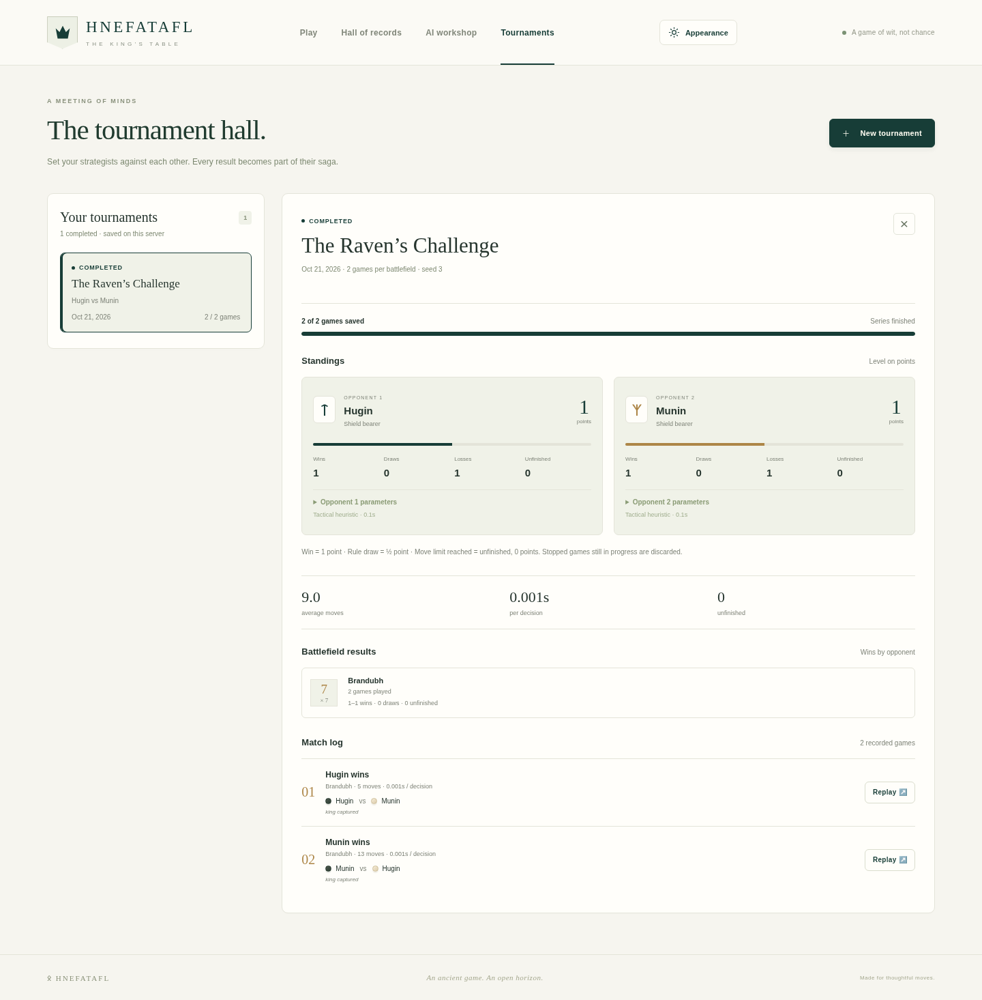

# AI tournaments

Use **Tournaments** in the main navigation to set up a balanced comparison and
return to its saved results later. This is a two-opponent comparison: each
opponent can use a different algorithm, budget or compatible trained model.



The [setup dialog](screenshots/tournament-setup.png) and
[mobile dark view](screenshots/tournaments-mobile.png) use the same saved collection.

## Set up a comparison

1. Choose **New tournament** and give the run a recognizable name.
2. Select one or more battlefields, listed in board-size order.
3. Name both opponents and select their profiles and search parameters. A neural
   model must match every selected battlefield; use separate tournaments to compare
   models trained for different rulesets.
4. Choose an even number of games per battlefield, a move limit and a seed.
5. Start the tournament. The saved view shows progress while the worker plays.

Opponents swap attacker/defender sides after every game. The total number of
scheduled games is games per battlefield multiplied by selected battlefields.
The move limit counts individual moves (plies), not pairs of turns.
The shared tournament seed determines the per-game/per-move randomness; it
supersedes individual profile seeds. Tight wall-clock budgets can still produce
different search completion on different hardware. A larger balanced sample is
needed to assess playing strength.

## Read the results

Standings show each opponent's wins, losses, draws, unfinished games and score.
Wins earn one point, actual rule draws half a point for each opponent, and
unfinished games no points. Reaching the experimental move limit is unfinished,
even when one side appears to have an advantage. A stopped tournament can have
fewer finished games than scheduled; an interrupted in-flight game is discarded.

Inspect the saved opponent parameters, results by battlefield, game lengths and
decision timings. Each retained match includes its side assignments, recorded
moves and outcome. **Replay game** opens a read-only board with move navigation.
Replay uses the rules engine, so it still works after the original model is deleted.
The selected appearance settings also apply to tournament boards.

## Keep, stop and delete

Tournaments are stored on the server in the application's SQLite database, not
only in browser storage. Reloading the page or reopening the application retains
the collection. One tournament can run at a time; its worker runs separately so
regular gameplay remains available. Training has its own worker lifecycle.

**Stop tournament** retains the completed matches and marks the run cancelled.
Shutdown stops workers started by that server; after an unexpected interruption,
the saved view reports that the worker stopped and keeps completed matches.
Runs do not automatically resume. Start a new comparison to schedule more games.

Delete an inactive tournament using its delete button. The confirmation offers
**Keep it** or **Delete**. Deletion removes that tournament's configuration,
results, replay records and worker artifacts. It does not remove models,
training checkpoints, player profiles or regular saved games. Stop a running
tournament before deleting it. Models used by a running tournament are protected
from deletion until the worker has stopped.

## API and deployment

The API exposes collection/detail routes under `/api/tournaments`, creation via
`POST`, cancellation via `POST /{id}/cancel`, and deletion via `DELETE /{id}`.
`GET /{id}/games/{index}/replay` validates and reconstructs a zero-indexed match.
Request schemas are available at `/docs`; clients provide model IDs, never paths.

Schema 3 adds a tournament table without rewriting existing game records.
Run a single API worker as documented in [DEPLOYMENT.md](DEPLOYMENT.md). Back up
the entire data directory consistently before updating. Tournament endpoints have
the same trusted-local-administrator scope as the model/training endpoints.

For headless comparisons, the existing CLI remains available:

```sh
.venv/bin/python -m hnefatafl.cli tournament --config configs/tournament.json
```

CLI reports are written to stdout; browser tournaments form the saved collection.
