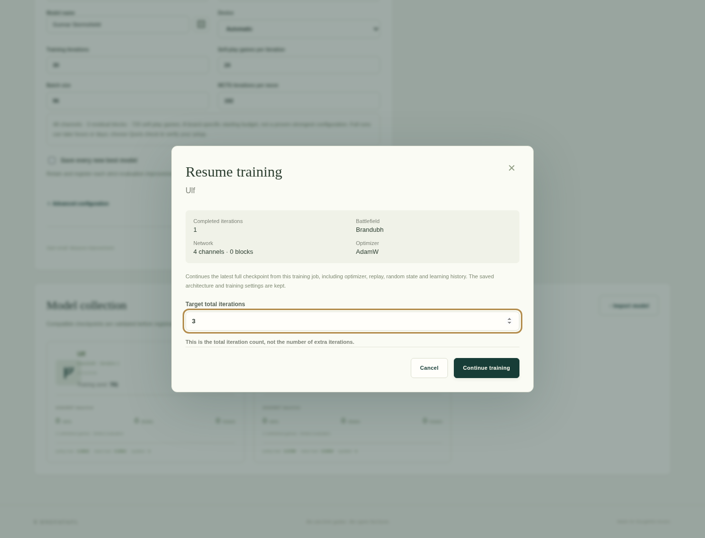

# Training data, checkpoints, models and migration

[Documentation index](README.md) · [Training](TRAINING.md) · [Backups](#consistent-backup-and-restoration)

A **job** owns a training lifecycle and retained outputs. A **checkpoint** is a
saved tensor file; only a full training checkpoint restores learning state. A
**model** is a separately registered inference copy available for play. Deleting
one collection does not imply deletion of the others.

## Application storage layout

`HNEFATAFL_DATA_DIR` selects the server's absolute storage root after resolution
(default `./data` relative to the server working directory). Web-managed paths are
server-owned; browser clients submit IDs, not arbitrary filesystem paths.

```text
data/
  hnefatafl.sqlite3       # games, players, jobs, tournaments, analysis, runes, workers
  jobs/<job-id>/          # web-managed training or tuning outputs
    config.json
    worker.log           # local subprocess stdout/stderr; remote reports retain log tails
    progress.json
    last.pt              # once a full checkpoint exists
    best.pt
    inference.pt
    result.json          # on completion/cancellation when available
    best/iteration-NNNNNN.pt  # optional strict-best snapshots
  models/
    index.json           # inference catalog metadata
    <model-id>.pt        # registered, content-addressed checkpoint copies
  tournaments/           # separate browser tournament worker artifacts
```

Files vary with job kind, execution target and lifecycle; a queued or failed job
need not have a checkpoint/result. Tuning adds `study.sqlite3`, trial directories
and `best-config.json`. Remote jobs retain uploaded artifacts and server progress;
the worker's private work directory is separate. CLI output paths come from JSON:
for example `configs/train-smoke.json` writes `data/training-smoke`, outside `jobs/`.
`HNEFATAFL_DATA_DIR` configures the server; it does not rewrite CLI `output_dir` or
`registry_dir` settings.

The SQLite **jobs** table is the registry of web-managed jobs: columns `id`,
`created_at` and `data`. Kind, status, configuration and progress live in the
saved `data` JSON. The server lists those rows, then reads
owned files for reconciliation. Copying `jobs/<id>/` alone **does not register a
job**, and `models/index.json` is a model catalog, not the training-job registry.
Standalone CLI training likewise does not create a web job row. A model imported
into another installation is playable but does not import its source job.

## Monitoring, cancellation and resumption



This historical screenshot shows checkpoint review and target-total iterations.
The current dialog additionally exposes the editable settings described below.

In the workshop, select a stopped or completed job and choose **Resume from
checkpoint**. The dialog validates its full `last.pt`, shows the saved completed
iteration, ruleset, network, seed and optimizer, and lets you choose **Target total
iterations**. The target must exceed the saved completed iteration. All new-job
settings except the historical preset, ruleset, channels, blocks, seed and optimizer type are editable,
initialized from the effective saved configuration rather than the current form.
The preset selector is available only for new jobs; resumption never reapplies a preset.
Learning rate, weight decay and SGD momentum reflect saved optimizer groups;
momentum does not apply to Adam or AdamW. Execution mode/concurrency/inference
batch size can change without replacing the retained learning state.

Model cards linked to a retained source job also offer **Resume training**.
This continues that job's **latest full checkpoint**, which may be later than
the selected best model's iteration; the dialog makes that iteration explicit.
Imported inference-only models without a retained full training checkpoint are
available for play but cannot restore optimizer/replay/random state.

Resumption starts a new job/output directory and preserves the original run.
The API uses `GET /api/training/jobs/{id}/resume` for reviewed checkpoint metadata
and `POST` to the same route with `{ "iterations": <target total> }` to continue.
Optional editable training fields, including `self_play_mode`,
`self_play_concurrency` and `inference_batch_size`, override saved settings for
the new job on local or updated remote workers, using new-job validation.
It never accepts an arbitrary client checkpoint path or an architecture override.

To resume, keep the same ruleset, architecture, seed and optimizer and increase
`iterations` in a copied JSON configuration. This field is the target **total**
iteration count, not the number of additional iterations:

```sh
.venv/bin/python -m hnefatafl.cli train --config my-resume-config.json --resume data/training-brandubh/last.pt
```

The default tests verify resumed weights exactly match an uninterrupted CPU run
with the same settings. Hardware-dependent numerical determinism is not
guaranteed across CUDA versions or different devices. When a config explicitly
sets `learning_rate`, `weight_decay` or SGD `momentum`, it overrides that setting
after restoring the optimizer. Accumulated optimizer moments, momentum buffers,
replay, random state and learning history are retained. Unspecified optimizer
settings keep their effective checkpoint values.

The full `last.pt` also carries a cloned best-model snapshot and its original
metadata. Moving that one checkpoint to a new output directory preserves the
saved benchmark records and champion, even when later candidates are weaker.
`best.pt` and registry inference exports intentionally have no optimizer state and cannot be used for exact training resumption.

### Evaluation strategy changes and checkpoint migration

Choose Shield bearer, Jarl or Champion and the evaluation budgets when resuming,
for example from iteration 100 toward 200. Only these reviewed settings change;
weights, optimizer buffers, replay, RNG/scaler state, completed iteration, history
and model associations survive. CLI resumes also inherit saved inputs before
applying explicit overrides. Resume requires an explicit output directory whose
`last.pt` cannot overwrite the source checkpoint; it never inherits an old worker path.
Source checkpoints are read without modification.

New full checkpoints retain tensor format 1, add `extra.training_state_version: 2`
and a versioned `extra.evaluation_state`. It contains benchmark snapshots indexed
by protocol identity, a separate champion snapshot/provisional flag, promotion
records and the last evaluation. The existing tensor-only loader remains in use.
The historical `best_score`/`best_snapshot` fields retain baseline meaning and
cannot be overwritten by Jarl or Champion scores.

Legacy iteration-100-style checkpoints migrate in memory: the saved baseline
best becomes a historical benchmark, and can initialize the first provisional
Champion incumbent. Legacy independent-game/iteration-derived seed results
have their own protocol identity rather than fabricated paired-match evidence.
Existing history is kept. No on-disk source rewrite or inference-only conversion
is required. New workers understand both checkpoint generations; update local
and remote installations together before sending new evaluation settings.
Portable job archives retain this state as part of the full checkpoint.

A cancelled evaluation records the already optimized iteration without a score
and saves its full state. Resume to a higher total target to continue training;
an unchanged candidate is not automatically reevaluated. Graceful cancellation
saves state; abrupt process termination still relies on the last atomic checkpoint.

## Checkpoints, registry, import and export

A completed **local training** run writes the files below. Remote jobs retain
uploaded full checkpoints and imported model copies, with reports stored in job
JSON; they need not mirror every local file. Tuning has its own study/trial tree.

- `last.pt`: full resumable state from the last checkpoint iteration.
- `best.pt`: compact selected fixed-benchmark best or accepted/provisional champion;
  ties keep the incumbent. It has no optimizer/replay state.
- `inference.pt`: compact weights plus model/training/evaluation metadata,
  without optimizer, replay or RNG state.
- `config.json`, `progress.json`, `result.json`: human-readable provenance.

The compact model is automatically registered with name/version, ruleset,
architecture, date, configuration and metrics. Select that model in Human vs AI
or AI vs AI with any compatible [neural search wrapper](AI.md#neural-search-wrappers).
Models are content-addressed so repeated imports do not produce duplicate entries.

```sh
.venv/bin/python -m hnefatafl.cli models --registry data/models
.venv/bin/python -m hnefatafl.cli models --registry data/models --import data/training-brandubh/inference.pt --name "Brandubh experiment"
.venv/bin/python -m hnefatafl.cli models --registry data/models --export MODEL_ID --output exported-model.pt
```

The registry API/UI supports the same import/list/export workflow. Loading uses
`torch.load(weights_only=True)`, validates format/version, exact tensor shapes
and dtypes, finite values, architecture and ruleset, and rejects arbitrary pickle
objects. Imports have file and expanded-storage bounds; no unsafe loading
fallback exists. Keep full job checkpoints for resumption; compact inference
exports intentionally cannot resume an optimizer.

## Managing models and retained training data

Model cards show the recorded policy/value network width and residual depth,
snapshot iteration, self-play/search budget and optimizer settings. These describe
the saved snapshot rather than the current training form. Earlier imports can lack
training metadata; missing values are identified rather than inferred from today's
recommended plan. Tournament setup and saved reports use the same summary.

**Rename model** changes its catalog label while preserving its model ID, rune,
weights and original training metadata. New selections use the new name; existing
games and tournaments retain their recorded name snapshots. Checkpoint exports
still contain their original embedded name. Reimporting the same checkpoint into
the existing catalog keeps the chosen catalog name.

**Load training parameters** copies recorded, editable training settings into the
workshop form, including architecture and advanced settings. Review them before
starting a new run. This does not restore weights, optimizer or replay state; use
**Resume training** for that. Server paths and resume tokens are never copied into
the form. Unrecorded settings keep their current form values, with an explicit
notice. Models without any usable recorded settings cannot supply this action.

Select a saved job and choose **Delete training data** to remove its job record,
checkpoints, replay state, progress and logs after confirmation. Registered model
copies and existing game/tournament histories remain available. Deleting a source
job removes the ability to resume that source checkpoint. Stop a running worker
before deleting its data. Shared optimization study data remains protected while
another saved job references it; remove dependent jobs first.

The API provides `PATCH /api/models/{id}` with `{ "name": "New name" }` and
`DELETE /api/training/jobs/{id}`. These are separate from model deletion.

## Moving data between installations

In **AI Workshop → At the forge**, select an inactive job and choose **Export job**.
Transfer the ZIP to another computer, open its workshop and choose **Import job**.
The imported job opens with its configuration, learning graphs, evaluation and
performance history. Its inference models join the normal model collection for
games and tournaments. Existing jobs and models are kept; repeated imports create
new job IDs and deduplicate model content, preserving existing catalog names.

The versioned archive contains `manifest.json`, a sanitized SQLite job-record
snapshot in `job.json`, and available configuration, progress, results, worker logs,
full/best/inference checkpoints and retained `best/` snapshots. `models/` contains
associated registered inference copies. The manifest records the format and source
application versions, original job ID, file sizes and SHA-256 checksums. Unknown
adjacent files are excluded. Runtime ownership, worker credentials, leases and
server paths are stripped; logs redact recognized credential assignments and paths.
Treat archives as private training data and review custom diagnostic log text before sharing.

Import validates inventory, checksums, bounded JSON and tensor-only checkpoint
compatibility in staging, then registers models, publishes a fresh job directory
and inserts its SQLite row. Controlled failures roll back new files/catalog entries.
It never starts training or restores a foreign PID, worker lease or queue assignment.
The job stays completed/cancelled/failed and defaults to local execution; original
job identity, timestamps and local/remote execution remain historical provenance.
Original resume dependencies are detached: the full checkpoint carries its own
optimizer, replay, RNG and portable best-model state.

**Resume from checkpoint** uses the same checkpoint-review API as ordinary jobs.
Only a full compatible `last.pt` is resumable; `best.pt` and inference-only imports
remain playable without being advertised as full training state. Resumption creates
a new job and leaves the imported source unchanged. CUDA-trained checkpoints load
on CPU; select **CPU** or **Automatic** in the resume dialog on a CPU-only machine.
The original device setting remains visible. Cross-device bitwise reproducibility
and model strength are not implied by a successful migration.

### Optimization studies and archive limits

A tuning archive additionally includes its single owned `study.sqlite3`, trial
folders and `best-config.json`. SQLite backup creates the snapshot; import validates
the current Optuna schema, preserves trial results/history and rewrites study URLs
and trial checkpoint attributes to the new destination. **Resume study** uses that
restored database. Studies with active trials, multiple studies in one database,
shared/external storage, missing trial checkpoints or unsupported schemas are
rejected with an explanation. Export the original owning job if it still contains
all trial outputs; otherwise use a consistent full-instance backup. A resumed
study that writes trials into other job folders is not self-contained.

Only inactive jobs can be transferred. Remote jobs include artifacts already
uploaded to the server, not unuploaded worker-private files; their original worker
need not exist on the destination. Limits are 512 MiB per ZIP, 1 GiB extracted,
2,048 files, 128 MiB per artifact, 16 MiB per JSON document and a 200:1 decompression
ratio. Exports use stored ZIP entries so repetitive tensor buffers stay within that
ratio. Unsafe paths, symlinks, duplicate/conflicting entries and unknown artifact
types are rejected. Missing optional files are allowed; unsafe/incompatible files
that are present are rejected rather than silently discarded.

Format **1** is independent of application version, but the destination must support
its checkpoint architecture, training settings and (for tuning) Optuna schema 12.
Future unsupported formats/configurations are rejected; do not bypass safe loading
or rename an arbitrary ZIP to import it. No database-schema migration is needed.

| Goal | Supported approach | What it preserves |
| --- | --- | --- |
| Play an existing model elsewhere | Export/import a compact model through UI or CLI | Weights and embedded provenance; no job or optimizer/replay state |
| Move a web training job to another installation | Export/import its job ZIP in the workshop | Registered job, available history/checkpoints/models, full-state resumption when available |
| Continue training headlessly elsewhere | Copy a validated full `last.pt`; resume with a matching JSON config in a new CLI directory | Learning state; no automatic web-job registration |
| Relocate an entire installation | Consistently back up/restore the whole data root with compatible code | All SQLite records, identities and owned model/job files |

Manual copying into `data/jobs/` does **not** insert the required SQLite job row.
Use the archive importer for individual web jobs; importing a model alone does not
restore its training job. Full-instance backups remain separate from merging jobs
into an existing installation.

## Consistent backup and restoration

1. Stop new submissions and gracefully stop local training/tournaments. Stop or
   quiesce enrolled remote workers too: their uploads and leases are writes.
2. Stop the API/service and confirm all owned writers have exited. Archive the
   **entire** data root together, preserving permissions. Protect the archive:
   it contains private histories, model data and worker credential hashes.
3. Verify the archive can be read. Keep the matching application version and
   any external CLI/Optuna output directories; these may live outside the data root.
4. Restore into an empty, isolated destination with a writable service account.
   Never overlay an unrelated installation's live SQLite/model catalog.
5. For the safest relocation, retain the original absolute storage path. Saved
   job configuration, embedded training metadata and study URLs can contain absolute paths;
   copying the root to a different path is not an implemented path-rebasing tool.
   Test all retained-job resumes/model loads before retiring the source. If a path
   must change, treat unresolved references as a migration task, not a ready restore.
6. Start one API process with the restored `HNEFATAFL_DATA_DIR`. Check health/schema,
   saved games and legal replay, model listing/loading, job list/checkpoints and
   rune continuity. Test a resume into a **new** job on a disposable restore before
   relying on the backup. Interrupted jobs do not automatically continue locally.

Never copy only the live `.sqlite3` file while WAL writes continue. SQLite's backup
API can create a consistent **database** snapshot, but does not synchronize model,
checkpoint or study files; a full-instance backup still needs coordinated writers.
Restoring also restores worker credential hashes. Coordinate worker endpoints and
credentials so a test restore cannot claim live production work; avoid running two
servers against the same worker ledger/storage.

For upgrades and rollback, see [Deployment](DEPLOYMENT.md#updating). Schema upgrades
are additive but older code can reject a newer schema; rollback uses the matching
pre-upgrade **database and files**, not just an older executable.

## Troubleshooting retained data

- **Directory exists, job missing:** the SQLite jobs registry was not moved, or the
  run was CLI-only. Use a job ZIP exported from the original installation, model import or CLI resume; folders are not scanned automatically.
- **Model plays but Resume is unavailable:** an inference export has no full state,
  the source job was deleted, its `last.pt` is missing/unsafe, or the job is active.
- **Resume starts later than a selected model:** model-card Resume uses the source
  job's latest full checkpoint, not the best model's earlier snapshot.
- **Cleanup is blocked:** stop active users; review shared-study/resume dependencies
  and model references instead of deleting files beneath a live worker.
- **Checkpoint exceeds 128 MiB:** reduce future replay/network budgets. Do not disable
  safe-load limits or use unrestricted pickle loading to bypass validation.
