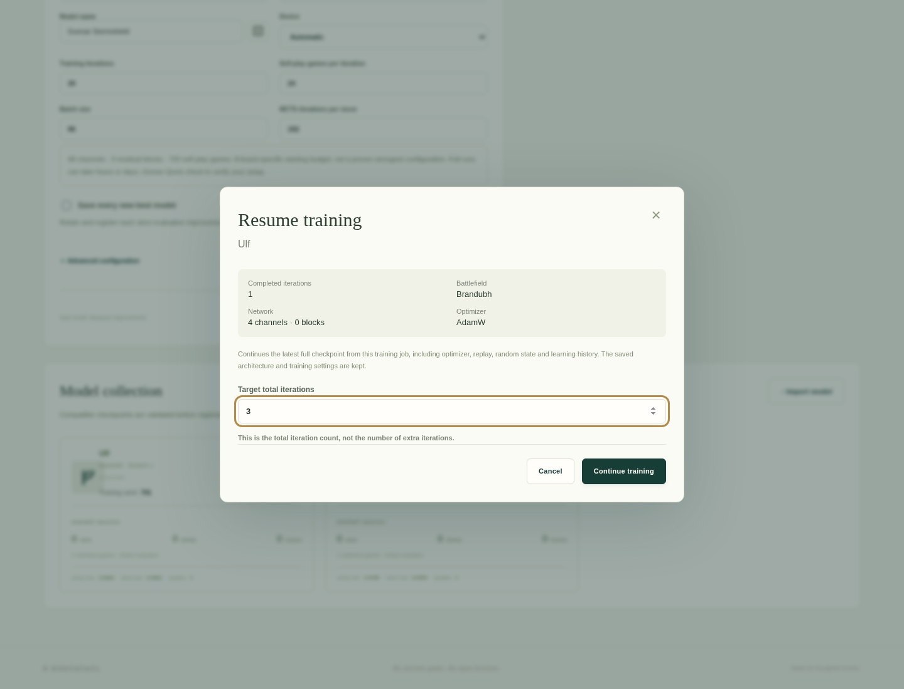

# Training data, checkpoints, models and migration

[Documentation index](README.md) · [Training](TRAINING.md) · [Backups](#consistent-backup-and-restoration)

A **job** owns a training lifecycle and retained outputs. A **checkpoint** is a
saved tensor file; only a full training checkpoint restores learning state. A
**model** is a separately registered inference copy available for play. Deleting
one collection does not imply deletion of the others.

## Application storage layout

`HNEFATAFL_DATA_DIR` selects the server's absolute storage root after resolution
(default `./data` relative to the server working directory). Web-managed paths are
server-owned; browser clients submit IDs, not arbitrary filesystem paths.

```text
data/
  hnefatafl.sqlite3       # games, players, jobs, tournaments, analysis, runes, workers
  jobs/<job-id>/          # web-managed training or tuning outputs
    config.json
    worker.log           # local subprocess stdout/stderr; remote reports retain log tails
    progress.json
    heartbeat.json       # bounded live phase/heartbeat snapshot between progress events
    last.pt              # once a full checkpoint exists
    best.pt
    inference.pt
    result.json          # on completion/cancellation when available
    best/iteration-NNNNNN.pt  # optional strict-best snapshots
  models/
    index.json           # inference catalog metadata
    <model-id>.pt        # registered, content-addressed checkpoint copies
  tournaments/           # separate browser tournament worker artifacts
```

Files vary with job kind, execution target and lifecycle; a queued or failed job
need not have a checkpoint/result. Tuning adds `study.sqlite3`, trial directories
and `best-config.json`. Remote jobs retain uploaded artifacts and server progress;
the worker's private work directory is separate. CLI output paths come from JSON:
for example `configs/train-smoke.json` writes `data/training-smoke`, outside `jobs/`.
`HNEFATAFL_DATA_DIR` configures the server; it does not rewrite CLI `output_dir` or
`registry_dir` settings.

The SQLite **jobs** table is the registry of web-managed jobs: columns `id`,
`created_at` and `data`. Kind, status, configuration and progress live in the
saved `data` JSON. The server lists those rows, then reads
owned files for reconciliation. Copying `jobs/<id>/` alone **does not register a
job**, and `models/index.json` is a model catalog, not the training-job registry.
Standalone CLI training likewise does not create a web job row. A model imported
into another installation is playable but does not import its source job.

## Monitoring, cancellation and resumption



This historical screenshot shows checkpoint review and target-total iterations.
The current dialog additionally exposes the editable settings described below.

In the workshop, select a stopped or completed job and choose **Resume from
checkpoint**. The dialog validates its full `last.pt`, shows the saved completed
iteration, ruleset, network, seed and optimizer, and lets you choose **Target total
iterations**. The target must exceed the saved completed iteration. All new-job
settings except the historical preset, ruleset, channels, blocks, seed, optimizer type
and Schedule-Free warm-up duration are editable,
initialized from the effective saved configuration rather than the current form.
The preset selector is available only for new jobs; resumption never reapplies a preset.
Learning rate, weight decay and SGD momentum reflect saved optimizer groups;
momentum does not apply to Adam or AdamW. Execution mode/concurrency/inference
batch size can change without replacing the retained learning state.

For [Schedule-Free AdamW](TRAINING.md#schedule-free-adamw), the saved model contains
averaged evaluation weights and the full optimizer keeps its internal `z` sequence,
second moments, warm-up counter, averaging history and evaluation-mode flag.
Loading the optimizer respects that flag before entering inference mode; training
then switches back through the upstream API without resetting history. Warm-up
duration is shown read-only; an imported conflicting duration is rejected with its
field name. Explicit base-rate/weight-decay overrides preserve all optimizer state.
The tensor-only format and 128 MiB limit are unchanged. Checkpoints and model exports
are placed in evaluation mode after recoverable optimization errors or cancellation.
If the optimizer's in-place mode transition itself fails, the live state is
explicitly unsafe and no replacement checkpoint/export is written. Its previous
valid checkpoint remains available, and the error retains the original cause plus
the restoration limitation. Resume that checkpoint into a fresh optimizer; do not
interpret a still-false upstream group flag as proof that every weight was restored.
Completed-iteration deterministic CPU continuation tests compare tensors with
`rtol=1e-6, atol=1e-7`, and compare optimizer scalar state/counters, replay, RNG and
non-timing history exactly. Wall-clock measurements are excluded. Cancellation
within an iteration retains completed minibatch updates, following the existing
resume semantics; it is not an exact mid-minibatch replay guarantee.

Model cards linked to a retained source job also offer **Resume training**.
This continues that job's **latest full checkpoint**, which may be later than
the selected best model's iteration; the dialog makes that iteration explicit.
Imported inference-only models without a retained full training checkpoint are
available for play but cannot restore optimizer/replay/random state.

Resumption starts a new job/output directory and preserves the original run.
The reviewed dialog and resume API also edit `training_symmetry_mode`. Checkpoints
that do not record it show and resume as `off`; switching to `random_d4` is a
deliberate, recorded change of the new job's effective configuration, and full
checkpoints add an optional `augmentation_rng` field (the replay itself remains
the original, untransformed positions; no format version change).
The API uses `GET /api/training/jobs/{id}/resume` for reviewed checkpoint metadata
and `POST` to the same route with `{ "iterations": <target total> }` to continue.
Optional editable training fields, including `self_play_mode`,
`self_play_concurrency` and `inference_batch_size`, override saved settings for
the new job on local or updated remote workers, using new-job validation.
It never accepts an arbitrary client checkpoint path or an architecture override.

**Import config.json** in the resume dialog applies the same parser on top of the
checkpoint-initialized values. Only editable parameters are overridden. The
ruleset, network channels, residual blocks, seed and optimizer remain fixed by the
checkpoint; an imported value that conflicts with them is reported as a kept
checkpoint setting rather than applied, and the target total iteration must still
exceed the saved completed iteration. Identifiers, paths, status fields and
metadata are ignored, so an imported file cannot replace the selected resume
source or bypass its compatibility checks. Importing never resumes a job by
itself, and a malformed or invalid file leaves the reviewed values unchanged.

To resume, keep the same ruleset, architecture, seed and optimizer and increase
`iterations` in a copied JSON configuration. This field is the target **total**
iteration count, not the number of additional iterations:

```sh
.venv/bin/python -m hnefatafl.cli train --config my-resume-config.json --resume data/training-brandubh/last.pt
```

The default tests verify resumed weights exactly match an uninterrupted CPU run
with the same settings. Hardware-dependent numerical determinism is not
guaranteed across CUDA versions or different devices. When a config explicitly
sets `learning_rate`, `weight_decay` or SGD `momentum`, it overrides that setting
after restoring the optimizer. Accumulated optimizer moments, momentum buffers,
replay, random state and learning history are retained. Unspecified optimizer
settings keep their effective checkpoint values.

The full `last.pt` also carries a cloned best-model snapshot and its original
metadata. Moving that one checkpoint to a new output directory preserves the
saved benchmark records and champion, even when later candidates are weaker.
`best.pt` and registry inference exports intentionally have no optimizer state and cannot be used for exact training resumption.

### Evaluation strategy changes and checkpoint migration

Choose Shield bearer, Jarl or Champion and the evaluation budgets when resuming,
for example from iteration 100 toward 200. Only these reviewed settings change;
weights, optimizer buffers, replay, RNG/scaler state, completed iteration, history
and model associations survive. CLI resumes also inherit saved inputs before
applying explicit overrides. Resume requires an explicit output directory whose
`last.pt` cannot overwrite the source checkpoint; it never inherits an old worker path.
Source checkpoints are read without modification.

New full checkpoints retain tensor format 1, add `extra.training_state_version: 2`
and a versioned `extra.evaluation_state`. It contains benchmark snapshots indexed
by protocol identity, a separate champion snapshot/provisional flag, promotion
records and the last evaluation. The existing tensor-only loader remains in use.
The historical `best_score`/`best_snapshot` fields retain baseline meaning and
cannot be overwritten by Jarl or Champion scores.

New full checkpoints may also carry `extra.adaptation_state` when optional online
learning-rate adaptation is enabled. It holds the algorithm name, state-schema
version, candidate set, effective rate, bounded learned predictors, a bounded
decision-event log and the controller's own random stream. It is JSON-finite and
size-bounded, travels with the full checkpoint through job archives and remote
artifacts, and is absent for jobs that never enabled adaptation. Resume validates
it atomically and resets only the controller state (with a visible reason) when
the candidate set, history window or evaluation settings changed, when the state
is malformed, or when its version is unknown; the model, optimizer and history are
never affected. State schema version 1 (the same learned contexts, the earlier
global exploration gate) migrates in place. Old checkpoints without the field load
unchanged.

Legacy iteration-100-style checkpoints migrate in memory: the saved baseline
best becomes a historical benchmark, and can initialize the first provisional
Champion incumbent. Legacy independent-game/iteration-derived seed results
have their own protocol identity rather than fabricated paired-match evidence.
Existing history is kept. No on-disk source rewrite or inference-only conversion
is required. New workers understand both checkpoint generations; update local
and remote installations together before sending new evaluation settings.
Portable job archives retain this state as part of the full checkpoint.

A cancelled evaluation records the already optimized iteration without a score
and saves its full state. Resume to a higher total target to continue training;
an unchanged candidate is not automatically reevaluated. Graceful cancellation
saves state; abrupt process termination still relies on the last atomic checkpoint.

## Checkpoints, registry, import and export

A completed **local training** run writes the files below. Remote jobs retain
uploaded full checkpoints and imported model copies, with reports stored in job
JSON; they need not mirror every local file. Tuning has its own study/trial tree.

- `last.pt`: full resumable state from the last checkpoint iteration.
- `best.pt`: compact selected fixed-benchmark best or accepted/provisional champion;
  ties keep the incumbent. It has no optimizer/replay state.
- `inference.pt`: compact weights plus model/training/evaluation metadata,
  without optimizer, replay or RNG state.
- `config.json`, `progress.json`, `result.json`: human-readable provenance.
- `heartbeat.json`: transient live monitoring state; refreshed about once per
  second and replaced by the next job, so it is not part of an exported job
  archive.

The compact model is automatically registered with name/version, ruleset,
architecture, date, configuration and metrics. Select that model in Human vs AI
or AI vs AI with any compatible [neural search wrapper](AI.md#neural-search-wrappers).

Registration is idempotent by **inference weights**. Every catalog entry carries a
fingerprint of the architecture and the model tensors; optimizer state, timestamps,
training configuration and evaluation metadata are deliberately excluded. Importing
a checkpoint whose weights already exist reuses the existing entry (and its stable
ID, rune and name) instead of copying the file or creating a second entry, so a run
that does not improve its best model adds no model and no checkpoint copy. The
training job still records its own `result.model` reference to the reused model and
flags `model_reused`; a run that does produce a genuinely different best registers a
new model normally. The same rule deduplicates repeated imports, identical resumed
runs and best-model snapshots that match an already registered model.

Catalog entries written before weight fingerprints existed are backfilled on the
next import (once, then persisted), so an upgraded installation still deduplicates
against its historical models. No database migration or file rewrite is required;
legacy `index.json` entries stay readable because the field is optional.

Before reusing a registered copy, the registry verifies its recorded integrity
hash and weight fingerprint. A missing, truncated or corrupted copy is restored
atomically from the validated incoming file only when its recorded weights match;
a valid copy with different weights is never overwritten. If a copy needs repair
and cannot be restored (for example during a job-archive import, which must roll
back completely), the import fails explicitly and leaves the registry unchanged;
re-import the model normally to repair it, then retry.

```sh
.venv/bin/python -m hnefatafl.cli models --registry data/models
.venv/bin/python -m hnefatafl.cli models --registry data/models --import data/training-brandubh/inference.pt --name "Brandubh experiment"
.venv/bin/python -m hnefatafl.cli models --registry data/models --export MODEL_ID --output exported-model.pt
```

The registry API/UI supports the same import/list/export workflow. Loading uses
`torch.load(weights_only=True)`, validates format/version, exact tensor shapes
and dtypes, finite values, architecture and ruleset, and rejects arbitrary pickle
objects. Imports have file and expanded-storage bounds; no unsafe loading
fallback exists. Keep full job checkpoints for resumption; compact inference
exports intentionally cannot resume an optimizer.

## Managing models and retained training data

Model cards show the recorded policy/value network width and residual depth,
snapshot iteration, self-play/search budget and optimizer settings. These describe
the saved snapshot rather than the current training form. Earlier imports can lack
training metadata; missing values are identified rather than inferred from today's
recommended plan. Tournament setup and saved reports use the same summary.

**Rename model** changes its catalog label while preserving its model ID, rune,
weights and original training metadata. New selections use the new name; existing
games and tournaments retain their recorded name snapshots. Checkpoint exports
still contain their original embedded name. Reimporting the same checkpoint into
the existing catalog keeps the chosen catalog name.

**Load training parameters** copies recorded, editable training settings into the
workshop form, including architecture and advanced settings. Review them before
starting a new run. This does not restore weights, optimizer or replay state; use
**Resume training** for that. Server paths and resume tokens are never copied into
the form. Unrecorded settings keep their current form values, with an explicit
notice. Models without any usable recorded settings cannot supply this action.

Select a saved job and choose **Delete training data** to remove its job record,
checkpoints, replay state, progress and logs after confirmation. Registered model
copies and existing game/tournament histories remain available. Deleting a source
job removes the ability to resume that source checkpoint. Stop a running worker
before deleting its data. Retained optimization studies protect their source
checkpoints, database owner and every contributing job's referenced trial/winner
checkpoints, including after completion, failure or cancellation. Deletion returns
HTTP 409 naming the dependent study/job; remove those dependencies first. An
unreadable database or unsafe reference also blocks deletion until repaired or
removed. The check reads bounded Optuna metadata, without loading model weights,
and never automatically deletes dependent studies.

For a study spanning several jobs, these references form a valid cycle: the owner
holds the database, while later jobs hold trial artifacts. Administrators can
choose **Delete entire tuning study** from any inactive member. The preview lists
the database owner, study identity (when recorded), every contributing tuning job,
their directories/statuses and external dependencies. Review it and explicitly
confirm all listed jobs. A changed scope requires a fresh preview and confirmation.
The operation removes their complete directories, including the SQLite study,
trial/full/objective checkpoints, replay buffers, results, history and logs.
Source training jobs, registered models, saved games and tournaments remain intact.

Internal group references do not block whole-study deletion. References from
**any retained external job**, including completed training continued from a
winning checkpoint or another study's source, do block it with HTTP 409. Remove
or explicitly rebase those dependencies first; deletion never cascades to them.
To retain an external completed run/study while detaching its old paths, export
and import it, verify its resumable checkpoints, then remove the original
referencing jobs. The importer consolidates required source dependencies locally.
Stop all participating jobs and workers first. Pending/queued jobs, actual local
processes, unfinished remote leases and a held CLI study lease are protected.
Unknown/corrupt metadata or unsafe/missing trial ownership must be repaired first;
there is no force option. Individual-job deletion keeps its existing safeguards.

Deletion uses the existing single API-worker job/catalog locks and study lease.
Complete directories are renamed on the same filesystem into
`jobs/.study-deletions/<operation-id>/` before one transaction removes all job rows.
A durable `manifest.json` journals the participating UUIDs. Before commit, failure
or restart restores quarantined directories; after commit, cleanup resumes there.
If cleanup cannot reclaim files immediately, the API reports `cleanup_pending`
and retries on the next deletion preview/operation or server startup. If rollback
cannot restore data, training reads are blocked until recovery succeeds. Retry the
preview after repairing filesystem access, or restart the server. Preserve the
quarantine and journal; mixed records, conflicting paths or invalid journals need
manual repair and fail closed. Filesystem and SQLite changes are recoverable,
not one atomic transaction; power-loss recovery also depends on filesystem and
storage durability. Stop unmanaged CLI writers before administrative cleanup.

The API provides `PATCH /api/models/{id}` with `{ "name": "New name" }` and
`DELETE /api/training/jobs/{id}`. These are separate from model deletion.
Whole-study operations use administrator-only
`GET /api/training/jobs/{id}/study-deletion-preview` and
`DELETE /api/training/jobs/{id}/study?confirmation_token=<preview-token>`.
Execution recalculates the group and dependencies under the locks; the preview
token never grants permission to bypass those checks.

### Detecting and cleaning up existing duplicates

Installations upgraded from an earlier release may already contain catalog entries
with identical weights. **Detection and deletion are separate steps.** Detection is
read-only and never deletes anything:

```sh
.venv/bin/python -m hnefatafl.cli models --registry data/models --duplicates
```

The command groups entries that share a verified inference-weight fingerprint. It
holds the registry lock for the scan, so concurrent imports cannot produce
inconsistent groups, and it never rewrites the index.

Removing a duplicate is an ordinary catalog deletion through
`DELETE /api/models/{id}` (or the UI model card). That endpoint only protects
**active** use: unfinished games, running tournaments and other live references are
previewed and must be explicitly discarded before deletion. It does not rewrite
history and does not look at retained job metadata.

Historical references are **not** protected. Completed and recorded games,
tournaments, evaluations and training jobs can keep a deleted model's ID and name
snapshot indefinitely; they stay readable because the ID is opaque and the name is
retained. Deleting a catalog copy therefore removes the playable weights while the
historical labels remain. This is intentional and is not a reason to rewrite IDs.

Before removing a duplicate:

- Inspect the groups and the model cards, and confirm the entries really share
  weights; a shared name or evaluation score alone is not identity.
- Check unfinished games and running tournaments with the deletion preview, and
  check retained jobs by their recorded `model_id`/`best_models` if those still
  matter for resumption or comparison.
- Keep at least one copy of any model you may still want to play or export.

Do **not** delete `models/<id>.pt` files by hand: the index, runes, game and
tournament references and the deletion/repair logic all assume the catalog is the
owner of those copies, and a stray file can be silently repaired or reused.
Registered model copies are separate from job `last.pt`/`best.pt` checkpoints, so
deleting a model never removes a training checkpoint. Do not rewrite or renumber
model IDs to "fix" duplicates either: IDs and runes are referenced by retained
games, tournaments, jobs and archives, and rewriting them would break those
references without freeing meaningful space.

Sometimes retaining historical duplicates is the better choice. Disk cost is one
copy per distinct weight, catalog entries are cheap, and a duplicate entry can be
the only link from a retained job to its playable model. Prefer deleting the job
or leaving the duplicate in place over an irreversible cleanup that breaks a
record you may still want to inspect. There is no automatic historical cleanup and
no broad reference migration.

If a registered copy is missing or corrupted, do not delete the entry to hide it:
re-import a valid copy of the same weights (outside any archive import) so the
existing ID, name, rune and references are repaired in place.

## Moving data between installations

In **AI Workshop → At the forge**, select an inactive job and choose **Export job**.
Transfer the `.tar.gz` to another computer, open its workshop and choose **Import job**.
The file picker also accepts previously exported `.zip` jobs; format is validated
from the contents, independently of the filename.
The imported job opens with its configuration, learning graphs, evaluation and
performance history. Ordinary training inference models join the normal collection for
games and tournaments; tuning trials retain study-local artifacts without creating
permanent playable models. Existing jobs and models are kept; repeated imports create
new job IDs and deduplicate model content, preserving existing catalog names.

New exports use **schema 3**, a deterministic USTAR archive compressed once with
gzip level 1. Its layout separates bounded metadata from growing histories:

- `manifest.json` identifies the archive/application versions, original job,
  model associations, logical JSON documents and their ordered chunk references.
  Every physical member has a byte count and SHA-256 checksum.
- `job.json` holds the small sanitized job identity/status/timestamps/provenance.
  The manifest's `job_fields` maps configuration, progress, results, metrics and
  logs to logical documents named `metadata/<field>.json`.
- `data/<sha256>.json-part` stores at most 1 MiB of canonical UTF-8 JSON. A logical
  document's chunks concatenate into the complete JSON text; a boundary may split
  a UTF-8 character. Equal documents/chunks share one physical copy, including
  repeated database and file reports. No history is sampled, truncated or rounded.
- Checkpoints, `best/` snapshots, associated inference copies in `models/`, worker
  logs and owned tuning databases keep their established artifact names. JSON
  artifacts such as `config.json`, `progress.json` and `result.json` are logical
  documents reconstructed under their ordinary filenames during import.

The 16 MiB metadata guard now applies to the manifest and small job record.
Individual reconstructed JSON documents can use the existing 128 MiB artifact
budget. This allows thousands of iterations within the documented resource limits.
Database reports and file reports remain distinct when their contents differ.
Only known job-owned artifact types are transferred. Runtime ownership, worker
credentials, leases and server paths are stripped; recognized credential assignments
and paths in logs are redacted. Tensor values, optimizer/replay/RNG state and
training precision survive; sanitization and reference rebasing can change a
checkpoint's serialized metadata/bytes. Treat archives as private training data and
review custom diagnostic log text before sharing.

Recognized credential values in diagnostic strings and worker logs are replaced
with `[redacted]`, retaining their assignment labels and ordinary quoting.
This includes password/token/secret/credential/API-key assignments, JSON-style
quoted keys, environment assignments, and Bearer/Basic authorization values.
Single/double quoted values may contain spaces, Unicode, escaped quotes,
backslashes or newlines; serialized JSON quote escaping is handled too. Simple
unquoted values end at unescaped whitespace or punctuation. Structured credential
keys are still removed from metadata, and recognized absolute paths are redacted.
Portable `job://` references keep their path semantics and use the same credential
filter, so a reference-looking diagnostic cannot bypass it.

Log sanitization retains state across reads of at most 65,536 characters, without
buffering complete lines, keys, paths or credential values. Unterminated quoted
credentials and malformed/deep credential containers fail closed through the rest
of the log; unknown authorization schemes consume the rest of their header line.
The cleaned log must still fit the existing artifact byte limit. These are
heuristics for recognizable scalar assignments/headers, not a general secret
detector or a complete shell-language parser. Custom labels, unlabeled secrets,
arbitrary encodings and fragments already leaked by older exports may not be
recognizable. Credential-like labels can also cause extra redaction. **Archives
containing arbitrary diagnostics must still be treated as potentially sensitive**;
review them before sharing. The [security-review measurements](benchmarks/job-archive-security-review.md)
cover long-log CPU time, bounded working memory and concurrent training.

Inactive job files and a consistent SQLite study backup are pinned under
lifecycle/catalog locks. Model references are then discovered from metadata,
reports and checkpoints outside those locks; only the required registered models
are pinned under the registry lock. The initial snapshot retains the atomically
replaced catalog index without decoding it under global locks. If a referenced
model present in that index disappears before pinning, export fails with HTTP 409
and an actionable retry message. Optional models absent before capture remain
historical references; frozen opponents remain mandatory and content-validated.
Cross-filesystem snapshots stage private hard links on the source filesystem,
outside deletable job directories, and copy after releasing the locks. This keeps
descriptor use bounded even with more than 1,000 artifacts. A filesystem unable
to establish those safe pins fails explicitly rather than reading mutable paths
later. Serialization, study migration
and compression use FastAPI's existing request thread pool. Normal training and
persistence do not change.
The server admits one archive operation at a time, before parsing an import's
multipart body. Competing imports and exports receive HTTP 409 with a retry
message and `Retry-After` header, without staging another upload or waiting in a
request-worker queue. Existing upload and multipart size limits still apply.
Capacity remains reserved through response streaming and until an abandoned
worker finishes cleaning up. Snapshot files, upload spools and partial archives
are cleaned up on failure or cancellation; downloads remove their temporary
output even after a disconnect. Decompression and validation also run outside
lifecycle locks; publication remains transactional under the existing locks.
The existing loading indicators stay active until the request finishes.
See the [archive benchmarks](benchmarks/job-archives.md) for measured tradeoffs
and the [review benchmarks](benchmarks/job-archive-review.md) for catalog,
concurrency and large-history comparisons against the initial schema-3 PR.
The [second-review measurements](benchmarks/job-archive-second-review.md) compare
model lifecycle protection, bounded descriptors and real HTTP/browser imports
against commit `9b58c884`.
The [final compatibility review](benchmarks/job-archive-final-review.md) repeats
the large-job HTTP/browser measurements with explicit workshop summary requests.

Schema-3 imports preserve distinct database and file reports. Full job views and
the default full import response read the retained files; navigator summaries use a bounded
projection cached once at import, without reopening large histories on refresh.
The cache contains counters and small report/metadata maps, never another full history.
Retained best-model associations contain only unique model IDs, so the existing
model-name search works for imported and deduplicated models. Scalar/map projections
retain their 32 KiB budget; model associations separately retain at most 2,048
24-character IDs, matching the archive member ceiling. Deleted references do not
match unrelated catalog models. Full reports keep complete best-model metadata.
SQLite replaces those imported fields before decoding navigator rows in Python;
renames and other live job metadata still come from the current row.
The original database reports remain available for lossless re-export. Genuine
[historical ZIP fixtures](../tests/fixtures/job_archives/README.md) exercise both
legacy schemas and full checkpoint resumption.

`POST /api/training/jobs/import` returns HTTP 201 with the complete imported job
by default, preserving the existing API contract. `?summary=false` explicitly
selects the same complete response. `?summary=true` returns a compact job object:
`summary: true`, the new `id`, status, configuration, resume/checkpoint information,
model associations and bounded progress. Both TAR.GZ and legacy ZIP imports use
the same response selection.

The workshop explicitly requests `POST /api/training/jobs/import?summary=true`,
immediately selects the job and uses its existing on-demand detail loader, showing the localized
**Loading history…** state while loading. Pending requests are shared; a completed
detail is retained through ordinary navigator refreshes, including nested metrics,
evaluation/performance data, tuning metadata and histories. New summary counters,
status and timestamps still update the selected view. Complete reports remain
available at `GET /api/training/jobs/{id}`.
Run and model identities define which detail can be retained: missing run IDs are
legacy-compatible only when both reports lack them; one-sided/different IDs replace
run-specific reports. Known trial changes replace only the trial snapshot, keeping
cumulative study history. Compact imported reports reserve run/trial/model IDs
before optional diagnostics use their existing budget. Same-ID model projections
keep omitted attributes; changed, unknown or removed models cannot inherit another
model's name/path. A detail response from a former identity triggers at most one
immediate retry through the existing loader. Continued identity churn leaves the
loading state and a localized refresh error, rather than mixed history.
This response optimization changes neither stored histories nor the archive format.

Import validates inventory, checksums, bounded JSON and tensor-only checkpoint
compatibility in staging, then registers models, publishes a fresh job directory
and inserts its SQLite row. Controlled failures roll back new files/catalog entries.
It never starts training or restores a foreign PID, worker lease or queue assignment.
The job stays completed/cancelled/failed and defaults to local execution; original
job identity, timestamps and local/remote execution remain historical provenance.
Original resume dependencies are detached: the full checkpoint carries its own
optimizer, replay, RNG and portable best-model state.

**Resume from checkpoint** uses the same checkpoint-review API as ordinary jobs.
Only a full compatible `last.pt` or tuning `objective.pt` is resumable; `best.pt` and inference-only imports
remain playable without being advertised as full training state. Resumption creates
a new job and leaves the imported source unchanged. CUDA-trained checkpoints load
on CPU; select **CPU** or **Automatic** in the resume dialog on a CPU-only machine.
The original device setting remains visible. As in new training, the resume
dialog disables CUDA or Metal options this server cannot provide. A specific
remote worker disables the accelerators it lacks, while **Any remote worker**
keeps every option enabled so the queue selects a worker with the requested
device. Cross-device bitwise reproducibility and model strength are not implied
by a successful migration.

### Optimization studies and archive limits

Schema **3** retains the format-2 tuning layout: archives consolidate a single persistent `study.sqlite3`
and globally numbered `trial-N/` folders from **every contributing job** in the
same owned job store. `study-artifacts.json` records the original database owner,
contributing jobs and each trial's selected/full/final checkpoint references.
The source full checkpoint is included as `dependencies/source/last.pt`;
registered fixed opponents travel in `models/`. SQLite backup takes a consistent
snapshot; every contributing job must be inactive. The archive inventory checksums
all artifacts. External database/checkpoint paths, missing required trial/source
files, symlinks and executable SQLite objects are rejected explicitly.

Every required frozen opponent must be present, loadable in the supported safe
format, compatible with the study's ruleset and identical to its saved content pin.
Export rejects missing, changed or unverifiable opponents and identifies the model;
it cannot silently produce an incomplete portable study. Import checks the required
model inventory and pins before publication, preserves model-ID rebasing and
deduplication, and never replaces an existing registry file. A failed import rolls
back newly registered models and job data. Ordinary training exports still allow
missing historical inference copies.

Import validates/stages the entire inventory, then consolidates artifact ownership
under one fresh job ID and rebases all trial checkpoint references, configuration,
source dependencies and immutable model references. Trial numbers, scores and
historical rankings do not change. Even exporting an earlier owning job projects
the current database winner/history into the archive, leaving original result
files unchanged. A held-out result for an earlier winner remains historical,
rather than being attributed to the new winner. Full `objective.pt`/`last.pt` files preserve
optimizer, replay, RNG and training history. Only required frozen opponents are registered for tuning imports; legacy trial
inference artifacts do not populate the permanent registry. Study content identity and resumption checks remain active.
Ambiguous legacy studies can be imported for inspection/export, but cannot acquire
compatibility from the new requested configuration. Legacy frozen-opponent archives
need reliable saved content pins to pass dependency validation; absent pins must
not be inferred from whichever model is currently registered. Formats 1 and 2
remain importable with that evidence.

For example, export the most recent inactive resumed study job, import its TAR.GZ,
select **Resume study** to add comparable trials, or **Continue winning trial**
to create ordinary training from its full objective checkpoint. The original jobs
are untouched; the imported job owns the consolidated artifacts and later resumed
jobs may contribute further global trial numbers. Re-exporting includes them too.
Missing frozen registry dependencies are reported before further trials can launch;
restore the exact content or start a new study. Normal training resume dependencies
are detached because its full state is self-contained; checkpoint-based tuning
keeps its source dependency explicitly for repeated comparable branching.

Only inactive jobs can be transferred. Remote jobs include artifacts already
uploaded to the server, not unuploaded worker-private files; their original worker
need not exist on the destination. Limits are 512 MiB uploaded/compressed,
1 GiB of physical extracted files **and** 1 GiB of reconstructed logical data,
2,048 physical members, 128 MiB per artifact/logical JSON document, and 16 MiB
per manifest or small job record. JSON nesting, field/list counts and string sizes
also remain bounded. Deduplicated references count in full toward the logical
size budget, so repeated chunks cannot bypass it. TAR parsing bounds the entire
decompressed stream, including headers and trailing padding. A compression-ratio
limit would reject legitimate repetitive histories/tensors; TAR.GZ therefore uses
these absolute byte/count bounds. Legacy ZIP imports retain their 16 MiB per-JSON
and 200:1 per-entry ratio guards.

Imports manually copy regular members into isolated staging; they never call
`extractall`. Unsafe paths, symlinks, hard links, devices, directories, sparse and
extended TAR headers, encrypted ZIPs, duplicate/conflicting members, invalid JSON,
checksum failures and unknown artifact types are rejected. Missing optional files
are allowed; unsafe/incompatible files that are present are rejected explicitly.
The writer uses only ordinary USTAR files, so extended TAR headers are unnecessary.

Schema **3** is independent of application version, but older applications cannot
read it. This importer also accepts legacy ZIP schemas **1** and **2**. The
destination must support the checkpoint architecture, training settings and
(for tuning) Optuna schema 12. Future unsupported schemas/configurations are
rejected; renaming an arbitrary file does not make it an archive. No database
schema or remote-worker protocol migration is needed.

| Goal | Supported approach | What it preserves |
| --- | --- | --- |
| Play an existing model elsewhere | Export/import a compact model through UI or CLI | Weights and embedded provenance; no job or optimizer/replay state |
| Move a web training job to another installation | Export/import its job TAR.GZ in the workshop (legacy ZIP imports supported) | Registered job, available history/checkpoints/models, full-state resumption when available |
| Continue training headlessly elsewhere | Copy a validated full `last.pt`; resume with a matching JSON config in a new CLI directory | Learning state; no automatic web-job registration |
| Relocate an entire installation | Consistently back up/restore the whole data root with compatible code | All SQLite records, identities and owned model/job files |

Manual copying into `data/jobs/` does **not** insert the required SQLite job row.
Use the archive importer for individual web jobs; importing a model alone does not
restore its training job. Full-instance backups remain separate from merging jobs
into an existing installation.

## Consistent backup and restoration

1. Stop new submissions and gracefully stop local training/tournaments. Stop or
   quiesce enrolled remote workers too: their uploads and leases are writes.
2. Stop the API/service and confirm all owned writers have exited. Archive the
   **entire** data root together, preserving permissions. Protect the archive:
   it contains private histories, model data and worker credential hashes.
3. Verify the archive can be read. Keep the matching application version and
   any external CLI/Optuna output directories; these may live outside the data root.
4. Restore into an empty, isolated destination with a writable service account.
   Never overlay an unrelated installation's live SQLite/model catalog.
5. For the safest relocation, retain the original absolute storage path. Saved
   job configuration, embedded training metadata and study URLs can contain absolute paths;
   copying the root to a different path is not an implemented path-rebasing tool.
   Test all retained-job resumes/model loads before retiring the source. If a path
   must change, treat unresolved references as a migration task, not a ready restore.
6. Start one API process with the restored `HNEFATAFL_DATA_DIR`. Check health/schema,
   saved games and legal replay, model listing/loading, job list/checkpoints and
   rune continuity. Test a resume into a **new** job on a disposable restore before
   relying on the backup. Interrupted jobs do not automatically continue locally.

Never copy only the live `.sqlite3` file while WAL writes continue. SQLite's backup
API can create a consistent **database** snapshot, but does not synchronize model,
checkpoint or study files; a full-instance backup still needs coordinated writers.
Restoring also restores worker credential hashes. Coordinate worker endpoints and
credentials so a test restore cannot claim live production work; avoid running two
servers against the same worker ledger/storage.

For upgrades and rollback, see [Deployment](DEPLOYMENT.md#updating). Schema upgrades
are additive but older code can reject a newer schema; rollback uses the matching
pre-upgrade **database and files**, not just an older executable.

Schema 11 adds independent online authority and the rating pool. Use the
[online recovery procedure](ONLINE.md#migration-backup-and-recovery) as well:
compatible updater restores retain live accepted online moves/results, revoke
capabilities and audit/pause timeouts; snapshot-only recovery cannot reconstruct
post-backup progress. Cross-online-schema rollback is refused. Quiesce all online
writers and pause the timeout gate before maintenance; inspect it before resuming.

## Troubleshooting retained data

- **Directory exists, job missing:** the SQLite jobs registry was not moved, or the
  run was CLI-only. Use a job archive exported from the original installation, model import or CLI resume; folders are not scanned automatically.
- **Model plays but Resume is unavailable:** an inference export has no full state,
  the source job was deleted, its `last.pt` is missing/unsafe, or the job is active.
- **Resume starts later than a selected model:** model-card Resume uses the source
  job's latest full checkpoint, not the best model's earlier snapshot.
- **Cleanup is blocked:** stop active users; review shared-study/resume dependencies
  and model references instead of deleting files beneath a live worker.
- **Checkpoint exceeds 128 MiB:** reduce future replay/network budgets. Do not disable
  safe-load limits or use unrestricted pickle loading to bypass validation.

## Recorded self-play provenance

Progress JSON and model/checkpoint metadata may contain `self_play_games`:

```json
{"version": 1, "job": 2000, "baseline": 4000, "cumulative": 6000}
```

`job` counts committed generated self-play games in this execution; `baseline`
is the actual cumulative counter loaded from its input checkpoint (zero for a
new run). `cumulative` is their sum. Unknown counters are `null`, distinct from
zero. The legacy `games_generated` field retains its cumulative meaning and is
`null` when the lineage baseline is unknown. Old full checkpoints with a valid
`extra.games_generated` supply a reliable baseline; budgets never supply one.
Old inference-only exports without counters remain unknown. There is no automatic
scan of old training folders or alteration of registered checkpoint bytes.

Counters publish during self-play and persist in normal, cancelled and failed
full checkpoints. A resumed execution starts a new job counter from zero; it
does not add the source job's local contribution again. Model-selection snapshots
capture counters alongside their weights. Best-model exports keep that snapshot's
count rather than the final job total. Job archive migration and inference exports
preserve recorded metadata; an old full checkpoint's actual cumulative counter is
also retained when exported as an inference model. Remote progress and validated
artifacts carry the same optional fields. Tensor format and database schema remain
unchanged. See [dashboard count semantics](TRAINING_DASHBOARD.md#recorded-self-play-totals).

## Optional OpenVINO inference

See [Inference backend portability](OPENVINO.md) for opt-in setup, defaults, checkpoint portability and measured limitations.
