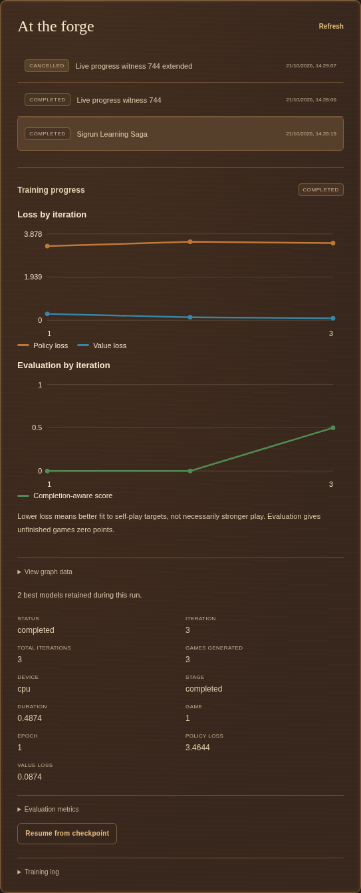

# Training plans by battlefield

The workshop defaults to a **recommended, ruleset-specific starting experiment**.
These budgets are chosen from board geometry and the existing learning pipeline.
They have not won a comparative benchmark and are not a claim of strongest play.
Full runs can take hours or days, especially on CPU. Use **Quick check** for a
small real self-play/update/evaluation run before committing a larger budget.
The beginner and balanced presets remain available, and every field is editable.

| Ruleset | Board | Channels / residual blocks | Iterations × games | Search visits / time ceiling | Replay positions | Evaluation games / visits / move limit |
| --- | --- | --- | --- | --- | --- | --- |
| Brandubh | 7×7 | 32 / 2 | 20 × 16 | 128 / 2 s | 8,000 | 12 / 64 / 300 |
| Tablut, market rules | 9×9 | 48 / 3 | 30 × 24 | 192 / 3 s | 12,000 | 16 / 96 / 500 |
| Copenhagen | 11×11 | 64 / 4 | 40 × 32 | 256 / 4 s | 20,000 | 20 / 128 / 800 |

The time ceiling can end search before its visit budget. Record actual hardware
and budgets when comparing runs. Self-play move limits are 200, 300 and 500,
respectively; unfinished games bootstrap a network value and remain distinct from
rules draws. Evaluation gives unfinished games zero points and reports them.

## Features and network structure

The six input planes encode attackers, defenders, king, defender-to-move, throne
and restricted corners. Tablut has no restricted corner plane because its king
escapes at edges. Each ruleset gets a separate model and checkpoint: edge escape,
corner escape and Copenhagen capture/fort rules are learned from that engine's
legal positions and outcomes rather than mixed into incompatible training labels.

The existing residual convolution trunk uses a 3×3 input convolution and two 3×3
convolutions per block, with GroupNorm and SiLU. Its nominal receptive field is
`3 + 4 × blocks`: 11, 15 or 19 cells for the plans above. This covers each board,
allowing local capture patterns to combine with king escape lanes and distant
siege structure. Wider channels on larger boards provide capacity for different
patterns. Residual connections help gradients reach early layers; GroupNorm also
works with small batches. This is a capacity choice, not proof that every learned
feature has the stated interpretation.

The source/destination attention policy head scores legal move pairs. MCTS visit
distributions train that policy using masked cross entropy. A separate value head
learns defender-perspective returns with mean squared error; attackers reverse the
perspective during search. AdamW and gradient clipping regularize the update.
Learning rates are 0.001, 0.0007 and 0.0005; epochs per iteration are 2, 3 and 3.
Larger replay buffers mix older and newer positions rather than repeatedly fitting
one short game. Opening temperature and Dirichlet noise diversify self-play, with
noise alpha 0.3, 0.2 and 0.15 as the branching space grows. These plans do not enable
[symmetry augmentation](TRAINING.md#training-symmetry-augmentation), which is an
explicit opt-in, and add no hand-labelled tactical curriculum.

## How to establish a better configuration

Start with the corresponding plan, inspect completed-game fraction and learning
curves, then vary one capacity/search/learning-rate choice or use Optuna. Keep
evaluation opponents, move budgets, hardware, seeds and side balance comparable.
Choose one evaluation opponent per training job, then confirm promising models
in separate larger tournaments with held-out seeds. See
[evaluation selection](TRAINING.md#evaluation-and-model-selection). A lower loss only
means a better fit to current self-play targets; a high small-sample win fraction
is not reliable evidence of general strength. Persistent truncation calls for a
longer game/evaluation budget and investigation before interpreting a score.

## Live history and best models

For checkpoint formats, model registration, resumption and cleanup, use the
[training data guide](TRAINING_DATA.md). For execution/batch settings and throughput
interpretation, see [Performance](PERFORMANCE.md). These do not change the plans'
learning targets below.

The [running-worker view](screenshots/training-running.png) shows the graphs
updating before a run is complete.

The progress panel plots policy/value losses and the completion-aware evaluation
score against completed iterations. The graphs refresh while the worker runs;
numeric graph data remains available in an accessible table. Evaluations skipped
by a frequency setting remain missing, not fabricated as zeros. Iteration history
is saved in progress and in the resumable `last.pt`, so reopening a job or resuming
training keeps its earlier curve.

**Save every new best model** is optional and off by default. A strictly higher
score within the same fixed benchmark, or an accepted champion promotion, writes
`best/iteration-NNNNNN.pt` and registers that
inference snapshot immediately. Ties do not create extra retained models. The
usual selected best model and resumable `last.pt` still exist; ties retain the
earlier incumbent. Different benchmark configurations remain separate. Retained
snapshots include their actual iteration and
evaluation metadata and can be selected, exported or deleted separately. Earlier
job checkpoints remain on disk when a model registry entry is deleted. Resumption
retains the history and prior best-model references; moving only `last.pt` carries
the portable best snapshot, not all earlier separately retained model files.
