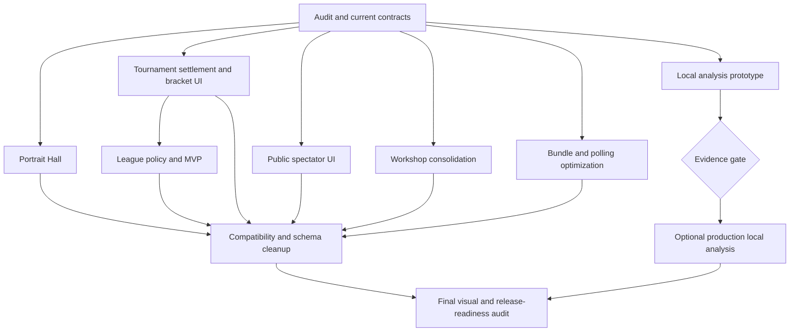

# Arena completion audit and implementation plan

Baseline: `2579a86b82ed1eca91f39e7d8064196597e873ed`, merged PR #84, audited
2026-11-15. This is the first delivery in the completion program: findings,
dependencies and acceptance gates, **not a claim that the missing features ship**.
[Current contracts](arena-v2-contracts.md) · [Release readiness](../RELEASE_READINESS.md)

## Audit method and phase terminology

Reviewed AGENTS, README, ARCHITECTURE, DESIGN_SYSTEM, the handoff implementation
plan, source routes/services/DTOs/tests/assets, and merged PRs #73–#84. Source
presence and an existing test are evidence of implementation, not a new test pass.
The handoff uses waves 0–5; the old contract uses phases 0–4. This report uses the
latter: 0 contracts, 1 shell, 2 APIs, 3 player UI/Workshop, 4 competitions. A wave
number is not proof that an entire phase is complete.

| Merged PR | Delivered authority / UI | Remaining scope |
| --- | --- | --- |
| #73 | Initial architecture contract | Reconciled by the current contract; many old “reserved” APIs now exist |
| #74 | Persisted private local 1v1 and indexed category reads, schema 16 | UI delivered later in #81 |
| #75 | Theme/shell foundation and Play resume/history fixes | Final four-theme sidebar/artwork delivered in #84 |
| #76 | Applied-ledger rating history and rated streaks | Login/activity streak deliberately excluded |
| #77 | Correct online game ID/history reconstruction for completed analysis | Does not provide live assistance or browser analysis |
| #78 | Achievement/portrait authority, schema 17 | No Portrait Hall or claim/select frontend |
| #79 | Real rating chart, local statistics and richer leaderboard | Public player portrait rendering incomplete |
| #80 | Human double elimination, real online legs, schema 18 | Backend-only; explicit settlement required |
| #81 | Unified Play, local mode, private replay and authenticated discovery | Public UI not included |
| #82 | Public read-only online APIs, safe portrait IDs and rate limits | Signed-out frontend not included |
| #83 | Category-aware Hall filters, URL normalization and docs | Preserve assertions while removing obsolete adapters deliberately |
| #84 | Four-theme Arena shell/art, scale, first paint, Dashboard correctness and contrast | Placeholder destinations remain; Workshop completion not claimed |

Historical PR descriptions/results remain historical. The audit does not relabel
their test runs as fresh evidence.

## Verified Phase 0–4 feature matrix

Statuses: **UI** = implemented and exposed; **Backend** = implemented only in
backend; **Partial** = some required behavior exists; **Missing** = no production
implementation; **Deferred** = intentionally excluded pending policy/evidence.

| Phase | Capability | Status | Source evidence and remaining work |
| --- | --- | --- | --- |
| 0 | Shared engine, privacy, separate Arena/AI competition authority | UI | `engine.py`, `auth.py`, `player_tournaments.py`, `server.py`; do not duplicate rules or weaken permissions |
| 0 | Current architecture contract | Partial | Old contract still described future APIs/modes; reconciled in this documentation PR |
| 1 | Four themes, original artwork, safe asset mapping | UI | `appearanceCatalog.json`, `arenaAssets.ts`, `arena-themes.css`, committed `arena-final` screenshots |
| 1 | First-paint/version-2 preferences and CSS viewport scale | UI | `appearance-init.js`, shared catalog generator, `Appearance.tsx`; old-mode normalization still present |
| 1 | Persistent desktop shell, mobile navigation, EN/DE | UI | `ArenaShell`, sidebar/top bar, existing browser suites; add every new destination through shared shell |
| 2 | Local 1v1 backend/private replay, separate statistics | UI | `server.py`, `personal_api.py`, `LocalStatistics`, `PlayModes`; schema 16 |
| 2 | Online creation, clocks, side swaps, version guards | UI | `online_core.py`, `online_api.py`, `Online.tsx`; reuse for all competition games |
| 2 | Applied Elo history, corrected/voided results, rated streaks | UI | `online_ratings.py`, `progression.py`, `RatingHistory`, `PersonalStatistics` |
| 2 | Public online list/detail/completed replay | Backend | `public_api.py` three GET routes, filters and cursor, safe profiles/portraits, no private games |
| 2 | Achievement catalog/progress/confirmation/selection | Backend | `progression.py`, `progression_api.py`, `profile_api.py`; GET never awards; schema 17 |
| 2 | Double-elimination tournament domain | Backend | `player_tournaments.py`, `player_tournament_api.py`, schema 18; byes, reset, revisions and audited moderation |
| 2 | Automatic tournament advancement | Missing | `_advance` invoked by start/settle/override/rebuild only; no result consumer in server lifespan |
| 2 | Durable UTC-day login/activity streak | Deferred | No ledger in schema 17; rated streaks are a different implemented feature |
| 3 | Dashboard hero, selected portrait, authoritative totals | UI | `PersonalDashboard.tsx`, `DashboardCountdown.tsx`; seconds resolution and account guards |
| 3 | Portrait Hall, progress, claim/select, unlock feedback | Missing | `sidebarNavigation.ts` placeholder, no frontend confirmation/selection call |
| 3 | Profile portrait and gallery links | Partial | `ProfilePage` DTO contains portrait ID but no portrait gallery/selection; Dashboard card lacks link |
| 3 | Shared published portraits across player surfaces | Partial | Public API supplies effective selection; authenticated online/leaderboard/tournament projections do not |
| 3 | Signed-out discovery/live spectator/completed replay | Missing | `main.tsx` wraps entire `App` in `Auth`; signed-out users receive account forms |
| 3 | Existing Workshop training/tuning/resume/models/workers | UI | `Training.tsx`, `TrainingJobs`, `ModelCollection`, `RemoteWorkers`; preserve all parameters and operations |
| 3 | Workshop visual consolidation and long-list scaling | Partial | Existing tabs/disclosure/filters work; dense layout and unbounded filtered job list remain |
| 3 | Route/feature bundle splitting | Missing | Eager imports in `App.tsx`; measured single JS entry ~1 MB |
| 3 | Shared/adaptive/hidden-tab Dashboard query state | Partial | `useOnlinePoll` has per-hook cancellation/epochs/backoff; no shared cache and hidden timers still run |
| 3 | Correct singular status string | Missing | `PersonalDashboard` formats `{count} games await your move` for count 1 too |
| 4 | Human tournament discovery/registration/details/admin UI | Missing | No player-tournament frontend route; `/tournaments` is AI Workshop |
| 4 | Hierarchical upper/lower/final/reset bracket | Partial | Backend grouped rounds exist; no UI and projection omits persisted source edges/portraits |
| 4 | League policy, schema, seasons, queues, results, UI | Missing | No league service/API/migration; tier artwork and placeholder are not gameplay |
| Cross | Production browser-local classical analysis | Missing | Only isolated `spikes/browser_offline` proof, server-only production hook |
| Cross | Browser neural execution | Deferred | No real-model ONNX/ORT parity, masking, memory or strength benchmark |
| Cross | Release security/backup/deployment evidence | Partial | Existing controls/docs/tests; fresh deployment/load/recovery drill not performed |
| Cross | Distribution license and third-party notices | Missing | No top-level LICENSE/NOTICE; owner must choose license |

Phase 0 is implemented but its documentation required reconciliation. Phase 1 is
implemented. Phase 2's major domain APIs exist, but automatic tournament settlement
is missing and activity streaks remain excluded. Phase 3 and Phase 4 are not
complete. Original F2's public-search UI was not delivered by #81 or #82.

## Priority and dependencies

1. Complete Portrait Hall using existing authority; no schema work needed.
2. Add durable server settlement and safe bracket edges, then complete tournament
   UX. A browser must never be required to advance official results.
3. Add public entry before Auth and typed credential-free GET adapter; reuse board
   rendering without advisor/mutation controls.
4. Consolidate Workshop presentation while preserving existing functionality.
5. Implement the documented league policy using online result authority.
6. Measure and reduce initial bundle/request work; can begin alongside independent
   UI after the baselines below are recorded.
7. Benchmark local classical analysis separately; integrate only after evidence.
8. Remove compatibility incrementally with a tested data-recovery path; finish
   visual QA and release-readiness audit last.



All implementation PRs target current main and remain independently reviewable.
The owner merges; dependent work rebases after dependencies land. No worktree or
shared-branch rewrite is needed. Do not stack all work into this audit PR.

| PR / owner boundary | Owned files and API seam | Acceptance evidence |
| --- | --- | --- |
| Audit | Current contracts, feature matrix, readiness checklist | Documentation links, source/PR evidence, truthful fresh/historical measurements |
| Portrait Hall | New gallery/domain DTO/CSS/tests; integrator owns App/sidebar/Profile/Dashboard/DE strings | Four states, authoritative progress/claim, idempotency, immediate owner-scoped selection, account switch, all themes/keyboard |
| Human tournaments | Tournament service/adapter/result settlement/schema owner; new tournament UI/CSS/tests | No-browser/restart settlement, revisions/disputes, byes, reset, concurrency, readable graphical/list bracket, admin grants |
| Public spectator | New public root/API/types/read-only views; entry owner owns main/Auth boundary | Auth service failure must not block signed-out browsing, cursors, privacy, no advice/mutations, real terminal replay |
| Workshop | Training/Tournaments presentation and route-owned styles; avoid engine/training algorithm edits | Existing create/resume/tune/import/export/model/worker operations; long-list and chart readability |
| Leagues | One policy/schema/online-result owner, league UI and admin adapters | Queue races, pair caps, correction/void replay, rollover/restart, no AI, indexed bounded reads |
| Performance | Lazy route boundaries and shared poll state; coordinate App integration separately | Build budgets, request traces, hidden-tab tests, account cancellation, multi-client/query plans |
| Local prototype | Spike, bridge/worker/result types and reproducible fixture/benchmark harness | Current engine differential proof, startup/search/strength/IPC/cancellation/memory, no production default |
| Local integration | Optional executor UI/worker package/CSP/notices only after prototype gate | auto/local/server/disabled, bounded scheduling/cache, explicit fallback, unsupported devices, no online assistance |
| Cleanup | Canonical types/routes/services, safe schema baseline and backup inventory | Per-removal justification, fresh install, development fixture backup/restore and checkpoint parity |
| Final QA | Shared design tokens, visual matrix, release report | All major surfaces, all themes, EN/DE, zoom, permissions, measured capacity and deployment drill |

Only one integrator edits shared routing/navigation/locale files at a time.
Independent agents may own new components/services; the integrator applies route
extensions on each focused branch. Never allocate conflicting migration numbers.

## Tournament reliability contract before UI completion

`OnlineCore._persist` writes authoritative result revisions in the caller's write
transaction. Enqueue the linked tournament durably there on completion/correction/
void, using indexed leg-to-game lookup. Do not recursively advance the bracket
inside result persistence: advancement itself can create or retire online games.
A bounded lifespan worker consumes IDs, invokes idempotent service settlement as
an explicit system actor (nullable audit account, never a fabricated admin), and
retries with backoff. Add startup catch-up for pre-worker terminal legs and missed
revisions, including completed tournaments. Pure GETs stay read-only. Respect
freeze, cancellation and clean shutdown; update restore-table inventory with any
new queue table. Tests must close every browser before result/timeout settlement,
crash between enqueue and consume, and correct/void a previously settled final.

Expose persisted source match/slot edges and published portrait IDs in bracket
DTOs; do not copy the authority algorithm into frontend code. Batch legs and
identities rather than adding an N+1 query per card. Existing registration deadline
is not a scheduled start; a real schedule requires a separate field and policy.

## League MVP implementation policy

The following defaults are the implementation plan, **not current functionality**.
They favor a small initial population without pretending that LP is calibrated
playing strength. Document later changes with a policy version.

- Calendar-month UTC seasons, separate ruleset pools. Score resets each season;
  Elo does not. Server creates season IDs deterministically at first use, with
  unique boundaries and no invented historical standings.
- League points: win +3, draw +1, loss -1, floor 0, folded in authoritative result
  sequence. Tiers start at 0/6/15/30/50 for Midgard/Nidavellir/Alfheim/Asgard/Valhalla.
  Tier can demote on a loss or correction. No inactivity decay. Show actual progress
  from the first result; rank is unqualified until three eligible results.
- League games use existing rated online games, unchanged Elo initial 1500/K32/
  provisional 10/pools. Existing casual tournament legs never count. Eligibility
  is a verified, current, non-suspended human account; AI is disabled.
- One queue entry and at most one active league game per account globally. Match
  oldest compatible entries atomically, same ruleset and fixed total clock 600s
  plus 5s increment. Elo window starts at 200, expands 100 per waiting minute up to
  600; both accounts must accept the effective window. No self/duplicate match.
  Entries expire after ten minutes and can be cancelled idempotently.
- Maximum three scoring games per unordered opponent pair per UTC day; refuse
  further league pairing for that pair with a clear cooldown. This limits repeated
  farming but does not prove collusion prevention. Prefer honest empty queues over
  fictional opponents or silently scoring casual games.
- Match is assigned to the season at creation. End-of-season games receive a
  24-hour scoring grace; no new old-season pairing after rollover. Games finishing
  after grace keep their official online/Elo result but do not add seasonal points.
  Show season summary as provisional through grace, then finalized with a revision.
  Later corrections/voids can revise archived standings and history with an audit.
- Persist game-to-season provenance and effective result revision; a unique game
  contribution is replaced/replayed after correction/void, never awarded twice.
  Rebuild deterministically in ledger order because a floor makes naive delta
  subtraction incorrect. Standings sort by LP, wins, fewer losses; sporting ties
  share a rank, with account ID only a stable cursor tie-breaker.
- Admin can pause matching, inspect queue/result health, cancel stale entries,
  correct/void through existing online authority and rebuild a season with a private
  reason/version/audit. Recovery must work after restart and without browsers.
  Queue matching/contributions use constraints and `BEGIN IMMEDIATE`; indexed
  bounded workers avoid recurring global scans.

## Measured performance baseline and gates

Fresh production build at this baseline passed. Main JavaScript is **1,013,700
bytes**, Python gzip **308,928 bytes** (Vite rounded gzip 310.10 KB); CSS **176,657
bytes**, Vite rounded gzip 32.81 KB. No Pyodide/neural runtime is bundled. Eager
Training/Tournaments/analysis imports are concrete splitting candidates; don't
replace training logic to reduce the entry chunk.

Static recurring Dashboard budget is approximately 61 requests/minute empty or
73/minute with an active hero: independent list/leaderboard hooks at five seconds,
hero at five seconds, plus periodic auth. This is a **source-derived upper bound**,
not a measured network trace or server throughput result. Hidden-tab listeners
wake polling on return but do not suspend existing timers. Per-hook epochs,
abort, backoff and one-inflight logic already exist and must be retained.

A fresh real-browser **production preview** trace (Chromium 156.0.8078.4,
Node 24.22.2, Linux cloud host with four CPUs, 1920×1080, isolated BrowserAdmin
fixture) measured 61 requests in an empty visible 60-second window, 69 with one
real active Brandubh local-game hero, and 71 with the active document marked
hidden. Window boundaries and completion-relative cadence produce 11–12 cycles.
Initial empty startup was 11 requests; startup is excluded from those windows.
Hidden was a `visibilityState` override plus event: this proves missing application
suspension, not physical background-browser throttling. The development server's
StrictMode startup doubled reads, so it is not the production-startup baseline.

Reproduce after a production build with:

```sh
npm --prefix frontend run build
node frontend/benchmarks/arena-polling.mjs --output=/tmp/arena-polling.json
```

The harness launches disposable real fixture storage and preview services, checks
port ownership, cleans up its own processes/data, and stores endpoint/status
counts without credentials or raw event payloads. See the [machine-readable
baseline](../benchmarks/arena-baseline.json). Representative fresh-store query
plans use `games_category_owner`, online participant indexes, result revision PK,
`online_due`, `player_tournaments_status` and `player_ratings_pool`. This proves
index availability, not populated-data throughput or a p95 capacity claim.

Initial proposed budgets: <=180 KB gzip initial JavaScript, no Workshop/analysis/
Pyodide in the landing chunk; <=12 steady-state Dashboard requests/minute visible,
zero periodic Dashboard requests while hidden, excluding explicit actions and
session expiry. Keep online participant updates <=2s under healthy conditions and
seconds-accurate local clocks. These are targets, not achieved results. Measure
startup separately from steady state and report cold/cached/route chunk sizes.

Use repeatable seeded request traces and p50/p95 latency/error/SQL counts at 1/10/
50 clients. Include lobby, active games, dashboard/stats, bracket, queue, long
replay and bounded concurrent analysis. Leagues cannot be benchmarked before they
exist. Inspect `EXPLAIN QUERY PLAN`; measure owner/category indexes, applied-ledger
queries, player substring search and per-card bracket queries. A paginated API can
still scan an unindexed filter. Keep SQLite/single API process until evidence
requires a change; shared rate limiting and scheduler ownership precede multiworker.

## Browser-local analysis evidence gate

Reuse the existing Pyodide spike and current Python rules/search implementations.
Historical 2026-10-25 evidence is 34 differential fixture vectors, roughly 4.9s
fresh worker startup, ~13.41 MiB raw runtime (~5.48 MiB summed gzip estimates),
baseline AI only. This was cloud Chromium, not a physical phone or percentile
benchmark; it does not prove alpha-beta/MCTS, real-search responsiveness, memory,
production CSP or arbitrary-checkpoint neural execution.

Regenerate vectors for all three rulesets, repetition and terminal outcomes; prove
all current imports can run in Pyodide. Normalize existing analysis report types
for local/server executors, one active worker job, generation/request IDs, bounded
cache/settings keys, hard time budget and terminate/recreate cancellation. Measure
fresh/cached download+startup, IPC/render latency, actual search strength with
unfinished searches separately, memory/CPU, low-end behavior and unsupported
fallback. No public/live-online advice. No service worker/offline replay claim
without explicit persistence/eviction/refresh tests.

Only a later PR may integrate auto/local/server/disabled after the evidence gate.
Neural research needs an actual valid trained model, deterministic ONNX export,
architecture/hash compatibility, numerical/value/logit/masking parity, WASM/WebGPU
support and measured memory/download/search strength. Do not ship it from a
synthetic benchmark. Self-hosting, CSP and browser-runtime notices are release gates.

## Cleanup and validation plan

Remove obsolete routes/mode shims only after canonical consumers and tests exist.
Do not remove safe checkpoint loading, authorization checks, category isolation,
current model reference guards or data recovery merely because they mention legacy
state. Keep valuable development data: inventory and backup database/WAL, jobs,
checkpoints, model registry and studies; restore a disposable copy and verify real
resume/model/game reads before destructive schema work.

Every runtime PR runs established full CI: pytest, Ruff/format/mypy, frontend
format/catalog check/TypeScript/Vitest/build, main Playwright, registration,
online and personal suites. Add relevant domain and concurrency/security tests.
Visual evidence covers all four themes and major routes at 320/390/768/1024/1366/
1920/3840 CSS px where relevant, genuine 200% zoom, EN/DE, reduced motion, normal
text contrast >=4.5:1 and keyboard/focus. Inspect screenshots, do not merely save
files. New accounts must show real empty states and correct singular/plural labels.
