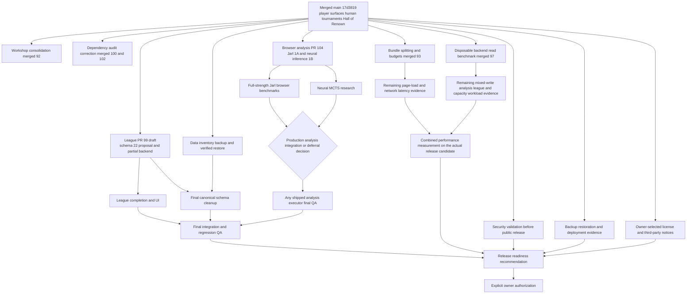

# Current Arena completeness and roadmap

Source snapshot: merged `main`
`17d381927835c726a412d445a39d403098502e3f` (2026-11-20, PR #93 merge),
reviewed 2026-11-20. This is the primary current roadmap. It supplements the
[original post-PR #84 audit](arena-completion.md), whose baseline matrix and
historical test counts remain unchanged and historical. Source review is not a new
full-suite test run or a combined release acceptance.

Provenance for this snapshot: Git history and merge commits in this repository;
PR states and green check runs verified through the GitHub API on 2026-11-20
(merge commits, head revisions and run IDs are listed below). Measurement
revisions and fingerprints come from the linked validation records. No benchmark
or full CI matrix was re-run merely to write this document.

[Release readiness](../RELEASE_READINESS.md) ·
[Historical audit](arena-completion.md) ·
[Contracts](arena-v2-contracts.md) ·
[Design system](../DESIGN_SYSTEM.md)

## Status vocabulary

Implementation, UI exposure and validation are separate dimensions. A merged
backend architecture is complete without being exposed in the UI; a UI surface is
not release-accepted because its feature merged.

| Dimension | Values and meaning |
| --- | --- |
| Functional | **Merged** on `main`; **Open PR** implemented for review; **Draft** in development; **Partial** some required behavior exists; **Missing** no implementation; **Deferred** deliberately excluded |
| UI exposure | **Exposed** through the production shell; **None** no production surface; **Planned** reserved only |
| Validation | **Verified** with the named evidence scope; **Partial** some gates met; **Not validated** no acceptance evidence; **Historical only** earlier evidence that is not current |

A green PR matrix is evidence for that PR revision, not combined-main acceptance.
Final visual, regression, capacity, recovery, security and deployment acceptance
remains outstanding for every shipped feature.

## Phase 0–4 matrix

| Phase | Capability | Functional | UI | Validation | Evidence / remaining work |
| --- | --- | --- | --- | --- | --- |
| 0 | Shared engine, authoritative results, ownership and permission boundaries | Merged | Exposed | Verified | Existing Python engine and authoritative HTTP/database services; no second gameplay authority |
| 0 | Current architecture and Arena contracts | Merged | None | Verified | Reconciled contracts; historical audit retained separately |
| 1 | Four themes, original artwork, first paint and interface scale | Merged (#84) | Exposed | Verified in PR #84 scope | Shared catalog and tokens preserved by later PRs; combined cross-route QA pending |
| 1 | Persistent desktop navigation, mobile shell and EN/DE shell | Merged | Exposed | Verified in browser suites | The Great Hall, Battlefield, Trials of Valor, Hall of Renown, Hall of records; combined QA pending |
| 2 | Single-player, private local 1v1, replay and distinct statistics | Merged (#74, #81) | Exposed | Verified | Existing shared authority and category ownership |
| 2 | Online modes, clocks, optimistic version guards and Elo history | Merged | Exposed | Verified | Authoritative online core and applied rating ledger |
| 2 | Public online read-only APIs | Merged (#82) | Exposed (#87) | Verified | Discovery, live and completed replay without Auth initialization |
| 2 | Portrait entitlement, progress and awards | Merged (#78, #86, #94) | Exposed | Verified | Automatic server-owned awards in schema 21; later reads and selection never award |
| 2 | Human double-elimination authority, durable settlement and advancement | Merged (#80, #90) | Exposed (#90) | Verified | Result outbox and lifespan-owned settlement; no browser required to advance |
| 2 | Durable UTC login/activity-day streak | Deferred | None | Not applicable | Rated win streaks exist; no activity ledger is claimed |
| 3 | The Great Hall board/countdown, totals, selected portrait and polling | Merged (#84, #91) | Exposed | Verified in PR #91 scope | Seconds-resolution clock, hidden-tab suspension and targeted invalidation; combined QA pending |
| 3 | Hall of Renown, progress, unlock feedback and profile/gallery links | Merged (#86, #94, #101) | Exposed | Verified | `/portraits`, automatic awards, Deeds of Valor progress and selection; user-facing heading is Hall of Renown |
| 3 | Published player portraits across player surfaces | Merged | Exposed | Verified | Allowlisted selected portrait IDs on appropriate leaderboard, online and tournament surfaces |
| 3 | Signed-out discovery, live watch and completed replay | Merged (#82, #87) | Exposed | Verified | Separate public entry, bounded cursor API and read-only board; no private games or advisor |
| 3 | Existing Workshop training/tuning/resume/import/models/workers | Merged | Exposed | Verified | Working capabilities retained by PR #92; no training algorithm rewrite |
| 3 | Workshop visual consolidation and bounded job rendering | Merged (#92) | Exposed | Verified in PR #92 scope | Shared presentation, 20-row paging and bounded option DOM; combined QA pending |
| 3 | Route/feature bundle splitting and enforced budgets | Merged (#93) | None | Verified in PR #93 scope | Deferred feature graph and build budget; no page-load latency or capacity claim |
| 4 | Human tournament discovery, registration, details, moderation and bracket | Merged (#90) | Exposed | Verified | `/player-tournaments`, hierarchical bracket with accessible list alternative |
| 4 | Tournament scheduling and sequential/simultaneous two-game modes | Merged (#90) | Exposed | Verified | Scheduled full starts, early start when eligible, restart recovery |
| 4 | League policy, seasons, standings, queue, results and UI | Draft (#99) | None | Not validated | Proposed schema 22 and partial backend on a draft branch; not merged production functionality. Security and Python jobs were failing at review |
| Cross | Classical browser analysis feasibility | Merged (#89) | None | Verified as isolated prototype | Pyodide worker, differential fixtures, search and cancellation; no production entry or live advice |
| Cross | Full-strength Jarl classical analysis | Open PR (#104) | None | Partial | Production-equivalent Jarl in the isolated browser worker; physical devices and some Copenhagen depth-5 cases remain open |
| Cross | Trained-model export and numerical inference parity | Open PR (#104) | None | Partial | Smoke-model ONNX export, native parity and browser WASM parity; competitive trained weights and physical WebGPU blocked |
| Cross | Browser neural MCTS | Missing | None | Not started | Primary roadmap target, not implemented; inference boundary only prepared in PR #104 |
| Cross | Production analysis execution modes (`auto`/`local`/`server`/`disabled`) | Missing | Planned | Not validated | No production local/neural executor; explicit integration-or-deferral decision required |
| Cross | Compatibility cleanup and canonical schema | Partial | None | Not validated | Canonical head on `main` is schema 21; PR #99 proposes schema 22 on its branch. Data inventory and verified recovery precede any destructive cleanup |
| Cross | Final combined release, deployment and recovery acceptance | Missing | None | Not performed | No combined release-candidate QA, capacity, backup/restore or deployment drill |
| Cross | Owner-selected distribution license and third-party notices | Missing | None | Not started | No root LICENSE; owner decision and notice inventory remain required |

Phase 0 and Phase 1 are merged. Phase 2's tournament settlement gap is closed and
portraits/achievements are automatic; activity streaks remain deliberately
excluded. Phase 3's player surfaces, Workshop consolidation, bundle budgets and
Dashboard polling are merged. Phase 4 has merged human tournaments and no merged
league. Browser analysis is an isolated prototype plus open Phase 1 work, not a
production feature. The program is not complete or release-accepted.

## Delivery state by category

| State | Scope |
| --- | --- |
| Implemented and merged | Hall of Renown (`/portraits`)/portrait selection and automatic achievements (#86, #94, #101); signed-out discovery/live/replay (#82, #87); human tournament UI, durable settlement and scheduling (#90); Dashboard polling (#91); Workshop consolidation (#92); bundle splitting and budgets (#93); backend read benchmark (#97); Norse terminology and portrait order (#101); Hall of records navigation (#103); dependency-audit corrections (#100, #102) |
| Implemented on open branches | Browser analysis Phase 1A (Jarl) and Phase 1B (trained smoke-model ONNX/WASM parity) in PR #104; benchmark mountinfo follow-up in PR #105 |
| In development | League seasons, queue and authoritative accounting in draft PR #99 (proposed schema 22, partial backend, no UI, failing checks at review) |
| Missing | Merged league functionality/UI; production classical/neural analysis executor; neural MCTS; combined capacity, recovery and deployment evidence; license and third-party notices |
| Deferred | Browser-neural production integration is optional for the initial release; login/activity streaks stay excluded |
| Final combined acceptance | Not performed: no merged release candidate has been tested as one system across performance, recovery, security and deployment |

## Open and draft work at this review

| PR | State | Head / merge revision | Evidence and remaining work |
| --- | --- | --- | --- |
| #99 | Draft, open | `ac5fb6f` on `feat/league-arena` | Schema 22 proposal, league policy/service/migrations and tests; no frontend. Security and Python checks failed at review; do not describe as merged or accepted |
| #104 | Open | `274e983` on `feat/browser-analysis-phase1` | Phase 1A/1B implementation and revision-3 evidence; security, python, node22 and browser checks green. Competitive weights, physical WebGPU/devices, neural MCTS and production integration remain open |
| #105 | Open | `f9e008a` on `fix/benchmark-mountinfo-read` | Follow-up hardening of the disposable benchmark's cgroup mountinfo parsing; benchmark-only, no production query or schema change |

Status corrections: PR #96 was closed without merging and superseded by
#100/#102. PR #93 and #97 are merged, not open. Re-verify every PR state before
acting on this table.

## Security status

GHSA-fc5q-39xc-vjpf was withdrawn by GitHub on 2026-11-18
(`withdrawn_at` 2026-11-18T15:38:56Z). Withdrawal is not an upstream technical
patch: no dependency version, override, fork or lockfile entry changed, and no
patched picomatch release was required. The historical owner approval on PR #95
and its development-only exposure analysis remain preserved in the
[test-toolchain security record](../validation/test-toolchain-security.md#withdrawal-and-empty-exception-state-2026-11-18);
they are not a current exception.

- PR #100 (merged `2ffa951`) removed the unused temporary risk acceptance and
  supports a valid empty exception configuration.
- PR #102 (merged `711978e`) hardened approval metadata validation.
- PR #96 is closed, not an outstanding prerequisite.
- The dependency audit remains fail-closed: production findings, unauthorized or
  expired exceptions, changed advisory/range/package sets and malformed reports
  fail. There is no blanket ignore or severity reduction.
- The clean audits dated 2026-11-18 are dated registry observations, not permanent.
  A fresh full and production-only audit is required before release.

The active **Main branch rules** ruleset (`25820905`) was verified on 2026-11-20:
it has `deletion`, `non_fast_forward` and `pull_request` rules, zero required
approving reviews and **no required status checks**. The `security`, `python`,
`node22` and `browser` jobs are therefore not GitHub-enforced merge gates. This
document does not change repository rulesets or approval requirements; applying
them remains an explicit owner action.

## Browser-side analysis roadmap

The established direction has two primary analysis targets:

1. Full-strength Jarl classical alpha-beta analysis in the browser.
2. A genuinely trained neural network with MCTS.

Neural MCTS is a primary target; production browser-neural integration remains
optional for the initial public release. Phase status:

| Phase | Scope | Status |
| --- | --- | --- |
| 0 | Browser engine feasibility | Completed prototype (#89, isolated; not production) |
| 1A | Full-strength Jarl and native/browser comparison | Partially validated on PR #104 |
| 1B | Trained-model ONNX export and browser inference | Partially validated on PR #104 (smoke model; competitive weights and physical WebGPU blocked) |
| 2 | Browser-side neural MCTS | Not started; inference boundary prepared |
| 3 | Search optimization, strength evaluation and physical devices | Not started |
| 4 | Production security, packaging, CSP and licensing | Not started |
| 5 | Frontend execution-mode integration | Not started |
| 6 | Final acceptance and controlled rollout | Not started |

The dedicated roadmap and its revision-3 evidence are carried by open PR #104
(not yet on `main`): [browser-analysis-roadmap.md](https://github.com/freeDom-/hnefatafl/blob/274e98332ede8e764253219a2d900b7deca963e6/docs/designs/browser-analysis-roadmap.md)
and [PR #104](https://github.com/freeDom-/hnefatafl/pull/104). Current local
records are [classical prototype validation](../validation/browser-analysis-prototype.md)
and [neural feasibility](../validation/browser-neural-feasibility.md).

Remaining gates, none of which the current prototype satisfies: competitive
trained weights for all three rulesets; real export and numerical policy/value
parity; browser neural inference across WASM and a genuinely available WebGPU
adapter; neural MCTS execution; completed-search strength, CPU, memory, startup
and physical-device benchmarks; production CSP, runtime packaging and license
notices; normalized `auto`/`local`/`server`/`disabled` frontend integration; and
final regression and rollout acceptance. Server authority, game permissions,
private-model access and the restriction on assistance in live online games are
unchanged.

## Performance evidence and budgets

These classes are not interchangeable. Historical results are not rewritten as
fresh evidence, and reduced bundle size is not page-load latency or capacity.

| Evidence class | Revision | Result | Provenance |
| --- | --- | --- | --- |
| Historical initial bundle | `2579a86` (PR #84 baseline) | JS 1,015,562 raw / 309,626 gzip bytes; CSS 176,657 raw / 32,599 gzip | [Historical audit](arena-completion.md#measured-performance-baseline-and-gates-historical) and PR #93 validation |
| Historical Dashboard polling | PR #91 baseline record (descriptive, no verified build fingerprint) | 61 empty / 69 active hero / 71 simulated hidden requests per minute | [Polling validation](../validation/dashboard-polling.md) |
| Latest clean branch bundle | `ab3ac68` (PR #93, fingerprint `9cf07db7…a7695`) | JS 569,155 raw / 181,828 gzip bytes; CSS 114,187 raw / 23,803 gzip | [Feature-splitting validation](../validation/frontend-feature-splitting.md#integrated-main-and-final-bundle-evidence) |
| Actual merged main | `17d3819` | No new bundle measurement was run for this review. The merged frontend tree is identical to `ab3ac68` (`git diff` empty), so the branch measurement describes those files but is not relabelled a merged-main run | This review; PR #93 merge commit |
| Latest clean branch polling | `00e5917` (PR #91) | 11.00 empty / 23.00 active / 0 hidden requests per context per minute, zero steady failures | [Polling validation](../validation/dashboard-polling.md#final-integrated-measurement) |
| Latest corrected backend read | `c5e7066` (PR #97, merged `07d7438`) | 936/936 HTTP 200 warm loopback GETs; p95 9.74 / 31.69 / 59.36 ms at concurrency 1/4/8 | [Backend read validation](../validation/backend-read-baseline.md#corrected-measured-baseline) |
| Proposed targets | Post-#84 audit | ≤180 KB gzip initial JavaScript; ≤12 visible Dashboard requests/minute; zero periodic hidden requests; ≤2 s online participant updates; seconds-accurate clocks | Targets, not achieved acceptance results |
| Enforced build budgets | `main` `17d3819` | JS 600,000 raw / 200,000 gzip bytes; CSS 150,000 raw / 35,000 gzip bytes, gzip level 9 per asset | `frontend/scripts/check-bundle-budget.mjs`; PR #93 |
| Production network and capacity | Not measured | No WAN, TLS, mixed-write, league, analysis-admission or realistic-volume capacity result | Outstanding |

The original target was written as "180 KB gzip". The enforced budget is
**200,000 gzip bytes (decimal)**, which is 195.31 KiB. These are different
numbers and must not be conflated: 200,000 bytes is the build-failure ceiling
with headroom for merged features, while `181,828` gzip bytes is the latest
measured initial graph. If the original target meant 180 KiB (184,320 bytes), the
measurement is under it; if it meant 180,000 bytes, the measurement is 1,828
bytes over it. This document keeps the original target visible rather than
silently relaxing it.

The disposable backend read benchmark remains limited to its workload: warm
loopback GETs from eight verified accounts against a small seeded fixture. Mixed
authoritative writes, bounded concurrent analysis, league workloads, realistic
data volumes and deployment capacity remain separate acceptance requirements.

## Remaining dependency graph

Work already owned by a PR is not duplicated: #99 owns league schema/backend
work, #104 owns browser analysis, and #105 owns the benchmark mountinfo follow-up.
Optional browser-neural production scope is distinct from mandatory acceptance
for any functionality that is included in the release.

## Migration and data guards

The canonical migration head on `main` `17d3819` is **schema 21**. PR #99 proposes
schema 22 on its own branch; that number is not reserved on `main` and must be
re-checked after any merge. Do not allocate a migration number from an older
document. League completion precedes final canonical schema cleanup, and a data
inventory with a verified backup/restore of development databases, games, jobs,
checkpoints, model registry and Optuna studies precedes any destructive cleanup.
Lack of a public legacy-compatibility promise is not permission to delete
recoverable development data.

No merge, tag, release, version bump or deployment is authorized by this record.
Maintain online/Elo authority, transaction guards, account isolation, the
existing shared components, styles, classes and design tokens, all supported
themes, desktop and mobile layouts, EN/DE localization, keyboard navigation,
accessibility, contrast and zoom throughout.
