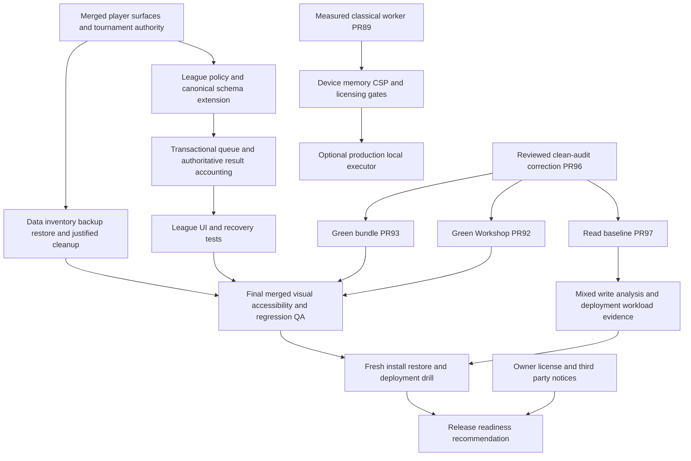

# Current Arena completeness

Source snapshot: merged main `0c5f27054411cf140033531d4179821071768b10`,
reviewed 2026-11-18. This supplements the
[original post-PR #84 audit](arena-completion.md); its baseline matrix and historical
test counts remain unchanged. Source review is not a new full-suite test run.

## Phase 0–4 matrix

Statuses: **UI** implemented and exposed; **Backend** implemented only on the
server; **Partial** some required behavior remains; **Missing** no production
implementation; **Deferred** gated deliberately by evidence or product policy.

| Phase | Capability | Status | Current evidence / remaining work |
| --- | --- | --- | --- |
| 0 | Engine, authoritative online results, ownership and permission boundaries | UI | Existing shared engine and HTTP/database services; no second gameplay authority |
| 0 | Current architecture and Arena contracts | UI | Reconciled contracts; retain the historical audit separately |
| 1 | Four named themes, safe artwork, first paint and interface scale | UI | PR #84; shared catalog and tokens retained by subsequent feature PRs |
| 1 | Persistent desktop game/replay navigation and responsive EN/DE shell | UI | Existing Arena shell; full final merged cross-route QA remains required |
| 2 | Single-player, private local 1v1, replay and distinct statistics | UI | Existing shared game authority and category ownership |
| 2 | Online modes, clocks, optimistic version guards and Elo history | UI | Normal online gameplay and authoritative rating ledger |
| 2 | Public online read-only APIs | UI | PR #87 frontend now exposes discovery/live/replay without Auth initialization |
| 2 | Portrait entitlement and achievement progress/awards | UI | PR #86 plus owner-reviewed tiered automatic achievements in PR #94 |
| 2 | Human double-elimination authority and automatic advancement | UI | PR #90, durable result outbox and lifespan-owned settlement; no browser required |
| 2 | Durable login/activity-day streak | Deferred | Rated win streaks are implemented; do not imply an activity ledger exists |
| 3 | Dashboard board/countdown, authoritative totals and selected portrait | UI | Existing seconds-resolution clock; PR #91 polling/invalidation and singular labels |
| 3 | Portrait Hall, progress, unlock feedback and profile/gallery links | UI | `/portraits`, automatic server-owned awards and selection; current tiers documented in PROGRESSION |
| 3 | Published player portraits | UI | Allowlisted selected portrait IDs across appropriate leaderboard/online/tournament surfaces |
| 3 | Signed-out discovery/live watch/completed replay | UI | Separate public entry, bounded cursor API, read-only board; no private games or advisor |
| 3 | Existing Workshop training/tuning/resume/import/models/workers | UI | Working capabilities retained; presentation changes remain in PR #92 |
| 3 | Workshop visual consolidation and bounded job DOM | Partial | PR #92 open; no claim that it is in this main snapshot |
| 3 | Initial route/feature bundle splitting | Partial | Public entry and gallery/tournament routes split on main; broad feature splitting/budgets in PR #93 |
| 3 | Adaptive/hidden Dashboard polling | UI | PR #91; cancellation, account isolation, hidden pause and targeted invalidation; no new global cache |
| 4 | Human tournament discovery, registration, details and moderation | UI | `/player-tournaments`, creator/admin capabilities and authoritative online legs |
| 4 | Upper/lower/final/reset bracket, byes and history | UI | Hierarchical bracket with accessible list alternative, portraits and official game links |
| 4 | Tournament schedule and two-game modes | UI | Reviewed PR #90 refinements: due full starts, sequential/simultaneous side-swapped games and restart recovery |
| 4 | League policy | Partial | Explicit defaults proposed in the original completion plan; not an implemented competition |
| 4 | League seasons, standings, queue, result accounting and UI | Missing | No league service/API/schema or live queue; artwork/placeholder is not league gameplay |
| Cross | Classical browser analysis feasibility | Partial | PR #89 standalone current-engine worker and measured differential/search/cancellation results |
| Cross | Production local/server/auto/disabled execution | Missing | Production still uses server analysis; device/memory/CSP/package gates remain |
| Cross | Browser neural execution | Deferred | Real checkpoint/export/runtime/device evidence insufficient; not shipped |
| Cross | Compatibility cleanup and canonical fresh schema | Partial | Current schema is 21; existing development data must be backed up and recoverable before destructive simplification |
| Cross | Release/deployment/backup/security acceptance | Partial | Existing tests and documentation, but final fresh deployment/recovery and mixed-load evidence outstanding |
| Cross | Owner-selected license and third-party notices | Missing | No root LICENSE at this snapshot; owner decision required |

Phase 0 and the original Phase 1 are implemented. Phase 2's tournament settlement
gap is now closed; activity streaks remain deliberately excluded. Phase 3's player
surfaces are delivered, while Workshop and broad bundle work remain open. Phase 4
has real human tournaments but no leagues. The whole program is not complete.

## Evidence and open changes

Merged PR #90's latest checks were all green at review (run
[44343230926](https://github.com/freeDom-/hnefatafl/actions/runs/44343230926));
PR #94's checks were also green (run
[44298853250](https://github.com/freeDom-/hnefatafl/actions/runs/44298853250)).
These are the named PR revisions' evidence, not a newly run combined-main suite.
See [tournament refinement](../validation/player-tournament-refinement.md),
[progression policy](../PROGRESSION.md),
[public production validation](../validation/public-watch-production.md),
[polling evidence](../validation/dashboard-polling.md) and
[local analysis feasibility](../validation/browser-analysis-prototype.md).

- PR #92: Workshop consolidation; integration CI still pending. A statistics test
  now waits for its exact progression requests; no request assertions were removed.
- PR #93: broad deferred loading and authenticated-graph budgets; measured clean
  integrated JS 565,320 bytes / 180,407 gzip. Original post-#84 initial graph was
  1,015,562 / 309,626. No merged-main bundle reduction is claimed yet.
- PR #96: remove the now-unused advisory exception and support a clean empty
  acceptance list. Both live lockfile audits reported zero findings; no upstream
  patch/withdrawal is inferred. Its security and Node 22 jobs passed; full CI is
  pending. Other open branches still inherit the stale exception from main.
- PR #97: disposable eight-account read baseline, 936/936 HTTP 200; one short
  same-host read run is not capacity, mixed-write or analysis evidence.

The original audit priorities 1–3 and classical feasibility work are delivered.
Do not rebuild them. Next priorities are completing/reviewing Workshop and bundle
work, implementing leagues, satisfying production classical-analysis gates or
explicitly deferring integration, safe compatibility cleanup, then final visual
and release acceptance. Neural execution remains optional.

## Remaining dependency graph

No merge, release, tag or version bump is authorized by this record. League
implementation must check the then-current migration head; do not reuse historical
schema numbers 19 or 20. Maintain online/Elo authority, transaction guards and
account isolation throughout.
