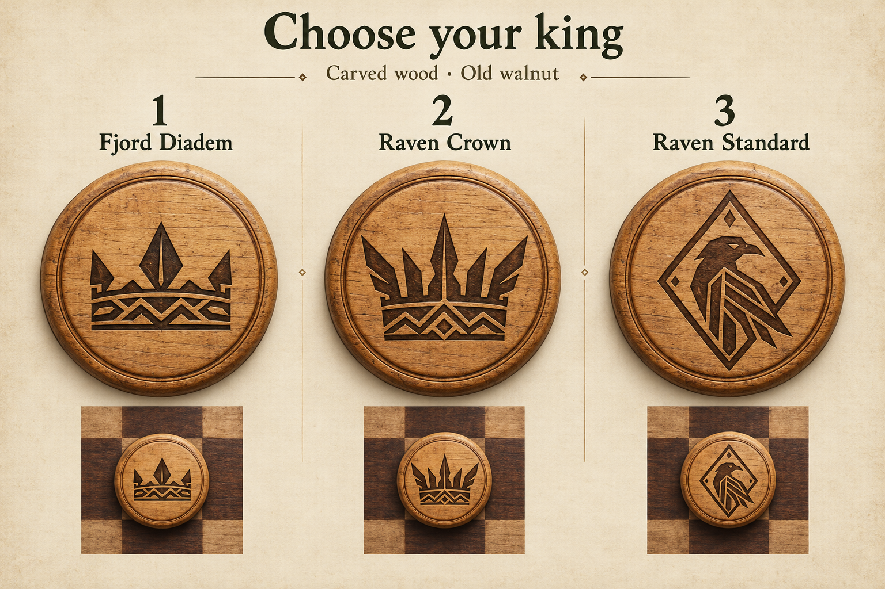

# King token concepts

Three alternatives for the carved wooden set on the Old walnut board:

1. **Fjord Diadem** — a low northern circlet with angular peaks and an interlaced band.
2. **Raven Crown** — a taller, broader crown with a spear-like center and wing-shaped points.
3. **Raven Standard** — a crown-free raven emblem in an angular rune/shield frame.

The sheet compares the symbols enlarged and at a smaller board scale.

**Selected: 1 · Fjord Diadem.** The carved-wood king uses a crisp SVG interpretation
of its low three-peak circlet and interlaced band. This selection applies only to
the carved wooden token set; Classic stones and Viking figures retain their
existing king artwork. The other concepts remain here for reference.

No game rules, piece identities or player statistics change with the king artwork.
