# Interface guide

This page maps the current authenticated Arena and Workshop surfaces. Labels are
the English UI strings; German uses the same routes. Shared concepts link to their
canonical guide instead of being explained twice.

Screenshots in `docs/assets/` were captured from the running application with
disposable browser-test fixtures, not production data. They show the default
**The King's Table** theme unless labelled otherwise. A page without a screenshot
is still documented; do not infer that an image exists for every state.

## Navigation

| Surface | Route | Purpose |
| --- | --- | --- |
| The Great Hall | `/dashboard` | Landing page, running games, standing, leaderboard preview, recent records |
| Battlefield | `/play` | Resume the latest running game or start a new one |
| Play screen | `/games/{id}` | Single-player or local 1v1 board, history and analysis |
| Online Play | `/online` | Authenticated lobby, joining and live games |
| Online game | `/online/games/{id}` | Board, clocks, concede and result |
| Statistics | `/statistics` | Personal Singleplayer / Multiplayer / Local 1v1 statistics |
| Leaderboard | `/leaderboard` | Rated standings and own rank |
| Player tournaments | `/player-tournaments` | Discovery, registration, bracket and results |
| Leagues | `/leagues` | Seasonal standings and queue |
| Hall of records | `/archive` | Read-only account history and selected review |
| Hall of Renown | `/portraits` | Portrait gallery, selection and achievements |
| My Profile | `/profile` | Personal details, privacy, security and appearance |
| AI Workshop | `/training` | Training, models and remote workers (permission required) |
| AI testing | `/tournaments` | Saved AI round-robin comparisons (permission required) |

Signed-out surfaces: `/login`, `/register`, `/verify-email`,
`/forgot-password`, `/reset-password`, `/watch` and
`/watch/games/{id}[/replay]`.

## Sign in, registration and recovery

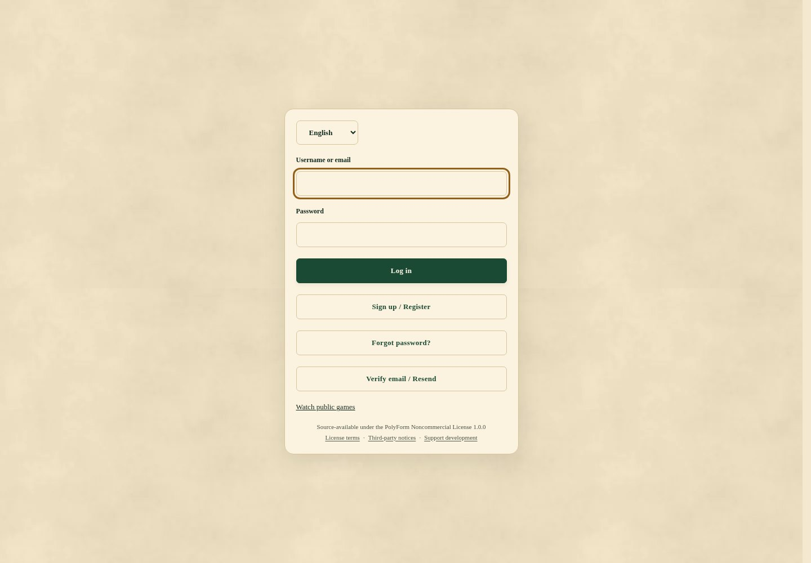

`/login` is the entry form. It shows registration links only when the operator has
enabled public registration and a working mail configuration. `/register`,
`/verify-email`, `/forgot-password` and `/reset-password` are separate views on the
same account surface. Forms keep validation and authentication errors inline,
preserve entered values where safe and never reveal whether an account exists.
Successful registration asks the user to verify their email; login remains
available when admission is enabled. A session expiry returns to login with an
explanation rather than silently discarding the page.

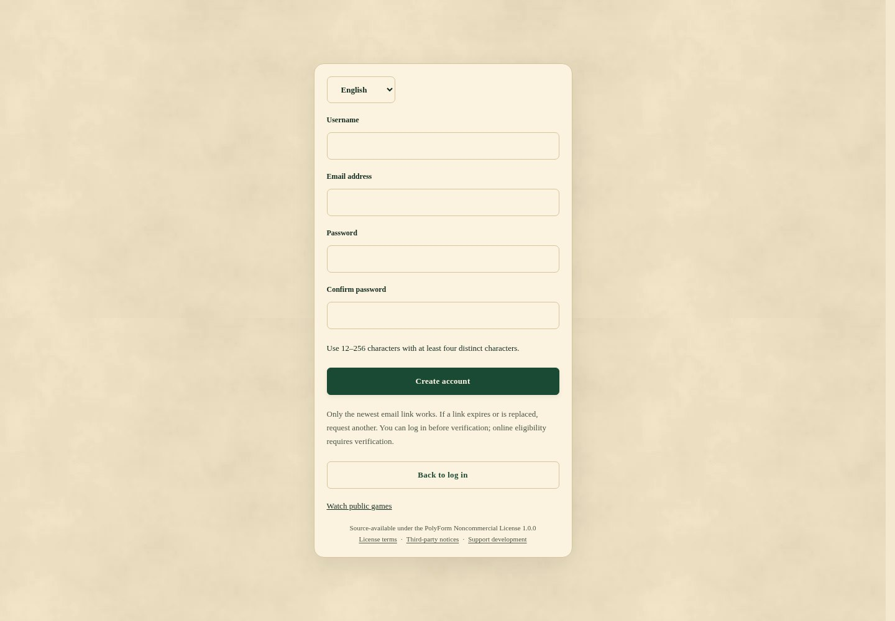

Registration uses the same account surface. It is shown only when the operator
has enabled registration and mail delivery. Passwords are checked against the
shared policy and entered values are preserved on validation errors.

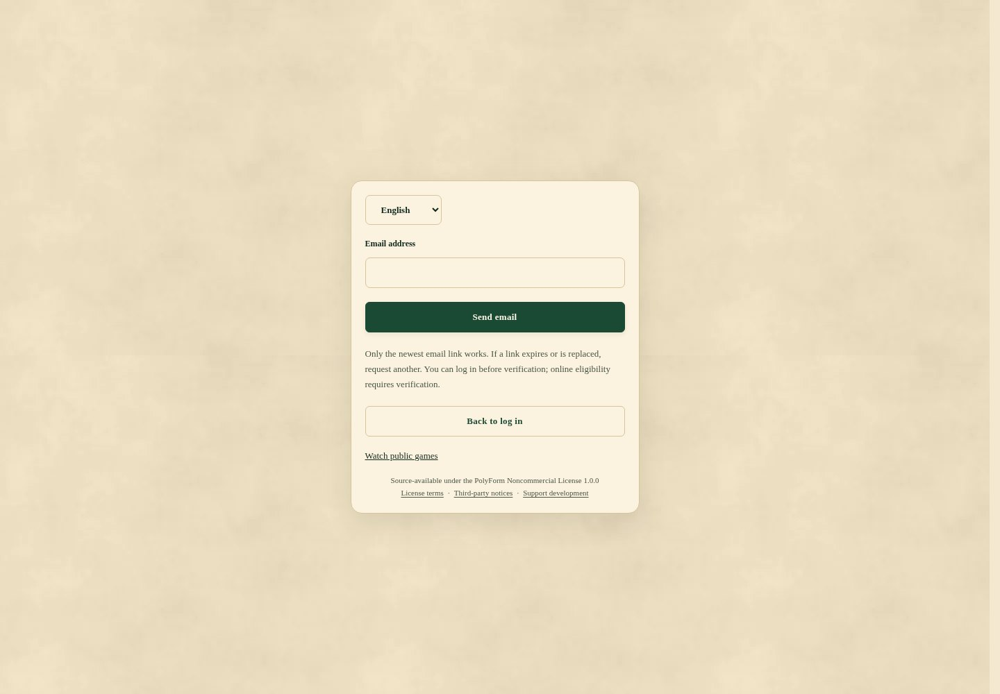

Verification links are single-use and replace earlier links. An expired or
already-used link offers a resend path instead of a dead end.

Password recovery uses the same email-request pattern; the reset link opens a
new-password form. Responses never reveal whether an account exists.

The signed-out `/watch` surface is separate and read-only; see
[Public Watch Hall](#public-watch-hall). Account creation is not required to view
public games, but it is required to play, keep private history or earn progression.
See [user management](../../administration/user-management.md) and
[security](../../administration/security.md).

## The Great Hall

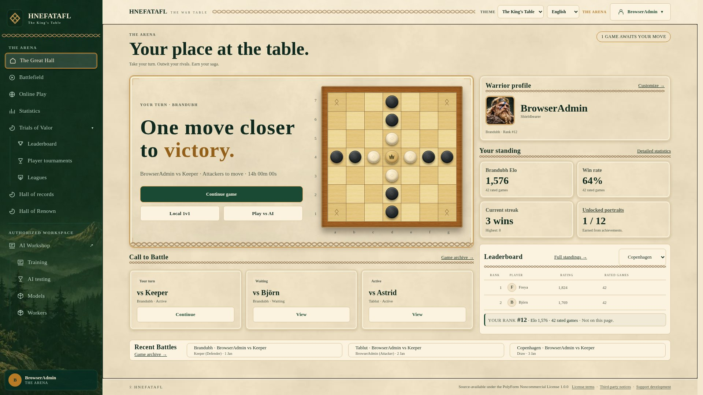

The page prioritizes a running game in the hero. **YOUR TURN** appears only when
the server confirms that the account (or a local player) must move; an online
clock follows the authoritative deadline at seconds resolution and pauses while
the tab is hidden. The three creation actions are **Play online**, **Local 1v1**
and **Play vs AI**; a selected running game replaces the primary slot with
**Continue game**.

Supporting panels show the warrior profile and selected portrait, ruleset Elo,
online win rate, current rated win streak and unlocked portraits. **Detailed
statistics** opens `/statistics`. **Games that need you** previews bounded lists
and states when more games exist outside the preview. **Recorded games** shows at
most three completed eligible records and links to the Hall of records. The
leaderboard preview carries qualified/provisional markers and the account's own
rank without fabricating an unearned position. See
[dashboard and history](../dashboard.md).

Theme comparison (desktop dashboards):
[kings-table](../../assets/game/themes/kings-table-dashboard.jpg) ·
[iron-ash](../../assets/game/themes/iron-ash-dashboard.jpg) ·
[saga-hall](../../assets/game/themes/saga-hall-dashboard.jpg) ·
[classic-table](../../assets/game/themes/classic-table-dashboard.jpg).

## Battlefield and the play screen

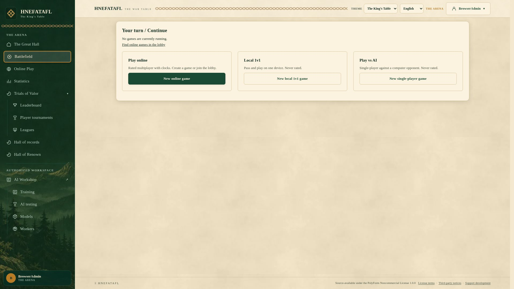

**Battlefield** (`/play`) resumes the last remembered unfinished account game
after checking it against current server lists; otherwise it offers the three
creation modes and a link to the online lobby. The play screen keeps the board
between a game/player summary, a move list and, for single-player, an Analytics
tab. On mobile the board stays in place while the Moves / Analytics / My games
panel switches below it; landscape places the panel beside the board.

Controls are mouse, touch and keyboard. Arrow keys navigate, Enter/Space selects
and Escape clears selection. The server validates every move and rejects stale
versions. Local 1v1 alternates the two labelled seats automatically. Online games
show the remaining clock and no analysis or move assistance. See
[gameplay](../gameplay.md) and [online play](../online-play.md).

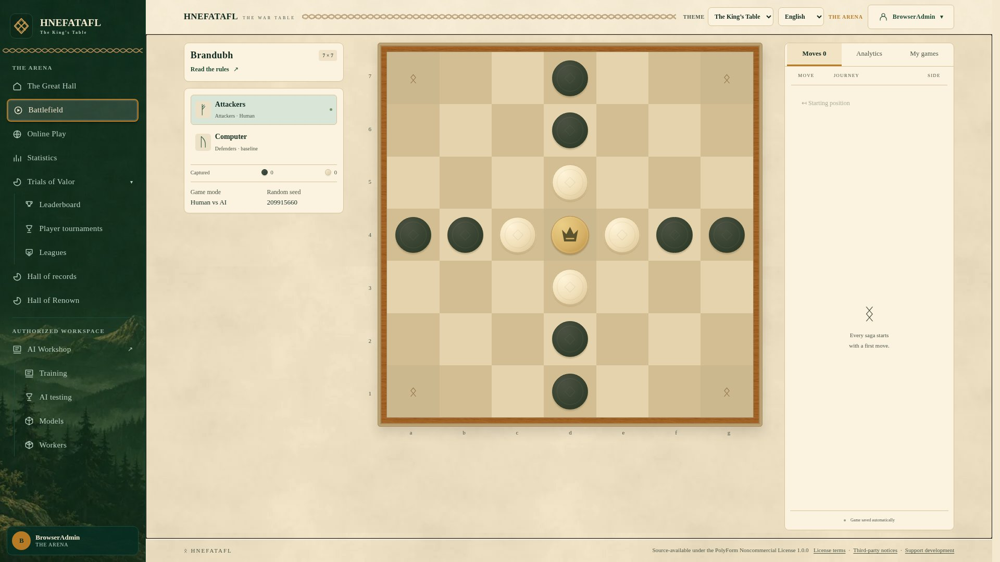

The single-player and local 1v1 board reuses the same layout in every theme:
[Iron Ash](../../assets/game/themes/iron-ash-battlefield.jpg) ·
[Saga Hall](../../assets/game/themes/saga-hall-battlefield.jpg) ·
[Classic Table](../../assets/game/themes/classic-table-battlefield.jpg).
Online games use the same board with the clock and lobby controls instead of
analytics. Local 1v1 starts from the same Battlefield dialog and keeps the two
seats on one device; the shared board is shown in the
[local 1v1 view](../../assets/game/kings-table-local.jpg).

Dialogs: **Begin a new saga** (single-player setup), **Start a local 1v1 game**,
**Create an online game**, **Game options** (advisor and mobile panel settings),
**Appearance** and the account menu.

## Online Play

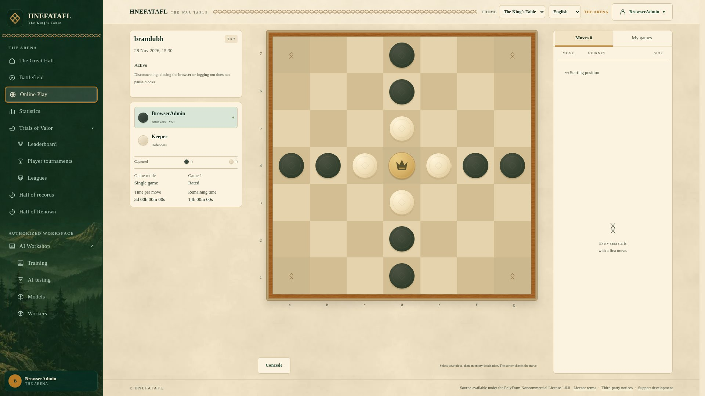

The authenticated lobby always opens at `/online`; it never auto-resumes a game.
Tabs are **All games**, **My games** and **My turn**, with a ruleset filter and
bounded pagination. Waiting games can be joined; creators can cancel. Completed,
cancelled and voided games are not listed. Active cards show the authoritative
remaining time. Creation is rated-only, freezes its clock settings at creation and
offers single games or two-game matches. Retained-request recovery is explained in
[online play](../online-play.md#create-find-and-join).

## Statistics and Leaderboard

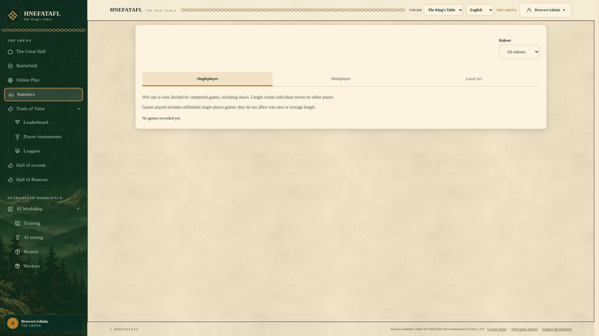

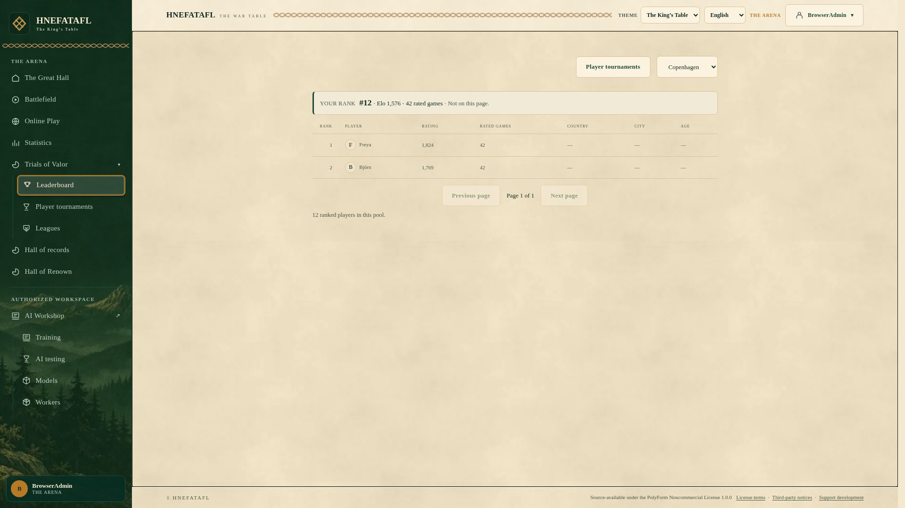

**Your statistics** is relative to the signed-in account's authoritative seat.
The Singleplayer / Multiplayer / Local 1v1 tabs and ruleset filter stay in the URL.
Each ruleset shows outcome distributions plus overall, attacker and defender
comparison tables (games, wins, losses, draws, win rate, average length). Local 1v1
is never mixed into personal or online statistics.

**Leaderboard** shows rated standings for the selected ruleset, qualified versus
provisional markers, pagination and the account's own rank. League standings are a
separate seasonal surface. See [ratings](../ratings.md) and [leagues](../leagues.md).

## Player tournaments

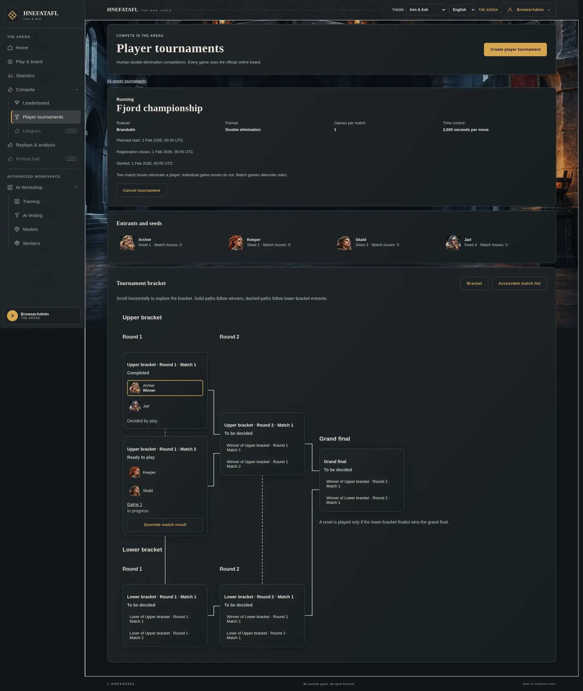

Double-elimination tournaments support discovery, registration, seeding,
scheduling, creator moderation, durable automatic advancement and accessible
bracket/list alternatives. The page separates lobby-style discovery from the
selected tournament's entrants, bracket and match links. See
[player tournaments](../tournaments.md).
Theme comparison: [Kings Table](../../assets/game/kings-table-player-tournaments.webp) ·
[Saga Hall](../../assets/game/saga-hall-player-tournaments.webp) ·
[Classic Table](../../assets/game/classic-table-player-tournaments.webp).

## Leagues

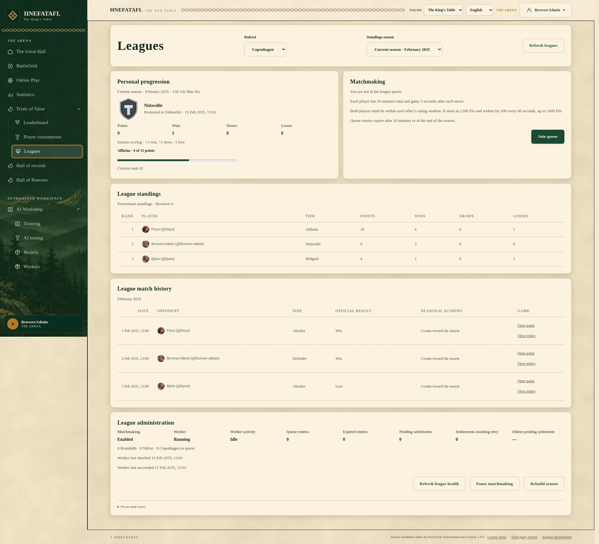

`/leagues` shows the current UTC calendar season, separate Brandubh/Tablut/
Copenhagen standings, tier progress, the ranked queue and the account's league
history. League points are seasonal progress, not an Elo estimate. Queue and
settlement are server-owned; an empty population is never filled with invented
opponents or ranks. See [leagues](../leagues.md).

## Hall of records

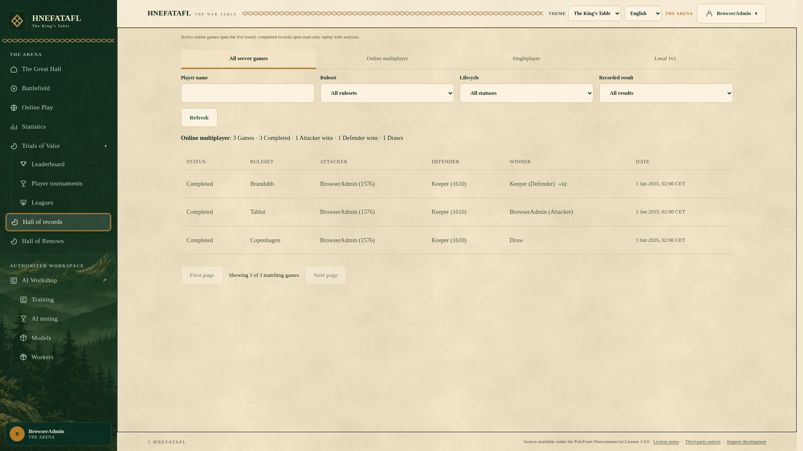

The read-only archive offers **All records**, **Online multiplayer**,
**Singleplayer** and **Local 1v1** categories, with player, ruleset, status,
result and cursor filters. Ordinary accounts see records they participated in;
administrators can inspect all server-recorded categories. Selecting a record
opens an independent read-only review with the shared board and move list; replay
navigation changes only the viewer's position and never branches or overwrites the
saved game. Move advisors can analyse a completed record where permitted. See
[replay and analysis](../replay-and-analysis.md).

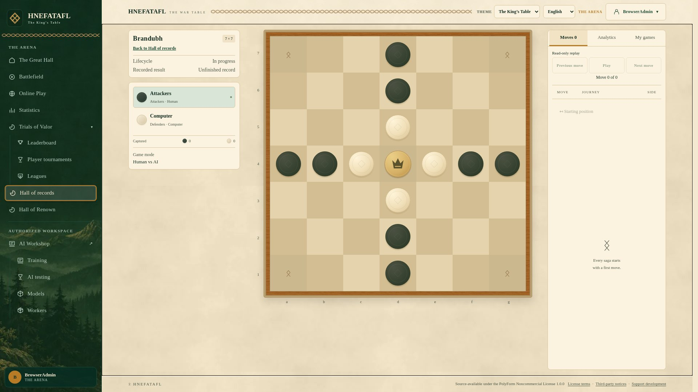

## Hall of Renown

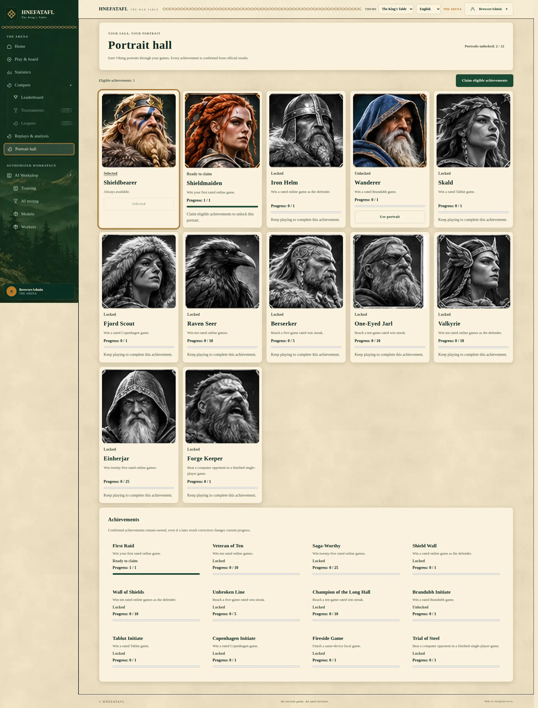

Shows unlocked and locked portraits, the selected portrait, **Deeds of Valor**
achievement progress and milestone rewards. Confirmed achievements remain earned
even if a later result correction changes current progress. Portrait selection is
cosmetic and never changes gameplay. See [progression](../progression.md).
Theme comparison: [Iron Ash](../../assets/game/iron-ash-portrait-hall.webp) ·
[Saga Hall](../../assets/game/saga-hall-portrait-hall.webp) ·
[Classic Table](../../assets/game/classic-table-portrait-hall.webp).
Mobile comparison: [portrait hall on phone](../../assets/game/portrait-hall-mobile.jpg).

### Achievements and role statistics

Achievement cards summarize tier progress; [desktop](../../assets/game/achievement-cards-desktop.webp)
and [mobile](../../assets/game/achievement-cards-mobile.webp) examples show the
compact layout. Role-specific win rates on the statistics and online surfaces are
shown on [Kings Table](../../assets/game/role-win-rates/kings-table-desktop.webp),
[Iron Ash](../../assets/game/role-win-rates/iron-ash-desktop.webp),
[Saga Hall](../../assets/game/role-win-rates/saga-hall-desktop.webp) and
[Classic Table](../../assets/game/role-win-rates/classic-table-desktop.webp), with
mobile examples for [Iron Ash](../../assets/game/role-win-rates/iron-ash-compact-mobile.webp)
and [Saga Hall](../../assets/game/role-win-rates/saga-hall-large-mobile.webp),
including the [online Saga Hall view](../../assets/game/role-win-rates/saga-hall-online-large-mobile.webp). A
manual Shieldmaiden unlock reveal is shown in
[the portrait reveal](../../assets/game/shieldmaiden-reveal.webp).

The variant achievement galleries are available on
[Kings Table](../../assets/game/kings-table-achievements.png),
[Iron Ash](../../assets/game/iron-ash-achievements.png),
[Saga Hall](../../assets/game/saga-hall-achievements.png) and
[Classic Table](../../assets/game/classic-table-achievements.png).

## My Profile

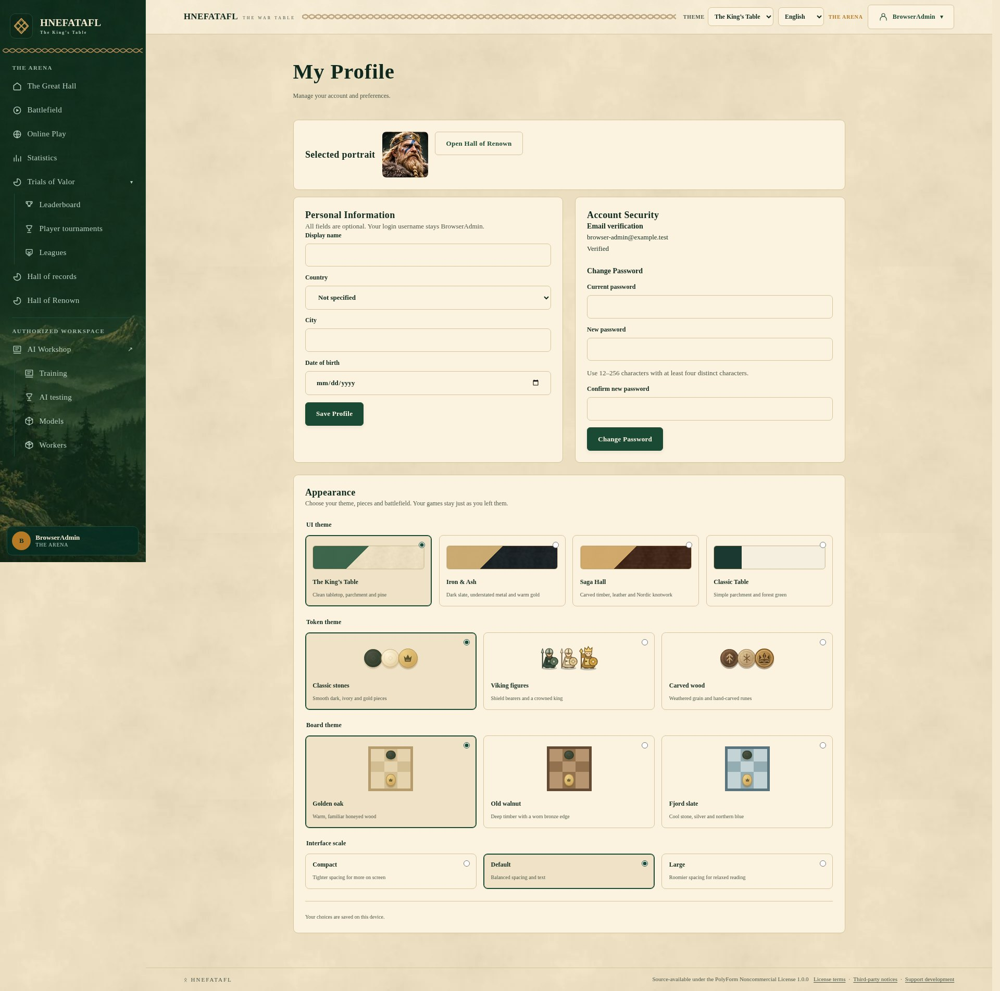

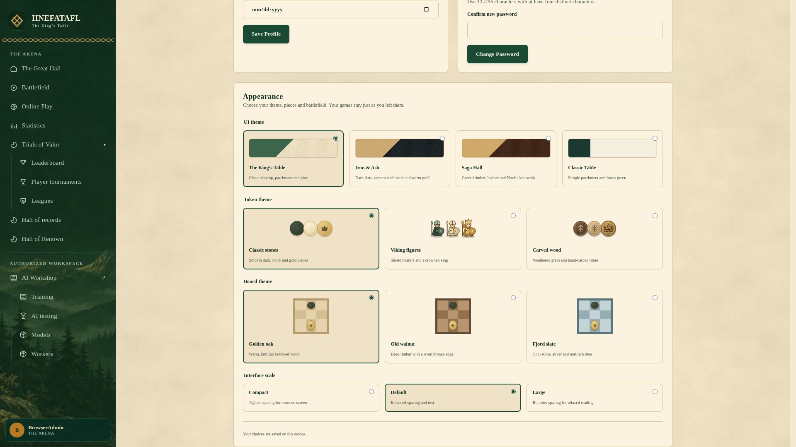

`/profile` contains the selected portrait, **Personal Information** (display name,
country, biography and publication choices), **Account Security** (email
verification and password change) and **Appearance** (theme, board, tokens and
interface scale). Private birth dates are not published; an eligible public age is
derived instead. See [profile](../profile.md) and
[personalization](../personalization.md).

## Public Watch Hall

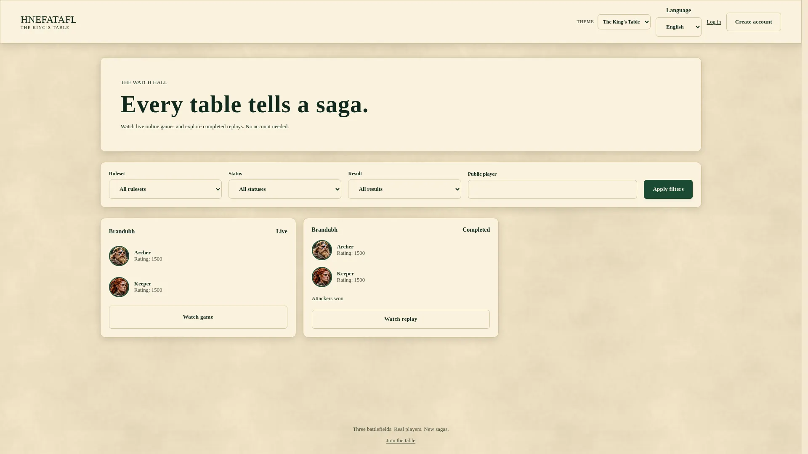

Signed-out visitors can browse eligible online games at `/watch`, open a live board
and its completed replay. The public projection never exposes single-player or
local records, private profiles, email, full birth dates or live analysis. Login
and registration links are available but no gameplay action is. See
[public online](../public-online.md).
Theme comparison: [public themes](../../assets/game/public-watch-themes.jpg) ·
[Iron Ash](../../assets/game/iron-ash-public-watch.webp) ·
[Saga Hall](../../assets/game/saga-hall-public-watch.webp) ·
[Classic Table](../../assets/game/classic-table-public-watch.webp). Mobile:
[public Watch Hall on phone](../../assets/game/public-watch-mobile.jpg).

## AI Workshop

The Workshop is permission-gated and visually distinct from the Arena. Training,
job monitoring, models and workers are documented with screenshots in
[training interface](../../training/interface.md). **AI testing** is documented in
[AI tournaments](../../evaluation/ai-tournaments.md).

## Dialogs and shared states

- **New single-player game**: battlefield, side and fixed or custom opponent;
  administrator-only AI vs AI and custom-agent controls.
- **Online creation**: ruleset, side, match mode and clock; invalid aggregate
  durations are rejected rather than clamped.
- **Appearance**: theme, board, token set and interface scale; persisted locally.
- **Game options / Analytics**: advisor selection and bounded search budget on
  mobile; the desktop Analytics tab exposes the same settings.
- **Account menu**: profile, Hall of Renown, language and logout; session expiry
  returns to the login form with an inline explanation.
- Notifications are transient top-centre messages. Field validation and
  authentication errors stay inline. See
  [frontend notifications](../../development/notifications.md).

## Screenshot provenance

The committed images come from the Playwright visual-acceptance suite and
disposable fixtures. They may include synthetic accounts, ratings, tournaments and
achievements. They are interface examples, not benchmark evidence or production
data. Regenerate them with the test suite when the UI changes; see
[documentation guidelines](../../development/documentation-guidelines.md#screenshots).
