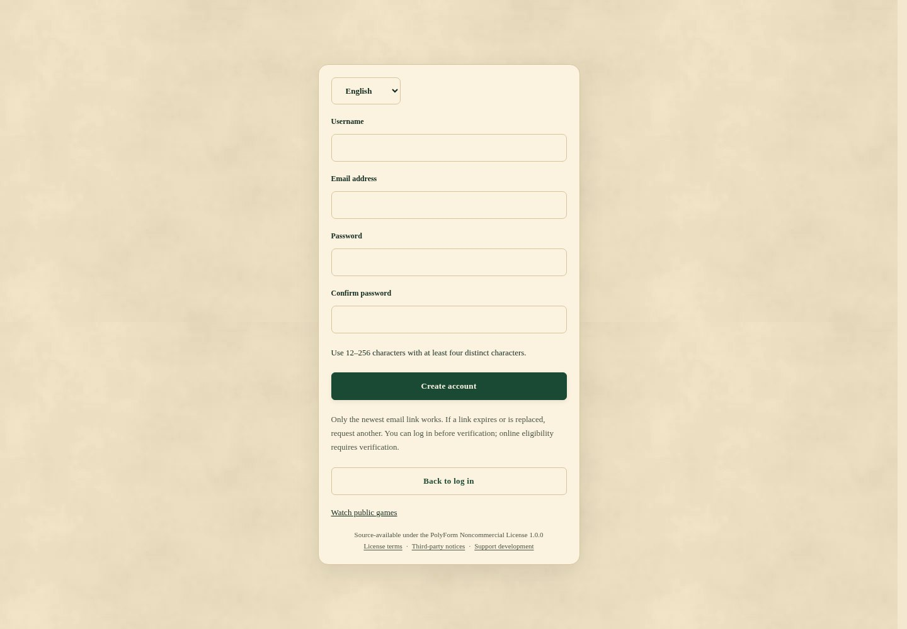
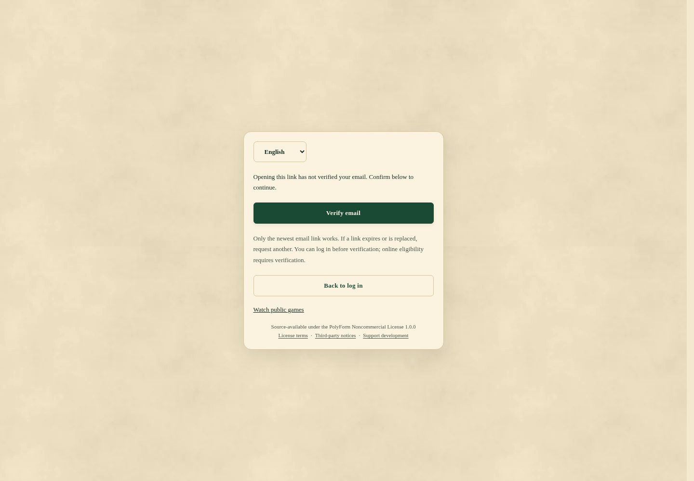
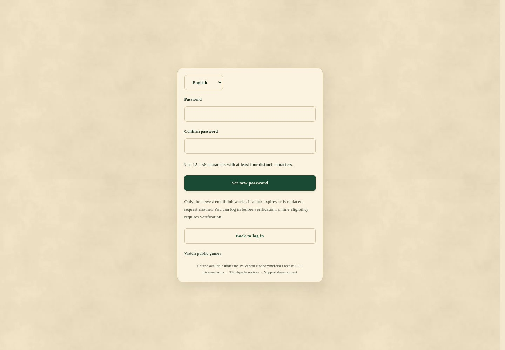

# Account and profile surfaces

[Interface index](README.md) · [Profile privacy](#my-profile) · [Security](../../administration/security.md) · [User management](../../administration/user-management.md)

## Login

**Purpose:** authenticate. **Access:** `/login`, or redirect after logout/session
expiry.

**Main functionality:** username/email and password; links to registration, password
recovery, verification resend and the public Watch Hall.

**Controls and restrictions:** registration links appear only when enabled; errors
stay inline; no default credentials exist.

## Registration and verification

**Purpose:** create and verify an account. **Access:** `/register` and
`/verify-email`.

**Main functionality:** username/email/password with policy validation; single-use
verification link; explicit **Verify email** confirmation. An expired/used link
offers resend.

**Controls and restrictions:** registration and mail delivery are operator-enabled;
only the newest link works; responses do not reveal account existence.

## Password recovery

**Purpose:** request and complete a password reset. **Access:** `/forgot-password`
and `/reset-password`.

**Main functionality:** request an email link, then enter and confirm a new password.

**Controls and restrictions:** single-use expiring link; the full reset form appears
only with a valid token; invalid/expired links offer a new request.

## My Profile

**Purpose:** manage public profile fields, security and appearance. **Access:**
`/profile` or **My Profile** in the account menu.

**Main functionality:** selected portrait, display name, country, city, biography,
optional birth date/public age; email verification and password change; appearance
settings.

**Profile publication:** all optional fields may be empty. A populated field is
public; clearing it withdraws its value. There are no permanent sharing checkboxes.
Previously saved private values remain private until that specific field is edited or
reconfirmed. A display name is shown with **(@username)** when it differs from the
username and is non-unique. Country/city appear in the detailed leaderboard. A
complete birth date produces only an integer public age using UTC; the full date and
birth year stay private. Unsafe control/bidirectional characters are rejected and
length limits count Unicode code points.

**Account security:** unverified accounts can resend verification; password changes
require the current password. Verification/reset links are single-use and only the
newest works. The profile never displays raw tokens.

**Appearance and identity:** choose a UI theme (King's Table, Iron Ash, Saga Hall,
Classic Table), board (Golden oak, Old walnut, Fjord slate), tokens (Classic stones,
Viking figures, Carved wood) and interface scale (Compact, Default, Large or
follow-display). Preferences are per browser/device, not account-wide:
[appearance capture](../../assets/game/kings-table-appearance.jpg). The header
language selector switches English/German and is remembered per browser. Account
ID and persistent runes identify accounts/models when display names repeat; runes
are presentation only. See [account implementation](../../development/accounts.md).
