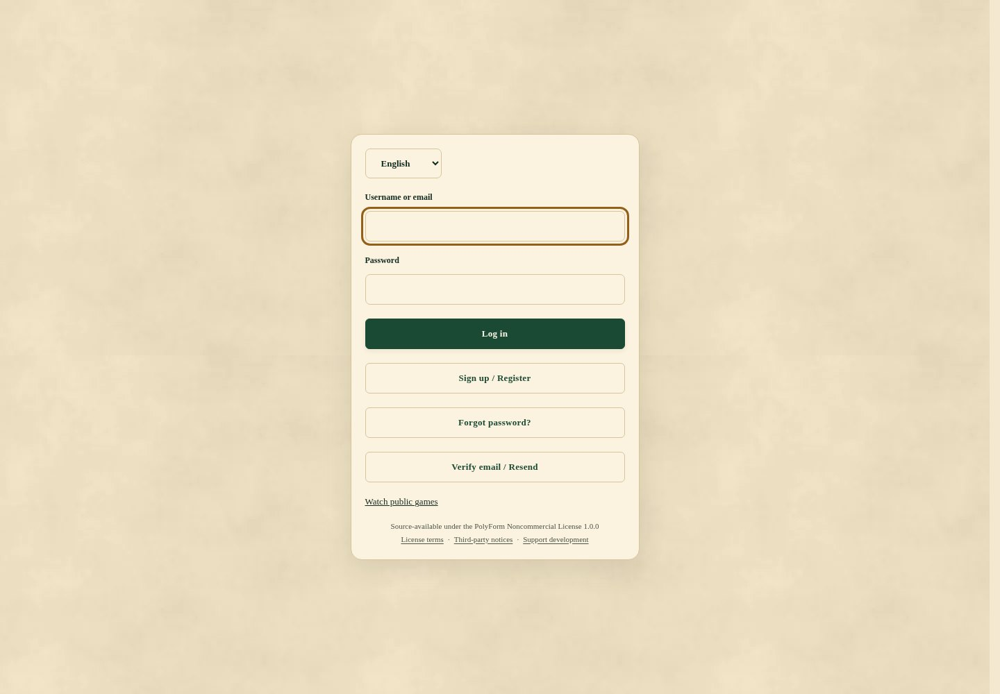
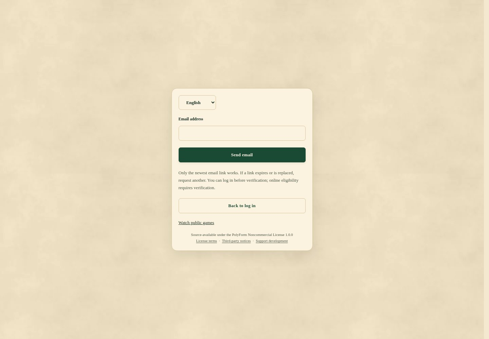
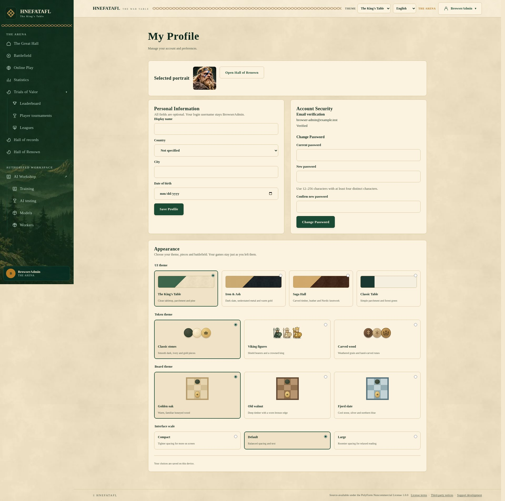

# Account and profile surfaces

[Interface index](README.md) · [Profile](../profile.md) · [Security](../../administration/security.md) · [User management](../../administration/user-management.md)

## Login

**Purpose:** authenticate. **Access:** `/login`, or redirect after logout/session
expiry.

**Main functionality:** username/email and password; links to registration, password
recovery, verification resend and the public Watch Hall.

**Controls and restrictions:** registration links appear only when enabled; errors
stay inline; no default credentials exist.

## Registration and verification

**Purpose:** create and verify an account. **Access:** `/register` and
`/verify-email`.

**Main functionality:** username/email/password with policy validation; single-use
verification link; explicit **Verify email** confirmation. An expired/used link
offers resend.

**Controls and restrictions:** registration and mail delivery are operator-enabled;
only the newest link works; responses do not reveal account existence.

## Password recovery

**Purpose:** request and complete a password reset. **Access:** `/forgot-password`
and `/reset-password`.

**Main functionality:** request an email link, then enter and confirm a new password.

**Controls and restrictions:** single-use expiring link; the full reset form appears
only with a valid token; invalid/expired links offer a new request.

## My Profile

**Purpose:** manage public profile fields, security and appearance. **Access:**
`/profile` or **My Profile** in the account menu.

**Main functionality:** selected portrait, display name, country, city, biography,
optional birth date/public age; email verification and password change; appearance
settings.

**Controls and restrictions:** optional fields are public when populated and private
when cleared; full birth date is never public; account ID remains the authorization
identity. Appearance controls are also shown in
[this capture](../../assets/game/kings-table-appearance.jpg). See [profile](../profile.md)
and [account implementation](../../development/accounts.md).
