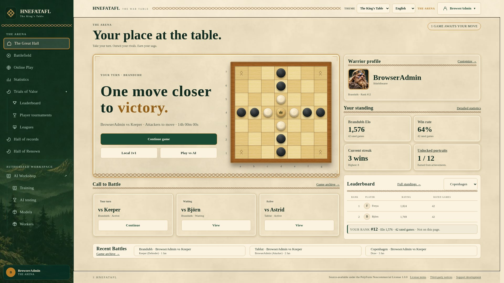
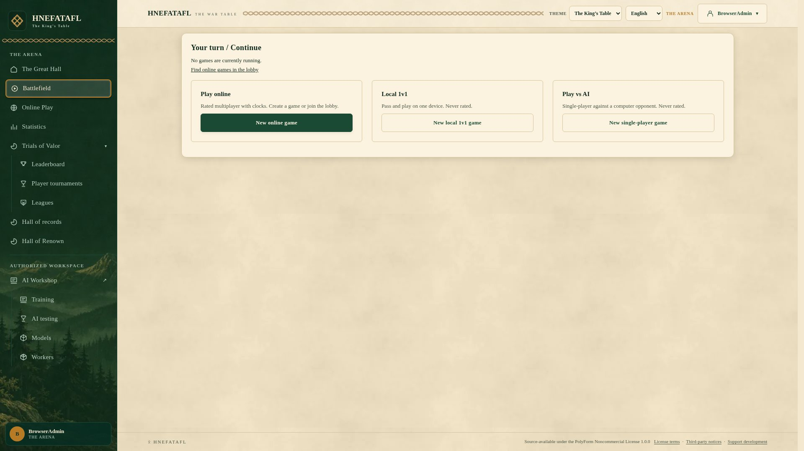
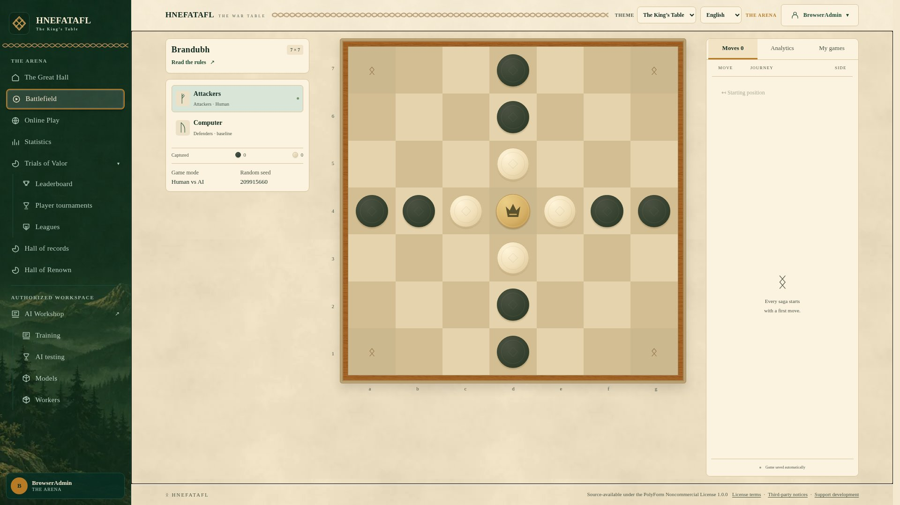
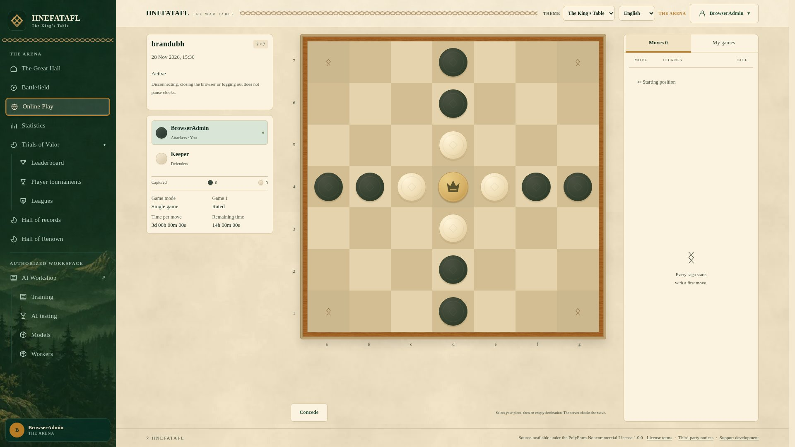
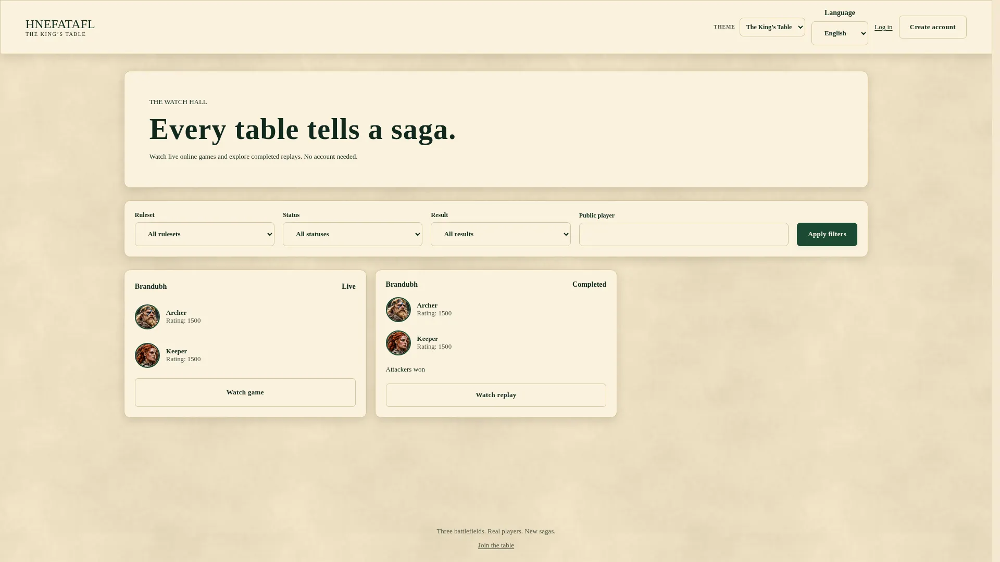

# Arena: play surfaces

[Interface index](README.md) · [Gameplay](../gameplay.md) · [Online play](../online-play.md) · [Public Watch Hall](#public-watch-hall)

## The Great Hall

**Purpose:** authenticated landing page with running games, creation actions,
standing, leaderboard preview and recent records. **Access:** `/dashboard`, the
default post-login page and **The Great Hall** in the Arena navigation.

**Main functionality:** hero game with **YOUR TURN** and authoritative online clock;
**Play online**, **Local 1v1** and **Play vs AI** creation actions or **Continue
game**; warrior profile and standing cards; compact leaderboard; bounded **Games that
need you** and recent records.

**Controls and restrictions:** **Detailed statistics** opens `/statistics`; recent
records link to replay; no rank or reward is invented. The page requires an
authenticated account.

Theme comparison: [Iron Ash](../../assets/game/themes/iron-ash-dashboard.jpg) ·
[Saga Hall](../../assets/game/themes/saga-hall-dashboard.jpg) ·
[Classic Table](../../assets/game/themes/classic-table-dashboard.jpg).

## Battlefield and play screen

**Purpose:** resume an unfinished account game or start a new one. **Access:** `/play`
and the Battlefield destination; individual games use `/games/{id}`.

**Main functionality:** automatic resume of the last unfinished game after checking
server lists; otherwise the three creation modes and a link to the online lobby. On
the board, select a piece then a highlighted legal destination. Desktop exposes
Moves / Analytics / My games; mobile switches the panel below the board.

**Controls and restrictions:** mouse, touch and keyboard (arrows, Enter/Space,
Escape). History is read-only; completed games cannot restart; live online games do
not offer analysis. Local 1v1 alternates two labelled seats and uses the same board:
[local 1v1 view](../../assets/game/kings-table-local.jpg). Other themes:
[Iron Ash](../../assets/game/themes/iron-ash-battlefield.jpg) ·
[Saga Hall](../../assets/game/themes/saga-hall-battlefield.jpg) ·
[Classic Table](../../assets/game/themes/classic-table-battlefield.jpg). See
[gameplay](../gameplay.md).

## Online Play

**Purpose:** authenticated lobby for creating, joining and resuming online games.
**Access:** `/online` and the Online Play destination; games open at
`/online/games/{id}`.

**Main functionality:** **All games**, **My games** and **My turn** tabs; ruleset
filter; bounded pages; create a single game or two-game match; join waiting games;
cancel your own waiting game. Active cards show remaining time.

**Controls and restrictions:** no move advisor, hints or win probability in a live
game; creation settings freeze after creation; admission and quotas are operator
controlled. Online clocks follow the authoritative deadline; hiding the browser tab
stops only local countdown rendering, not the deadline. See
[online play](../online-play.md).

## Public Watch Hall

**Purpose:** signed-out discovery and read-only viewing of eligible online games.
**Access:** `/watch`, with live games at `/watch/games/{id}` and completed replays at
`/watch/games/{id}/replay`.

**Main functionality:** browse public games, open a live board or completed replay,
step through saved moves.

**Controls and restrictions:** no account, gameplay or private history. Only an
allowlisted public projection is returned. Public visitors cannot generate or modify
analysis; live games expose none. A completed replay's API may include already-stored
terminal analysis, but the public UI does not render it. Private configuration,
single-player/local records, email and full birth dates are excluded. Public discovery
is enabled by default; an operator can disable it, after which the Watch Hall shows
not found.
Themes: [comparison](../../assets/game/public-watch-themes.jpg) ·
[Iron Ash](../../assets/game/iron-ash-public-watch.webp) ·
[Saga Hall](../../assets/game/saga-hall-public-watch.webp) ·
[Classic Table](../../assets/game/classic-table-public-watch.webp). Mobile:
[phone view](../../assets/game/public-watch-mobile.jpg).
