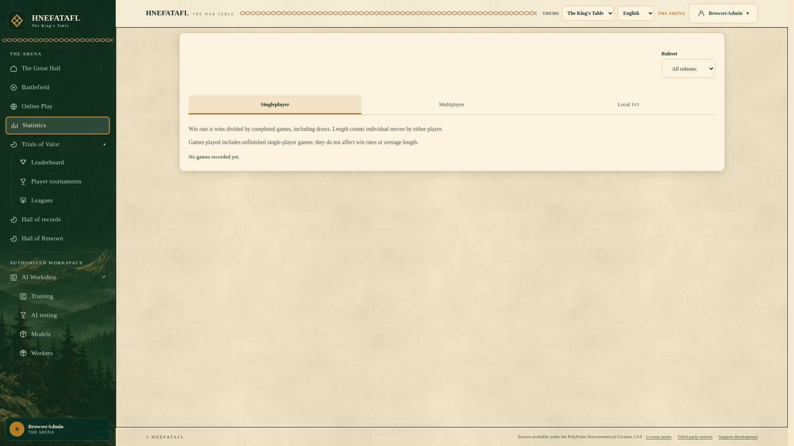
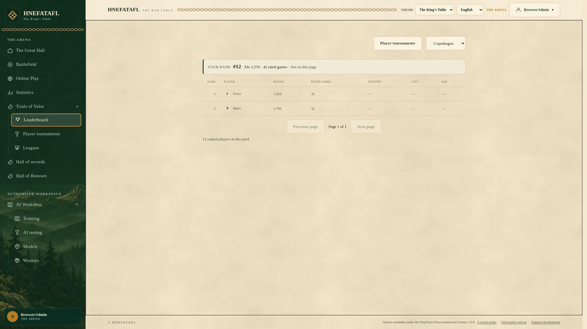
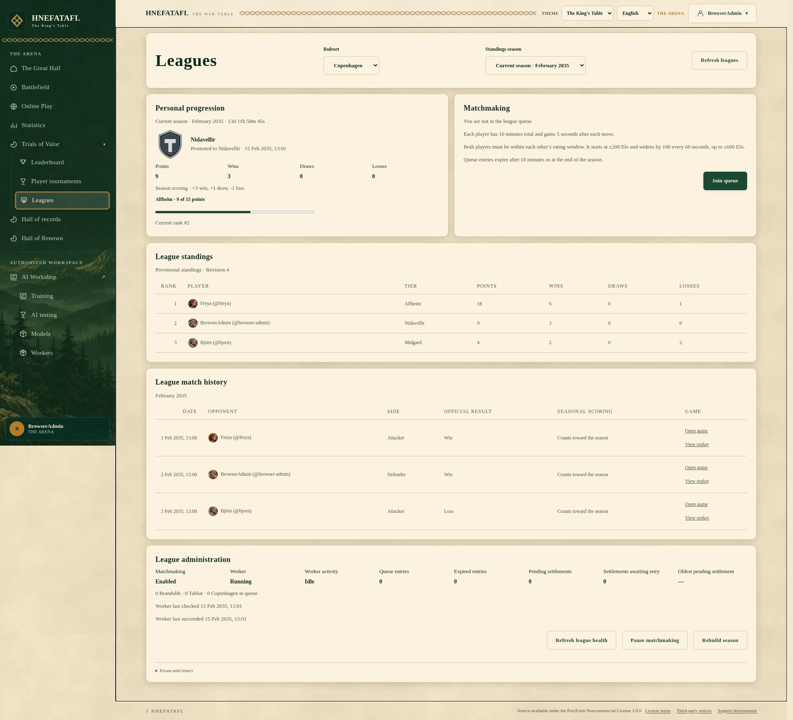
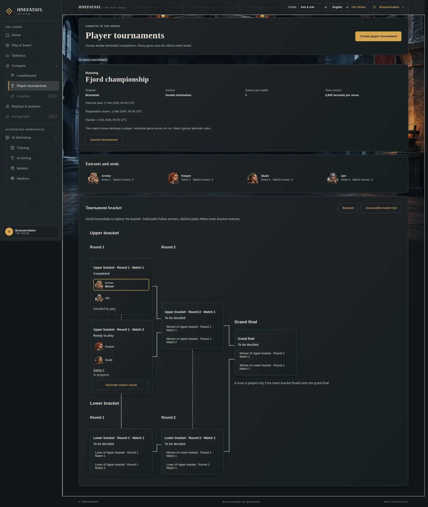

# Arena: competition surfaces

[Interface index](README.md) · [Ratings](../ratings.md) · [Leagues](../leagues.md) · [Player tournaments](../tournaments.md)

## Statistics

**Purpose:** personal results from your authoritative seat. **Access:**
`/statistics` and **Statistics** in the Arena navigation.

**Main functionality:** **Singleplayer**, **Multiplayer** and **Local 1v1** tabs;
ruleset filter; outcome distribution plus overall, attacker and defender tables
(games, wins, losses, draws, win rate, average length). Tabs/filter stay in the URL.

**Controls and restrictions:** statistics are account-relative; local 1v1 is never
mixed with online or account single-player data. See
[dashboard and statistics](../dashboard.md#personal-statistics).

## Leaderboard

**Purpose:** rated standings and your own rank. **Access:** `/leaderboard` and
**Leaderboard** under **Trials of Valor**.

**Main functionality:** one list per ruleset, qualified/provisional markers,
pagination and a separate own-rank row when outside the page.

**Controls and restrictions:** only rated online/league results count; tournament
legs and historical casual records do not. Role-specific win rates are shown on the
statistics and online surfaces:
[Kings Table](../../assets/game/role-win-rates/kings-table-desktop.webp) ·
[Iron Ash](../../assets/game/role-win-rates/iron-ash-desktop.webp) ·
[Saga Hall](../../assets/game/role-win-rates/saga-hall-desktop.webp) ·
[Classic Table](../../assets/game/role-win-rates/classic-table-desktop.webp); mobile:
[Iron Ash compact](../../assets/game/role-win-rates/iron-ash-compact-mobile.webp) ·
[Saga Hall](../../assets/game/role-win-rates/saga-hall-large-mobile.webp) ·
[online Saga Hall](../../assets/game/role-win-rates/saga-hall-online-large-mobile.webp).
See [ratings](../ratings.md).

## Leagues

**Purpose:** seasonal progress, queue, standings and history. **Access:** `/leagues`
and **Leagues** under **Trials of Valor**.

**Main functionality:** current UTC season; ruleset selector; personal points,
tier, qualification and rank; **Join queue**; qualified standings; match history with
official result, seasonal scoring and game/replay links; administrator health and
recovery controls for authorized accounts.

**Controls and restrictions:** queue expires after ten minutes or at the season
boundary; one active league game; only verified, eligible humans. League games are
rated, but league points are a separate seasonal score. See [leagues](../leagues.md).

## Player tournaments

**Purpose:** discover, register for and follow human double-elimination tournaments.
**Access:** `/player-tournaments` and **Player tournaments** under **Trials of
Valor**; a selected tournament uses its own URL.

**Main functionality:** open/upcoming tournaments, registration, entrants and seeds,
scheduled rounds, winners/losers bracket, match links, results and an accessible
list alternative. Creators see start/reschedule/moderation actions when permitted.

**Controls and restrictions:** tournament legs are unrated; registration closes at
the configured time; settlement and corrections are authoritative and audited.
Themes: [Kings Table](../../assets/game/kings-table-player-tournaments.webp) ·
[Saga Hall](../../assets/game/saga-hall-player-tournaments.webp) ·
[Classic Table](../../assets/game/classic-table-player-tournaments.webp). See
[player tournaments](../tournaments.md).
