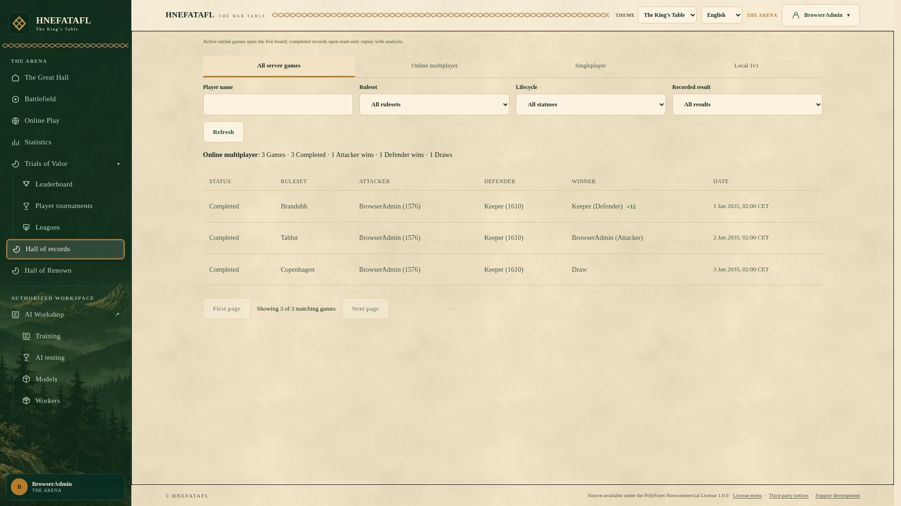
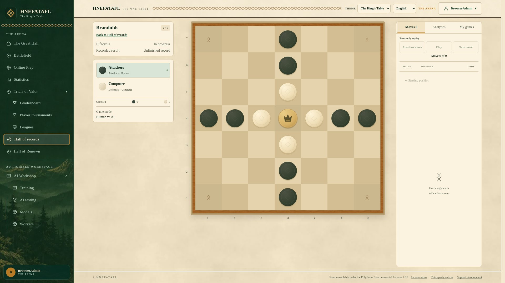
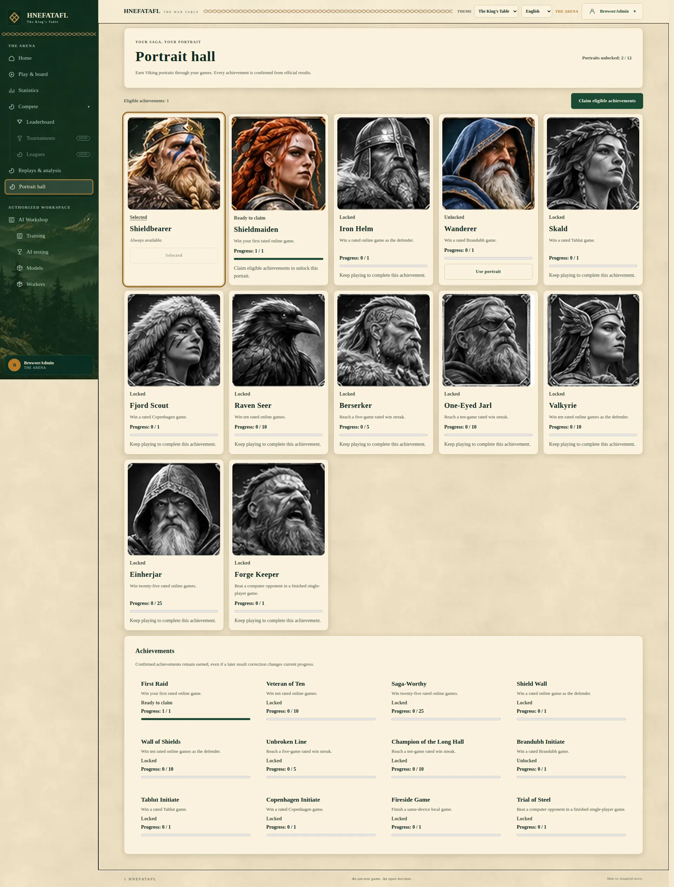

# Arena: records and portraits

[Interface index](README.md) · [Replay and analysis](../replay-and-analysis.md) · [Progression](../progression.md)

## Hall of records

**Purpose:** read-only account history with filters and selected review. **Access:**
`/archive` and **Hall of records** in the Arena navigation.

**Main functionality:** **All records**, **Online multiplayer**, **Singleplayer** and
**Local 1v1**; filters for player, ruleset, lifecycle and result; totals, bounded
pagination and a selected review that survives filter changes.

**Controls and restrictions:** ordinary accounts see participating/owned records;
administrators can inspect all server-recorded categories. No mutation, restart or
export controls.

## Replay and analysis

**Purpose:** inspect a completed game read-only and, where permitted, saved agent
estimates. **Access:** select a record in the Hall of records.

**Main functionality:** shared board and move list; step through positions; return to
the selected review or live game; open saved analysis/advisor results on eligible
records.

**Controls and restrictions:** replay never branches or overwrites the saved game;
live online games have no analysis; estimates are uncalibrated expected scores. See
[replay and analysis](../replay-and-analysis.md).

## Hall of Renown

**Purpose:** portrait collection, selection and achievement progress. **Access:**
`/portraits` and **Hall of Renown** in the Arena navigation.

**Main functionality:** unlocked/locked portraits, selected portrait, **Deeds of
Valor** achievement cards, milestone rewards, **Unlock portrait** for eligible
portraits and **Use portrait** to equip an unlocked one. Achievement cards show
earned tier, recorded progress, next milestone and milestone rewards; awards are
automatic and no point cost is charged for a portrait.

**Controls and restrictions:** only earned catalog IDs can be selected; awards are
permanent after confirmation; artwork is cosmetic. See [progression](../progression.md).

Achievement galleries: [Kings Table](../../assets/game/kings-table-achievements.png) ·
[Iron Ash](../../assets/game/iron-ash-achievements.png) ·
[Saga Hall](../../assets/game/saga-hall-achievements.png) ·
[Classic Table](../../assets/game/classic-table-achievements.png). Achievement cards:
[desktop](../../assets/game/achievement-cards-desktop.webp) ·
[mobile](../../assets/game/achievement-cards-mobile.webp). Manual reveal:
[Shieldmaiden portrait](../../assets/game/shieldmaiden-reveal.webp).

Theme comparison: [Iron Ash](../../assets/game/iron-ash-portrait-hall.webp) ·
[Saga Hall](../../assets/game/saga-hall-portrait-hall.webp) ·
[Classic Table](../../assets/game/classic-table-portrait-hall.webp). Mobile:
[portrait hall on phone](../../assets/game/portrait-hall-mobile.jpg).
