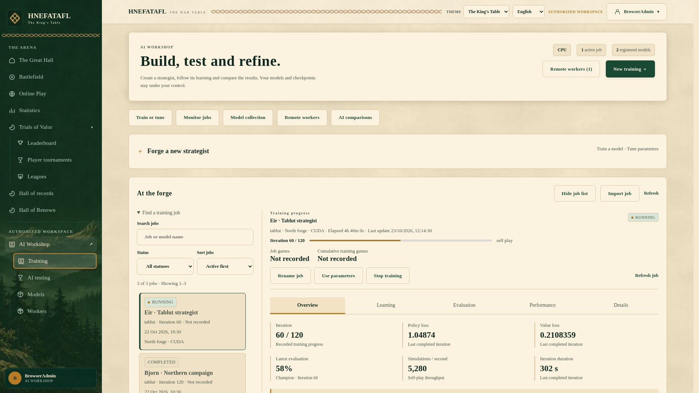
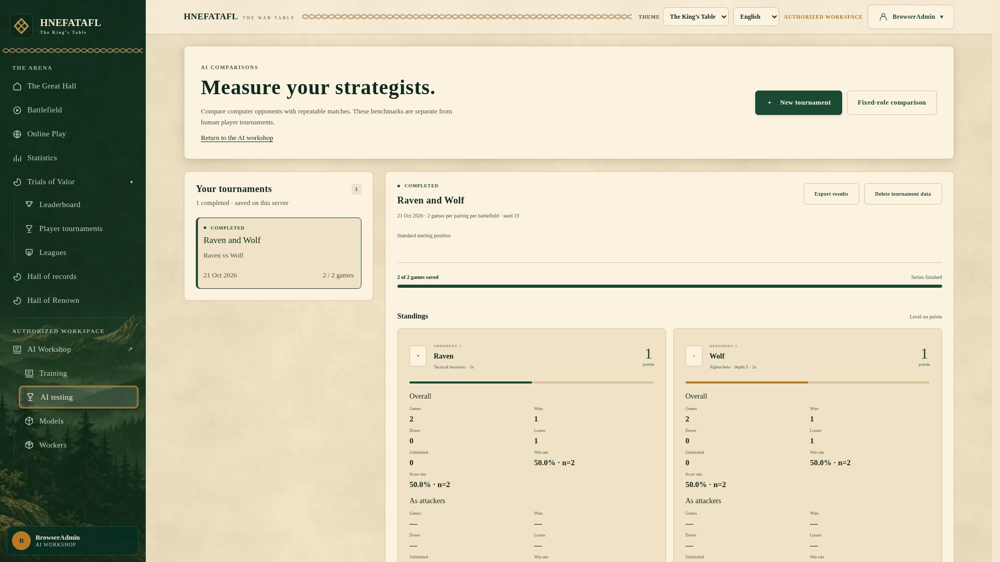
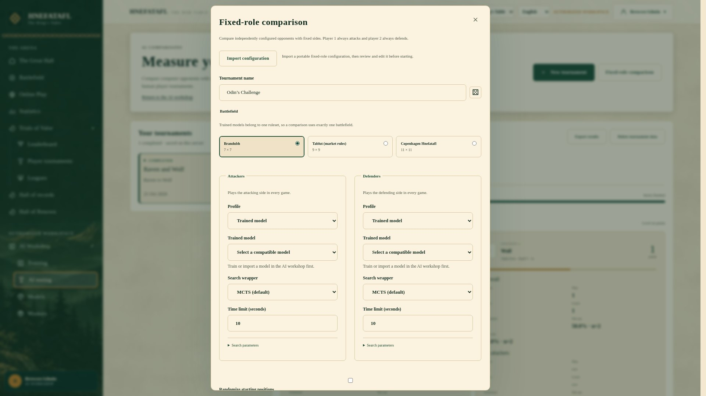

# Workshop surfaces

[Interface index](README.md) · [Training interface](../../training/interface.md) · [AI Testing guide](../../evaluation/ai-tournaments.md)

The **AI Workshop** is a separate permission-gated workspace. The Arena navigation
does not expose training, models or workers to unauthorized accounts.

| Destination | Route | Guide |
| --- | --- | --- |
| Training (create/monitor/tune/resume, Models, Workers) | `/training` | [Training interface](../../training/interface.md) |
| AI Testing (saved AI comparisons) | `/tournaments` | [AI Testing](../../evaluation/ai-tournaments.md) |

## Training

**Purpose:** create and monitor training/tuning jobs and manage models and workers.
**Access:** **AI Workshop → Training** (`/training`), also the Models and Workers
anchors on the same page.

The Workshop keeps the selected job's overview and analysis tabs in the main
content, with a bounded job navigator, import/export, and model/worker sections.
Operators can create jobs, review parameters, monitor phases, inspect learning/
evaluation/performance/details, resume from a full checkpoint, tune with Optuna and
manage remote workers. See the [training interface](../../training/interface.md) for
page and tab documentation.

## AI Testing

**Purpose:** saved AI round-robin and fixed-role comparisons, separate from human
tournaments. **Access:** **AI Workshop → AI testing** (`/tournaments`).

The page lists saved series, standings, per-battlefield win matrices, role analytics,
replay and export. **New tournament** starts a balanced round robin; **Fixed-role
comparison** pins an attacker and defender. These games never affect player Elo,
leagues or statistics. See [AI Testing](../../evaluation/ai-tournaments.md).
