# Workshop interface

[Training index](README.md) · [Getting started](getting-started.md) · [Models](models.md) · [Workers](remote-workers.md) · [AI testing](../evaluation/ai-tournaments.md)

The **AI Workshop** is a separate permission-gated workspace with four destinations:
**Training**, **Models**, **Workers** and **AI testing**. Training/Models/Workers
share `/training`; AI testing uses `/tournaments`. Unauthorized destinations are
not shown and direct routes are rejected by the backend.

| Destination | Route | Use |
| --- | --- | --- |
| Training | `/training` | Create/resume/tune jobs, monitor progress, inspect analysis tabs |
| Models | `/training#model-collection` | Registered model cards, compatibility and lifecycle |
| Workers | `/training#workshop-workers` | Enroll, inspect, revoke and override remote workers |
| AI testing | `/tournaments` | Saved AI comparison series |

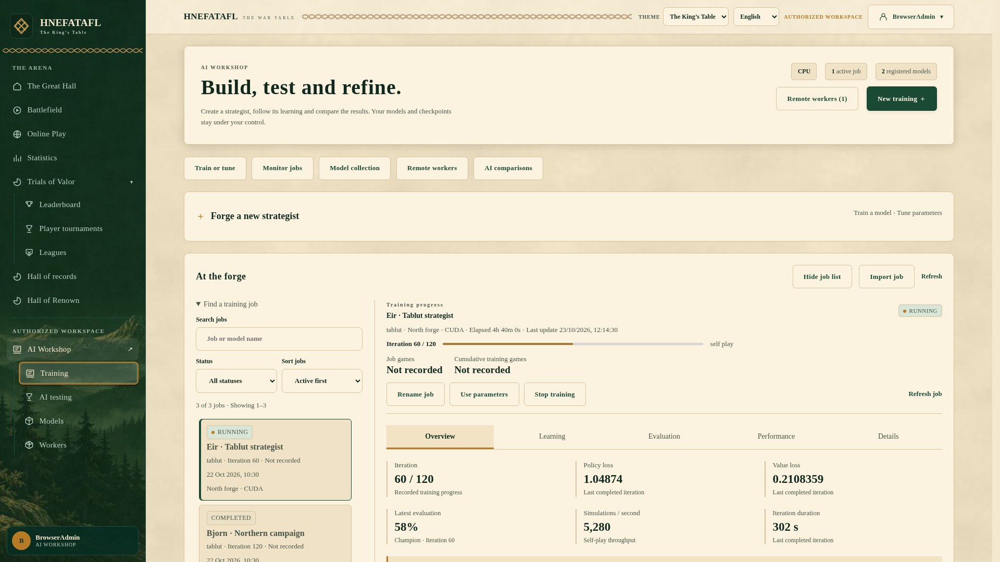

Theme comparison: [Kings Table](../assets/training/kings-table-workshop.jpg) ·
[Iron Ash](../assets/training/iron-ash-workshop.jpg) ·
[Saga Hall](../assets/training/saga-hall-workshop.jpg) ·
[Classic Table](../assets/training/classic-table-workshop.jpg). A
[contact sheet](../assets/training/contact-kings-table.webp) summarizes the sections.

## Training

### Create, select and resume

**Train or tune** starts a job from a preset or reviewed configuration, imports a
portable `config.json`, or opens **Tune parameters**. **Monitor jobs** selects a
retained job. **Resume training** starts from the source job's latest full
checkpoint and requires immutable architecture/optimizer identity to stay unchanged.

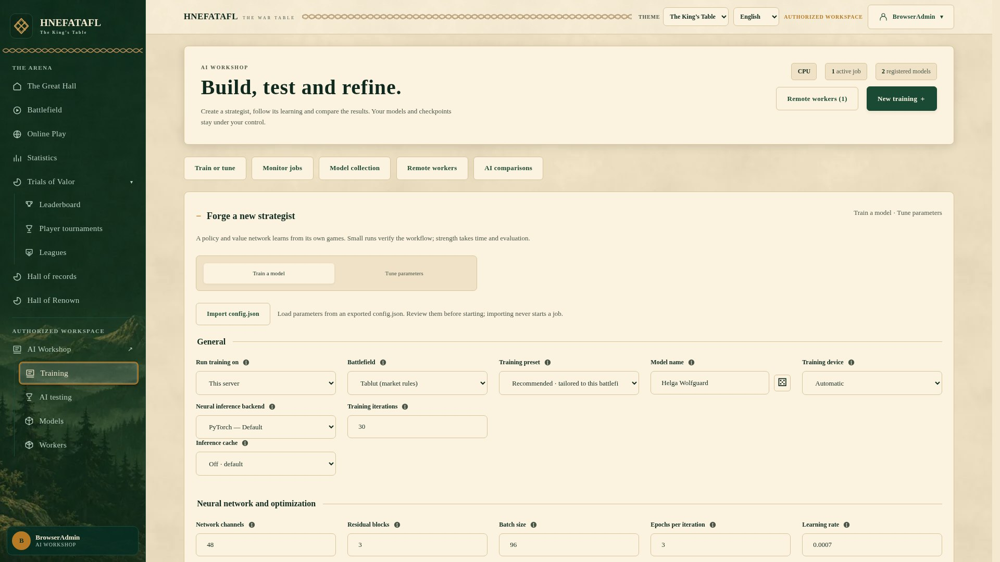

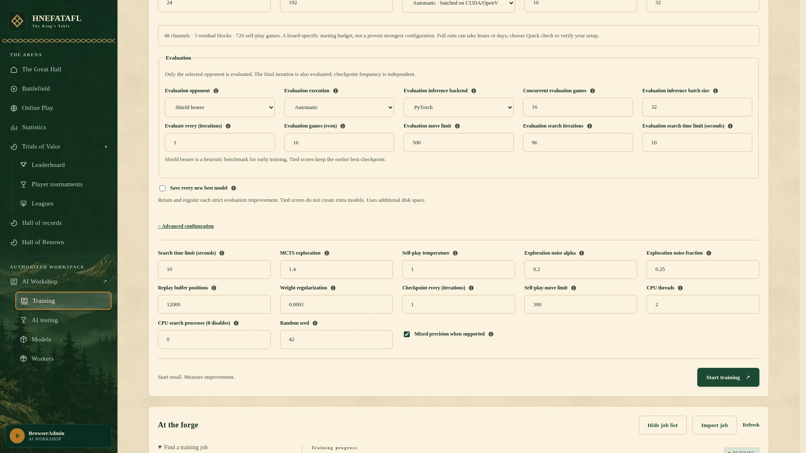

The form exposes common settings first; **Advanced configuration** adds search,
replay, seed, thread and precision controls. Field help is shared with the resume
dialog. Values, defaults, bounds and resume rules are canonical in
[parameters](parameters.md); plans are in [training plans](plans.md); workflows are
in [getting started](getting-started.md), [models](models.md) and [tuning](tuning.md).

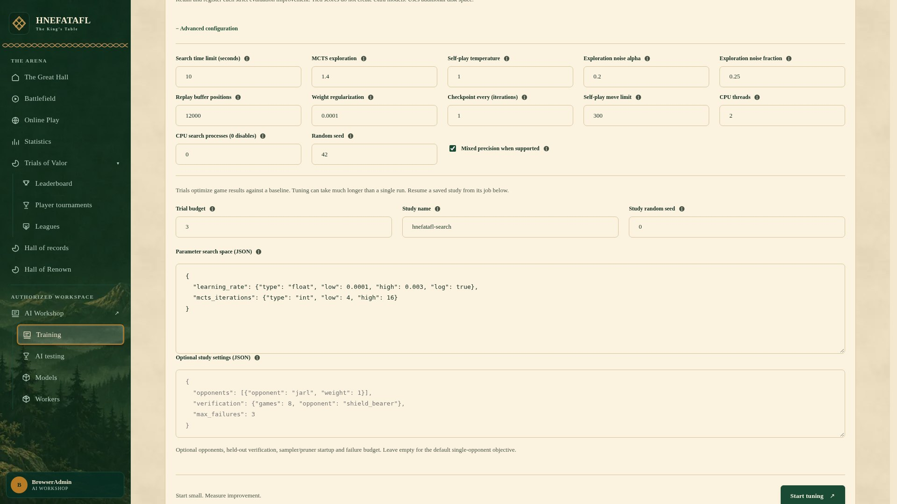

### Job overview and analysis tabs

The selected job shows its status, ruleset, device/worker, iteration progress, loss
and evaluation KPIs, and a bounded job navigator. Analysis tabs are:

| Tab | Use |
| --- | --- |
| **Overview** | Progress, latest losses/evaluation, phase timings and checkpoint selection |
| **Learning** | Loss/metric history, replay occupancy, optimizer updates, learning-rate/adaptation history |
| **Evaluation** | Scores by opponent/context, merged series, Champion promotions and game totals |
| **Performance** | Throughput, batch/concurrency, phase durations and resource counters |
| **Details** | Saved configuration, logs, checkpoints, execution metadata and export/import references |
| **Tuning results** | Optuna trial table, objective/best-so-far charts, winning parameters and apply/continue actions |

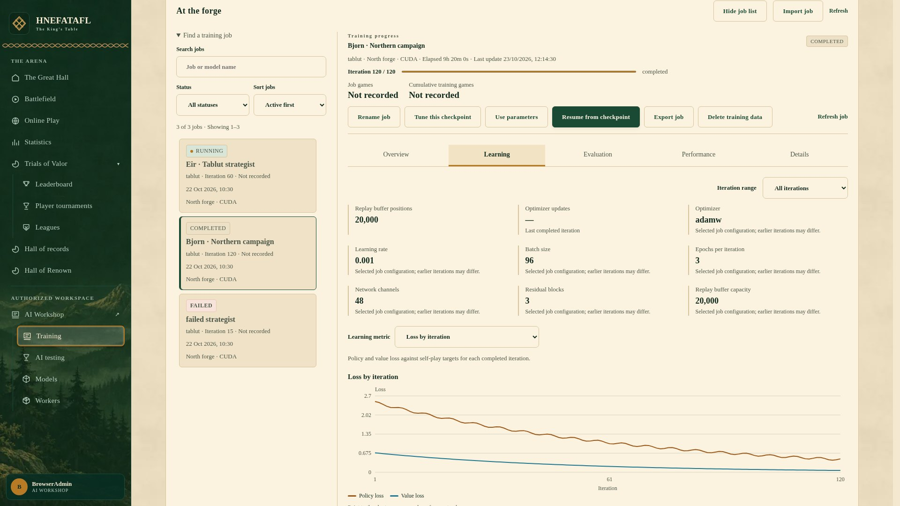

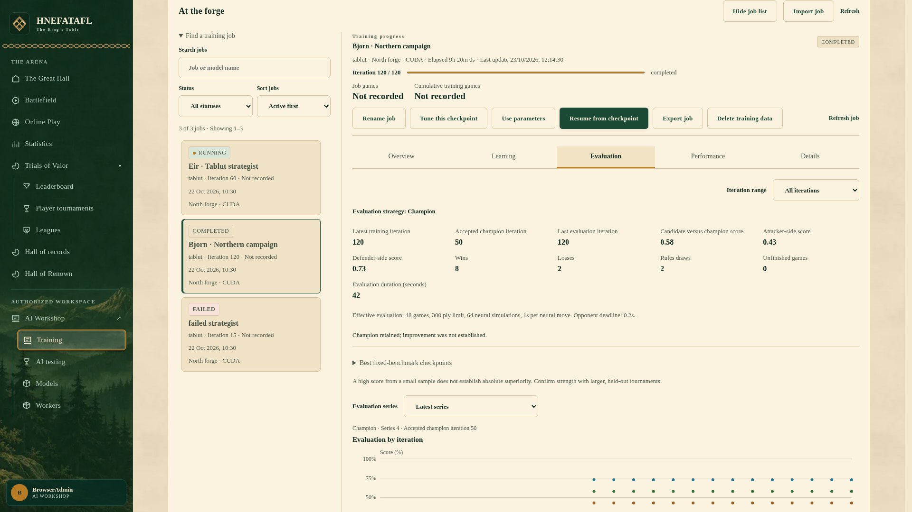

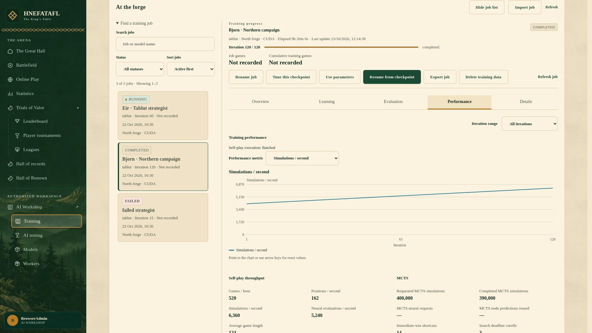

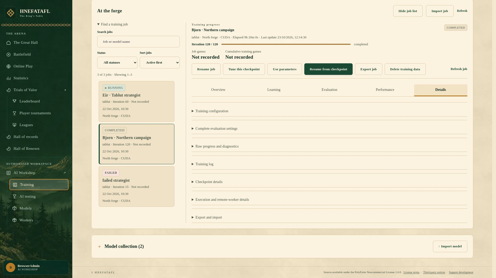

Chart behavior: missing evaluations are gaps, not zeros; a merged evaluation series
connects contexts but a step where opponent/Champion changed is a context change,
not continuous improvement; use per-series views for like-for-like comparison.
Tuning results and apply/continue workflows are in [tuning](tuning.md). Evaluation
opponents and Champion evidence are in [evaluation](evaluation.md).

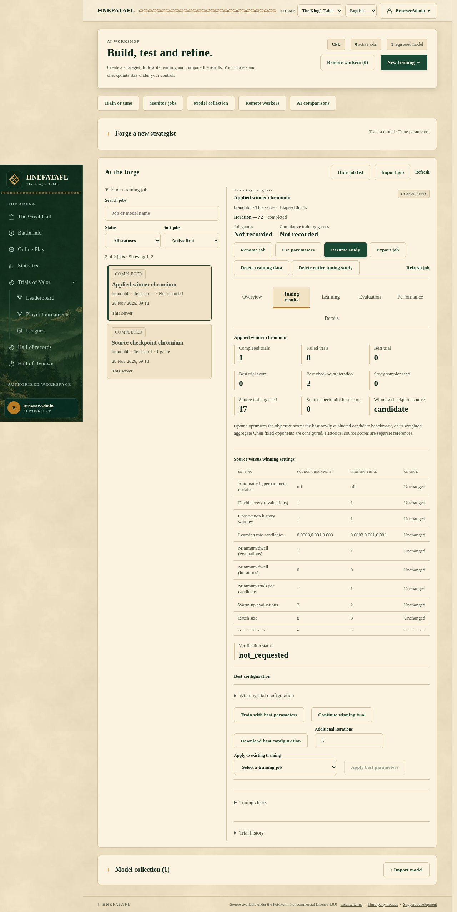

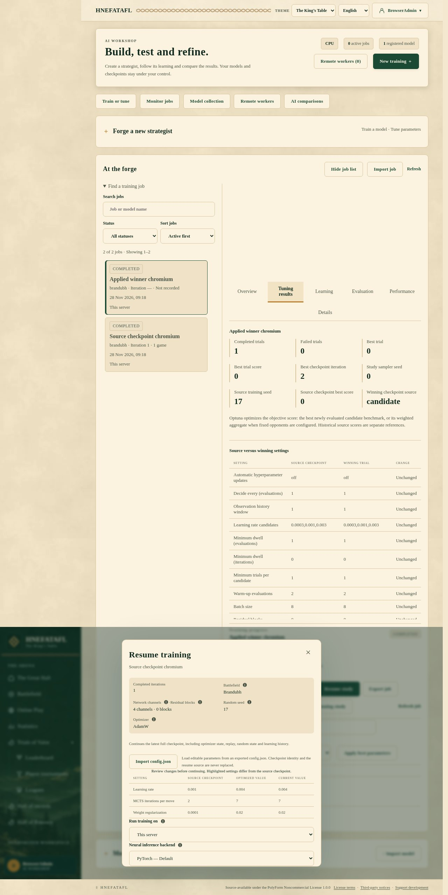

The screenshots use synthetic job fixtures or a real disposable CPU smoke run. They
are workflow examples, not throughput or model-strength evidence.

### Monitoring states

The monitor distinguishes training progress, worker heartbeat and snapshot
publication. Initialization reports `starting`, `loading_checkpoint`, `initializing`,
`restoring_state` and `initializing_inference`; a long game/epoch keeps elapsed time
advancing. Cancel writes a resumable checkpoint between moves/minibatches.

| State | Meaning |
| --- | --- |
| **Worker active** | Publication fresh and work progressing |
| **Running, long operation** | Fresh publication, no meaningful counter for two minutes |
| **Potentially stalled** | Fresh publication, no meaningful counter for ten minutes |
| **No recent updates** | Child process published nothing for twenty seconds while supervisor still reports |
| **Worker connection lost** | Server confirms supervisor silent for twenty seconds; job fails when lease expires |
| **Monitoring connection unavailable** | Browser has no fresh monitoring response for twenty seconds; worker state unknown |
| **Waiting for a worker** | Job is queued |

Hiding the browser suspends local countdown rendering only. Full publication/polling
internals are in [training monitoring](../development/training-monitoring.md).
Heartbeat labels never change job management or outcome.

## Models

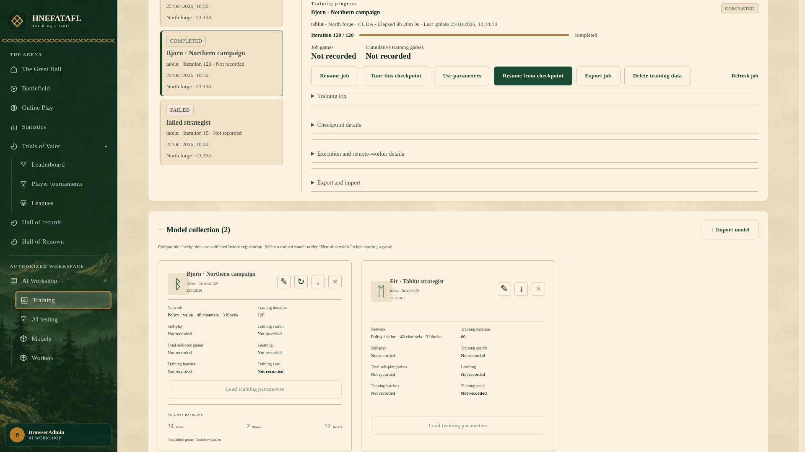

Model cards show name/rune, ruleset, iteration, architecture, recorded evaluation and
training seed when available. Controls: **Rename**, **Load training parameters**,
export, **Resume training** when a resumable source exists, and **Delete model**.
Deletion checks active jobs, studies and unfinished games; unfinished references need
explicit discard consent. Deleting a model does not delete its source job; deleting
training data does not delete a playable model. See [models](models.md).

## Workers

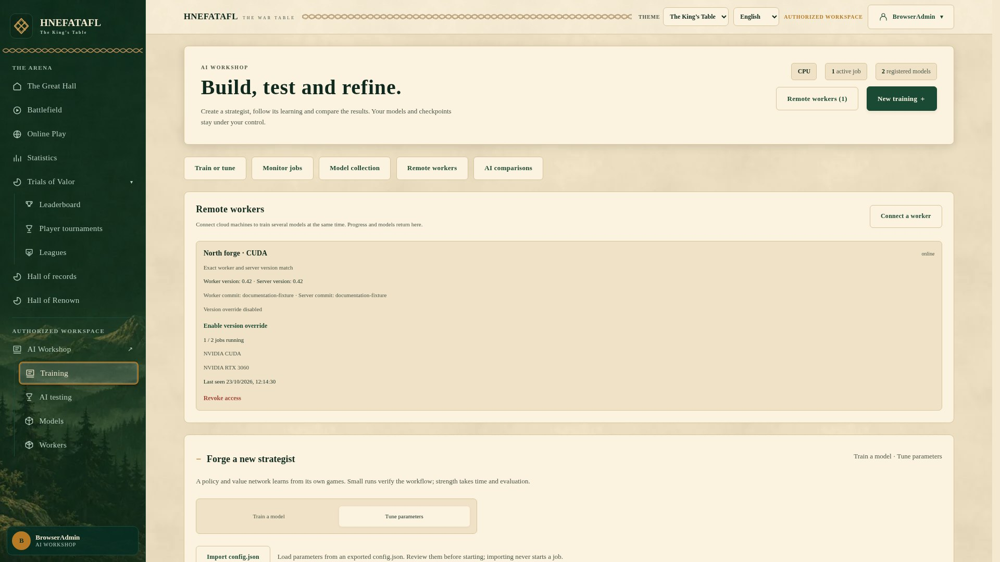

Worker cards show online status, compatibility, version/commit, capacity/active jobs,
device capabilities (CUDA/MPS/OpenVINO), last-seen time and revoke/override actions.
Enrollment returns a one-time token and command; only a hash is stored. See
[remote workers](remote-workers.md) and
[worker protocol](../development/worker-protocol.md).

## AI testing

AI testing (`/tournaments`) is a separate saved collection of AI comparison series.
It never enters player Elo, leagues or statistics.

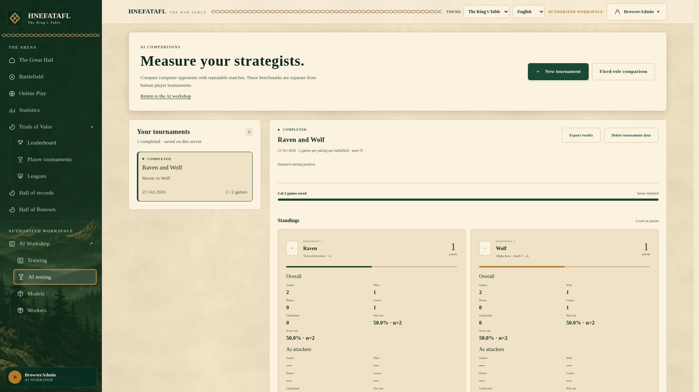

**New tournament** starts a balanced round robin; **Fixed-role comparison** pins an
independent attacker and defender. The setup chooses ruleset(s), entrants, games per
pair, search budgets, optional compatible models and randomized legal openings.

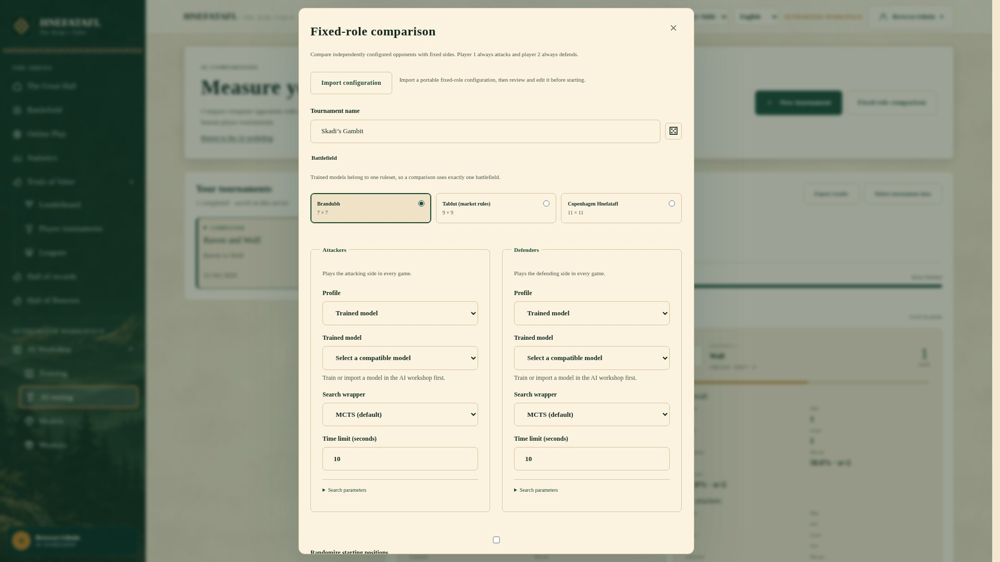

Saved series show standings, per-opponent scores, battlefield win matrices, role
analytics, game links/replay and export. Running series can be stopped; saved data can
be deleted after live references clear. Unfinished games remain separate from draws
and wins. See [AI testing methodology](../evaluation/ai-tournaments.md) and
[AI testing authority](../development/ai-testing.md).

## Optional OpenVINO

See [OpenVINO](openvino.md) for setup, portability and measured limitations.

## Screenshot provenance

Regenerate these opt-in with `npm run test:docs-screenshots`; see
[documentation guidelines](../development/documentation-guidelines.md#screenshots).
