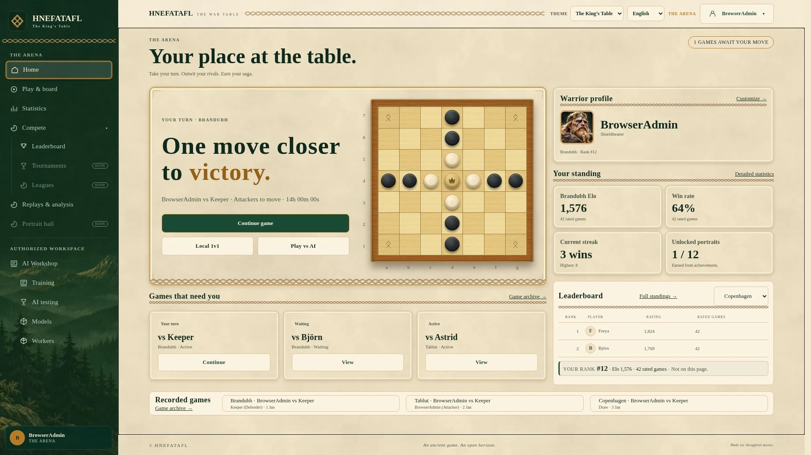
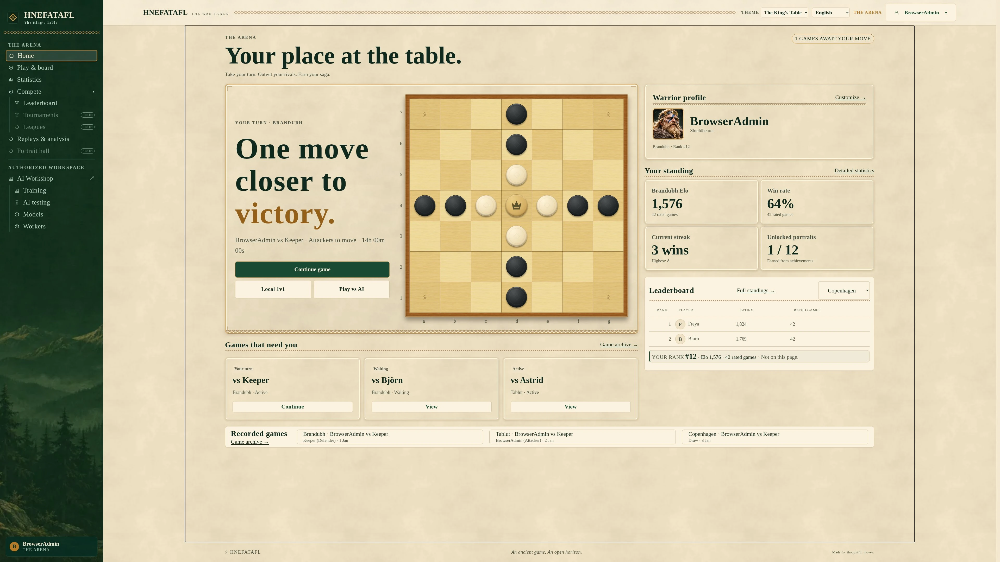
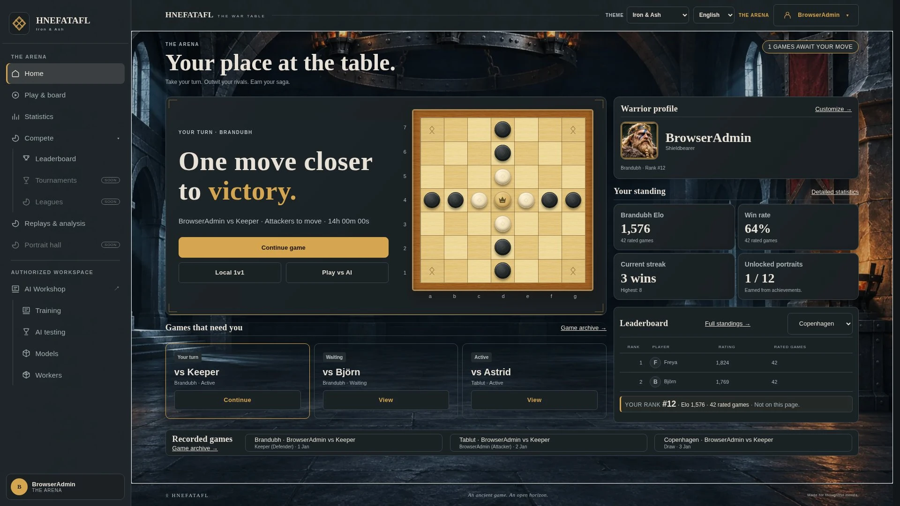
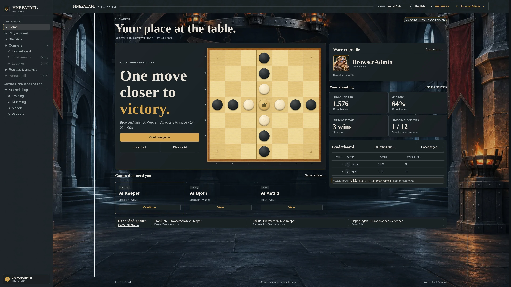
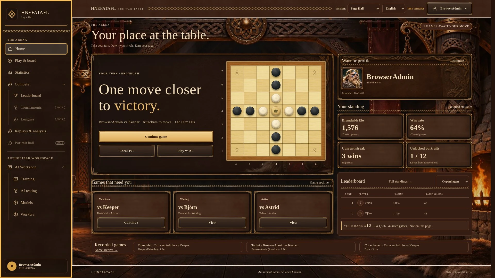
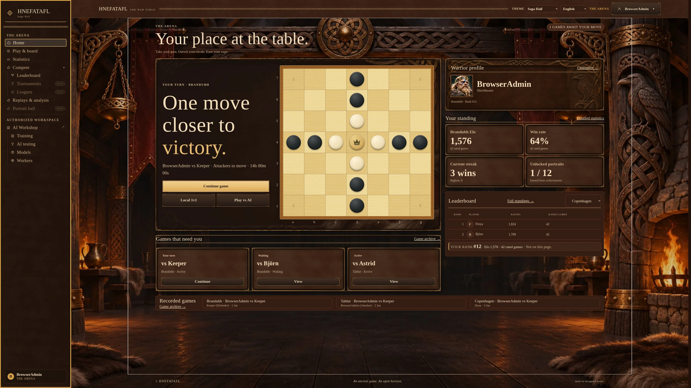
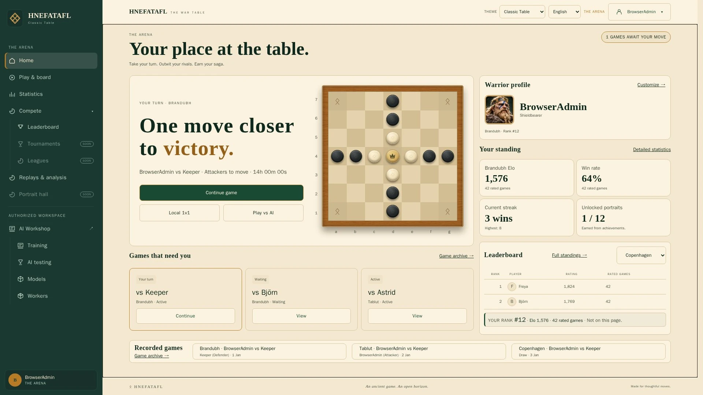
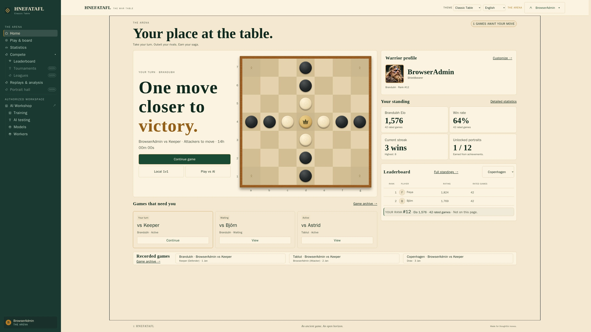

# Final Arena visual acceptance

[Design system](../DESIGN_SYSTEM.md) · [Personalization](../PERSONALIZATION.md)

This record covers the final PR #84 acceptance corrections. The earlier
[theme completion record](arena-theme-completion.md) retains its original screenshot
and test evidence; it is not evidence for these subsequent changes.

## Capture matrix

All four themes are captured at 1920×1080 with Default scale and 3840×2160 with
Large scale. The browser uses isolated account fixtures and production components;
illustrative names and statistics never enter production data.

The eight native Dashboard captures below retain the requested CSS viewport sizes.
Each contact sheet includes empty/populated Dashboard, Play, active single-player,
local 1v1, online, replay, Statistics, authorized Workshop and appearance settings.
A common Golden oak board / Classic stones preference makes the shell comparison
consistent; production defaults remain independently selectable Carved wood / Old walnut.

| Theme | 1920×1080 / Default | 3840×2160 / Large |
| --- | --- | --- |

| The King’s Table |  |  |
| Iron & Ash |  |  |
| Saga Hall |  |  |
| Classic Table |  |  |

## All-surface contact sheets

- The King’s Table: [1080p](../screenshots/arena-final/kings-table-1920-contact.webp), [4K](../screenshots/arena-final/kings-table-3840-contact.webp).
- Iron & Ash: [1080p](../screenshots/arena-final/iron-ash-1920-contact.webp), [4K](../screenshots/arena-final/iron-ash-3840-contact.webp).
- Saga Hall: [1080p](../screenshots/arena-final/saga-hall-1920-contact.webp), [4K](../screenshots/arena-final/saga-hall-3840-contact.webp).
- Classic Table: [1080p](../screenshots/arena-final/classic-table-1920-contact.webp), [4K](../screenshots/arena-final/classic-table-3840-contact.webp).

The full JPEG capture set (80 views plus four genuine-zoom views) is uploaded by
browser CI as `arena-final-visual-acceptance` before later browser configurations
clean their temporary output. The image names identify theme, width and surface.

## Review and validation

The native captures and all eight contact sheets were inspected against the
approved reference composition. The primary hero/profile/standings/queue hierarchy
is retained. Scene artwork stays behind readable panels; SVG trim follows panel
edges. The board remains square and the persistent sidebar does not overlap it.

Automated acceptance checks require no horizontal page overflow, non-overlapping
hero/aside and queue, a usable square board (under one pixel aspect difference),
and a primary-fixture footer within the viewport at both target sizes. The theme
label must sit left of the select and its centre differ vertically by under 2px.
Actual 200% Chromium zoom is checked with the test-only extension and
`chrome.tabs.getZoom()`, including CSS viewport width and scale changes; it is not
represented by pinch-zoom emulation. Explicit scale choices survive zoom and reload.

Local final appearance/acceptance suites: **37 passed, 9 intentional skips**. The
skips avoid duplicating the desktop matrix and native-zoom extension in the mobile
project; mobile controls, resizing, migration and failed-artwork behavior run.
The complete frontend unit suite passed **1312 tests in 93 files**.
A broader local selection also passed 158 checks with 12 intentional skips;
its two failures were in the new fallback test (detached hero timing and a
mobile-only control location), corrected and passed in the final 37-case run.
A further **20 checks passed** after strengthening light-theme metadata contrast: all four themes retain at least 4.5:1 for primary controls and standing-card metadata, including obsolete-mode migration inputs; affected light-theme captures were refreshed. No contrast or geometry threshold was relaxed.

The complete final-head pipeline and its exact backend/browser totals are recorded
on [PR #84](https://github.com/freeDom-/hnefatafl/pull/84) and its Verify workflow.
Earlier commits' validation is not represented as final-head validation.

## Differences and limits

The reference screenshots contain concept-only league/season progression and
illustrative identities. Production uses real account state and explicit empty
states; unsupported league and portrait-hall navigation retains its labelled
unavailable state. These captures use isolated fixtures, with online visual reads
stubbed; the separate real-session online/personal suites cover permissions and
account isolation. Page names retain the established screen-reader-only treatment.

The great-hall and forge artwork are original new interpretations, not crops of
the reference screenshots. Their native 1672×941 sources scale as decorative
backgrounds at 4K; they are not claimed as native 4K illustrations. Current portrait
catalog thumbnails are reused rather than claimed as newly rendered high-resolution
portraits. Chromium desktop/mobile emulation is not physical-device Safari evidence.
