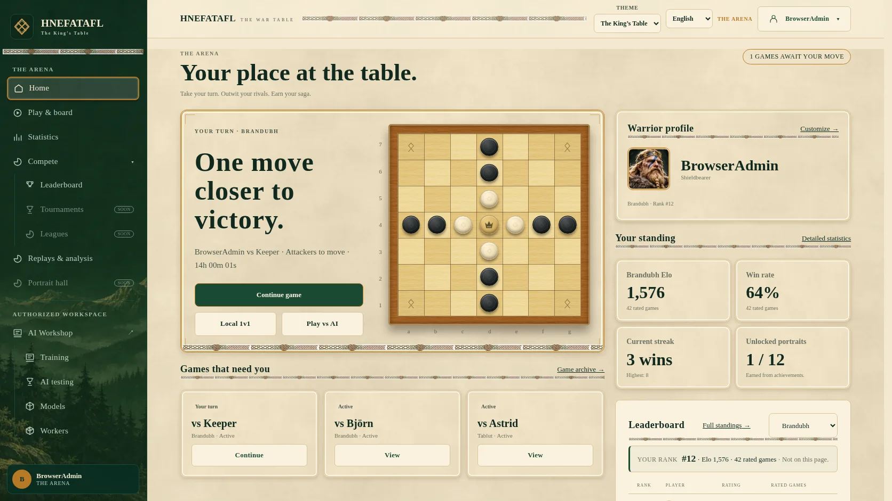
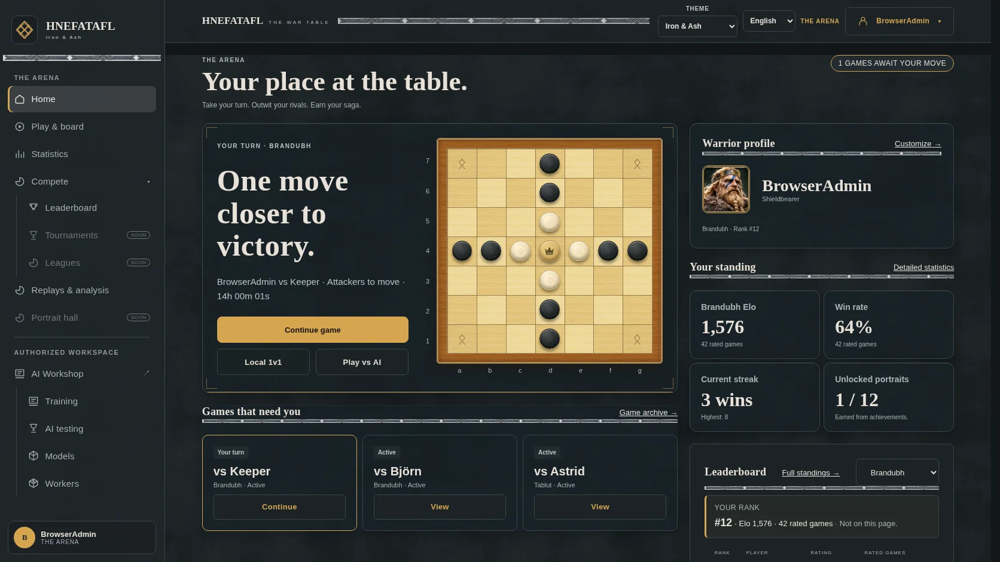
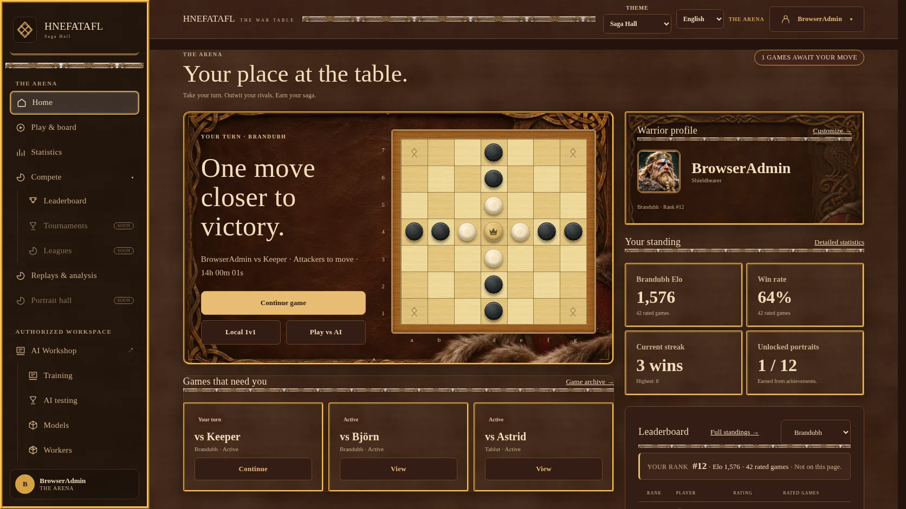
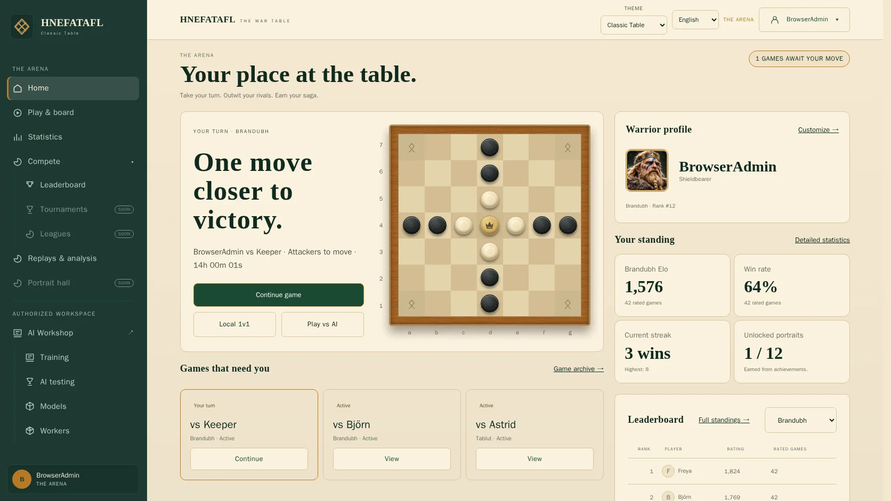

# Arena theme completion

The Arena uses one layout with four reference themes: King's Table (parchment,
forest green and gold), Iron & Ash (slate and metal), Saga Hall (carved timber
and leather), and Classic Table (flat green and parchment). The separate legacy
appearance preserves the older color-mode behavior. Board palettes, token sets,
interface scale and language remain independent choices.

## Asset integration

The generated `kings-table-forest.webp` (512 × 768) and
`saga-hall-raven-panel.webp` (1104 × 736) are original text-free decorative art.
Their paths and dimensions are maintained in `frontend/src/arenaAssets.ts`.
They are applied as CSS backgrounds, carry no game information and cannot take
focus or pointer input. Existing seamless materials remain reusable background
tiles; the supplied reference screenshots and source atlas are not runtime art.
A separate 768 × 768 wood-grain tile improves the board material while CSS
retains the selected palette. All three new assets are compressed WebP files.

The hero renders exactly one dynamic board. Artwork contains no board or pieces.
The board keeps its selected palette/token set, legal geometry and replay state.
Short desktop windows scroll normally rather than shrinking the dashboard to fit.
Long game lists and compact standings no longer clip their rows into a tiny
scrolling region. Mobile retains the compact navigation and stacked layout.

The transparent SVG interlace trim replaces the white-matted raster band studies;
Iron & Ash uses restrained metal hairlines instead.

## Desktop captures

These 1672 × 941 browser captures use isolated Brandubh fixtures and the
production components, with the route-focus outline cleared for the image only.

| Theme | Browser capture |
| --- | --- |
| The King’s Table |  |
| Iron & Ash |  |
| Saga Hall |  |
| Classic Table |  |

## Validation procedure

Run `make check` and the Arena redesign, shared UI, play discovery and workspace
navigation Playwright suites. The redesign suite captures all four themes plus
legacy at 320, 390, 768, 1024, 1366, 1440 and 1672 pixels. Its populated fixture uses
real production components with isolated test responses for three running games,
a Brandubh position and standings. Fixture values never enter production views.
Inspect the resulting screenshots against the supplied handoff references.

The shared heading check excludes the intentional hero display heading while
retaining the common typography check for ordinary section headings. The
reference-composition check requires a readable board and correct section order,
not an artificially fixed document height.

No league progress or unearned rewards are fabricated. The portrait hall and
league navigation retain their existing unavailable states. Browser screenshots
establish visual evidence only for the recorded fixtures and viewport sizes;
they do not establish pixel identity with generated concept art.
