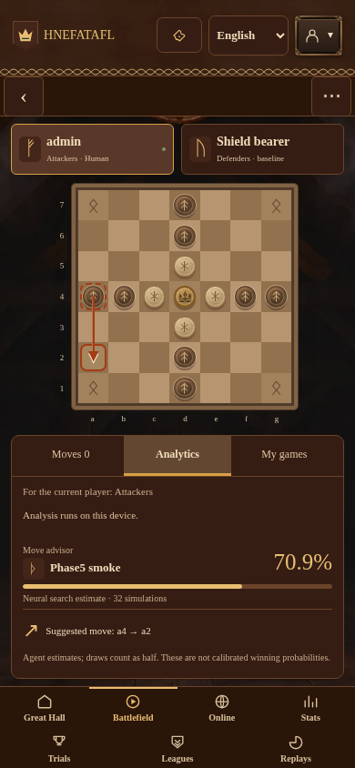

# Phase 5 — Transparent browser-first integration

[Roadmap](../designs/browser-analysis-roadmap.md) · [Architecture](../../ARCHITECTURE.md) ·
[Deployment](../DEPLOYMENT.md) · [Security](../SECURITY.md) ·
[Phase 4 runtime](browser-analysis-phase4.md) · [Phase 3C-B](browser-analysis-phase3c-b.md)

Status: **Phase 5 implementation is complete at the software level and validated
in a production-equivalent browser build. It is not production acceptance and the
feature remains opt-in and disabled by default on existing installations.**

Verified here: server-owned execution policy and enforcement, transparent local
Jarl and neural MCTS through the existing analysis UI, automatic WASM selection,
bounded WebGPU recovery, verified model reuse, warm offline computation,
cancellation/stale-result rejection, zero server analysis computation for
successful local requests, and unchanged initial-bundle budgets.

Explicitly not verified/closed: competitive trained-model strength, physical
device compatibility, independently verified GPU execution, Copenhagen depth-5
fixed-work completion, sustained-memory acceptance, cold offline startup and
complete distribution licensing. Those remain Phase 7 gates.

## 1. Architecture delivered

The deployment owns *where* analysis runs. Players keep using the existing
analysis controls; there is no Local/Server/Auto/Disabled selector, no provider
selector, no diagnostics panel and no separate browser-analysis page.

| Layer | Responsibility |
| --- | --- |
| `hnefatafl/analysis_policy.py` | Policy resolution/validation, public capability projection, per-process admission limits and coarse counters |
| `hnefatafl/auth.py` | CSP/delivery gating and policy on `SecuritySettings` |
| `hnefatafl/server.py` | Endpoint enforcement, execution policy in existing analytics/availability payloads, authorized analysis-context delivery, model-to-registry mapping, administrator metrics |
| `hnefatafl/analysis_service.py` | Task-lifetime admission/release around the existing shared analysis service |
| `frontend/src/useGameAnalysis.ts` | Chooses local vs server from the server policy; preserves the existing hook contract and presentation |
| `frontend/src/browserAnalysis/loader.ts` | Tiny deferred loader; contains no runtime import |
| `frontend/src/browserAnalysis/integration.ts` | Request normalization, managed Phase 4 runtime ownership, provider selection, model resolution, fallback classification, result adaptation, offline TTL/revalidation |
| `frontend/src/browserAnalysis/runtime.ts` | Existing Phase 4 runtime plus bounded warm-offline lease enforcement and model-session readiness |
| `frontend/src/AgentAnalysis.tsx` | Existing analysis UI plus unobtrusive local/offline/fallback feedback |

The browser still executes the shared Python engine in Pyodide; no JavaScript
rules engine or second search implementation was added. `analysis-context` returns
the server's authoritative serialized positions, including repetition history, so
local search semantics match the server.

## 2. Server execution policies

`HNEFATAFL_ANALYSIS_MODE` accepts exactly four values (case/whitespace normalized):

| Policy | Browser delivery | Server computation | Automatic fallback | Intended use |
| --- | --- | --- | --- | --- |
| `browser_only` | Yes | **No** | No | Normal browser-first operation |
| `browser_preferred` | Yes | Bounded compatibility path | Yes, classified failures only | Opt-in rollout |
| `server_only` | No (explicit) | Yes, legacy | Not applicable | Rollback/emergency compatibility |
| `disabled` | No | No | No | Optional analysis disabled |

Defaults and migration:

- No `HNEFATAFL_ANALYSIS_MODE`: historical behaviour. Server analysis remains
  enabled; `HNEFATAFL_BROWSER_ANALYSIS_ENABLED=1` keeps browser runtime delivery
  available for diagnostics but **does not** activate browser-first execution.
- An explicit mode always wins. The legacy flag cannot enable browser delivery in
  explicit `server_only` or `disabled` mode. It is ignored (documented precedence)
  rather than allowed to reopen a disabled browser path.
- Existing installations therefore keep their previous behaviour until an owner
  explicitly selects `browser_preferred` or `browser_only`.
- Invalid/unknown modes, invalid switch values, out-of-range offline/TTL/limit
  values and WebGPU enabled without browser delivery fail at startup.
- `HNEFATAFL_ANALYSIS_WEBGPU` defaults to `0`. The automatic provider path always
  starts with the validated WASM baseline; this flag only permits an attempt to
  use WebGPU, and a WebGPU request still refuses claims of verified execution.

### Configuration reference

| Variable | Default | Bounds | Meaning |
| --- | --- | --- | --- |
| `HNEFATAFL_ANALYSIS_MODE` | unset (legacy) | 4 modes | Deployment execution policy |
| `HNEFATAFL_BROWSER_ANALYSIS_ENABLED` | `0` | 0/1 | Legacy delivery flag; explicit mode wins |
| `HNEFATAFL_ANALYSIS_WEBGPU` | `0` | 0/1 | Permit an attempted WebGPU provider |
| `HNEFATAFL_ANALYSIS_OFFLINE_SECONDS` | `900` | 60–3600 | Server-defined warm-offline authorization window |
| `HNEFATAFL_ANALYSIS_MAX_CONCURRENT` | `16` | 1–64 | Global admitted analysis tasks per process |
| `HNEFATAFL_ANALYSIS_MAX_PER_USER` | `4` | 1–8 | Per-account concurrent analysis tasks |
| `HNEFATAFL_ANALYSIS_REQUESTS_PER_MINUTE` | `240` | 1–600 | Per-account analysis request ceiling |

The supported deployment runs **one API worker** (`--workers 1` in the shipped
service unit). Admission is therefore global for the supported architecture, not
per-API-worker. It reuses the existing bounded executor/queue (`MAX_ANALYSIS_TASKS`
= 16), synchronous waiter bound, retry-after responses, request deduplication and
result cache. There is no unbounded queue and no process-local limit presented as
multi-worker-safe.

### Backend enforcement

- `POST /api/games/{id}/analysis` and
  `POST /api/history/online/{id}/analysis` call the policy guard **before** any
  cache read, schedule or evaluation.
- In `browser_only` and `disabled`, every direct/historical/background request
  receives HTTP 409 with `code: analysis_server_disabled`; the analysis service is
  never invoked. Tests monkeypatch both `analyze_position` and the scheduler to
  prove no computation is started.
- `browser_preferred` applies the same per-account rate/concurrency limits to
  direct requests and to requests carrying `X-Analysis-Fallback: 1`. A client
  claim of local failure never grants capacity; the header is only a coarse
  observability category.
- `disabled` leaves replay navigation, game reads, move validation, AI opponents,
  training, tournaments and the rest of the engine operational. Stored analysis
  remains readable; no new optional computation is started.
- The guard is server-side only. Browser storage or front-end state cannot
  override the mode.

## 3. Analysis contexts and fair play

The new read-only `GET /api/games/{id}/analysis-context` and
`GET /api/history/online/{id}/analysis-context` endpoints return the normalized
`State` sequence (including repetition history) only where the existing analysis
surface would authorize the caller. They schedule/evaluate nothing and expose no
new game, replay, account or permission data.

| Context | Existing policy | Phase 5 local execution |
| --- | --- | --- |
| Active single-player game | Authorized analysis | Yes, current position |
| Completed single-player replay | Existing replay/analysis permission | Yes, already authorized positions |
| Completed online game | Completed-only analysis adapter | Yes, already authorized positions |
| League/tournament completed games | Through the existing completed/online or account replay authorization | Yes, exactly where the existing adapter allows it |
| Local 1v1 (`mode: local`) | No advisor/analysis by design | **No** (unchanged) |
| Active online/league/tournament game | Never authorized for analysis | **No** |
| Public spectator page | Stored analysis only | No automatic runtime/model/context work |
| Unauthorized private game/replay | Rejected | Rejected by the same authorization boundary |

Browser results carry `authoritative: false` and never write games, clocks, results,
ratings, league progression, tournament progression or achievements. No
progression/achievement credit is emitted for local results; replay credit remains
a server-analysis behaviour. The distributed client engine can be extracted and
used independently by a determined player; front-end restrictions cannot prevent
external cheating. That inherent limitation is documented rather than claimed
solved.

## 4. Transparent execution flow

`useGameAnalysis` reads the execution policy from the existing analytics payload
(server-owned projection) and:

1. Keeps the historical server path for `server_only`.
2. Does nothing computational for `disabled` (stored reports remain visible).
3. For `browser_only`/`browser_preferred`, dynamically loads the integration only
   when analysis is actually needed and visible; `server_only`/`disabled` never
   import the runtime chunk.
4. Resolves the requested advisor without substitution:
   - `alpha_beta` → local Jarl;
   - neural MCTS with a registered model → published compatible model;
   - classical MCTS, baseline or another unsupported local agent →
     `unsupported-agent`; no weaker agent replaces it.
5. Preserves requested depth, time budget, simulation count, exploration, seed,
   model ruleset/size and evaluations; effective settings are validated and shown.
6. Executes locally, adapts the advisory result to the existing `AgentAnalysis`
   contract, and keeps progress/error/retry semantics.
7. On a classified eligible failure under `browser_preferred`, settles the local
   attempt first, then requests the existing server endpoint with the fallback
   header. No local/server searches run concurrently for one logical request.

### Provider selection and evidence

- WASM is the dependable default.
- WebGPU is attempted only when deployment policy enables it and the browser
  exposes `navigator.gpu`; capability detection or session creation is not reported
  as verified GPU execution.
- Recoverable WebGPU initialization/capability failures retry once with WASM
  before any server consideration. Integrity, cancellation and authorization
  failures never take that path.
- The runtime preserves requested provider, observed placement, inference count,
  completion reason and `gpuExecutionVerified:false` from the validated evidence.

### Lifecycle and cancellation

The integration reuses the Phase 4 managed runtime ownership: per-tab singleton,
single active search, generation/context ownership, caller-signal forwarding,
bounded cancellation cleanup, captured-resource retirement and managed-admission
release only after settling. `useGameAnalysis` aborts local work on unmount, key
change (position/version/cursor/advisor/strength/account), route change or policy
change; stale results cannot replace a newer key. React Strict Mode therefore
creates no duplicate runtime or unmanaged worker.

## 5. Models and downloads

- Models are resolved only from the published catalog and only when the published
  `source_weights_sha256` maps to the advisor's already-visible registered model id.
  The mapping is produced server-side (`registered_model_ids`); no private
  checkpoint, optimizer state or unpublished artifact is exposed.
- Jarl needs no model: zero transfers.
- A cold compatible model initialization performs one artifact transfer; a healthy
  live inference session is reused with no catalogue re-read, cache read, re-hash
  or transfer. Verified cached bytes initialize without a transfer.
- Model identity remains bound to ruleset, board size, runtime/encoder/search/bridge
  versions, ONNX digest, source weights and publication status. A missing
  compatible publication is reported, never substituted.
- Downloads retain the Phase 4 bounded concurrency, timeout, retry, aggregate-byte,
  storage-quota, eviction and ownership-safe cleanup behaviour.

Measured production-browser integration session: **one** model artifact transfer;
repeated neural searches and warm offline neural search made zero additional
transfers. The separate direct-runtime probe also measured exactly one transfer
plus three publication metadata checks.

## 6. Warm offline execution

After an authorized online initialization and position fetch, the runtime can
execute repeated local searches without network access:

- repeated Jarl and neural MCTS searches;
- prepared replay positions and navigation between them;
- cancellation and restart with the same initialized session;
- no server-only position reconstruction during the warm window (all authorized
  positions are fetched once, including repetition history);
- no repeated capability, manifest, model metadata or artifact transfer during the
  warm window;
- missing resources fail closed with an offline/unavailable state and no server
  fallback.

### Offline security boundary

The offline lease is established only after a successful online authenticated
policy/availability and analysis-context fetch. It is bound to the account id, the
initialized runtime identity and a server-provided TTL (default 900 s). The runtime
continues to enforce the requested model/session identity on every search.

- Explicit logout/session end disposes the runtime, workers, cached contexts and
  lease. Account changes invalidate the runtime before new work.
- Reconnection marks the next local search as requiring origin authorization and
  runtime identity revalidation before further work.
- TTL expiry requires online revalidation; expired state is never perpetual.
- Offline state is client-side only and is never treated as server-verifiable proof
  of permissions.
- Revocation of a model/permission cannot be delivered to an already disconnected
  browser. The bounded TTL, revalidation on reconnection, no-new-resource rule and
  documented inability to recall downloaded bytes limit (but do not eliminate) this.
- If a security contract requires persistent offline authorization, that scenario
  remains fail-closed for Phase 6.

**Deferred to Phase 6:** cold runtime initialization without network access,
persistent runtime asset caching for offline startup, service-worker architecture
(if required), offline initialization after browser restart, comprehensive cache
version/eviction lifecycle, persistent offline authorization architecture, full
offline application startup and offline access to arbitrary previously viewed
pages.

## 7. Fallback classification and admission

Automatic fallback is available **only** in `browser_preferred` and only after a
local attempt has settled.

| Local outcome | Handling |
| --- | --- |
| WebGPU unavailable | Try WASM |
| Recoverable WebGPU failure | Try WASM recovery |
| Unsupported local browser/runtime | Bounded server fallback eligible |
| Repeated WASM initialization failure | Bounded fallback eligible |
| Insufficient local memory (`RESOURCE_EXHAUSTED` search failure) | Potentially eligible |
| Missing compatible published model | Eligible during rollout (preserves requested model; server may still report it unavailable) |
| Transient model download failure | Runtime's bounded retry first; then eligible if still failing |
| Unsupported local agent (classical MCTS/baseline) | Eligible only in `browser_preferred`; no substitution |
| Requested budget outside local limits | Eligible only in `browser_preferred`; no silent reduction |
| Slow but functioning local search | Continue locally within existing budgets |
| Search time budget reached | Return valid available result; no fallback |
| User cancellation / replay navigation | No fallback |
| Account change/logout/invalid authorization | No fallback |
| Prohibited/disabled context | No fallback |
| Integrity/size/digest failure | Fail closed; no fallback |
| Malformed or inconsistent engine result | Fail closed; no fallback |
| Offline device | Local or meaningful unavailable state; no server attempt |
| Unknown error | No automatic expensive server computation |

The server treats fallback exactly like a direct analysis request: authentication,
analysis-context authorization, global/per-account concurrency, per-account rate,
bounded queue, existing result cache/deduplication, overload `503` + `Retry-After`,
and computation budgets. Capacity exhaustion returns a structured retryable error;
it does not grow an unbounded queue or trigger local/server retry loops. Fabricated
client failure reports do not change admission.

Administrator metrics are coarse counts only (`GET /api/analysis/metrics`):
admitted/released tasks, direct vs fallback request categories and rejections.
No position history, credentials, raw model data or device fingerprinting is sent.
Fallback rate can be measured as `fallback_request / (direct_request +
fallback_request)` (or `admitted` for computation rate) without adding per-search
telemetry or load. The proposed long-term target of ≥99 % local and <1 % fallback
is **not** a measured Phase 5 result.

## 8. Measured production-browser validation

Environment: Chromium from the project Playwright install, real FastAPI process,
production Vite build, real CSP, same-origin workers, actual Pyodide/WASM and
ONNX Runtime, a staged verified runtime
(`runtime_id 35c2e5188e967850`, 48,106,695 bytes) and one published structural smoke
model (`f8f0345749723a28f5a2b6f5`, ONNX SHA-256
`64c4a60e1c08bec38c1af909b9cb8193a36c8dcc48f6d49e4ee676e96ea80d74`, 47,540
bytes). This is structural model evidence, **not** competitive strength evidence.

Evidence files:

- [direct runtime probe](browser-analysis-phase5-browser-runtime.json)
- [application integration, offline and UI probe](browser-analysis-phase5-browser-integration.json)

| Measurement | Result |
| --- | --- |
| Cold runtime initialization (direct probe) | 3,037 ms |
| Repeated `initialize()` when ready | 0 ms |
| Jarl depth-3 search (direct probe) | 244.6 ms |
| Runtime asset requests (single direct probe) | 104 |
| Model artifact transfers (cold model) | 1 |
| Publication metadata checks | 3 |
| Neural MCTS | 33 inferences, 32 simulations, provider `wasm`, `gpuExecutionVerified:false` |
| Application integration: Jarl online (cold) | 3,266.2 ms |
| Application integration: neural online (cold) | 2,455.5 ms |
| Warm offline Jarl | 242.0 ms |
| Warm offline neural MCTS | 80.9 ms |
| Offline analysis/authorization requests | 0 |
| Local searches causing server analysis computation | 0 (metrics counters unchanged) |
| Production UI local indication | “Analysis runs on this device.” |
| Production UI advisory evaluation | Rendered from local execution |
| Production UI POSTs to legacy analysis endpoint | 0 |

The direct probe's model run reproduced the Phase 4 provider evidence exactly:
WASM request/placement, unverified GPU, 33 inferences for 32 completed simulations.
The application integration probe loaded the production build, switched the
advisor to the published neural model, rendered the existing analysis panel, then
disconnected the browser completely and repeated Jarl and neural searches using
only initialized resources. Its runtime-asset count (516) includes multiple
full-page reloads for the theme screenshots; it is not a single cold-start count.

## 9. UI validation and screenshots

The existing `AgentAnalysis` panel and design system were reused. The only visible
additions are one subtle device/offline line, a fallback line and stage-specific
status text using existing classes/tokens. No execution-mode or provider control
was added.

| Theme | Screenshot |
| --- | --- |
| The King’s Table |  |
| Iron & Ash |  |
| Saga Hall |  |
| Mobile (390×844) |  |

The browser probe exercised a 1920×1080 desktop viewport and a 390×844 mobile
viewport. 4K and the full range of supported UI scales were not individually
captured; the layout uses the existing responsive shell, and CI/browser checks
cover the application's ordinary responsive behaviour. Keyboard focus and screen
reader semantics come from the unchanged tab/panel and analysis markup; the new
status text uses an existing `role="status"` region. Localized strings were added
for German, and the production screenshots show the existing English UI.

## 10. Bundle and deferred loading

Current production initial bundle (authenticated graph):

| Measurement | Phase 4 reported | Phase 5 measured | Budget |
| --- | ---: | ---: | ---: |
| JavaScript raw | 585,756 | **592,053** | 600,000 |
| JavaScript gzip | 186,716 | **188,761** | 200,000 |
| CSS raw | — | 115,551 | 150,000 |
| CSS gzip | — | 24,114 | 35,000 |

Budgets were not loosened. The build emits `integration-*.js` and `entry-*.js` as
separate lazy chunks; `.cache/bundle-modules.json` confirms `integration.ts` and
the Phase 4 runtime modules are absent from the initial authenticated chunk. Only
the tiny dependency-free `loader.ts` and `analysisPolicy.ts` policy projection are
in the initial graph. Server-only/disabled deployments do not import the
integration, initialize a worker, download a model or download runtime assets.
Ordinary page loads, spectator pages and entry to replay make no browser-analysis
runtime requests (also asserted by the browser probes).

## 11. Previous-phase finding resolution matrix

The merged Phase 4 code was not rewritten where it already satisfied the finding.
Verification was by code inspection plus the full browser-analysis regression
suite, not by relying on PR descriptions.

| Finding | Status | Evidence/notes |
| --- | --- | --- |
| E1 (lifecycle sweep exit/cleanup) | Preserved | Existing `tests/test_browser_analysis_lifecycle_sweep.py` remains green; no sweep code changed |
| F1 operation ownership | Preserved | Runtime 77-test suite includes cancellation/account/import ownership; new integration adds a key/abort owner above it |
| F2 immutable runtime identity | Preserved | Availability/context policy projection carries the runtime identity; revalidation calls `availability()` which verifies the manifest identity |
| F3 provider/search evidence | Preserved | Actual browser probe reproduced WASM/unverified evidence; integration adapts only validated fields |
| F4 generation-safe downloads | Preserved | No download-manager changes; policy/offline additions use the same manager |
| F5 verified model bytes | Preserved | `downloadModel`/`ensureModelBytes` path unchanged; integration skips transfers for a healthy session |
| F6 atomic publication | Preserved | No publication code changed; registered-id mapping uses public records only |
| F7 runtime compatibility | Preserved | Manifest validation unchanged; policy projection rejects contradictory modes |
| F8 explicit algorithm/settings | Preserved | Integration refuses unsupported agents/budgets; requested depth/time/iterations/model are passed through |
| G1 cancellation/model-session recovery | Preserved + extended | Runtime 77 tests; warm-offline session reuse and lease clearing tests added |
| G2 generation resource limits | Preserved | No limits increased; per-tab singleton unchanged; fallback admission is server-side and bounded |
| G3 provider validation | Preserved | Integration attempts WASM recovery only for capability/initialization failures; integrity/cancellation fail closed |
| G4 file identity | Preserved | No server artifact-resolution changes |
| G5 healthy-session reuse | Preserved + verified | `modelReady()` avoids redundant bytes/cache work; integration test asserts zero download for a healthy session |
| G6 effective settings | Preserved | Jarl/neural settings are normalized and effective settings are returned/validated by the runtime |
| H1 coordinated admission | Preserved + extended | Initialization/search/cleanup barriers unchanged; integration never runs local and server concurrently |
| H2 retirement accounting | Preserved | Runtime disposal outcomes unchanged; integration awaits `dispose()` on logout |
| H3 bounded download outcomes | Preserved | No download changes |
| H4 abort-listener cleanup | Preserved | Signal forwarding unchanged; new hook aborts local work on cleanup |
| I1 tracked cache verification | Preserved | No cache/download accounting changes |
| I2 cleanup-barrier recovery | Preserved | No retirement changes |
| J1 cache verification across generations | **Independently verified** | Reviewed the merged deduplicated outstanding-record set, exactly-once release, shared admission and `whenIdle()`/`drain()` coverage. Existing deterministic tests for cross-generation overlap, conflicting specs, byte budgets, repeated cancellation and replacement admission all pass in the 77-test runtime suite. No code rewrite was needed. |

## 12. Sustained-memory investigation

The existing 10/30-minute workload infrastructure was reused conceptually, but a
new driver (`scripts/phase5_sustained_memory.mjs`) exercises the actual Phase 5
integration: 3 rulesets, repeated Jarl, repeated neural MCTS with the published
model, cancellation, offline/online transitions, cache reuse, model reuse and
runtime reuse and a separate initialization/disposal diagnostic. JS heap is sampled through CDP; whole-browser
RSS through `/proc`; cache bytes/entries through IndexedDB. WASM heap capacity is
not exposed by the pinned runtime and is recorded as unavailable.

Evidence: [30-minute profile](browser-analysis-phase5-memory-30m.json),
[10-minute profile](browser-analysis-phase5-memory-10m.json). The acceptance
validator is `spikes/browser_offline/memory_validation.py`.

| Measurement (30 min post-warmup) | Result |
| --- | ---: |
| Completed local requests | 6,973 |
| Successful searches | 6,641 |
| Workload failures | 0 |
| Peak live workers | 3 |
| Max JS heap | 7,049,924 bytes (~6.7 MiB) |
| Max whole-browser RSS | 1,192,652,800 bytes (~1.11 GiB) |
| Cache footprint | one published model (~47.5 KiB) |
| First-third average heap | ~5.26 MiB |
| Last-third average heap | ~5.76 MiB |
| Linear slope over full window | ~23 KiB/min |
| Observed pattern | ~4.4 → 5.2 MiB over the first ~10 min, then a stable sawtooth plateau around 5.1–5.9 MiB |

**Conclusion:** the 30-minute JS heap shows a bounded high-water step, not
continued unbounded growth: the last ~20 minutes average ~5.7 MiB with a stable
GC sawtooth and a maximum ~6.7 MiB. The 10-minute profile showed the same pattern.
This does not satisfy the unchanged sustained-memory acceptance rule, which flags
the ~25 % growth from the early baseline. The validator also blocks on missing
WASM heap-capacity telemetry. Therefore sustained-memory acceptance remains
**open/blocked**, not passed; no metric was substituted.

Investigated and not implicated by the observed data: unbounded Jarl result cache
(bounded to 8), unbounded context cache (bounded to 64), download/cache
verification reservations (Phase 4 accounting unchanged), worker growth (peak 3,
no growth), and model transitions (none). The remaining V8 high-water step is
consistent with browser/engine allocator and optimization behaviour; it is not
proven to be a leak. A physical-platform acceptance rerun with observable WASM
metrics remains the required gate.

## 13. Copenhagen depth-5 status

The existing reassessment workflow was rerun natively with the current engine and
production search settings at 2/5/10/30 s:

| Position | 2 s | 5 s | 10 s | 30 s |
| --- | --- | --- | --- | --- |
| copenhagen-opening | depth 3 | depth 3 | depth 4 | depth 4 |
| copenhagen-midgame | depth 3 | depth 3 | depth 3 | depth 4 |
| copenhagen-repetition | depth 3 | depth 3 | depth 4 | depth 4 |

No case completes depth 5; all are deadline-limited and are reported as such.
Evidence: [Copenhagen reassessment](browser-analysis-phase5-copenhagen-depth5.json).
Production Jarl strength and depth were **not** reduced. The blocker remains and
the proposed resolution is an owner-approved adaptive/iterative-deepening target or
a revised acceptance budget, evaluated separately. Browser fixed-work evidence for
these cases remains an owner-side command through the existing Jarl verification
workflow; no browser evidence is fabricated here.

## 14. Competitive models, physical devices and GPU

- **Competitive trained checkpoints:** unavailable. Structural smoke models are
  correctness/performance evidence only. Native/browser inference and search parity,
  effective settings, tactical correctness and role-balanced tournaments remain
  blocked until owner-supplied checkpoints are published.
- **Physical devices:** not available. Emulation is not physical evidence.
  Windows/Linux/Android/Safari startup, WASM/WebGPU, mobile backgrounding, memory
  pressure, thermal behaviour, cancellation, offline continuation and storage
  restrictions remain a Phase 7 device-matrix gate. The outstanding physical Windows
  descendant-process cleanup verification remains outstanding.
- **Verified GPU execution:** not available. This environment has no verified
  adapter/per-operator evidence; no GPU execution is claimed. WebGPU recovery is
  implemented but not presented as verified GPU execution.
- The Phase 5 application integration is added to the owner device checklist
  through this report; the executable device/GPU runbooks remain those in the
  Phase 3C documentation.

No public model/weights, checkpoints, optimizer state or replay buffers were
published or committed. The only published model used here is a structural smoke
artifact in a disposable test data directory.

## 15. Distribution licensing status

No dependency was added or upgraded for the application. The staged runtime still
contains Pyodide 0.27.7 (MPL-2.0), ONNX Runtime Web 1.22.0 (MIT) and the CPython
stdlib inside Pyodide (PSF-2.0); the required texts are shipped under
`hnefatafl/browser_licenses/` and inside every staged runtime, covered by manifest
digests.

The unresolved Phase 4 blocker remains: the pinned Pyodide core distribution and
the `onnxruntime-web` npm tarball do not ship the complete embedded third-party
notice inventory, and that inventory could not be independently retrieved here.
This is a **distribution blocker before wider public redistribution**. Model
distribution licensing is separate: published ONNX artifacts are first-party or
owner-authorized weights, are content-addressed and revocable, and are not
relicensed under the project license. No required upstream notice was removed and
no licensing right is declared resolved without owner/legal acceptance.

## 16. Tests and validation executed

| Check | Result |
| --- | --- |
| `tests/test_analysis_policy.py` | 22 passed |
| Focused backend policy/analysis/security set | 149 passed |
| Full backend CI (`python` job) | **4,616 passed, 50 skipped**; deployment check 64 + 9 passed |
| `tests/test_browser_analysis_api.py` | 12 passed |
| `tests/test_analysis_api.py`, `test_background_analysis.py`, `test_analysis_coordination.py` | 102 passed (earlier focused run) |
| Browser-analysis runtime Vitest | 77 passed in `runtime.test.ts` (Phase 4 lifecycle + new offline lease tests) |
| Browser-analysis integration Vitest | 12 passed |
| `useGameAnalysis` policy Vitest | 7 passed |
| Execution-policy projection Vitest | 3 passed |
| Full frontend Vitest | **1,776 passed (116 files)** |
| Production build + bundle budget | passed (592,053 raw / 188,761 gzip) |
| TypeScript check | passed |
| Ruff / format check / mypy | passed (89 mypy files) |
| `scripts/audit_api.py` | 142 routes accounted for |
| `make docs` / Prettier check | passed |
| Production-browser direct runtime probe | 26/26 checks, `ok:true` |
| Production-browser integration/offline/UI probe | 21/21 checks, `ok:true` |
| Sustained-memory validator | blocked: JS-heap high-water threshold + unobservable WASM capacity |
| Copenhagen depth-5 reassessment | measured; depth 5 not completed (blocker retained) |
| Physical device / verified GPU / competitive strength | blocked; not claimed |

GitHub Actions on the Phase 5 head passed every required job (`security`,
`python`, `node22`, `deployment-cross-version`, `browser`); the full backend job
completed 4,616 passed / 50 skipped. Tests that require external hardware, private
checkpoints or licensing evidence are explicitly blocked rather than reported as
passing here. The actual
browser scripts are reproducible with the disposable setup commands below.

## 17. Enabling and verifying on an existing test installation

Prerequisites: a built frontend, a disposable test data directory, an administrator
account, and a staged verified runtime. Never point these commands at production
data for validation.

```sh
export HNEFATAFL_DATA_DIR=/absolute/disposable/data
export HNEFATAFL_ANALYSIS_MODE=browser_preferred   # or browser_only
export HNEFATAFL_BROWSER_ANALYSIS_ENABLED=1         # optional legacy delivery flag
make browser-runtime                                # stages/verifies/activates
make browser-runtime-status
make build                                          # production frontend
.venv/bin/python -m uvicorn hnefatafl.server:app --host 127.0.0.1 --port 8000
```

Open an eligible completed replay or single-player analysis page and select the
existing move advisor. For `browser_only`, direct legacy analysis endpoints return
`409 analysis_server_disabled`; for `browser_preferred`, they remain available
subject to admission. No player-facing switch exists.

Verification that successful browser analysis causes no server computation:

1. Sign in as an administrator and note
   `GET /api/analysis/metrics` → `counters.admitted`.
2. Run analysis in the UI; confirm the subtle “Analysis runs on this device.”
   indication and a rendered evaluation.
3. Re-read `/api/analysis/metrics`; `admitted` must be unchanged. The production
   probe records before/after equality and zero POSTs to the analysis endpoint.
4. For offline: initialize with the network connected, load the required model if
   neural, disconnect the browser network, and repeat Jarl/neural analysis and
   replay-position navigation. Warm searches must complete with no
   `/api/browser-analysis`, `/analysis-context` or analysis-endpoint requests.
5. Reconfirm `make browser-runtime-status` and the server logs; no fallback or
   server analysis admission should appear for local successes.

Rollback:

- Set `HNEFATAFL_ANALYSIS_MODE=server_only` (or `disabled`) and restart. The
  explicit mode disables browser delivery; the legacy flag is ignored under an
  explicit policy.
- Alternatively remove `HNEFATAFL_ANALYSIS_MODE` and set
  `HNEFATAFL_BROWSER_ANALYSIS_ENABLED=0`; this restores the historical server-only
  behaviour with no browser runtime delivery.
- To disable optional analysis entirely, use `disabled`; this does not affect
  replay, gameplay, AI opponents, training or tournaments.
- Runtime/publication data lives in the persistent data root; existing backup,
  updater and rollback procedures are unchanged. No reverse-proxy or CSP change is
  required beyond the existing enabled web-CSP allowance for WASM/workers.
- In-flight server tasks retire through the existing bounded analysis-service
  shutdown; policy is resolved at process start, so a policy change requires a
  restart. Until the restart, the old process continues its old policy; direct
  requests cannot bypass it.

## 18. Deviations from the specification

1. **WebGPU is not selected by default.** Deployment policy defaults to WASM
   because the pinned runtime still has no independent GPU-execution verification.
   The code path and recovery are implemented and evidence-gated, but enabling
   WebGPU remains an explicit deployment choice and not a Phase 5 acceptance claim.
2. **No dedicated policy endpoint** was added. The effective policy is projected
   through the existing analytics settings and browser-analysis availability
   payloads, avoiding an extra round-trip and unnecessary capability requests.
3. **Task-lifetime admission is per-process**, matching the supported single-API-
   worker deployment. It is documented rather than presented as safe for an
   unsupported multi-worker configuration.
4. **Warm offline only.** Cold offline startup, persistent runtime asset caching,
   a service worker and persistent offline authorization remain Phase 6. Warm
   cancellation/restart relies on the browser's immutable HTTP cache for worker
   scripts and Pyodide assets; the 30-minute and browser probes passed here, but a
   cold cache/restart scenario is explicitly not claimed.
5. **No replay/achievement credit for local results.** Local results are advisory
   and never mutate authoritative progression. Server analysis remains the only
   path that records such credit.
6. **Public/spectator pages do not initialize analysis.** They continue to show
   stored server analysis only.
7. **The Phase 5 memory driver is new** and feeds the existing validator; it does
   not replace the Phase 3C-B collector/telemetry architecture. The validator
   blocked on the real JS-heap step and unavailable WASM capacity rather than
   accepting the profile.

## 19. Remaining gates before Phase 7 acceptance

- Owner-approved competitive checkpoints for Brandubh/Tablut/Copenhagen and
  playing-strength/parity validation.
- Physical Windows/Linux/Android/Safari device matrix, mobile backgrounding,
  memory pressure, thermal/resource limits and physical Windows descendant cleanup.
- Independently verified GPU execution evidence (not adapter detection).
- Sustained-memory acceptance with observable WASM/process metrics and a reviewed
  JS-heap high-water policy.
- Copenhagen depth-5 acceptance or owner-approved revised target.
- Complete distribution notice/licensing review before wider redistribution.
- Controlled rollout measurement of local/fallback rates and the owner decision to
  make `browser_only` the production default.
- Full backend/CI results on the PR, including all existing security, deployment,
  API-inventory, documentation and bundle-budget gates.

Phase 5 implementation completion is not production readiness. No merge, release,
deployment, public model publication or browser-only default is claimed or
performed by this report.
