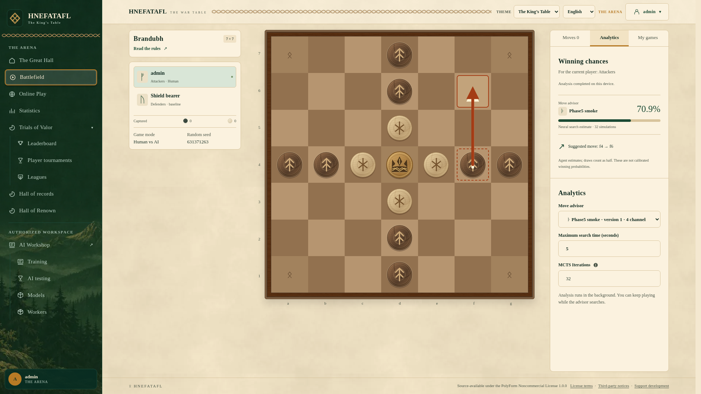
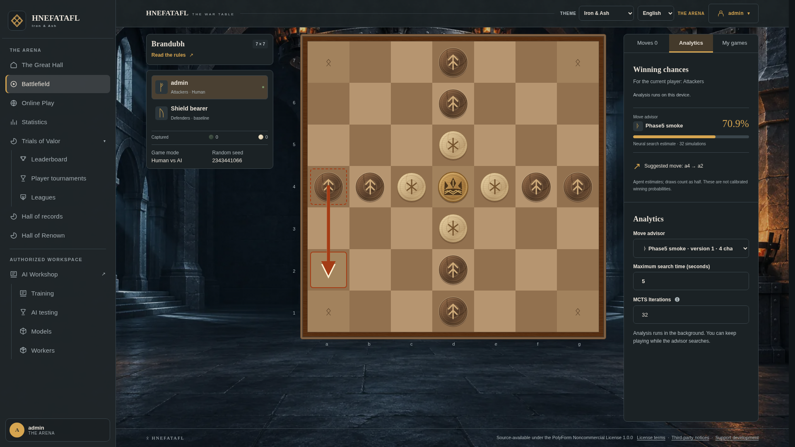
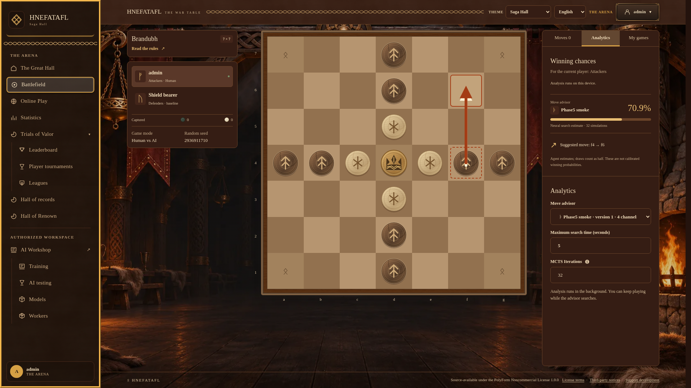

# Phase 5 — Transparent browser-first integration

[Roadmap](../designs/browser-analysis-roadmap.md) · [Architecture](../../ARCHITECTURE.md) ·
[Deployment](../DEPLOYMENT.md) · [Security](../SECURITY.md) ·
[Phase 4 runtime](browser-analysis-phase4.md) · [Phase 3C-B](browser-analysis-phase3c-b.md)

The [seventh-review matrix](#seventh-review-corrections-q01q03) records the Q01–Q03
corrections and current validation. Chromium verified warm offline Jarl and
neural MCTS, historical fallback after a temporary receipt-creation rejection,
and a successful retry after a retained partial checkpoint. The
[sixth-review matrix](#sixth-review-corrections-p01p06) preserves the previous
P01–P06 evidence. Deployment remains opt-in and the
[external acceptance gates](#19-remaining-gates-before-phase-7-acceptance)
remain open.

Verified here: server-owned execution policy and enforcement, transparent local
Jarl and neural MCTS through the existing analysis UI, automatic WASM selection,
bounded WebGPU recovery, verified model reuse, warm offline computation,
cancellation/stale-result rejection, zero server analysis computation for
successful local requests, and unchanged initial-bundle budgets.

Explicitly not verified/closed: competitive trained-model strength, physical
device compatibility, independently verified GPU execution, Copenhagen depth-5
fixed-work completion, sustained-memory acceptance, cold offline startup and
complete distribution licensing. Those remain Phase 7 gates.

## 1. Architecture delivered

The deployment owns *where* analysis runs. Players keep using the existing
analysis controls; there is no Local/Server/Auto/Disabled selector, no provider
selector, no diagnostics panel and no separate browser-analysis page.

| Layer | Responsibility |
| --- | --- |
| `hnefatafl/analysis_policy.py` | Policy resolution/validation, public capability projection, per-process admission limits and coarse counters |
| `hnefatafl/auth.py` | CSP/delivery gating and policy on `SecuritySettings` |
| `hnefatafl/server.py` | Endpoint enforcement, execution policy in existing analytics/availability payloads, authorized analysis-context delivery, model-to-registry mapping, administrator metrics |
| `hnefatafl/analysis_service.py` | Task-lifetime admission/release around the existing shared analysis service |
| `frontend/src/useGameAnalysis.ts` | Chooses local vs server from the server policy; preserves the existing hook contract and presentation |
| `frontend/src/browserAnalysis/loader.ts` | Tiny deferred loader; contains no runtime import |
| `frontend/src/browserAnalysis/integration.ts` | Request normalization, managed Phase 4 runtime ownership, provider selection, model resolution, fallback classification, result adaptation, offline TTL/revalidation |
| `frontend/src/browserAnalysis/runtime.ts` | Existing Phase 4 runtime plus bounded warm-offline lease enforcement and model-session readiness |
| `frontend/src/AgentAnalysis.tsx` | Existing analysis UI plus unobtrusive local/offline/fallback feedback |

The browser still executes the shared Python engine in Pyodide; no JavaScript
rules engine or second search implementation was added. `analysis-context` returns
the server's authoritative serialized positions, including repetition history, so
local search semantics match the server.

## 2. Server execution policies

`HNEFATAFL_ANALYSIS_MODE` accepts exactly four values (case/whitespace normalized):

| Policy | Browser delivery | Server computation | Automatic fallback | Intended use |
| --- | --- | --- | --- | --- |
| `browser_only` | Yes | **No** | No | Normal browser-first operation |
| `browser_preferred` | Yes | Bounded compatibility path | Yes, classified failures only | Opt-in rollout |
| `server_only` | No (explicit) | Yes, legacy | Not applicable | Rollback/emergency compatibility |
| `disabled` | No | No | No | Optional analysis disabled |

Defaults and migration:

- No `HNEFATAFL_ANALYSIS_MODE`: historical behaviour. Server analysis remains
  enabled; `HNEFATAFL_BROWSER_ANALYSIS_ENABLED=1` keeps browser runtime delivery
  available for diagnostics but **does not** activate browser-first execution.
- An explicit mode always wins. The legacy flag cannot enable browser delivery in
  explicit `server_only` or `disabled` mode. It is ignored (documented precedence)
  rather than allowed to reopen a disabled browser path.
- Existing installations therefore keep their previous behaviour until an owner
  explicitly selects `browser_preferred` or `browser_only`.
- Invalid/unknown modes, invalid switch values, out-of-range offline/TTL/limit
  values and WebGPU enabled without browser delivery fail at startup.
- `HNEFATAFL_ANALYSIS_WEBGPU` defaults to `0`. The automatic provider path always
  starts with the validated WASM baseline; this flag only permits an attempt to
  use WebGPU, and a WebGPU request still refuses claims of verified execution.

### Configuration reference

| Variable | Default | Bounds | Meaning |
| --- | --- | --- | --- |
| `HNEFATAFL_ANALYSIS_MODE` | unset (legacy) | 4 modes | Deployment execution policy |
| `HNEFATAFL_BROWSER_ANALYSIS_ENABLED` | `0` | 0/1 | Legacy delivery flag; explicit mode wins |
| `HNEFATAFL_ANALYSIS_WEBGPU` | `0` | 0/1 | Permit an attempted WebGPU provider |
| `HNEFATAFL_ANALYSIS_OFFLINE_SECONDS` | `900` | 60–3600 | Server-defined warm-offline authorization window |
| `HNEFATAFL_ANALYSIS_MAX_CONCURRENT` | `16` | 1–64 | Global admitted analysis tasks per process |
| `HNEFATAFL_ANALYSIS_MAX_PER_USER` | `4` | 1–8 | Per-account concurrent analysis tasks |
| `HNEFATAFL_ANALYSIS_REQUESTS_PER_MINUTE` | `240` | 1–600 | Per-account analysis request ceiling |

The supported deployment runs **one API worker** (`--workers 1` in the shipped
service unit). Admission is therefore global for the supported architecture, not
per-API-worker. It reuses the existing bounded executor/queue (`MAX_ANALYSIS_TASKS`
= 16), synchronous waiter bound, retry-after responses, request deduplication and
result cache. There is no unbounded queue and no process-local limit presented as
multi-worker-safe.

### Backend enforcement

- `POST /api/games/{id}/analysis` and
  `POST /api/history/online/{id}/analysis` call the policy guard **before** any
  cache read, schedule or evaluation.
- In `browser_only` and `disabled`, every direct/historical/background request
  receives HTTP 409 with `code: analysis_server_disabled`; the analysis service is
  never invoked. Tests monkeypatch both `analyze_position` and the scheduler to
  prove no computation is started.
- `browser_preferred` applies the same per-account rate/concurrency limits to
  direct requests and to requests carrying `X-Analysis-Fallback: 1`. A client
  claim of local failure never grants capacity; the header is only a coarse
  observability category.
- `disabled` leaves replay navigation, game reads, move validation, AI opponents,
  training, tournaments and the rest of the engine operational. Stored analysis
  remains readable; no new optional computation is started.
- The guard is server-side only. Browser storage or front-end state cannot
  override the mode.

## 3. Analysis contexts and fair play

The new read-only `GET /api/games/{id}/analysis-context` and
`GET /api/history/online/{id}/analysis-context` endpoints return the normalized
`State` sequence (including repetition history) only where the existing analysis
surface would authorize the caller. They schedule/evaluate nothing and expose no
new game, replay, account or permission data.

| Context | Existing policy | Phase 5 local execution |
| --- | --- | --- |
| Active single-player game | Authorized analysis | Yes, current position |
| Completed single-player replay | Existing replay/analysis permission | Yes, already authorized positions |
| Completed online game | Completed-only analysis adapter | Yes, already authorized positions |
| League/tournament completed games | Through the existing completed/online or account replay authorization | Yes, exactly where the existing adapter allows it |
| Local 1v1 (`mode: local`) | No advisor/analysis by design | **No** (unchanged) |
| Active online/league/tournament game | Never authorized for analysis | **No** |
| Public spectator page | Stored analysis only | No automatic runtime/model/context work |
| Unauthorized private game/replay | Rejected | Rejected by the same authorization boundary |

Browser results carry `authoritative: false` and never write games, clocks, results,
ratings, league progression, tournament progression or achievements. No
progression/achievement credit is emitted for local results; replay credit remains
a server-analysis behaviour. The distributed client engine can be extracted and
used independently by a determined player; front-end restrictions cannot prevent
external cheating. That inherent limitation is documented rather than claimed
solved.

## 4. Transparent execution flow

`useGameAnalysis` reads the execution policy from the existing analytics payload
(server-owned projection) and:

1. Keeps the historical server path for `server_only`.
2. Does nothing computational for `disabled` (stored reports remain visible).
3. For `browser_only`/`browser_preferred`, dynamically loads the integration only
   when analysis is actually needed and visible; `server_only`/`disabled` never
   import the runtime chunk.
4. Resolves the requested advisor without substitution:
   - `alpha_beta` → local Jarl;
   - neural MCTS with a registered model → published compatible model;
   - classical MCTS, baseline or another unsupported local agent →
     `unsupported-agent`; no weaker agent replaces it.
5. Preserves requested depth, time budget, simulation count, exploration, seed,
   model ruleset/size and evaluations; effective settings are validated and shown.
6. Executes locally, adapts the advisory result to the existing `AgentAnalysis`
   contract, and keeps progress/error/retry semantics.
7. On a classified eligible failure under `browser_preferred`, settles the local
   attempt first, then requests the existing server endpoint with the fallback
   header. No local/server searches run concurrently for one logical request.

### Provider selection and evidence

- WASM is the dependable default.
- WebGPU is attempted only when deployment policy enables it and the browser
  exposes `navigator.gpu`; capability detection or session creation is not reported
  as verified GPU execution.
- Recoverable WebGPU initialization/capability failures retry once with WASM
  before any server consideration. Integrity, cancellation and authorization
  failures never take that path.
- The runtime preserves requested provider, observed placement, inference count,
  completion reason and `gpuExecutionVerified:false` from the validated evidence.

### Lifecycle and cancellation

The integration reuses the Phase 4 managed runtime ownership: per-tab singleton,
single active search, generation/context ownership, caller-signal forwarding,
bounded cancellation cleanup, captured-resource retirement and managed-admission
release only after settling. `useGameAnalysis` aborts local work on unmount, key
change (position/version/cursor/advisor/strength/account), route change or policy
change; stale results cannot replace a newer key. React Strict Mode therefore
creates no duplicate runtime or unmanaged worker.

## 5. Models and downloads

- Models are resolved only from the published catalog and only when the published
  `source_weights_sha256` maps to the advisor's already-visible registered model id.
  The mapping is produced server-side (`registered_model_ids`); no private
  checkpoint, optimizer state or unpublished artifact is exposed.
- Jarl needs no model: zero transfers.
- A cold compatible model initialization performs one artifact transfer; a healthy
  live inference session is reused with no catalogue re-read, cache read, re-hash
  or transfer. Verified cached bytes initialize without a transfer.
- Model identity remains bound to ruleset, board size, runtime/encoder/search/bridge
  versions, ONNX digest, source weights and publication status. A missing
  compatible publication is reported, never substituted.
- Downloads retain the Phase 4 bounded concurrency, timeout, retry, aggregate-byte,
  storage-quota, eviction and ownership-safe cleanup behaviour.

Measured production-browser integration session: **one** model artifact transfer;
repeated neural searches and warm offline neural search made zero additional
transfers. The separate direct-runtime probe also measured exactly one transfer
plus three publication metadata checks.

## 6. Warm offline execution

After an authorized online initialization and position fetch, the runtime can
execute repeated local searches without network access:

- repeated Jarl and neural MCTS searches;
- prepared replay positions and navigation between them;
- cancellation and restart with the same initialized session;
- no server-only position reconstruction during the warm window (all authorized
  positions are fetched once, including repetition history);
- no repeated capability, manifest, model metadata or artifact transfer during the
  warm window;
- missing resources fail closed with an offline/unavailable state and no server
  fallback.

### Offline security boundary

The offline lease is established only after a successful online authenticated
policy/availability and analysis-context fetch. It is bound to the account id, the
initialized runtime identity and a server-provided TTL (default 900 s). The runtime
continues to enforce the requested model/session identity on every search.

- Explicit logout/session end disposes the runtime, workers, cached contexts and
  lease. Account changes invalidate the runtime before new work.
- Reconnection marks the next local search as requiring origin authorization and
  runtime identity revalidation before further work.
- TTL expiry requires online revalidation; expired state is never perpetual.
- Offline state is client-side only and is never treated as server-verifiable proof
  of permissions.
- Revocation of a model/permission cannot be delivered to an already disconnected
  browser. The bounded TTL, revalidation on reconnection, no-new-resource rule and
  documented inability to recall downloaded bytes limit (but do not eliminate) this.
- If a security contract requires persistent offline authorization, that scenario
  remains fail-closed for Phase 6.

**Deferred to Phase 6:** cold runtime initialization without network access,
persistent runtime asset caching for offline startup, service-worker architecture
(if required), offline initialization after browser restart, comprehensive cache
version/eviction lifecycle, persistent offline authorization architecture, full
offline application startup and offline access to arbitrary previously viewed
pages.

## 7. Fallback classification and admission

Automatic fallback is available **only** in `browser_preferred` and only after a
local attempt has settled.

| Local outcome | Handling |
| --- | --- |
| WebGPU unavailable | Try WASM |
| Recoverable WebGPU failure | Try WASM recovery |
| Unsupported local browser/runtime | Bounded server fallback eligible |
| Repeated WASM initialization failure | Bounded fallback eligible |
| Insufficient local memory (`RESOURCE_EXHAUSTED` search failure) | Potentially eligible |
| Missing compatible published model | Eligible during rollout (preserves requested model; server may still report it unavailable) |
| Transient model download failure | Runtime's bounded retry first; then eligible if still failing |
| Unsupported local agent (classical MCTS/baseline) | Eligible only in `browser_preferred`; no substitution |
| Requested budget outside local limits | Eligible only in `browser_preferred`; no silent reduction |
| Slow but functioning local search | Continue locally within existing budgets |
| Search time budget reached | Return valid available result; no fallback |
| User cancellation / replay navigation | No fallback |
| Account change/logout/invalid authorization | No fallback |
| Prohibited/disabled context | No fallback |
| Integrity/size/digest failure | Fail closed; no fallback |
| Malformed or inconsistent engine result | Fail closed; no fallback |
| Offline device | Local or meaningful unavailable state; no server attempt |
| Unknown error | No automatic expensive server computation |

The server treats fallback exactly like a direct analysis request: authentication,
analysis-context authorization, global/per-account concurrency, per-account rate,
bounded queue, existing result cache/deduplication, overload `503` + `Retry-After`,
and computation budgets. Capacity exhaustion returns a structured retryable error;
it does not grow an unbounded queue or trigger local/server retry loops. Fabricated
client failure reports do not change admission.

Administrator metrics are coarse counts only (`GET /api/analysis/metrics`):
admitted/released tasks, direct vs fallback request categories and rejections.
No position history, credentials, raw model data or device fingerprinting is sent.
Fallback rate can be measured as `fallback_request / (direct_request +
fallback_request)` (or `admitted` for computation rate) without adding per-search
telemetry or load. The proposed long-term target of ≥99 % local and <1 % fallback
is **not** a measured Phase 5 result.

## 8. Historical production-browser measurements

Environment: Chromium from the project Playwright install, real FastAPI process,
production Vite build, real CSP, same-origin workers, actual Pyodide/WASM and
ONNX Runtime, a staged verified runtime
(`runtime_id 145b2afae925f21a`, 48,106,695 bytes) and one published structural smoke
model (`f8f0345749723a28f5a2b6f5`, ONNX SHA-256
`64c4a60e1c08bec38c1af909b9cb8193a36c8dcc48f6d49e4ee676e96ea80d74`, 47,540
bytes). This is structural model evidence, **not** competitive strength evidence.

Evidence files:

- [direct runtime probe — Brandubh](browser-analysis-phase5-browser-runtime.json)
- [direct runtime probe — Tablut](browser-analysis-phase5-browser-runtime-tablut.json)
- [direct runtime probe — Copenhagen](browser-analysis-phase5-browser-runtime-copenhagen.json)
- [direct runtime probe — neural MCTS](browser-analysis-phase5-browser-runtime-neural.json)
- [application integration, offline and UI probe](browser-analysis-phase5-browser-integration.json)
- [non-integer identity/time-limit probe](browser-analysis-phase5-identity-limits.json)

| Measurement | Result |
| --- | --- |
| Cold runtime initialization (direct probe) | 2,406.3 ms |
| Repeated `initialize()` when ready | 0 ms |
| Jarl depth-3 search (direct probe) | 242 ms |
| Runtime asset requests (single direct probe) | 172 |
| Model artifact transfers (cold model) | 1 |
| Publication metadata checks | 3 |
| Neural MCTS | 33 inferences, 32 simulations, provider `wasm`, `gpuExecutionVerified:false` |
| Application integration: Jarl online (cold) | 2,634.7 ms |
| Application integration: neural online (cold) | 2,190.6 ms |
| Warm offline Jarl | 212.3 ms |
| Warm offline neural MCTS | 66.2 ms |
| Offline analysis/authorization requests | 0 |
| Local searches causing server analysis computation | 0 (metrics counters unchanged) |
| Non-integer effective Jarl limit | 2.5 s preserved with canonical identity and seed |
| Production UI local indication | “Analysis completed on this device.” |
| Production UI advisory evaluation | Rendered from local execution |
| Production UI POSTs to legacy analysis endpoint | 0 during local execution |
| Server-fallback probe | MCTS unsupported locally → exactly **1** fallback POST, **1** receipt, read-only result retrieval, completed-server provenance |
| Fallback admission | One logical fallback request; retained result rendered; no duplicate computation |
| Probe checks | **24/24**, `ok:true` |

The direct probes ran Jarl on Brandubh, Tablut and Copenhagen, and neural MCTS on
Brandubh. The first integration run on the N head exposed a real canonical identity
mismatch: JavaScript rendered an integral time limit as `5.0`, while Python
received the transported JSON integer `5`. The shared identity contract now
preserves transported JSON number types; Python/JavaScript fixtures cover
integer `5`, decimal `1.5`, fraction `0.1`, and neural WASM/WebGPU identities. The
application integration probe then loaded the production build, switched the
advisor to the published neural model, rendered the existing analysis panel,
disconnected the browser completely and repeated Jarl and neural searches using
only initialized resources. Its runtime-asset count includes the additional
non-integer probe page load; it is not a single cold-start count. The same probe
finally selected a server-supported classical MCTS advisor that the browser does
not implement locally, observed the eligible local failure and completed-server
provenance, and verified exactly one fallback POST plus read-only result retrieval
with no duplicate computation.

## 9. UI validation and screenshots

The existing `AgentAnalysis` panel and design system were reused. The only visible
additions are one subtle device/offline line, a fallback line and stage-specific
status text using existing classes/tokens. No execution-mode or provider control
was added.

| Theme | Screenshot |
| --- | --- |
| The King’s Table |  |
| Iron & Ash |  |
| Saga Hall |  |
| Mobile (390×844) |  |

The browser probe exercised a 1920×1080 desktop viewport and a 390×844 mobile
viewport. 4K and the full range of supported UI scales were not individually
captured; the layout uses the existing responsive shell, and CI/browser checks
cover the application's ordinary responsive behaviour. Keyboard focus and screen
reader semantics come from the unchanged tab/panel and analysis markup; the new
status text uses an existing `role="status"` region. Localized strings were added
for German, and the production screenshots show the existing English UI.

## 10. Bundle and deferred loading

Production initial bundle for the authenticated graph, including the local
Node 22 build of the Q code revision.

| Measurement | Phase 4 | O review, CI | P review, local Node 22 | Q review, local Node 22 | Budget |
| --- | ---: | ---: | ---: | ---: | ---: |
| JavaScript raw | 585,756 | 599,385 | 598,774 | **598,644** | 600,000 |
| JavaScript gzip | 186,716 | 190,564 | 190,475 | **190,505** | 200,000 |
| CSS raw | — | 115,551 | 115,551 | **115,551** | 150,000 |
| CSS gzip | — | 24,114 | 24,114 | **24,114** | 35,000 |

Budgets were not loosened. The build emits `integration-*.js` and `entry-*.js` as
separate lazy chunks; `.cache/bundle-modules.json` confirms `integration.ts` and
the Phase 4 runtime modules are absent from the initial authenticated chunk. Only
the tiny dependency-free `loader.ts` and `analysisPolicy.ts` policy projection are
in the initial graph. Server-only/disabled deployments do not import the
integration, initialize a worker, download a model or download runtime assets.
Ordinary page loads, spectator pages and entry to replay make no browser-analysis
runtime requests (also asserted by the browser probes).

## 11. Previous-phase finding resolution matrix

The merged Phase 4 code was not rewritten where it already satisfied the finding.
Verification was by code inspection plus the full browser-analysis regression
suite, not by relying on PR descriptions.

| Finding | Status | Evidence/notes |
| --- | --- | --- |
| E1 (lifecycle sweep exit/cleanup) | Preserved | Existing `tests/test_browser_analysis_lifecycle_sweep.py` remains green; no sweep code changed |
| F1 operation ownership | Preserved | Runtime 77-test suite includes cancellation/account/import ownership; new integration adds a key/abort owner above it |
| F2 immutable runtime identity | Preserved | Availability/context policy projection carries the runtime identity; revalidation calls `availability()` which verifies the manifest identity |
| F3 provider/search evidence | Preserved | Actual browser probe reproduced WASM/unverified evidence; integration adapts only validated fields |
| F4 generation-safe downloads | Preserved | No download-manager changes; policy/offline additions use the same manager |
| F5 verified model bytes | Preserved | `downloadModel`/`ensureModelBytes` path unchanged; integration skips transfers for a healthy session |
| F6 atomic publication | Preserved | No publication code changed; registered-id mapping uses public records only |
| F7 runtime compatibility | Preserved | Manifest validation unchanged; policy projection rejects contradictory modes |
| F8 explicit algorithm/settings | Preserved | Integration refuses unsupported agents/budgets; requested depth/time/iterations/model are passed through |
| G1 cancellation/model-session recovery | Preserved + extended | Runtime 77 tests; warm-offline session reuse and lease clearing tests added |
| G2 generation resource limits | Preserved | No limits increased; per-tab singleton unchanged; fallback admission is server-side and bounded |
| G3 provider validation | Preserved | Integration attempts WASM recovery only for capability/initialization failures; integrity/cancellation fail closed |
| G4 file identity | Preserved | No server artifact-resolution changes |
| G5 healthy-session reuse | Preserved + verified | `modelReady()` avoids redundant bytes/cache work; integration test asserts zero download for a healthy session |
| G6 effective settings | Preserved | Jarl/neural settings are normalized and effective settings are returned/validated by the runtime |
| H1 coordinated admission | Preserved + extended | Initialization/search/cleanup barriers unchanged; integration never runs local and server concurrently |
| H2 retirement accounting | Preserved | Runtime disposal outcomes unchanged; integration awaits `dispose()` on logout |
| H3 bounded download outcomes | Preserved | No download changes |
| H4 abort-listener cleanup | Preserved | Signal forwarding unchanged; new hook aborts local work on cleanup |
| I1 tracked cache verification | Preserved | No cache/download accounting changes |
| I2 cleanup-barrier recovery | Preserved | No retirement changes |
| J1 cache verification across generations | **Independently verified** | Reviewed the merged deduplicated outstanding-record set, exactly-once release, shared admission and `whenIdle()`/`drain()` coverage. Existing deterministic tests for cross-generation overlap, conflicting specs, byte budgets, repeated cancellation and replacement admission all pass in the 77-test runtime suite. No code rewrite was needed. |

## K1–K16 review-correction matrix

| Finding | Original problem / root cause | Correction | Files | Regression evidence | Remaining limitation |
| --- | --- | --- | --- | --- | --- |
| K1 canonical effective settings | Local integration read `advisor.config.time_limit` and current-game ply; server overrides with analytics `time_limit` and analyzed-state ply. Two default resolvers could diverge. | Server resolves one canonical advisor config (`effective_ai_config` + analytics time limit) and publishes requested/effective config, revision, show-chances and seed-ply semantics in the authorized context. Browser rejects unknown behaviour-affecting keys, uses the server config, derives seed from the analyzed state's ply, and never defaults/shortens the requested budget. | `hnefatafl/server.py`, `frontend/src/browserAnalysis/integration.ts` | Server context asserts requested `.1` vs effective `5`; integration tests cover time-limit conflict, historical seed/ply, show-chances off, unsupported settings/budgets, neural/Jarl. | UI still permits 15 s; local Jarl supports ≤5 s and neural ≤10 s. Larger/classical settings remain fallback/browser-only blockers (K8). |
| K2 execution state machine | `fallbackFor` key state could survive navigation A→B→A and authorize an old server path; two effects could race. | One generation-owned effect executes locally, awaits retirement, then optionally falls back. No key-based fallback authorization remains; stale effects abort and cannot publish. | `frontend/src/useGameAnalysis.ts` | A→B→A test verifies one server call and the new local path; stale navigation, cancellation, reconnection, policy refresh and retry tests. | A server request already admitted before navigation may continue server-side; the browser stops observing it and never claims it retired. |
| K3 offline authorization | Lease renewed after initialization, cache reuse and successful local search, which are not fresh server authorization. | Lease is issued only after a successful authenticated policy/context fetch. Per-context and per-model leases enforce TTL and account/version/model binding; local success never extends them; reconnection requires origin revalidation; network failure is distinct from denial. | `frontend/src/browserAnalysis/integration.ts`, `runtime.ts` | Expiry despite offline searches, unreachable origin with warm lease, explicit 401 denial, no lease on cache-hit-only, runtime model-authorization tests. | Revocation cannot be delivered to a disconnected browser; downloaded bytes cannot be recalled. Documented limitation. |
| K4 integration ownership | Context/model/provider caches and requests lived outside the runtime generation. | Account/session generation now covers context caches (including revision), shared context requests, catalogue, leases and runtime acquisition; late responses cannot repopulate caches; subscribers cancel independently. | `frontend/src/browserAnalysis/integration.ts` | Delayed context during account switch, delayed catalogue/logout, A→B→A, concurrent consumers, cancellation during init, obsolete runtime creation. | Context consumers share one origin fetch; cancellation of the last consumer aborts it (intended). |
| K5 server computation admission | Synchronous playing-agent `analyze_position()` bypassed task admission. | The synchronous AI-evaluation path now reserves/releases the same task admission as service tasks; overload is structured; browser-only/disabled guards remain before all optional computation. | `hnefatafl/server.py`, `hnefatafl/analysis_policy.py` | Sync AI-AI admission and rejection tests; existing policy/browser-only/disabled/cached tests. | Admission remains per-process on the supported single-API-worker deployment. |
| K6 context identity | Request did not bind version; cached keys could be shared across settings; missing position keys were duplicated. | Version/cursor/game/ruleset/revision are bound; server rejects stale versions; browser rejects mismatched identity and missing/malformed history/position keys. | `hnefatafl/server.py`, `frontend/src/browserAnalysis/integration.ts` | Stale version, mismatched cursor, missing history/position keys and malformed state tests; server stale/version test. | Completed online replays retain immutable versions; active games intentionally use a new version. |
| K7 context size/memory | Full game history serialized for every state, quadratic text duplication; only entry-count client cache. | Compact states + one shared history prefix + position keys; server immutable cache bounded to 8 entries/24 MiB; client 64 entries/8 MiB and 4096-state cap; histories injected immediately before search. | `hnefatafl/server.py`, `frontend/src/browserAnalysis/integration.ts`, `scripts/phase5_context_benchmark.py` | Compact/identity tests; context benchmark (0 duplicated history entries, linear response sizes). | Pyodide still reconstructs the authoritative state; no divergent JS rules engine. |
| K8 capability compatibility | Local runtime covers Jarl/neural only; Jarl originally 3 s while the UI default was 5 s. | Classical Jarl budget extended to 5 s with matching 7.5 s watchdog and bridge validation; browser-only settings panel explains unsupported agents/time limits; unsupported agents remain explicit fallback/browser-only errors. | `hnefatafl/browser_bridge.py`, `frontend/src/browserAnalysis/{contracts,runtime,integration}.ts`, `AdvisorSelect.tsx` | Bridge budget tests; browser integration uses the default 5 s; unsupported-agent/budget tests. | Classical MCTS/baseline/neural wrapper `none`/alpha-beta and UI >5 s (Jarl) / >10 s (neural) remain unsupported locally. This is a documented server-decommissioning blocker, not silently substituted. |
| K9 historical evaluations | Local adapter replaced the report with only new advice; a stored non-advisor complete report suppressed the requested advisor. | Local results merge with matching stored attacker/defender evaluations, filter only obsolete advisor/hint, and completeness is judged for the requested advisor/revision. | `frontend/src/useGameAnalysis.ts` | Merge test with old advisor revision; no-suppression and saved-report tests. | Local results remain advisory and are never uploaded to authoritative caches. |
| K10 progression compatibility | Browser-only has no server-analysis POST, so replay-analysis achievement credit is unavailable. | No insecure client-generated credit was added. Explicit owner-decision blocker and proposed mechanism documented below. | `docs/designs/browser-analysis-roadmap.md`, this report | Audit of `record_completed_replay`/achievement path. | **Open owner decision.** Proposed: a server-verifiable authorized replay-review event/session protocol, not client search claims. |
| K11 policy revalidation | Missing policy was treated like legacy; malformed policy was silently server-only; only mode name compared; stale fallback could survive policy change. | Missing projection retains legacy; malformed projection fails closed as `disabled`; full policy attributes are compared; context/policy change triggers analytics refresh; stale fallback becomes failed/refresh, never a fallback decision. | `frontend/src/useGameAnalysis.ts`, `frontend/src/browserAnalysis/integration.ts` | Malformed projection, policy transition/refresh, context policy mismatch tests. | There is no continuous policy polling; change detected on next context/retry/reconnect, by design to avoid background origin traffic. |
| K12 error/recovery | Any `TypeError` meant network failure; retries were loosely bounded. | Fetch-boundary network errors are explicit; generic TypeError is unknown/engine fault; integrity fails closed; WebGPU and offline recovery are one-shot; server 429/503 retries are capped at 8 with Retry-After; cancelled requests cannot retry. | `frontend/src/browserAnalysis/integration.ts`, `useGameAnalysis.ts` | TypeError, integrity, WebGPU recovery, 429/503 backoff/cap, timer cleanup tests. | Server-side task duration remains bounded by its own service deadline. |
| K13 admission accounting | Inactive rate buckets accumulated; duplicate releases could undercount. | Lazy bounded bucket cleanup (≤once/30 s), 4096-bucket cap; token ownership and duplicate-release detection; exactly-once release; global/per-account counters. | `hnefatafl/analysis_policy.py`, `analysis_service.py`, `server.py` | High-cardinality expiry, duplicate release, concurrent/rejected admission, failed-submission tests. | Supported deployment invariant remains one API worker; no multi-worker-global claim. |
| K14 UI feedback | Device line could contradict fallback state; raw error text surfaced. | Provenance chooses local vs server text; localized user-facing error categories; existing classes/tokens only. | `frontend/src/AgentAnalysis.tsx`, `useGameAnalysis.ts`, `locales/de-extra.ts` | Fallback provenance, localized failure and theme/mobile snapshots. | Server fallback cancellation stops observation but not already-admitted server work (documented handover). |
| K15 cancellation/progress | No download progress or local cancel action. | Determinate `<progress>` only with real byte totals and a local cancel action; obsolete progress cleared outside the download stage. | `frontend/src/AgentAnalysis.tsx`, `useGameAnalysis.ts` | Progress/cancel tests. | Cancellation is cooperative; admitted server work may continue. |
| K16 validation evidence organization | Large raw memory JSON increased repository/diff noise. | Raw evidence is gzip-compressed with SHA-256 recorded; summaries and reproducible commands retained. | `docs/validation/browser-analysis-phase5-memory-*.json.gz`, this report | `make docs`, hashes, validator runs against decompressed evidence. | Compression is a repository-storage choice; evidence is byte-identical after `gzip -dc`. |
| Previous-phase preservation (E1/F/G/H/I/J regression requirement) | New orchestration could regress runtime/account/download guarantees. | Phase 4 runtime, accounting, download and cleanup code preserved; runtime/account/offline tests extended; no threshold or budget loosened. | Runtime/analysis service/integration | 77 runtime tests plus 23 integration tests, full frontend/CI. | External acceptance gates remain unchanged. |

### K8 local compatibility matrix

| Existing analysis option | Local browser support | Handling |
| --- | --- | --- |
| Jarl alpha-beta, depth 1–5, time ≤5 s | Yes | Canonical server config; default 5 s supported |
| Jarl depth >5 / time >5 s | No | `unsupported-budget`; fallback only in `browser_preferred`; browser-only explains limitation |
| Neural MCTS with published registered model, ≤4096 simulations, time ≤10 s, temperature 0 | Yes | Published model/session authorization |
| Neural MCTS time >10 s, wrapper `none`/`alpha_beta`, missing model | No | Explicit `unsupported-budget`/`unsupported-agent`/`model-unavailable`; no substitution |
| Classical MCTS (`mcts`) | No | Explicit local blocker; fallback only where policy permits |
| Baseline/other legacy advisor algorithms | No | Explicit local blocker; fallback only where policy permits |
| All three rulesets | Jarl yes; neural only with a ruleset/board-compatible publication | Model ruleset/size checked |

### K10 owner-decision proposal

Replay-analysis achievements currently require a successful server analysis POST
and stored advisor/agent evidence. Browser-only execution deliberately does not
fabricate or upload client search claims. The safe compatible direction is a
future server-verifiable "authorized replay review" activity record (bound to the
account, replay permission, canonical position identity and an idempotent review
session), awarded independently of expensive search computation. That changes
progression semantics and requires owner approval; it is **not** implemented here.
Until then, browser-only installations do not earn replay-analysis achievement
credit, and the roadmap records this compatibility blocker.

## L1–L11 second-review correction matrix

| Finding | Root cause | Correction | Files | Regression tests | Remaining limitation |
| --- | --- | --- | --- | --- | --- |
| L1 fallback/retirement separation | `serverFallbackKeys` retained position keys and used a computation-capable POST to observe old work. | Removed key-based fallback authority. Fallback is only started by the current effect after a classified local failure. Retired server work is tracked as bounded observation metadata; a narrow read-only `analysis-status` endpoint reports actual admitted tasks, and local work waits for inactivity before running. Status is never permission to start a fallback. | `useGameAnalysis.ts`, `server.py` | Genuinely pending A→B→A test uses status barrier; existing A→B→A, cancel/retry, account/policy/offline tests. | Already-admitted server work may continue after HTTP cancellation; observation is bounded and documented, not claimed retired. |
| L2 canonical context identity | Revision/advisor/effective-config identity was not fully bound; missing canonical config fell back to frontend defaults. | Context request/response now binds version, cursor, advisor revision, game/ruleset, canonical effective config, requested/effective agent identity, model ID, position/position-key association, board shape, turn/ply and history. Missing/malformed canonical metadata fails closed; revision conflicts refresh settings. | `server.py`, `integration.ts` | Revision/version/cursor, missing advisor/config, wrong agent/model/algorithm, position-key, history/board tests; K1 parity retained. | JavaScript does not reimplement rules; canonical identity is computed by the server engine and validated structurally by the browser. |
| L3 account binding | `runLocalAnalysis`/`getRuntime` could bind to an input account; generation was captured after async binding. | Authentication lifecycle exclusively calls `setAnalysisAccount`. Operations capture generation first and reject account mismatch; runtime acquisition cannot install an obsolete generation; cache/lease/runtime mutations are generation-guarded. | `integration.ts`, hook account effect | Obsolete runtime creation, context/account switching, abort consumers, late catalogue/context, Strict Mode/hook cleanup. | Authoritative login state remains the owner of account identity; analysis never logs in/out. |
| L4 refresh ownership | `refreshSettings` always incremented `settingsSequence`, cancelling valid running work even when unchanged. | Settings refresh has its own request sequence and compares full settings/policy; unchanged responses do not invalidate analysis. Genuine changes increment analysis ownership; stale/failed refresh does not block offline continuation or leave work permanently pending. | `useGameAnalysis.ts` | Visibility/unchanged refresh during local search, policy change refresh, navigation, mutation/refresh tests. | Policy changes are observed on context/visibility/reconnect/retry rather than a dedicated polling loop. |
| L5 offline authorization scope | Lease expiry could be computed from a later policy duration; identity did not include revision/runtime/publication/policy; provider cache could bypass WebGPU policy. | Context leases store immutable absolute expiry and bind account/generation, runtime, game/version/revision and policy. Model leases bind publication/artifact/runtime. Policy changes invalidate continuation leases; runtime identity changes invalidate; WebGPU policy overrides provider cache; only authenticated revalidation issues/renews. | `integration.ts`, `runtime.ts` | Duration increase/decrease, policy disable, runtime identity, expiry without renewal, unreachable origin, denial, logout/account tests. | Revocation cannot reach disconnected clients; downloaded bytes cannot be recalled. |
| L6 cache concurrency and limits | Server cache accesses/evictions were partly unsynchronized, concurrent misses rebuilt, cache replacements could miscount, oversized responses escaped limits; browser byte limit allowed one oversized entry. | All cache mutation under lock, per-key build locks deduplicate reconstruction, byte accounting replaces correctly, strict 2 MiB response limit, 4096-position pre-check, compact incremental reconstruction, bounded 8 entry/24 MiB server cache; browser 64 entry/8 MiB cache rejects single oversized entries and trims lease/provider maps with eviction. | `server.py`, `integration.ts` | Concurrent misses/lookup-eviction, overdue/replacement, context-version churn, offline navigation tests; context benchmark. | Pyodide still reconstructs authoritative state; no JS rules engine. |
| L7 server computation isolation | Synchronous playing-agent evaluations still ran `analyze_position()` in the HTTP thread. | Synchronous AI analysis now waits on the existing bounded `AnalysisService` executor/admission path; HTTP threads no longer execute optional engine work. Synchronous waiter limits and response shape are preserved. | `server.py`, `analysis_service.py` | Sync AI-AI admission/rejection, advisor/background mixed tests, cached-result and overload tests. | Mandatory AI gameplay/training/legal validation remain outside optional analysis admission by design. |
| L8 rate bucket capacity | Bucket capacity was only trimmed on periodic cleanup and could exceed the limit between sweeps; active history could be discarded. | Admission enforces capacity when creating a new bucket, reclaims only expired buckets, rejects overflow with structured `analysis_rate_capacity`/503, and never drops active history to make room. | `analysis_policy.py` | High-cardinality capacity, active preservation, expiry, duplicate release/precision tests. | Supported deployment remains one API worker; no multi-worker-global claim. |
| L9 runtime recovery | Fetch TypeError could escape unclassified; unavailable initialization was ignored; internal unsupported states could look fallback-eligible; server retry deadline was unbounded/reset by pending responses. | Runtime fetch boundary maps transport failure to `network-unavailable`; initialization state is checked for ready/unavailable/disabled/error; internal unsupported is non-fallback; finite 120 s server deadline, no reset on pending, 429/503 Retry-After honored. | `runtime.ts`, `integration.ts`, `useGameAnalysis.ts` | Transport, unavailable runtime, internal unsupported, pending/overload alternation, deadline/cancel tests. | A server task already running is bounded by its own service deadline; browser cancellation stops observation only. |
| L10 historical hint | Merge restored `stored.hint` when new advice explicitly had none. | New advisor hint is authoritative, including explicit null; immutable playing-agent evaluations remain preserved. | `useGameAnalysis.ts` | Stored hint followed by no-hint local result. | None within the local presentation contract. |
| L11 UI state | Device/server provenance could contradict; download progress survived stage changes; completed local/offline wording was imprecise. | Status text distinguishes local/server provenance and waiting/running/completed/offline; download progress is cleared outside the download stage; localized error categories and cancellation preserved; existing classes/tokens only. | `AgentAnalysis.tsx`, `useGameAnalysis.ts`, `locales/de-extra.ts` | Fallback provenance, progress/cancel, completed offline, theme/mobile snapshots. | Server cancellation stops observation but not already-admitted server work. |

The earlier K14–K15 row combined two separate findings. The canonical mapping is
K14 = UI feedback/provenance, K15 = cancellation/download progress, K16 =
validation-evidence organization, as shown above.

## M1–M8 third-review correction matrix

| Finding | Root cause | Implemented correction | Source references | Deterministic regression tests | Actual execution evidence / remaining limitation |
| --- | --- | --- | --- | --- | --- |
| M1 context-build lock ownership | Capacity eviction moved a still-locked entry to another key and could retire a returned-but-unacquired lock. | New `ContextBuildRegistry`/`BuildLease`: one record per context identity, consumers counted before a lock is returned, one serialized reconstruction, retirement only at zero consumers, no eviction of active/pending records, bounded records/builds/waiters and structured 503 overload. Endpoint keeps cache-byte accounting and lock-free expensive work. | `hnefatafl/context_preparation.py`, `hnefatafl/server.py` | `tests/test_context_preparation.py` (owned records, >64 sequential identities, acquired/returned locks, multiple consumers, waits/timeouts, exceptions, capacity, retirement reuse); concurrent endpoint test asserts exactly one reconstruction and zero leftover records. | 8 concurrent same-context endpoint requests produced **1 reconstruction**, 0 leftover records; 12 distinct contexts produced 10 OK / 2 bounded 503s with the registry returning to 0 records. |
| M2 server-task retirement tracking | Elapsed time, registry pressure and HTTP failure deleted retirement metadata; no receipt distinguished submitted from admitted work. | Module-scoped retirement records plus new narrowly scoped `analysis-receipt` routes and receipt-bound `analysis-status` states (`prepared`, `active`, `retired`, `expired`, `unknown`). Frontend keeps records across unmount/remount/account/route transitions, never evicts for capacity, treats malformed/missing status as unknown, and only deletes on explicit retirement/expiry/epoch evidence or a valid completed response. Server rejects late receipt consumption after expiry. | `hnefatafl/analysis_receipts.py`, `server.py`, `auth.py`, `docs/API_PERMISSIONS.json`, `frontend/src/analysisRetirements.ts`, `useGameAnalysis.ts` | `tests/test_analysis_receipts.py`; receipt endpoint/account/position/revision tests; frontend retirement bound, unmount/remount, malformed status, A→B→A, fallback receipt-order and server-retirement tests. | Receipt registries are bounded (256 total/32 per account) and expiry is 120 s; a missing record is never treated as safe. HTTP cancellation still cannot stop already-admitted server work. |
| M3 authoritative policy lifecycle | Policy comparison ran only inside a subsequent local search, so server-only/disabled transitions left runtime/context/model/provider continuation alive. | `setAnalysisPolicy()` applies known policy changes outside search: clears continuation leases/providers, forces online revalidation, clears runtime offline authorization, disposes the runtime when browser execution is removed, and ignores obsolete account generations. Queued stale work observes a policy revision and fails closed; policy-keyed operation identity prevents stale results. | `frontend/src/browserAnalysis/integration.ts`, `useGameAnalysis.ts`, `loader.ts`, `analysisRetirements.ts` | Integration policy-disable/WebGPU/obsolete-account tests; hook-only WebGPU policy-change test; authorization denial and offline-continuation tests; existing K/L policy tests. | Offline authorization is cleared only when a policy change is actually observed online; inability to reach the server is not revocation. |
| M4 canonical configuration and position validation | Missing/malformed depth, time, seed, iterations and exploration silently used frontend defaults; context policy projection was optional; result identity was not bound to the analyzed position. | Required canonical fields per local algorithm with integrity failures for missing/malformed data and unsupported-budget only for valid out-of-range requests; execution projection required; context states/history/board/turn/ply are checked, repetition keys recomputed, and the server position key recomputed with canonical sorted JSON + SHA-256; Jarl result identity is recomputed from state + effective settings; neural identity is derived by the validated runtime from state + effective settings + model + provider and checked by the integration. | `frontend/src/browserAnalysis/integration.ts`, `canonical.ts`, `runtime.ts` | Missing depth/time, malformed numeric, invalid seed, missing iterations, invalid exploration, missing policy projection, wrong state/digest/history, changed position result and valid unsupported budget tests; existing three-ruleset and server-resolved parity tests. | JavaScript still validates rather than reimplements the rules engine; the neural identity is a runtime-derived binding of the validated request, not an independent proof that a compromised worker executed faithfully. |
| M5 runtime acquisition and readiness | Logout replaced the retirement barrier before disposal settled; busy/retiring states could be classified as browser failures; runtime identity was captured before availability revalidation. | Chained retirement barriers across logout/account transitions; runtime creation waits for genuine retirement; pending creation/disposal handled; A→B→A creation cannot install obsolete work; ready/searching/initializing/cancelled/disabled/unavailable/failed states are distinguished; healthy busy runtimes return `busy` without fallback; compatible searches serialize; availability-change identity is reinitialized before search; authorization binds to the final runtime identity. | `frontend/src/browserAnalysis/integration.ts`, `runtime.ts` | Logout-while-disposal-pending, A→B→A creation, searching-runtime busy, identity change during revalidation, policy retirement, obsolete-account generation, no-duplicate-runtime and no-premature-fallback tests. | Managed singleton remains an independent Phase 4 safety net; the supported deployment still serializes local searches per tab. |
| M6 settings refresh and terminal states | Policy attributes were absent from operation identity; stale revision/version conflicts and deadline exhaustion could leave orphaned pending states; settings reads/writes could cross accounts. | Full policy signature in operation identity; explicit `analysis_revision_stale` and stale-game terminal handling; refresh only on genuine change; serialized settings writes check account/game/generation before sending; account-bound initial/recovery reads; retry deadline always terminal; partial reports preserved; pending displays require visible owned work; structured Retry-After honored. | `frontend/src/useGameAnalysis.ts` | Stale revision recovery, policy-only WebGPU/limits restart, unchanged visibility refresh, account-bound settings, partial report retention, retry/deadline and existing reconnect/navigation tests. | Stale game versions end in an explicit terminal state; the owning route remains responsible for reloading a newer game record. |
| M7 aggregate context-preparation capacity | Many distinct cache misses could each consume a thread and reconstruct long histories. | Separate bounded preparation registry (4 concurrent distinct builds, 64 records, 16 waiters) plus per-account context-request rate bucket; distinct excess is rejected immediately with structured 503, same-context waits are bounded and deduplicated, status polling reuses receipt/context identity instead of reconstructing, and gameplay/search admission stays separate. | `hnefatafl/context_preparation.py`, `server.py`, `scripts/phase5_context_benchmark.py` | Registry/rate tests; endpoint same-context dedup, distinct overload, capacity exhaustion/recovery, status read-only tests; benchmark extended with same/distinct load, polling, cache saturation, capacity rejection and gameplay latency. | Measured: same-context 8 requests → 1 reconstruction/172 ms; distinct 12 → 10 OK/2×503/430 ms; status poll average 7.1 ms; gameplay GET ~17 ms while preparation capacity was exhausted; cache occupied 8 entries. |
| M8 provider cache and UI status | Provider cache was read with publication+artifact+account but written with artifact+account, and WebGPU recovery was not persisted; UI could show completed server work as running and duplicate waiting messages. | One canonical provider-cache key (publication, artifact, account, runtime); policy checked before cache reuse; successful WASM recovery recorded and reused; maps trimmed at insertion; UI distinguishes preparing/downloading/local/offline/waiting/server-running/completed/cancelled/failed without contradictory messages or stale progress. | `frontend/src/browserAnalysis/integration.ts`, `AgentAnalysis.tsx`, `useGameAnalysis.ts`, `locales/de-extra.ts` | WebGPU→WASM reuse, policy-disabled provider reuse, publication/runtime/account identity, repeated cache churn, completed server, cancelled/failed and waiting-vs-running UI tests. | Existing styles/classes/tokens and responsive/mobile layout are reused; no new UI library or analysis surface. |

### Third-review execution evidence

- **Frontend:** full Vitest **1,830 passed (117 files)**; focused browser-integration
  suite **44 passed** (including 11 new M3–M8 cases); `useGameAnalysis` **21
  passed**; `AgentAnalysis` **57 passed**; retirement registry **3 passed**.
- **Backend:** focused policy/analysis/receipt/context/security suite **183
  passed**; the receipt/context modules add 16 deterministic tests.
- **Production build:** passed; initial bundle **599,439 raw / 190,757 gzip**
  against unchanged **600,000 / 200,000** budgets. No budget was loosened.
- **Context capacity benchmark:** regenerated evidence
  (`browser-analysis-phase5-context-benchmark.json`, SHA-256
  `bf5c560e66fd6bc5df685785ad3eff9497994c4008add1644205fe73cfb13562`) records
  same-context dedup, distinct-context overload, status polling, cache saturation
  and gameplay latency under preparation-capacity exhaustion.
- **M-head browser probe:** was not rerun for the M head; the subsequent N
  correction reran the direct and integration probes on `731001c` (see the N7
  matrix). Physical-device matrix, independently verified GPU, competitive
  checkpoints and strength, sustained-memory acceptance, Copenhagen depth-5, and
  distribution licensing remain Phase 7 external gates. No claim in this matrix
  changes those gates.

## N1–N7 fourth-review correction matrix

| Finding | Root cause | Required invariant / correction | Reproduction and regression tests | Validation evidence / limitations |
| --- | --- | --- | --- | --- |
| N1 genuine receipt retirement | Receipt consumption and task admission were separate; status inferred retirement from elapsed grace and visible activity, while consumed receipts could be consumed again. | Receipts are now authoritative lifecycle records: `prepared` → `submitted` → `active` → terminal (`completed`/`failed`/`expired`). `AnalysisService.schedule/wait` registers every joined or new task and completes it through the future callback; duplicate submissions cannot schedule independently; terminal receipts reject all later submissions. No timeout replaces the old grace period. | `tests/test_analysis_receipts.py` (expiry, submitted-outstanding, terminal non-reuse, task lifetime, cache hit, admission failure, capacity); `tests/test_analysis_receipt_lifecycle.py` (consumed-but-unscheduled barrier, admission rejection, cache-hit completion, failed submit, synchronous wait); service/API suites. | Actual endpoint tests assert the engine evaluation starts and the receipt only becomes terminal after the task future settles. HTTP cancellation cannot stop already-admitted work; server restart yields unknown and is reconciled by epoch/watermark (N3). |
| N2 aggregate context-preparation capacity | A waiting consumer acquired the per-key lock and incremented active builders without acquiring aggregate capacity; cache-hit consumers could also acquire unnecessary capacity. | Per-key records remain correctly owned. Capacity is acquired only through `BuildLease.reconstruct()` after a cache miss, held until reconstruction exits, and released exactly once. Waiter admission, timeout, failure, exception, double close and cache-hit paths are bounded. | `tests/test_context_preparation.py` with `max_concurrent=1` for A-builder/waiter/B-capacity, failed builder takeover, waiters, cache reads without capacity, timeout+double close, exception and retirement reuse; endpoint cached-read/capacity tests. | Continuous assertions check `building`, `waiting`, record lifetime and reconstruction counts at controlled transitions; no global lock is held during reconstruction. |
| N3 recoverable bounded reconciliation | Completed/expired receipt IDs eventually became unknown while browser records were bounded to 64 and game-bound status became unqueryable after game/revision changes. | Active admission capacity is separate from bounded terminal evidence. A read-only account-bound `GET /api/analysis/receipts/{id}` works without current game/revision data. Terminal cleanup advances `reconciled_before`; unknown receipts at/before that watermark (or after a server-epoch change) are safely terminal. Browser reconciliation queries all account records without revisiting games. | Receipt capacity tests (>40 per account, 300 across accounts, active-capacity separation, terminal cleanup, watermark), frontend retirement tests (>64 records, terminal/floor/epoch reconciliation, malformed status, account filter), direct receipt-route tests. | Terminal evidence is retained for 30 minutes/2048 records; active receipts are never evicted. Old evidence beyond retention is reconciled by the watermark only when no older active receipt can exist. |
| N4 account/policy generation ownership | A deferred loader callback mutated account before checking `alive`; local execution recaptured policy immediately before search; digest verification added another async boundary. | Account/policy generation is captured once at logical-request entry and checked after runtime acquisition, initialization, context preparation, model catalogue/download, search queue admission, result search and canonical digest. Unchanged policy projections do not increment the policy revision or dispose the runtime. Obsolete requests cannot publish results, renew leases/provider caches or clear newer state. | Deferred-load/account-change hook test; context-preparation, model-download, queued-search and digest-boundary integration tests; unchanged-policy continuation test; existing account/runtime A→B→A tests. | The hook only invokes deferred account/policy mutation while its captured account remains current; the service-side checks remain the final authority. |
| N5 cached-position validation | Only the originally requested context position was fully validated; later cursors reused cached states without checking board/turn/ply, history prefix or canonical digest. | Every local search validates the selected cursor against the displayed board/turn, advisor revision, exact history prefix and canonical position digest. Verification is cached per context/cursor; account/policy checks run again after the digest await. | Noninitial valid cursor, invalid digest/board/history, shared consumers at different cursors, warm offline navigation, and existing cache/eviction tests. | Per-position verification avoids rehashing the whole replay; no JavaScript rules engine was introduced. |
| N6 model-specific authorization | The integration renewed model leases from game-context authorization, while actual publication revalidation happened later inside the neural runtime; runtime authorization was keyed only by artifact digest. | Runtime exposes narrow publication/artifact/runtime-identity authorization evidence; evidence is cleared at the start of each online revalidation and set only after successful published-manifest validation. The integration renews model leases only from that fresh evidence. Keys bind account, publication, artifact and runtime; denial/revocation clears leases; unreachable revalidation does not renew but may still use a valid existing offline lease. | Model lease renewal on reused context, denied publication, unreachable revalidation, account change during revalidation, provider/digest binding, existing warm offline tests. | No extra metadata request or artifact transfer was added; game-context and model-publication authorization remain distinct. |
| N7 production-browser validation | The previous report explicitly did not rerun the dedicated probes on the M head. | Rebuilt the production bundle from commit `731001cbdddad5a72f9c44621165779778c281d0`, staged/activated a verified runtime, published a structural Brandubh model, ran the real backend/CSP/workers/WASM and exercised real network disconnection. | `browser-analysis-phase5-browser-integration.json`; `browser-analysis-phase5-browser-runtime-{brandubh,tablut,copenhagen,neural}.json`; `browser-analysis-phase5-identity-limits.json`; cross-language identity vectors. | The first probe exposed a real canonical mismatch: the JS float-aware serializer rendered integral JSON numbers as `5.0` while Python received `5`. Canonical serialization now preserves transported JSON number types; Python and JS fixtures cover integer/decimal Jarl limits and neural identities. All probes pass. |

### Fourth-review execution evidence

- Direct runtime probe: Jarl on **Brandubh, Tablut and Copenhagen**, plus neural
  MCTS with the published structural Brandubh model; all `ok:true`.
- Application integration probe: Jarl and neural local execution, UI provenance,
  real warm offline disconnection, zero server analysis computation, one model
  artifact transfer; all checks pass.
- Non-integer limit probe: server-resolved **2.5 s** effective Jarl budget,
  canonical position identity and reported seed pass through the production build.
- Cross-language identity fixtures cover integer `5`, decimal `1.5`, fraction
  `0.1`, and neural WASM/WebGPU identities.
- Production build from the tested commit: **598,415 raw / 190,503 gzip** local
  and **598,777 raw / 190,607 gzip** in CI Node 22; budgets remain 600,000 / 200,000.
  Deferred integration chunk: 28,262 bytes; browser-analysis entry chunk: 582
  bytes; canonical/identity helpers remain in deferred chunks.
- Focused backend suite: **190 passed** (policy, receipts, lifecycle, context,
  identity vectors, analysis/background/coordination, browser API, security).
- Full frontend suite: **1,852 passed (118 files)**.

## O1–O6 fifth-review correction matrix

| Finding | Root cause | Required invariant / correction | Regression tests | Validation evidence / limitations |
| --- | --- | --- | --- | --- |
| O1 fallback result after retirement | Frontend polled the computation POST; after the worker retired, the receipt was terminal and the next POST received 409 instead of the successful retained result. | Split submission, observation and retrieval. Added account-bound read-only `GET /api/analysis/receipts/{id}/result`, returning pending/failed/expired/unavailable or the retained advisor + playing-agent report. Frontend submits once, polls the read-only result, settles on terminal evidence and never reuses a terminal receipt. Retryable admission rejection retires the failed receipt before creating a new one. | Receipt lifecycle tests (submitted/active/terminal, cache hit, rejection, failed submit, sync path); frontend result-retrieval tests; production-browser MCTS fallback probe. | Production fallback probe observed one logical POST, one receipt, read-only result GETs, completed-server UI and one admitted logical fallback. Legacy server-only path remains unchanged. |
| O2 duplicate submission effects | Duplicate pending calculation only recognized `active`, so a `submitted` primary could make a duplicate report `complete`; synchronous duplicate path could continue into snapshot storage. | Duplicates are observers. Both `submitted` and `active` are nonterminal; non-primary sync/background requests return pending without scheduling or writing retained evidence. Primary task completion and receipt terminal transition remain authoritative. | Concurrent background duplicate while scheduling is blocked; synchronous duplicate test; no engine invocation, no empty advisor/agent store rows; completion/result retrieval afterwards. | Tests assert evaluation count and retained-store contents, not just response strings. |
| O3 orphaned context-build records | `build()` inserted a new record before checking waiting capacity, leaving a zero-consumer record when admission failed. | Admission checks run before publishing a record. Rejected existing-key/new-key/record-capacity paths mutate nothing; original consumers remain intact and later cleanup leaves an empty registry. | Repeated distinct rejections, existing-key rejection, simultaneous record/waiting exhaustion, returned-unacquired lease, timeout/double close, builder failure/takeover, capacity recovery. | Registry occupancy and `building`/`waiting` counters are asserted throughout controlled transitions. |
| O4 blocked receipt reconciliation | Terminal evidence could be evicted while an older active receipt blocked watermark advancement; the candidate was discarded, leaving unknown receipts unreconcilable. Terminal cleanup also scanned on every poll. | Monotonic server sequence ordering replaced wall-clock watermark ordering. A blocked candidate is retained and re-evaluated when the older active receipt retires. Periodic bounded cleanup plus cheap per-receipt expiry checks avoid full scans on every status request. Browser reconciliation is coalesced, bounded to 5 s, signal-aware, per-account and capacity-triggered. | Older-active blocking/retirement, terminal eviction, backward clock, per-account/global capacity, >64 records, malformed/unknown status, epoch restart, concurrent/cancelled reconciliation. | Backward/forward clock changes cannot affect sequence proof; active receipts are never evicted. Terminal evidence remains bounded at 30 minutes/2048 records. |
| O5 model lease expiry | Integration used `now()` after search/digest completion, while runtime evidence used `performance.now()`, extending the lease past actual authorization. | Runtime evidence now carries wall-clock `Date.now()` authorization time. Lease expiry is `checkedAt + policy window`; stale/expired evidence is not installed, and result processing cannot extend lifetime. | Delayed search completion past authorization expiry, repeated cached evidence, denied/unreachable revalidation, account change, offline before/after expiry, genuine unchanged-context revalidation. | Existing frozen-context renewal now increases expiry only when fresh evidence is genuinely issued. |
| O6 receipt/status overhead | Receipt result lookup could reconstruct historical positions; status polling could scan the full terminal registry; receipt traffic had no separate limiter. | Analyze endpoints reuse the already computed position state; result retrieval uses stored receipt cursor/ply/turn/key. Cleanup runs at most once per 5 s with O(1) per-receipt expiry checks; receipt create/status/result use a separate bounded per-account limiter. | State reuse tests; receipt latency/reconstruction benchmark; context capacity benchmark; rate/capacity tests; gameplay latency under load. | Measured receipt create 7.8 ms, status 3.28 ms, result 3.36 ms, 0 extra context reconstructions, one cleanup pass across 50 polls; ordinary gameplay remains responsive. |

### Fifth-review execution evidence

- Production-browser fallback probe on O head `83f5aaa`: MCTS (server-supported,
  unsupported locally) produced exactly **one** fallback POST, one receipt, read-only
  result GETs, completed-server UI, and one logical fallback admission. Local Jarl,
  neural, warm-offline, canonical identity and zero-local-server-computation checks
  remain passing (24/24 probe checks).
- Receipt benchmark: create **7.8 ms**, status poll **3.28 ms**, result poll
  **3.36 ms**, **0** additional context reconstructions, one bounded cleanup pass.
- Focused backend receipt/lifecycle/context/identity suites: **37 passed**;
  broader focused analysis/security set: **196 passed**.
- Full frontend suite: **1,856 passed (118 files)**.
- CI on O head `18bdfdd27d9693ef2e66ab430ea9d98425f5a975`: security, python,
  node22, deployment-cross-version and browser jobs all pass. Node 22 bundle
  **599,385 raw / 190,564 gzip**; budgets unchanged.

## Sixth-review corrections P01–P06

Production-equivalent validation used code revision
`b43a6a9c75e94b0d2aafbbf4f8c7aa41e9eedb91`, its clean Node 22 build, a real
FastAPI/SQLite process, Chromium, the verified Pyodide/WASM runtime and a
published structural Brandubh model in disposable storage.
[Measured evidence](browser-analysis-phase5-p-review.json) · [PR checks](https://github.com/freeDom-/hnefatafl/pull/129/checks)

| Finding | Root cause | Correction and source | Regression coverage and evidence | Remaining limitation |
| --- | --- | --- | --- | --- |
| P01 Historical position | The last recorded cursor reused the live state even after a rewind. | `analysis_request_position()` uses the stored state at its matching cursor with matching ruleset, ply and history length. Other cursors use canonical engine replay. [Server](../../hnefatafl/server.py) | `test_historical_analysis_matches_canonical_replay_after_seek` reproduced both the wrong board and wrong position key at `6ba846f`. It checks the actual engine state, repetition, seed and returned report in server-only and fallback modes. Online tests cover board-completed and conceded games. Chromium evaluated cursor 3 while the game remained at cursor 0. [Backend tests](../../tests/test_analysis_receipt_lifecycle.py) | A concession completes the online record while leaving the board's rules outcome as produced by its moves. |
| P02 Advisor snapshot | Submission validated revision A and later fetched settings B for scheduling or response. | Each submission uses its own detached settings snapshot for admission, scheduling and response. The scheduler and storage verify the current revision before performing or committing advisor work. [Server](../../hnefatafl/server.py) · [Service](../../hnefatafl/analysis_service.py) | `test_advisor_change_after_receipt_validation_never_substitutes_settings` changed A to B while admission was paused. The reviewed head ran B under A in three paths and accepted the stale online synchronous read. The correction rejects all four paths. A separate test supersedes a running advisor and checks storage. [Backend tests](../../tests/test_analysis_receipt_lifecycle.py) | A change can supersede an already-running search. Its old revision stays bound to that operation. |
| P03 Receipt authorization | Receipt ownership alone unlocked retained analysis and the status route exposed position details. | The account-wide status route reports retirement only. Result reads check current game scope, version and advisor revision in an indexed database snapshot. Replay credit is recorded by computation completion or an explicit cached POST. [Server](../../hnefatafl/server.py) · [Store](../../hnefatafl/storage.py) | Owner, administrator, demotion, revoked ownership, a different account, game version changes, deletion and online participant cases pass. Result reads are tested with history reconstruction and progression recording disabled. The resource benchmark reports zero extra reconstructions. [Backend tests](../../tests/test_analysis_receipt_lifecycle.py) | Superseded or inaccessible games still allow retirement inspection. The original analysis content follows the current game permissions. |
| P04 Fallback recovery | Creation and observation errors bypassed retry handling, POST responses could be mistaken for retirement and stalled HTTP outlived the budget. | One abort signal covers creation through terminal observation and all waits. Read-only recovery handles transient failures. Admission repeats only with affirmative evidence that the earlier attempt admitted no work. Result identity and terminal evidence are validated together. [Browser fallback](../../frontend/src/analysisRetirements.ts) | Fake-timer and transport tests cover 429/503, `Retry-After`, repeated read failures, HTTP stalls at every stage, cancellation, uncertain submissions and contradictory evidence. Chromium observed two receipt-creation requests, one historical submission and one backend admission. [Frontend tests](../../frontend/src/analysisRetirements.test.ts) | An ambiguous submission keeps its slot until authoritative retirement evidence becomes available. |
| P05 Advisor outcome | A successful playing-agent task or quietly settled worker could make a missing or partial advisor appear complete. | Receipt counters track outstanding work independently of the requested advisor outcome. Retained useful checkpoints keep their partial flag. The panel displays partial or unavailable analysis alongside valid playing-agent evidence. [Receipts](../../hnefatafl/analysis_receipts.py) · [Service](../../hnefatafl/analysis_service.py) · [Panel](../../frontend/src/AgentAnalysis.tsx) | The reviewed head reported `complete` for a failed advisor and for a failure after valid progress. Tests cover both, supersession, no retained advisor, complete advice and immediate cache reuse. Chromium completed the exact requested MCTS advisor. [Backend tests](../../tests/test_analysis_receipt_lifecycle.py) · [Panel tests](../../frontend/src/AgentAnalysis.test.tsx) | A retired partial checkpoint remains cached for its advisor revision. It is ineligible for replay credit. |
| P06 Reconciliation lifecycle | Coalesced status reads inherited one caller's signal and survived a change of session. Old accounts could fill a tab's global capacity. | The authentication session owns the five-second pass. Consumers cancel independently. The global cap also accepts authoritative epoch or sequence evidence from a fresh receipt creation. [Authentication transport](../../frontend/src/api.ts) · [Reconciliation](../../frontend/src/analysisRetirements.ts) | Tests cover account switch, logout during I/O, caller cancellation, shared lookup, per-account admission, global capacity across accounts and proof-based recovery. [Frontend tests](../../frontend/src/analysisRetirements.test.ts) | If proof is unavailable at capacity, sign in as the prior owner and open an analysis view while online to reconcile that account, then retry under the current account. A later registry watermark or new server epoch can also free proved entries. |

The production integration probe passed **29/29** checks, including the 24
previous checks. The injected 503 was limited to the first historical receipt
creation. The backend handled the successful creation, computation and result
reads. Metrics recorded zero server admissions during successful local searches
and exactly one admission for the rewound replay after recovery. Direct Jarl
probes passed on Brandubh, Tablut and Copenhagen, the verified structural model
passed neural MCTS on WASM, and the 2.5-second identity probe passed.

The local receipt benchmark measured **6.59 ms** for creation, **2.90 ms** for
status, **2.75 ms** for a pending result and **3.78 ms** for an authorized
completed result. The already-prepared and completed result phases each made
50 reads. Receipt lookups caused zero additional context reconstructions.
With all four context-build slots reserved, a new context received a structured
503. All build records were released during recovery.

The local Node 22.12 build passed the JavaScript and CSS budgets. Fallback and
reconciliation stay in the deferred integration chunk.

The authenticated session cancels every protected request on a session change.
Each request carries a separate abort signal, with a regression test for signal
independence and cancellation on session replacement. [Transport tests](../../frontend/src/api.test.ts)

## Seventh-review corrections Q01–Q03

The regressions reproduced on `592296ff0767e1ba4c9d93225d24ca271c00e81f`.
The production probes used code revision `a29d3ceb52f1e7e5d2fa424dc6669ebe13e9f1b0`.
[Measured evidence](browser-analysis-phase5-q-review.json) · [PR checks](https://github.com/freeDom-/hnefatafl/pull/129/checks)

| Finding | Root cause | Correction and source | Reproduction and validation |
| --- | --- | --- | --- |
| Q01 Explicit retry | The scheduler treated a retired checkpoint as a cache hit and storage protected it from writes. The Retry button could retrieve it again without evaluating. | A one-shot `retry_revision` binds the intent to the original work. Browser-preferred still tries local execution first. The shared executor joins equivalent active work. A successful retry can replace an incomplete advisor entry. Failed attempts preserve the best usable checkpoint. [Service](../../hnefatafl/analysis_service.py) · [Storage](../../hnefatafl/storage.py) · [Hook](../../frontend/src/useGameAnalysis.ts) | `test_explicit_retry_replaces_retired_partial_at_same_replay_revision` reproduced the unchanged invocation count. It now verifies active and duplicate retries, a weaker failure, stored evidence, an immutable completed result and replay credit only after success in both modes. The production Retry button completed on a fresh receipt with one additional admission at the original position and revision. [Backend tests](../../tests/test_analysis_receipt_lifecycle.py) · [Hook tests](../../frontend/src/useGameAnalysis.test.tsx) |
| Q02 Legacy partial status | The legacy API used retirement to infer successful completion after stripping the stored advisor flags. | Classify retained advisor evidence before merging the presentation report. Active searches remain pending. Retired partial results keep their hints and historical playing-agent evidence. A requested advisor with no usable result is unavailable. [Server](../../hnefatafl/server.py) · [Panel](../../frontend/src/AgentAnalysis.tsx) | `test_retired_advisor_failure_preserves_playing_evidence_and_any_partial` reproduced a legacy `complete` status for a partial checkpoint and for a failed advisor. It now checks legacy/receipt classification, retained playing evidence and stable invocation counts through ordinary polling and a later retry. Chromium displayed the existing partial state and Retry button. Three repeated result reads admitted zero work. [Backend tests](../../tests/test_analysis_receipt_lifecycle.py) |
| Q03 Superseded receipt recovery | Authorized terminal results lost the stale version or revision reason and the fallback observer classified a reportless supersession as a server failure. | Authorized reads include the established stale-game or stale-advisor error code when the corresponding version changed. Fresh and resumed fallback use the existing recovery outcomes after validating retirement and session ownership. A reasonless supersession maps to cancellation. [Server](../../hnefatafl/server.py) · [Fallback observer](../../frontend/src/analysisRetirements.ts) | `test_running_advisor_can_retire_as_superseded_with_reason` reproduced missing codes after a game or advisor change. Frontend tests cover both reasons, settings refresh, account changes, reasonless supersession and genuine server failure. [Backend tests](../../tests/test_analysis_receipt_lifecycle.py) · [Observer tests](../../frontend/src/analysisRetirements.test.ts) · [Hook tests](../../frontend/src/useGameAnalysis.test.tsx) |

A running computation can publish usable hints while its task remains pending.
Retirement records the end of that task. A complete evaluation is reusable and
immutable. A retired partial evaluation preserves useful hints and earns no
completed-analysis replay credit. Polling observes the retained outcome. An
explicit retry authorizes another bounded attempt for the same position and
advisor revision, using a fresh receipt when server fallback applies.
[Analysis API](../ANALYSIS.md)

The production integration passed **32/32** checks, including the 29 sixth-review
checks. Ordinary fallback used one computation POST. The rewound replay
recovered from an injected 503 with two receipt creation requests and one
computation POST. Warm offline Jarl and neural MCTS completed locally, and
successful local execution had zero optional server admissions. Direct Jarl
probes passed on Brandubh, Tablut and Copenhagen (19 checks each). The
verified structural model passed all 25 neural/WASM checks, including reuse
after one download. The 2.5-second search settings probe passed all 9 checks.
The local frontend suite passed 1,888 tests, and the analysis-localization
suite passed 28 Chromium desktop and mobile viewport checks. Local deployment,
cross-version deployment, dependency audit and type checks passed.
The read-only computer replay test now checks that a newly selected advisor
with no retained evaluation is unavailable and shows no hint. Both viewport
variants passed against the real API. [Replay test](../../frontend/tests/game.spec.ts)

The additional browser scenario uses a loopback FastAPI process and disposable
storage. It interrupts the named fixture advisor once after publishing actual
progress. The backend handles admission, storage, receipt reads and the
successful retry. Start the launcher in one terminal with the production
build, activated runtime and published structural model.

```sh
HNEFATAFL_ANALYSIS_MODE=browser_preferred .venv/bin/python \
  scripts/phase5_retry_probe_server.py --data-dir path/to/disposable-data --port 8614
```

Run the probe in a second terminal with the disposable administrator password
set in `BROWSER_ANALYSIS_PASSWORD`.

```sh
node scripts/verify_browser_analysis_integration.mjs --base-url http://127.0.0.1:8614 \
  --dist frontend/dist --retry-after-partial
```

The local Node 22.12 initial JavaScript bundle measured **598,644 raw /
190,505 gzip** bytes. The fallback observer and runtime remain deferred.
The receipt benchmark recorded 6.99 ms for creation, 3.20 ms for
status, 2.81 ms for a pending result and 7.89 ms for a completed result.
Receipt reads caused zero context reconstructions. Eight concurrent reads of
the same context shared one reconstruction. The preparation cap returned a
structured 503 at capacity, and all build records were released during recovery.

## 12. Sustained-memory investigation

The existing 10/30-minute workload infrastructure was reused conceptually, but a
new driver (`scripts/phase5_sustained_memory.mjs`) exercises the actual Phase 5
integration: 3 rulesets, repeated Jarl, repeated neural MCTS with the published
model, cancellation, offline/online transitions, cache reuse, model reuse and
runtime reuse and a separate initialization/disposal diagnostic. JS heap is sampled through CDP; whole-browser
RSS through `/proc`; cache bytes/entries through IndexedDB. WASM heap capacity is
not exposed by the pinned runtime and is recorded as unavailable.

Evidence: [30-minute profile](browser-analysis-phase5-memory-30m.json.gz),
[10-minute profile](browser-analysis-phase5-memory-10m.json.gz) (gzip-compressed raw evidence; sha256
`99cdd88068472fa959c1e798d88262f7c37f9a84ed504142ce546b507f0733d4` and
`a94dcd2fac503890c11e662962079b402ae949ca9d3bf0662125a2f71362add0`; decompress with `gzip -dc`). The acceptance
validator is `spikes/browser_offline/memory_validation.py`.

| Measurement (30 min post-warmup) | Result |
| --- | ---: |
| Completed local requests | 12,489 |
| Successful searches | 12,489 |
| Workload failures | 0 |
| Peak live workers | 3 |
| Max JS heap | 8,831,080 bytes (~8.4 MiB) |
| Max whole-browser RSS | 809,807,872 bytes (~772 MiB) |
| Cache footprint | one published model (~47.5 KiB) |
| First-tenth average heap | ~6.1 MiB |
| Last-tenth average heap | ~6.56 MiB |
| Linear slope over full window | ~8.3 KiB/min |
| Observed pattern | ~4.5 → 5.2 MiB early, then a stable sawtooth plateau around 4.9–5.2 MiB with GC spikes to ~8.3 MiB |

**Conclusion:** the 30-minute JS heap shows a bounded high-water step, not
continued unbounded growth: the last ten-minute averages stay around 6.8 MiB with a stable
GC sawtooth and a maximum ~8.4 MiB. The 10-minute profile showed the same plateau (max ~8.68 MiB).
This does not satisfy the unchanged sustained-memory acceptance rule, which flags
the ~25 % growth from the early baseline. The validator also blocks on missing
WASM heap-capacity telemetry. Therefore sustained-memory acceptance remains
**open/blocked**, not passed; no metric was substituted.

Investigated and not implicated by the observed data: unbounded Jarl result cache
(bounded to 8), unbounded context cache (bounded to 64), download/cache
verification reservations (Phase 4 accounting unchanged), worker growth (peak 3,
no growth), and model transitions (none). The remaining V8 high-water step is
consistent with browser/engine allocator and optimization behaviour; it is not
proven to be a leak. A physical-platform acceptance rerun with observable WASM
metrics remains the required gate.

### Context delivery and cache bounds (K7)

The context endpoint now sends each board position once, one shared
`history_keys` prefix and one `position_keys` list instead of duplicating the
growing repetition history in every state. The server caches immutable
`(game, version, advisor revision)` contexts with 8 entries/24 MiB bounds; the
browser cache keeps 64 entries but also enforces an 8 MiB aggregate bound. A
4096-position hard limit is applied before expensive reconstruction, and stale
version/cursor/position identity is rejected.

Measured with `scripts/phase5_context_benchmark.py` against the real endpoint:

| Game | Moves | Response bytes | Cold ms | Reused ms | Duplicated history entries |
| --- | ---: | ---: | ---: | ---: | ---: |
| Brandubh | 0 / 160 | 911 / 67,207 | 11 / 26 | 8 / 14 | 0 |
| Tablut | 0 / 160 | 1,067 / 92,643 | 9 / 31 | 8 / 16 | 0 |
| Copenhagen | 0 / 160 | 1,275 / 125,491 | 9 / 56 | 8 / 23 | 0 |

Response size is linear in move count rather than quadratic in accumulated
history text. Cold/cached timings include the authenticated HTTP test client and
are server-side measurements; browser parsing/memory is covered by the sustained
profile. The benchmark now also measures aggregate preparation capacity: eight
concurrent requests for one immutable context produced exactly one reconstruction
(172 ms total), twelve distinct contexts produced ten successes and two structured
`analysis_context_busy`/503 rejections (430 ms total) rather than unbounded thread
blocking, read-only status polling averaged 7.1 ms over 50 calls, cache occupancy
stayed at its eight-entry bound, and ordinary gameplay reads remained around 17 ms
while all four preparation slots were held. The same run measures receipt traffic:
create **7.8 ms**, status poll **3.28 ms**, result poll **3.36 ms**, zero additional
context reconstructions and one bounded cleanup pass across 50 status polls.
Evidence:
[context benchmark](browser-analysis-phase5-context-benchmark.json)
(sha256 `bf5c560e66fd6bc5df685785ad3eff9497994c4008add1644205fe73cfb13562`).

## 13. Copenhagen depth-5 status

The existing reassessment workflow was rerun natively with the current engine and
production search settings at 2/5/10/30 s:

| Position | 2 s | 5 s | 10 s | 30 s |
| --- | --- | --- | --- | --- |
| copenhagen-opening | depth 3 | depth 3 | depth 4 | depth 4 |
| copenhagen-midgame | depth 3 | depth 3 | depth 3 | depth 4 |
| copenhagen-repetition | depth 3 | depth 3 | depth 4 | depth 4 |

No case completes depth 5; all are deadline-limited and are reported as such.
Evidence: [Copenhagen reassessment](browser-analysis-phase5-copenhagen-depth5.json).
Production Jarl strength and depth were **not** reduced. The blocker remains and
the proposed resolution is an owner-approved adaptive/iterative-deepening target or
a revised acceptance budget, evaluated separately. Browser fixed-work evidence for
these cases remains an owner-side command through the existing Jarl verification
workflow; no browser evidence is fabricated here.

## 14. Competitive models, physical devices and GPU

- **Competitive trained checkpoints:** unavailable. Structural smoke models are
  correctness/performance evidence only. Native/browser inference and search parity,
  effective settings, tactical correctness and role-balanced tournaments remain
  blocked until owner-supplied checkpoints are published.
- **Physical devices:** not available. Emulation is not physical evidence.
  Windows/Linux/Android/Safari startup, WASM/WebGPU, mobile backgrounding, memory
  pressure, thermal behaviour, cancellation, offline continuation and storage
  restrictions remain a Phase 7 device-matrix gate. The outstanding physical Windows
  descendant-process cleanup verification remains outstanding.
- **Verified GPU execution:** not available. This environment has no verified
  adapter/per-operator evidence; no GPU execution is claimed. WebGPU recovery is
  implemented but not presented as verified GPU execution.
- The Phase 5 application integration is added to the owner device checklist
  through this report; the executable device/GPU runbooks remain those in the
  Phase 3C documentation.

No public model/weights, checkpoints, optimizer state or replay buffers were
published or committed. The only published model used here is a structural smoke
artifact in a disposable test data directory.

## 15. Distribution licensing status

No dependency was added or upgraded for the application. The staged runtime still
contains Pyodide 0.27.7 (MPL-2.0), ONNX Runtime Web 1.22.0 (MIT) and the CPython
stdlib inside Pyodide (PSF-2.0); the required texts are shipped under
`hnefatafl/browser_licenses/` and inside every staged runtime, covered by manifest
digests.

The unresolved Phase 4 blocker remains: the pinned Pyodide core distribution and
the `onnxruntime-web` npm tarball do not ship the complete embedded third-party
notice inventory, and that inventory could not be independently retrieved here.
This is a **distribution blocker before wider public redistribution**. Model
distribution licensing is separate: published ONNX artifacts are first-party or
owner-authorized weights, are content-addressed and revocable, and are not
relicensed under the project license. No required upstream notice was removed and
no licensing right is declared resolved without owner/legal acceptance.

## 16. Historical K–O test results

| Check | Result |
| --- | --- |
| `tests/test_analysis_policy.py` | 31 passed (receipt/context cases added) |
| Focused backend policy/analysis/security/browser set | **196 passed** on the O correction head |
| Full backend CI (`python` job) | passed on the N correction head |
| `tests/test_browser_analysis_api.py` | 12 passed |
| `tests/test_analysis_api.py`, `test_background_analysis.py`, `test_analysis_coordination.py` | 102 passed |
| `tests/test_analysis_receipts.py`, `test_analysis_receipt_lifecycle.py`, `test_context_preparation.py`, `test_browser_analysis_identity_vectors.py` | **37 passed** (N/O receipt, lifecycle, context and identity helpers) |
| Browser-analysis runtime Vitest | 77 passed in `runtime.test.ts` (Phase 4 lifecycle + offline authorization tests) |
| Browser-analysis integration Vitest | **59 passed** (M/N additions plus O5 expiry) |
| `useGameAnalysis` policy Vitest | **23 passed** |
| `AgentAnalysis` Vitest | **57 passed** |
| Retirement registry Vitest | **7 passed** |
| Execution-policy projection Vitest | 3 passed |
| Full frontend Vitest | **1,856 passed (118 files)** |
| Production build + bundle budget | passed (**599,385 raw / 190,564 gzip** CI; 599,023/190,468 local) |
| TypeScript check | passed |
| Ruff / format check / mypy | passed |
| `scripts/audit_api.py` | 148 routes accounted for |
| `make docs` / Prettier check | passed |
| Production-browser direct runtime probe | Jarl Brandubh/Tablut/Copenhagen + neural, all `ok:true` |
| Production-browser integration/offline/UI + fallback probe | **24/24 checks `ok:true`** on O head |
| Production-browser non-integer identity-limits probe | `ok:true` (2.5 s effective Jarl limit) |
| Sustained-memory validator | blocked: JS-heap high-water threshold + unobservable WASM capacity |
| Copenhagen depth-5 reassessment | measured; depth 5 not completed (blocker retained) |
| Physical device / verified GPU / competitive strength | blocked; not claimed |

Historical GitHub Actions evidence for the previous L correction head passed every
required job (`security`, `python`, `node22`, `deployment-cross-version`,
`browser`) after a rerun of the browser job; that evidence is retained as
historical and is not recast as M-head validation. The M correction was validated
locally with the focused suites above and a production build; its GitHub Actions
status is reported on PR #129 after pushing. The earlier browser rerun took
50m11s and no test, timeout or budget was weakened. Tests requiring external
hardware, private checkpoints or licensing evidence are explicitly blocked rather
than reported as passing.

## 17. Enabling and verifying on an existing test installation

Prerequisites: a built frontend, a disposable test data directory, an administrator
account, and a staged verified runtime. Never point these commands at production
data for validation.

```sh
export HNEFATAFL_DATA_DIR=/absolute/disposable/data
export HNEFATAFL_ANALYSIS_MODE=browser_preferred   # or browser_only
export HNEFATAFL_BROWSER_ANALYSIS_ENABLED=1         # optional legacy delivery flag
make browser-runtime                                # stages/verifies/activates
make browser-runtime-status
make build                                          # production frontend
.venv/bin/python -m uvicorn hnefatafl.server:app --host 127.0.0.1 --port 8000
```

Open an eligible completed replay or single-player analysis page and select the
existing move advisor. For `browser_only`, direct legacy analysis endpoints return
`409 analysis_server_disabled`; for `browser_preferred`, they remain available
subject to admission. No player-facing switch exists.

Verification that successful browser analysis causes no server computation:

1. Sign in as an administrator and note
   `GET /api/analysis/metrics` → `counters.admitted`.
2. Run analysis in the UI; confirm the subtle “Analysis runs on this device.”
   indication and a rendered evaluation.
3. Re-read `/api/analysis/metrics`; `admitted` must be unchanged. The production
   probe records before/after equality and zero POSTs to the analysis endpoint.
4. For offline: initialize with the network connected, load the required model if
   neural, disconnect the browser network, and repeat Jarl/neural analysis and
   replay-position navigation. Warm searches must complete with no
   `/api/browser-analysis`, `/analysis-context` or analysis-endpoint requests.
5. Reconfirm `make browser-runtime-status` and the server logs; no fallback or
   server analysis admission should appear for local successes.

Rollback:

- Set `HNEFATAFL_ANALYSIS_MODE=server_only` (or `disabled`) and restart. The
  explicit mode disables browser delivery; the legacy flag is ignored under an
  explicit policy.
- Alternatively remove `HNEFATAFL_ANALYSIS_MODE` and set
  `HNEFATAFL_BROWSER_ANALYSIS_ENABLED=0`; this restores the historical server-only
  behaviour with no browser runtime delivery.
- To disable optional analysis entirely, use `disabled`; this does not affect
  replay, gameplay, AI opponents, training or tournaments.
- Runtime/publication data lives in the persistent data root; existing backup,
  updater and rollback procedures are unchanged. No reverse-proxy or CSP change is
  required beyond the existing enabled web-CSP allowance for WASM/workers.
- In-flight server tasks retire through the existing bounded analysis-service
  shutdown; policy is resolved at process start, so a policy change requires a
  restart. Until the restart, the old process continues its old policy; direct
  requests cannot bypass it.

## 18. Deviations from the specification

1. **WebGPU is not selected by default.** Deployment policy defaults to WASM
   because the pinned runtime still has no independent GPU-execution verification.
   The code path and recovery are implemented and evidence-gated, but enabling
   WebGPU remains an explicit deployment choice and not a Phase 5 acceptance claim.
2. **No dedicated policy endpoint** was added. The effective policy is projected
   through the existing analytics settings and browser-analysis availability
   payloads, avoiding an extra round-trip and unnecessary capability requests.
3. **Task-lifetime admission is per-process**, matching the supported single-API-
   worker deployment. It is documented rather than presented as safe for an
   unsupported multi-worker configuration.
4. **Warm offline only.** Cold offline startup, persistent runtime asset caching,
   a service worker and persistent offline authorization remain Phase 6. Warm
   cancellation/restart relies on the browser's immutable HTTP cache for worker
   scripts and Pyodide assets; the 30-minute and browser probes passed here, but a
   cold cache/restart scenario is explicitly not claimed.
5. **No replay/achievement credit for local results.** Local results are advisory
   and never mutate authoritative progression. Server analysis remains the only
   path that records such credit.
6. **Public/spectator pages do not initialize analysis.** They continue to show
   stored server analysis only.
7. **The Phase 5 memory driver is new** and feeds the existing validator; it does
   not replace the Phase 3C-B collector/telemetry architecture. The validator
   blocked on the real JS-heap step and unavailable WASM capacity rather than
   accepting the profile. Raw profiles are gzip-compressed for repository storage;
   decompression is byte-identical and hashes are recorded above.
8. **Local Jarl now supports a 5-second budget** (the UI default) with a 7.5-second
   watchdog and matching bridge validation. This is a measured compatibility
   correction; Jarl budgets above 5 s, neural above 10 s, classical MCTS and
   baseline agents remain explicitly unsupported locally for later Phase 8 work.
9. **K10 is intentionally unresolved.** No client-generated search evidence is
   trusted for achievements; the proposed authorized replay-review activity record
   requires owner approval and is not part of this correction PR.

## 19. Remaining gates before Phase 7 acceptance

- Owner-approved competitive checkpoints for Brandubh/Tablut/Copenhagen and
  playing-strength/parity validation.
- Physical Windows/Linux/Android/Safari device matrix, mobile backgrounding,
  memory pressure, thermal/resource limits and physical Windows descendant cleanup.
- Independently verified GPU execution evidence (not adapter detection).
- Sustained-memory acceptance with observable WASM/process metrics and a reviewed
  JS-heap high-water policy.
- Copenhagen depth-5 acceptance or owner-approved revised target.
- Complete distribution notice/licensing review before wider redistribution.
- Controlled rollout measurement of local/fallback rates and the owner decision to
  make `browser_only` the production default.
- Full backend/CI results on the PR, including all existing security, deployment,
  API-inventory, documentation and bundle-budget gates.

Phase 5 implementation completion is not production readiness. No merge, release,
deployment, public model publication or browser-only default is claimed or
performed by this report.
