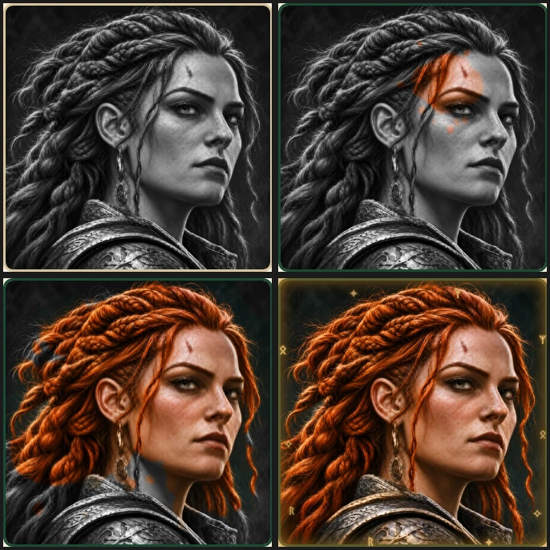

# Manual portrait unlock validation

[Progression](../PROGRESSION.md) · [Design system](../DESIGN_SYSTEM.md)

Shieldmaiden in the Hall of Renown at 1920 × 1080 with King’s Table. Read left to
right, top to bottom for ready, first reveal at 320 ms, expansion at 1.30 s and
celebration at 2.66 s.



The comparison used the bundled 1024 × 1024 Shieldmaiden in both the supplied
prototype and the Hall. The seeded curves, start locations, delays and expansion
timing follow the prototype. The Hall feathers the union of its masks at a maximum
of 480 px. The temporary color layer caps at 2× device scale and 640 px to bound
work on high-DPI screens. After the masks cover the full portrait, the Hall
restores the original image at its normal display resolution. It uses the existing
gallery frame and positions the runes around its edge within the card spacing.

## Regression checks

- `tests/test_progression.py` covers automatic milestones below, at and above
  the unlock threshold, own-account authenticated claims, CSRF and origin checks,
  duplicate requests, concurrent sessions, result corrections, remounting the
  application and upgrading historical entitlement and selection data.
- `frontend/tests/portrait-unlock.spec.ts` covers visible art coverage, complete
  restoration, failed and lost responses, retries, reduced motion, missing image
  or Canvas 2D data, unavailable blur, simultaneous reveals, backgrounding and
  route cleanup. An unmocked browser flow claims with the real API and equips
  during the animation. A lost response produces one unlock confirmation when
  the shared progression read recovers the claim.
- `frontend/src/useAchievementNotifications.test.tsx` covers separate award,
  eligibility and claim notices in English and German, including historical
  account baselines, duplicate IDs, stale responses and claims from another device.
- `frontend/tests/portraits.spec.ts` exercises all four themes in English and
  German on desktop and emulated mobile. It checks keyboard focus, artwork
  geometry, device-pixel limits, UI scale settings and horizontal overflow.

Playwright writes the Chromium capture frames to its results directory.

```sh
PORTRAIT_UNLOCK_EVIDENCE=1 npm --prefix frontend run test:e2e -- tests/portrait-unlock.spec.ts --project=chromium --grep 'reveals localized'
```

## WebKit

The headless Linux WebKit build runs the reveal with an offset Canvas shadow
because its Canvas 2D filter API is unavailable. The shadow feathers the same
mask within the existing buffer budget. The standard colored portrait appears
when neither blur method can initialize. The claim and selection flows remain
available in that case.

The optional WebKit project runs only the portrait unlock suite. It checks the
partially transparent edge pixels before resampling, expanding coverage, art
alignment, complete opacity, restoration, reduced motion and cleanup.

```sh
npm --prefix frontend exec -- playwright install webkit
PLAYWRIGHT_PORTRAIT_WEBKIT=1 npm --prefix frontend run test:e2e -- --project=webkit-portraits
```

The Linux WebKit run covers that engine build. Safari on Apple platforms and
physical-device performance remain unverified.

## Role statistics and achievement cards

The branch includes PR #122 from `main`. Attacker and defender win rates and
the simplified achievement labels are covered by the personal browser tests.
The achievement API still supplies the threshold and highest-achieved values
used for progress. [Role win rates and achievement card validation](role-win-rates-and-achievement-cards.md)
