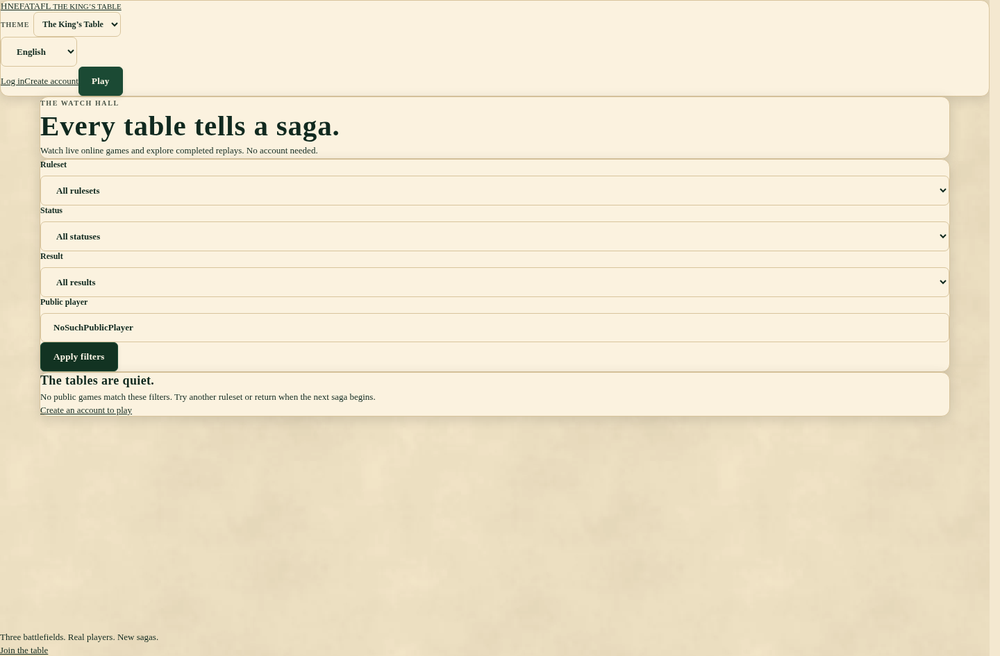
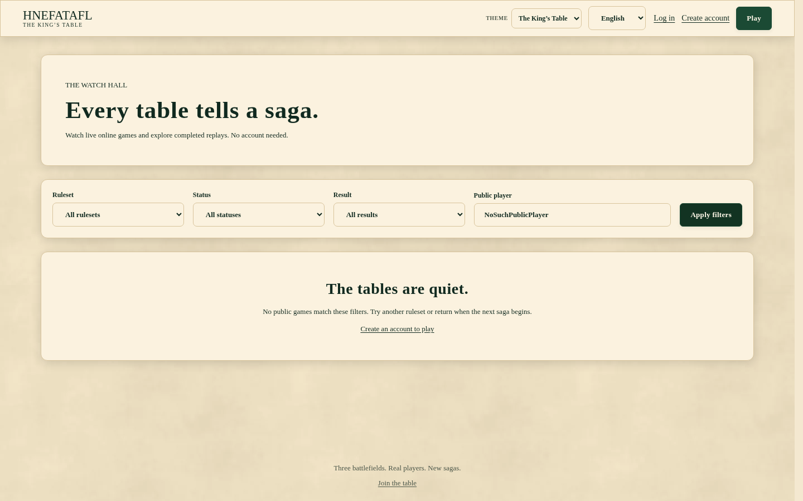
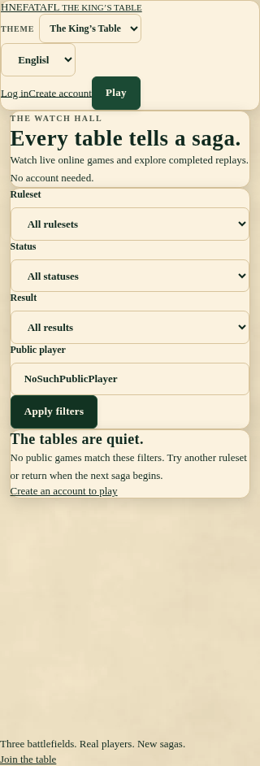
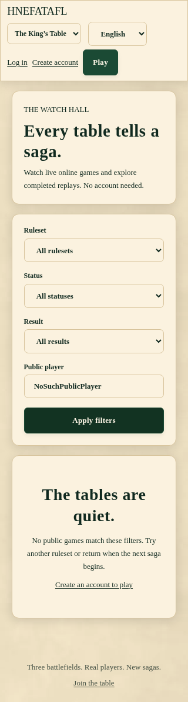

# Watch Hall production CSS regression

[Development](../DEVELOPMENT.md#browser-validation) · [Public online reads](../PUBLIC_ONLINE.md) ·
[Approved Arena visual references](arena-final-acceptance.md)

This record concerns PR #87, reviewed at `1511708416a3d5a366115c06d60f7d8e2447a62b`.
The branch was reconciled with main `7d57c29` by merge `f8589a8`; main's newer
required/optional inspector-tab helper and toolchain/security checks were retained.
No merge to main, tag, release or production deployment is performed here.

## Verified cause and correction

The defect reproduces with Vite 7.3.7, `npm run build` and the real FastAPI static handler,
without a reverse proxy. Desktop and phone production tests fail before the fix:
`.public-header` and `.public-header-nav` compute to `display: block`, filters to
`block`, intro/empty padding to `0px`, and the empty state aligns left.

`EntryRouter.tsx` originally used a conditional with two dynamic imports:

```ts
const module = publicRoute ? import('./PublicArena') : import('./AuthenticatedArena');
```

Vite 7's production preload transform associates the authenticated branch's
dependency list with the whole expression. The emitted entry invokes one preload
helper around the conditional and passes the authenticated dependency indexes
`[4, 1, 2, 5]`. Both branches therefore preload the authenticated JS/CSS and shared
top-bar assets. The public JS still executes, but `PublicArena-BKatoy-B.css` is
never requested or registered as a stylesheet. The development server does not
use this production preload transform, explaining the previous green browser suite.

Chromium DevTools Protocol CSS events and network responses show:

| Before | After |
| --- | --- |
| Public CSS absent from the request log and CSS domain | `PublicArena-BKatoy-B.css` registered and returned as HTTP 200, `text/css; charset=utf-8` |
| Authenticated JS/CSS unnecessarily preloaded | No authenticated JS/CSS requested on a public route |
| No browser console errors; all requested JS/CSS return 200 | All JS/CSS return 200, no redirects, correct MIME types and byte-for-byte current-build contents |
| Header/nav `block`, filters `block`, padding `0px` | Header/nav `flex`, filters `grid`, intro 43.2px desktop / 20px phone, empty 48px vertical padding and centered text |

[The captured request, stylesheet and computed-style evidence](public-watch-assets.json)
includes both viewport sizes and exact build-asset byte counts.

Separate `loadPublicEntry` and `loadAuthenticatedEntry` functions give each dynamic
import its own preload expression. The compiled public branch now uses `[0, 1, 2, 3]`,
including its CSS; the account branch keeps its own dependencies. CSS finishes
loading before the route component renders. Public and authenticated JS/CSS remain
split. Existing `publicArena.css`, shared `arenaTopBar.css`, design tokens, themes,
appearance storage and responsive rules are unchanged.

There is no eager CSS increase, duplicated CSS, inline-style workaround or
specificity override. No server, authentication, CSP or proxy rule needed changing.
The checked-in nginx example forwards assets unchanged. An external deployment's
proxy/cache has not been inspected without its URL; this record establishes the
independent, reproducible production-build defect.

## Before and after

Identical disposable real API records and filters, The King's Table, English,
Chromium at 1440×900 and 320×900. These are actual built-app captures.

| Viewport | Before | After |
| --- | --- | --- |
| Desktop |  |  |
| Phone |  |  |

The new production suite captures discovery with zero, one, two and many records;
waiting, live Brandubh/Tablut/Copenhagen, completed validated replay, cancelled and
voided games; and error/retry states. It covers four themes × two languages ×
320×844, 768×1024, 1440×900 and 3840×2160 viewports. The test artifact retains native
PNG screenshots plus per-case HTTP asset evidence. Reduced-motion, square boards,
read-only cells, replay keyboard controls/focus, mobile action targets, public
portraits, readable intro contrast and overflow are checked against computed
browser styles/geometry. References retain the established Arena surfaces, borders,
shadows, typography and theme palettes; no new visual design is introduced.

## Performance and security

Measured on identical locked builds, reconciled branch before/after the loader fix:

| Fetched public-page JS/CSS plus appearance initializer | Before | After |
| --- | ---: | ---: |
| Uncompressed bytes | 1,219,722 | 549,328 |
| Gzip bytes (offline, identical settings) | 353,878 | 168,428 |

The main entry grows by 63 minified bytes (19 bytes under the measured gzip
settings). Public CSS remains a separate 6,512-byte asset (1,821 gzip bytes).
Avoiding the accidental authenticated preload removes 576,225 bytes of JS and
100,744 bytes of CSS from the public request graph. These figures exclude images,
API responses and HTTP headers; offline gzip is not a claim that FastAPI itself
compresses these responses. Vite retains its existing authenticated-chunk size warning.

The application runtime change only chooses the module loader. Tests use the real
production boundary, real SQLite online lifecycles and completed-replay validation.
They check public API methods and full HTTP headers even with a stale session
cookie installed: GET only, no cookies or Authorization header, and no protected
API/analysis requests. Authenticated routes still redirect anonymous visitors;
private APIs reject them, unknown/private game IDs return 404, public mutations
fail, and stale hashed assets return 404 instead of HTML. Production policy/rate
defaults are unchanged; the disposable fixture raises its own read budget solely
to accommodate the matrix. Existing backend/frontend/browser suites retain
polling, abort, timeout, rate-limit, replay and authenticated-play coverage.

## Validation

Local verification before publishing the correction:

| Command | Result |
| --- | --- |
| New production regression on the unfixed build, desktop and phone | 2 expected failures: header `block` instead of `flex` |
| Focused production browser checks after correction | 10 passed |
| `npm test -- --maxWorkers=2` | 1,374 passed in 95 files |
| Frontend TypeScript, formatting and production build | Passed |
| Benchmark harness tests | 12 passed |
| Ruff lint/format, including the new fixture script | Passed |
| mypy | No issues in 69 source files |
| `make docs` | 141 Markdown files, 1,036 local links/images/anchors |
| `npm audit --audit-level=moderate` | Zero vulnerabilities |

The [PR #87 verification record](https://github.com/freeDom-/hnefatafl/pull/87)
holds the complete current-head Python/browser results and merge recommendation.
Required CI includes the 76-case production matrix, the existing main browser,
registration, online and personal suites, and the full Python/unit/check/build
pipeline. Its `public-spectator-production` artifact retains the matrix screenshots
and per-case asset evidence. This local reproduction record does not replace those
current-head gates or imply that the PR has been merged.

## Files changed

| File | Purpose |
| --- | --- |
| `frontend/src/EntryRouter.tsx` | Separate dynamic import expressions so each entry preloads its own CSS |
| `frontend/playwright.public.config.ts` | Production build/FastAPI matrix, independent output directory |
| `frontend/public-tests/watch-production.spec.ts` | Computed CSS, geometry, HTTP assets, history, state, accessibility and boundary regressions |
| `frontend/tests/start_public_backend.py` | Isolated real online records and production security settings; external loopback identifier controller |
| `frontend/package.json`, `.github/workflows/ci.yml` | Reproducible command and required CI run/artifact |
| `ARCHITECTURE.md`, `docs/DEVELOPMENT.md`, `docs/README.md` | Document the entry boundary and production-browser command |
| `docs/validation/public-watch-production.md`, `public-watch-assets.json`, `docs/screenshots/public-watch/` | Diagnosis, measurements and before/after evidence |
| `frontend/tests/play-helpers.ts` (merge commit) | Preserve main's required/optional tab behavior while resolving the only textual merge conflict |

Chromium desktop/mobile emulation is not physical-device or Safari evidence. The
fixture HTTP connection represents the documented internal hop behind TLS; external
TLS termination, deployed caches and a live production URL remain outside this local run.
